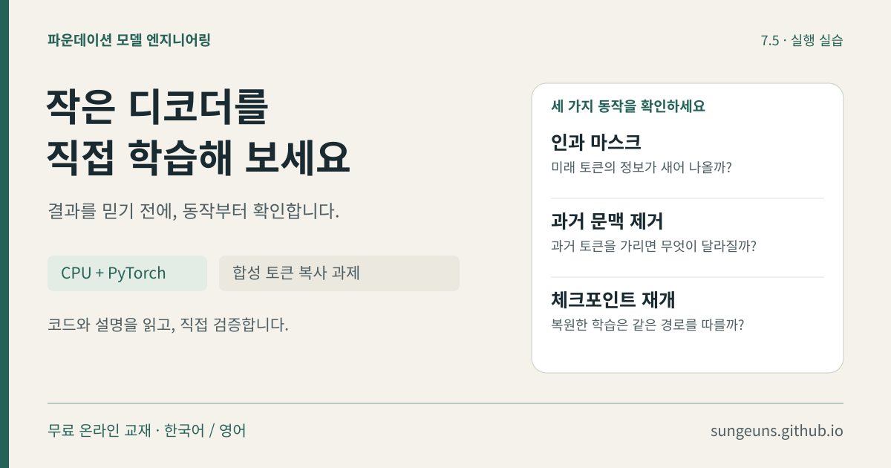

# 파운데이션 모델 엔지니어링

**[한국어 책 읽기](https://sungeuns.github.io/foundation-model-engineering/ko/)** · [English edition](https://sungeuns.github.io/foundation-model-engineering/) · [English README](README.md) · [서빙 세 절을 전자책으로 읽기(EPUB)](https://github.com/sungeuns/foundation-model-engineering/releases/download/serving-guide-2026-11/llm-serving-ko.epub)

모델 학습부터 서빙과 평가까지 다루는 무료 한영 교재입니다. 브라우저 실습과 CPU에서 실행할 수 있는 PyTorch 예제를 제공합니다.

**[24 GiB KV 캐시 계산기 열기](https://sungeuns.github.io/foundation-model-engineering/ko/chapter-12/kv-cache-management/?kv=1&batch=9&sequence=8192&generated=2048&layers=80&heads=8&dimension=128&precision=2&budget=24#kv-calculator)**. 예제의 프롬프트 9개는 22.5 GiB를 차지합니다. 요청마다 2,048토큰을 더 생성한다면 몇 개까지 끝낼 수 있을까요?

[](https://sungeuns.github.io/foundation-model-engineering/ko/chapter-12/kv-cache-management/?kv=1&batch=9&sequence=8192&generated=2048&layers=80&heads=8&dimension=128&precision=2&budget=24#kv-calculator)

## 궁금한 문제부터 읽어보세요

| 궁금한 문제 | 읽을 곳 | 직접 확인할 내용 |
| --- | --- | --- |
| 가중치는 GPU에 들어가는데, 왜 다음 요청에서 메모리가 부족할까? | [KV 캐시 관리](https://sungeuns.github.io/foundation-model-engineering/ko/chapter-12/kv-cache-management/#kv-cache-capacity) | 브라우저에서 KV 헤드 수를 바꿔 보거나 [혼합 요청 계산표(XLSX)](https://sungeuns.github.io/foundation-model-engineering/labs/kv-queue-ko.xlsx)를 내려받아 요청별 프롬프트 길이와 출력 한도를 입력하세요. |
| 어텐션 가중치는 실제 출력에 어떻게 쓰일까? | [셀프 어텐션의 수학](https://sungeuns.github.io/foundation-model-engineering/ko/chapter-3/self-attention-mathematics/#attention-weight-example) | [두 쪽짜리 활동지와 풀이](https://sungeuns.github.io/foundation-model-engineering/labs/attention-worksheet-ko.pdf)로 직접 계산하고 브라우저에서 같은 입력으로 확인합니다. |
| BERT는 일부러 그대로 둔 단어도 채점할까? | [다섯 토큰 예제](https://sungeuns.github.io/foundation-model-engineering/ko/chapter-4/encoder-only/#mlm-target-example) | 두 손실값을 계산합니다. 이어서 [교차 어텐션의 패딩 값](https://sungeuns.github.io/foundation-model-engineering/ko/chapter-4/encoder-decoder/#cross-attention-example)을 바꾸면 어떤 출력이 달라질지 확인합니다. |
| 이미지 한 장은 문맥을 몇 자리 차지할까? | [시각 토큰 계산](https://sungeuns.github.io/foundation-model-engineering/ko/chapter-11/vision-language-bridges/#visual-token-budget) | 이미지 크기와 장수를 바꾸며 패치 투영과 교차 어텐션의 디코더 자리 수를 비교합니다. |
| RAG 답변이 틀렸다. 어디서 근거가 사라졌을까? | [청크 ID 추적 예제](https://sungeuns.github.io/foundation-model-engineering/ko/chapter-14/rag-failure-modes-and-operational-design/#trace-a-rag-answer) | 여섯 사례에서 잃어버린 근거를 추적한 뒤 [재순위화에 넘기는 후보 수](https://sungeuns.github.io/foundation-model-engineering/ko/chapter-14/advanced-retrieval/#rrf-candidate-cutoff)를 바꿔 봅니다. |
| MoE에서 같은 단어가 왜 다른 전문가를 고를까? | [Top-k 라우터 실습](https://sungeuns.github.io/foundation-model-engineering/ko/chapter-5/sparse-vs-dense-models/#moe-routing-lab) | 앞 문맥에 따라 라우팅이 달라지는지 확인한 뒤, [CPU 프로세스 두 개에서 여섯 토큰의 왕복 경로](https://sungeuns.github.io/foundation-model-engineering/ko/chapter-5/expert-parallelism/#expert-dispatch-lab)를 추적합니다. |
| 새 모델은 무엇이 공개됐고, 어떤 조건에서 비교해야 할까? | [모델 비교와 공개 근거](https://sungeuns.github.io/foundation-model-engineering/ko/chapter-17/commercial-model-benchmarks/) | 45개 모델의 공개 상태와 평가 조건을 확인하고 [Python 예제로 긴 문맥 요금](https://sungeuns.github.io/foundation-model-engineering/ko/chapter-17/commercial-model-benchmarks/#long-context-cost)을 계산합니다. |
| 평가 점수가 올랐다면 바로 배포해도 될까? | [실험 설계와 불확실성](https://sungeuns.github.io/foundation-model-engineering/ko/chapter-17/experimental-design-and-uncertainty/) | 같은 사례의 결과를 대응 비교하고, 불확실성이 판단을 바꾸는 경우를 확인합니다. |
| 작은 모델을 학습하고, 일부러 망가뜨린 뒤 정확히 재개할 수 있을까? | [작은 디코더 실습](https://sungeuns.github.io/foundation-model-engineering/ko/chapter-7/tiny-decoder-lab/) | 실행 전에도 [첫 오답이 4번 반복된 예측 기록](https://sungeuns.github.io/foundation-model-engineering/ko/chapter-7/tiny-decoder-lab/#decoder-copy-trace)을 읽고, CPU에서 재현할 수 있습니다. |

모델 비교에는 **2026-11-24까지 확인한 자료** 를 반영했습니다. [GLM-5.4의 공개 상태](https://sungeuns.github.io/foundation-model-engineering/ko/chapter-17/commercial-model-benchmarks/#model-glm-54), [Ling-3.2-air의 공개 가중치](https://sungeuns.github.io/foundation-model-engineering/ko/chapter-17/commercial-model-benchmarks/#model-ling-32-air), [GPT-6.2 Sol의 평가 조건](https://sungeuns.github.io/foundation-model-engineering/ko/chapter-17/commercial-model-benchmarks/#model-gpt-62-sol), [GLM-5.4의 레이어 재사용 설명](https://sungeuns.github.io/foundation-model-engineering/ko/chapter-4/various-llm-architectures/#glm-54-레이어-재사용으로-깊이와-용량을-구분하기)으로 바로 이동할 수 있습니다. 이후 바뀔 수 있는 공개 상태와 가격은 연결된 원문에서 다시 확인하세요.

## 짧은 실습부터 시작하기

어텐션 마스크를 씌워도 미래 토큰의 값이 새어 들어갈까요? 토큰 일곱 개 중 다섯 번째 값만 바꾸고 네 번째 출력을 확인해 보세요. 입력이 고정된 CPU용 PyTorch 예제입니다. [마스크 실험](https://sungeuns.github.io/foundation-model-engineering/ko/chapter-4/hybrid-prefix-lm/#prefix-mask-test) · [Python 코드](public/labs/prefix_mask.py)

[](https://sungeuns.github.io/foundation-model-engineering/ko/chapter-7/tiny-decoder-lab/)

작은 디코더를 학습하고 재개하려면 [Colab에서 한국어 노트북을 열거나](https://colab.research.google.com/github/sungeuns/foundation-model-engineering/blob/main/public/labs/tiny-decoder-lab-ko.ipynb) [Linux와 Windows에서 검증한 한국어 노트북을 내려받으세요](https://github.com/sungeuns/foundation-model-engineering/releases/download/2026-11-labs/tiny-decoder-lab-ko.ipynb). CPU PyTorch를 사용하고, 실습에 필요한 합성 토큰을 직접 만듭니다. 모델 다운로드나 API 키는 필요하지 않습니다. 과거 문맥을 가리면 결과가 어떻게 달라질지 먼저 예상한 뒤 실행해 보세요.

Colab 실행에는 Google 로그인이 필요합니다. 로컬에서 실행할 때 필요한 Python·PyTorch 환경과 실험의 한계는 [실습 안내](https://sungeuns.github.io/foundation-model-engineering/ko/chapter-7/tiny-decoder-lab/)에 있습니다. 실행 코드는 [causal_lab.py](public/labs/causal_lab.py)에서도 읽을 수 있습니다.

[브라우저에서 배포 판단 실습 실행](https://sungeuns.github.io/foundation-model-engineering/ko/chapter-17/experimental-design-and-uncertainty/#release-lab) · 목표 과제에서 똑같이 15%p 개선된 두 후보 중 어느 쪽을 배포할지 판단해 보세요. 저장소를 내려받았다면 Python 3.10 이상에서 같은 실험을 실행할 수 있습니다.

```bash
python public/labs/paired_release.py --scenario gain
python public/labs/paired_release.py --scenario uncertain
python public/labs/paired_release.py --scenario regression
python public/labs/paired_release.py --scenario missing
```

각 시나리오는 `Pass`(통과), `Review`(재검토), `Block`(차단), `Review`를 출력합니다. 합성 평가 데이터인 `regression`에서는 목표 과제의 정답률이 15%p 올랐지만 기존 능력 평가의 정답률이 25%p 떨어져 차단됩니다. 대응 결과가 빠진 `missing`은 재검토 대상입니다. [평가 안내](https://sungeuns.github.io/foundation-model-engineering/ko/chapter-17/experimental-design-and-uncertainty/)에서 판단 기준과 불확실성 계산을 확인하세요.

## 책의 범위와 읽는 방법

20개 장에서 모델 아키텍처, 사전학습·후속학습, 추론, 검색, 에이전트, 평가, 안전성, 해석 가능성을 다룹니다. 각 절에는 이해를 확인할 퀴즈와 참고문헌이 있습니다. 시점에 따라 달라지는 비교에는 기준일과 출처를 붙이고, 제공자의 발표와 독립 평가를 구분합니다.

## 업데이트와 기여

- 강의계획서나 논문에 인용할 때는 [서지 정보](CITATION.cff)를 참고하세요. GitHub의 **Cite this repository** 에서 APA 또는 BibTeX 형식으로 복사할 수 있습니다. 특정 실습을 인용한다면 해당 절의 링크와 실행에 사용한 Git 커밋도 함께 적어 주세요.
- [한국어 RSS 구독](https://sungeuns.github.io/foundation-model-engineering/ko/feed.xml)으로 최근 수정한 절을 확인할 수 있습니다. [영문 RSS](https://sungeuns.github.io/foundation-model-engineering/feed.xml)도 제공합니다.
- 설명이나 코드가 잘못됐다면 [수정 제안](https://github.com/sungeuns/foundation-model-engineering/issues/new/choose)에 페이지, 문제 지점, 출처나 재현 예제를 남겨주세요. 어색한 한국어도 좋은 수정 대상입니다.
- [기여 안내](CONTRIBUTING.md)를 참고해 영문·한국어 설명, 실행 예제, 접근성을 개선할 수 있습니다.
- 도움이 된 설명이 있었다면 [GitHub Star](https://github.com/sungeuns/foundation-model-engineering)로 책을 저장하거나, 같은 문제를 겪는 동료에게 해당 절을 공유해주세요.

Seongeun So가 AI의 도움을 받아 집필·편집하는 독립 프로젝트입니다.

## 사이트를 로컬에서 수정하기

사이트 개발에는 Node.js 22.12.0 이상이 필요합니다. 저장소 루트에서 실행하세요.

```bash
npm ci
npm run dev
```

브라우저에서 `http://localhost:4321`을 열면 됩니다. 콘텐츠를 수정했다면 [기여 안내의 검증 절차](CONTRIBUTING.md)를 따르세요. 빌드와 GitHub Pages 배포 경로 설정은 [영문 README의 개발 안내](README.md#getting-started)에 정리되어 있습니다.

프로젝트는 [MIT 라이선스](LICENSE)를 따릅니다. 개인 프로젝트의 성격과 비소속 안내는 [DISCLAIMER](DISCLAIMER.md)를 참고하세요.
