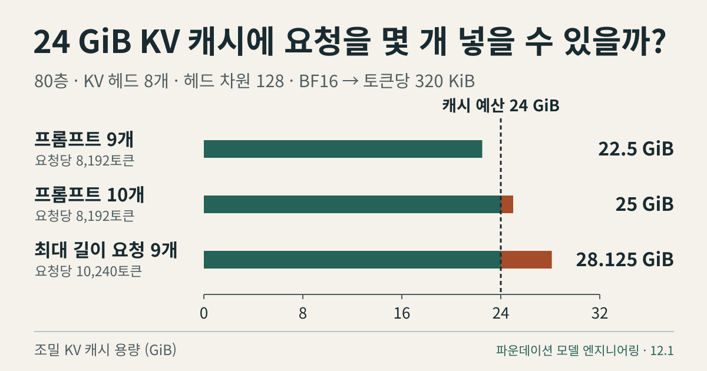

# 파운데이션 모델 엔지니어링

**[한국어 책 읽기](https://sungeuns.github.io/foundation-model-engineering/ko/)** · [English edition](https://sungeuns.github.io/foundation-model-engineering/) · [English README](README.md) · [서빙 세 절을 전자책으로 읽기(EPUB)](https://github.com/sungeuns/foundation-model-engineering/releases/download/serving-guide-2026-11-r3/llm-serving-ko-r3.epub)

모델 학습부터 서빙과 평가까지 다루는 무료 한영 교재입니다. [실습과 수업 자료](https://sungeuns.github.io/foundation-model-engineering/ko/labs/)에서 예제 풀이, CPU용 노트북, 인쇄용 활동지를 골라 보세요.

**[24 GiB KV 캐시 계산기 열기](https://sungeuns.github.io/foundation-model-engineering/ko/chapter-12/kv-cache-management/?kv=1&batch=9&sequence=8192&generated=2048&layers=80&heads=8&dimension=128&precision=2&budget=24#kv-calculator)**. 예제의 프롬프트 9개는 22.5 GiB를 차지합니다. 요청마다 2,048토큰을 더 생성한다면, 최대 길이의 캐시를 몇 개까지 동시에 담을 수 있을까요?

[](https://sungeuns.github.io/foundation-model-engineering/ko/chapter-12/kv-cache-management/?kv=1&batch=9&sequence=8192&generated=2048&layers=80&heads=8&dimension=128&precision=2&budget=24#kv-calculator)

[길이순으로 묶으면 패딩이 18칸에서 6칸으로 줄어드는데, 최대 KV 캐시는 왜 그대로 990 KiB일까요?](https://sungeuns.github.io/foundation-model-engineering/ko/chapter-12/length-bucketing-lab/) 프롬프트 여섯 개로 측정값을 재현할 수 있습니다.

## 궁금한 문제부터 읽어보세요

| 궁금한 문제 | 읽을 곳 | 직접 확인할 내용 |
| --- | --- | --- |
| 가중치는 GPU에 들어가는데, 왜 다음 요청에서 메모리가 부족할까? | [KV 캐시 관리](https://sungeuns.github.io/foundation-model-engineering/ko/chapter-12/kv-cache-management/#kv-cache-capacity) | [두 요청의 KV 캐시가 990 KiB에서 1,350 KiB로 늘어난 실행 기록](https://nbviewer.org/urls/sungeuns.github.io/foundation-model-engineering/labs/2026-11/kv-cache-payload-worked-ko.ipynb#cell-id=83af943d)을 [같은 배치 설정의 계산기](https://sungeuns.github.io/foundation-model-engineering/ko/chapter-12/kv-cache-management/?kv=1&batch=2&sequence=11&generated=4&layers=30&heads=3&dimension=64&precision=4&budget=24#kv-calculator)로 확인합니다. 직접 측정하려면 [CPU 노트북](https://sungeuns.github.io/foundation-model-engineering/ko/chapter-12/kv-cache-management/#kv-payload-notebook)을, 길이가 다른 요청을 계산하려면 [계산 시트(XLSX)](https://sungeuns.github.io/foundation-model-engineering/labs/kv-queue-ko.xlsx)를 사용하세요. |
| 어텐션 가중치는 실제 출력에 어떻게 쓰일까? | [셀프 어텐션의 수학](https://sungeuns.github.io/foundation-model-engineering/ko/chapter-3/self-attention-mathematics/#attention-weight-example) | [두 쪽짜리 활동지와 풀이](https://sungeuns.github.io/foundation-model-engineering/labs/attention-worksheet-ko.pdf)로 직접 계산한 뒤, [FlashAttention에서 타일별 출력을 단순 평균하면 왜 8 대신 6이 나오는지](https://sungeuns.github.io/foundation-model-engineering/ko/chapter-7/flash-attention/#online-softmax-tiles) 확인합니다. |
| BERT는 일부러 그대로 둔 단어도 채점할까? | [다섯 토큰 예제](https://sungeuns.github.io/foundation-model-engineering/ko/chapter-4/encoder-only/#mlm-target-example) | 두 손실값을 계산합니다. 이어서 [교차 어텐션의 패딩 값](https://sungeuns.github.io/foundation-model-engineering/ko/chapter-4/encoder-decoder/#cross-attention-example)을 바꾸면 어떤 출력이 달라질지 확인합니다. |
| 이미지 한 장은 문맥을 몇 자리 차지할까? | [시각 토큰 계산](https://sungeuns.github.io/foundation-model-engineering/ko/chapter-11/vision-language-bridges/#visual-token-budget) | 이미지 크기와 장수를 바꿔 보고, [합계 없는 영수증에서 두 품목의 줄을 맞바꾸면 모델이 어느 숫자를 답하는지](https://sungeuns.github.io/foundation-model-engineering/ko/articles/receipt-grounding/) 확인합니다. |
| RAG 답변이 틀렸다. 어디서 근거가 사라졌을까? | [청크 ID 추적 예제](https://sungeuns.github.io/foundation-model-engineering/ko/chapter-14/rag-failure-modes-and-operational-design/#trace-a-rag-answer) | 여섯 사례에서 잃어버린 근거를 추적한 뒤 [재순위화에 넘기는 후보 수](https://sungeuns.github.io/foundation-model-engineering/ko/chapter-14/advanced-retrieval/#rrf-candidate-cutoff)를 바꿔 봅니다. |
| MoE에서 같은 단어가 왜 다른 전문가를 고를까? | [Top-k 라우터 실습](https://sungeuns.github.io/foundation-model-engineering/ko/chapter-5/sparse-vs-dense-models/#moe-routing-lab) | 앞 문맥에 따라 라우팅이 달라지는지 확인한 뒤, [CPU 프로세스 두 개에서 여섯 토큰의 왕복 경로](https://sungeuns.github.io/foundation-model-engineering/ko/chapter-5/expert-parallelism/#expert-dispatch-lab)를 추적합니다. |
| 새 모델은 무엇이 공개됐고, 어떤 조건에서 비교해야 할까? | [모델 비교와 공개 근거](https://sungeuns.github.io/foundation-model-engineering/ko/chapter-17/commercial-model-benchmarks/) | 45개 모델을 비교하고 [Astra의 두 설정이 같은 62점인데 걸리는 시간은 왜 다른지](https://sungeuns.github.io/foundation-model-engineering/ko/chapter-17/commercial-model-benchmarks/#astra-effort-time) 살펴봅니다. [Python 예제로 긴 문맥 요금](https://sungeuns.github.io/foundation-model-engineering/ko/chapter-17/commercial-model-benchmarks/#long-context-cost)을 계산합니다. |
| 평가 점수가 올랐다면 바로 배포해도 될까? | [실험 설계와 불확실성](https://sungeuns.github.io/foundation-model-engineering/ko/chapter-17/experimental-design-and-uncertainty/) | 같은 사례의 결과를 대응 비교하고, 불확실성이 판단을 바꾸는 경우를 확인합니다. |
| 작은 모델을 학습하고, 일부러 망가뜨린 뒤 정확히 재개할 수 있을까? | [작은 디코더 실습](https://sungeuns.github.io/foundation-model-engineering/ko/chapter-7/tiny-decoder-lab/) | 실행 전에도 [첫 오답이 4번 반복된 예측 기록](https://sungeuns.github.io/foundation-model-engineering/ko/chapter-7/tiny-decoder-lab/#decoder-copy-trace)을 읽고, CPU에서 재현할 수 있습니다. |

모델 이용 경로는 2026-11-24 기준이며, 벤치마크 점수와 과업당 비용·소요 시간은 2026-11-25에 확인했습니다. [GLM-5.4의 공개 상태](https://sungeuns.github.io/foundation-model-engineering/ko/chapter-17/commercial-model-benchmarks/#model-glm-54), [Ling-3.2-air 공개 체크포인트의 문맥 길이](https://sungeuns.github.io/foundation-model-engineering/ko/chapter-17/commercial-model-benchmarks/#ling-32-air-context), [GPT-6.2 Sol의 평가 조건](https://sungeuns.github.io/foundation-model-engineering/ko/chapter-17/commercial-model-benchmarks/#model-gpt-62-sol), [GLM-5.4의 레이어 재사용 설명](https://sungeuns.github.io/foundation-model-engineering/ko/chapter-4/various-llm-architectures/#glm-54-레이어-재사용으로-깊이와-용량을-구분하기)으로 바로 이동할 수 있습니다. 이후 바뀔 수 있는 공개 상태와 가격은 연결된 원문에서 다시 확인하세요. [작은 모델의 CPU 실험에서 토큰을 하나 더 읽었을 때 KV 저장 공간이 4,608바이트 줄어든 이유를 살펴보세요.](https://sungeuns.github.io/foundation-model-engineering/ko/chapter-4/various-llm-architectures/#loop-cache-storage)

## 짧은 실습부터 시작하기

어텐션 마스크를 씌워도 미래 토큰의 값이 새어 들어갈까요? 토큰 일곱 개 중 다섯 번째 값만 바꾸고 네 번째 출력을 확인해 보세요. 입력이 고정된 CPU용 PyTorch 예제입니다. [마스크 실험](https://sungeuns.github.io/foundation-model-engineering/ko/chapter-4/hybrid-prefix-lm/#prefix-mask-test) · [Python 코드](public/labs/prefix_mask.py)

배터리를 직접 갈아도 되느냐는 한국어 문의에 다국어 검색기는 다른 모델의 뒷덮개를 여는 영문 안내문을 1위로 골랐습니다. [검색 실험](https://sungeuns.github.io/foundation-model-engineering/ko/chapter-14/lexical-to-semantic-search/#multilingual-retrieval-check)과 [문의 여덟 건의 점수](public/labs/2026-11/multilingual-retrieval.json)를 읽거나, [BM25와 다국어 E5를 CPU에서 실행](public/labs/multilingual_retrieval.py)할 수 있습니다.

[](https://sungeuns.github.io/foundation-model-engineering/ko/chapter-7/tiny-decoder-lab/)

디코더에 기호 네 개를 보여 준 뒤 앞 문맥을 가려 보세요. 모델은 여전히 그 수열을 복사할 수 있을까요? [Binder에서 한국어 노트북을 실행하거나](https://mybinder.org/v2/gh/sungeuns/foundation-model-engineering/b6a54ff80e80cbf10d68b15d4419bbae2269ef7e?urlpath=lab%2Ftree%2Fpublic%2Flabs%2Ftiny-decoder-lab-ko.ipynb) [앞 기호를 볼 때와 가릴 때의 테스트 손실](https://nbviewer.org/urls/sungeuns.github.io/foundation-model-engineering/labs/2026-11/tiny-decoder-worked-ko.ipynb#cell-id=compare-results)을 비교해 보세요. 둘 다 로그인 없이 열 수 있습니다. 노트북이 합성 데이터를 직접 만들고 CPU에서 학습합니다. [실습 안내](https://sungeuns.github.io/foundation-model-engineering/ko/chapter-7/tiny-decoder-lab/)에는 로컬 설치와 Colab 사용법이 있습니다. 오프라인에서는 [11월 노트북](https://github.com/sungeuns/foundation-model-engineering/releases/tag/2026-11-labs)을 내려받아 실행할 수 있습니다.

후보 둘 다 목표 과제의 정답률이 15%p 올랐습니다. [목표 과제 개선 사례](https://sungeuns.github.io/foundation-model-engineering/ko/chapter-17/experimental-design-and-uncertainty/?scenario=gain#release-lab)와 [기존 능력 하락 사례](https://sungeuns.github.io/foundation-model-engineering/ko/chapter-17/experimental-design-and-uncertainty/?scenario=regression#release-lab)를 각각 실행해 어느 쪽을 배포할지 판단해 보세요. 저장소를 내려받았다면 Python 3.10 이상에서 같은 실험을 실행할 수 있습니다.

```bash
python public/labs/paired_release.py --scenario gain
python public/labs/paired_release.py --scenario uncertain
python public/labs/paired_release.py --scenario regression
python public/labs/paired_release.py --scenario missing
```

각 시나리오는 `Pass`(통과), `Review`(재검토), `Block`(차단), `Review`를 출력합니다. 합성 평가 데이터인 `regression`에서는 목표 과제의 정답률이 15%p 올랐지만 기존 능력 평가의 정답률이 25%p 떨어져 차단됩니다. 대응 결과가 빠진 `missing`은 재검토 대상입니다. [평가 안내](https://sungeuns.github.io/foundation-model-engineering/ko/chapter-17/experimental-design-and-uncertainty/)에서 판단 기준과 불확실성 계산을 확인하세요.

## 책의 범위와 읽는 방법

한국어판과 영문판 모두 [20개 장, 108개 절](https://sungeuns.github.io/foundation-model-engineering/ko/#book-contents)을 읽을 수 있습니다. 마지막 네 장에서 다루는 주제는 [평가(7개 절)](https://sungeuns.github.io/foundation-model-engineering/ko/#chapter-17), [안전성(4개 절)](https://sungeuns.github.io/foundation-model-engineering/ko/#chapter-18), [해석 가능성(4개 절)](https://sungeuns.github.io/foundation-model-engineering/ko/#chapter-19), [상태 공간 모델을 비롯한 새로운 아키텍처(7개 절)](https://sungeuns.github.io/foundation-model-engineering/ko/#chapter-20)입니다. 각 절에는 이해를 확인할 퀴즈와 참고문헌이 있습니다. 시점에 따라 달라지는 비교에는 기준일과 출처를 붙이고, 제공자의 발표와 독립 평가를 구분합니다.

## 업데이트와 기여

- 강의계획서나 논문에 책 전체를 인용할 때는 [서지 정보](CITATION.cff)를 참고하세요. GitHub의 **Cite this repository** 에서 APA 또는 BibTeX로 복사할 수 있습니다. 각 절의 **이 절 인용하기 (RIS)** 에는 언어와 수정일, 해당 판의 원고 링크가 담겨 있습니다. 실험 결과를 보고할 때는 실행한 코드 버전과 환경도 함께 적어 주세요.
- RSS 리더에서 [한국어로 쓴 짧은 기술 글 전문](https://sungeuns.github.io/foundation-model-engineering/ko/articles.xml)을 읽거나 [최근 수정된 절](https://sungeuns.github.io/foundation-model-engineering/ko/feed.xml)을 구독할 수 있습니다. [영문판 수정 내역](https://sungeuns.github.io/foundation-model-engineering/feed.xml)도 제공합니다.
- 설명이나 코드가 잘못됐다면 [수정 제안](https://github.com/sungeuns/foundation-model-engineering/issues/new/choose)에 페이지, 문제 지점, 출처나 재현 예제를 남겨주세요. 어색한 한국어도 좋은 수정 대상입니다.
- [기여 안내](CONTRIBUTING.md)를 참고해 영문·한국어 설명, 실행 예제, 접근성을 개선할 수 있습니다.
- 도움이 된 설명이 있었다면 [GitHub Star](https://github.com/sungeuns/foundation-model-engineering)로 책을 저장하거나, 같은 문제를 겪는 동료에게 해당 절을 공유해주세요.

Seongeun So가 관리하는 독립 교재입니다. 첫 한국어판은 Gemini의 도움을 받아 영어 원고를 번역했습니다. 최근 추가한 [Whisper 샘플링 속도 실험](https://sungeuns.github.io/foundation-model-engineering/ko/articles/whisper-sample-rate/)은 Codex가 코드를 작성하고 실행한 뒤, 그 결과를 짧은 글로 정리한 사례입니다. [초기 한국어판 번역 안내](https://github.com/sungeuns/foundation-model-engineering/blob/7c1f561b5992d92ce243f1b7239df77bdf81e23a/README.md#L17)

지금은 한 절을 개정할 때 영문을 먼저 고친 뒤, 수식과 코드, 예제 풀이를 포함한 수정 사항을 한국어판에도 함께 반영합니다. 각 절에서 어떤 내용을 확인했는지는 검토 기록에서 볼 수 있습니다. [편집 지침](CONTRIBUTING.md) · [절별 검토 기록](docs/editorial_rewrite_worklog.md)

Data For Science는 2026년 9월 23일 발행한 [Data Science Briefing 337호](https://data4sci.com/newsletter/data-science-briefing-337)에서 이 책을 소개했습니다.

## 사이트를 로컬에서 수정하기

사이트 개발에는 Node.js 22.12.0 이상이 필요합니다. 저장소 루트에서 실행하세요.

```bash
npm ci
npm run dev
```

브라우저에서 `http://localhost:4321`을 열면 됩니다. 콘텐츠를 수정했다면 [기여 안내의 검증 절차](CONTRIBUTING.md)를 따르세요. 빌드와 GitHub Pages 배포 경로 설정은 [영문 README의 개발 안내](README.md#getting-started)에 정리되어 있습니다.

프로젝트는 [MIT 라이선스](LICENSE)를 따릅니다. SmolLM2 KV 캐시 실측 노트북 두 판에는 Apache 2.0이 적용되며 각 파일에 라이선스 전문과 출처를 담았습니다. 개인 프로젝트의 성격과 비소속 안내는 [DISCLAIMER](DISCLAIMER.md)를 참고하세요.
