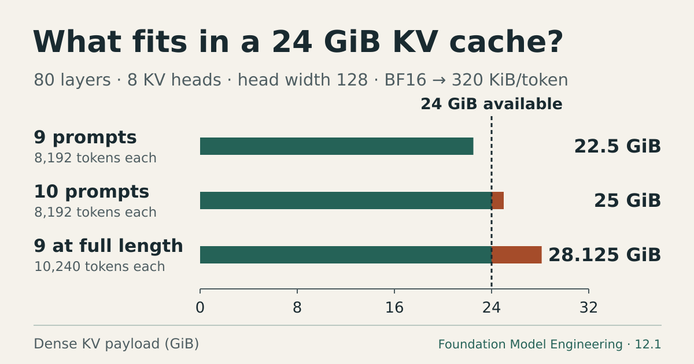

# Foundation Model Engineering

**[Read the book in English](https://sungeuns.github.io/foundation-model-engineering/)** · [한국어판](https://sungeuns.github.io/foundation-model-engineering/ko/) · [한국어 README](README.ko.md) · [Download the serving guide (EPUB)](https://github.com/sungeuns/foundation-model-engineering/releases/download/serving-guide-2026-11/llm-serving-en.epub)

A free textbook on training, serving, and evaluating foundation models. Work through browser experiments and PyTorch examples you can run on a CPU.

**[Try the 24 GiB KV-cache calculator](https://sungeuns.github.io/foundation-model-engineering/chapter-12/kv-cache-management/?kv=1&batch=9&sequence=8192&generated=2048&layers=80&heads=8&dimension=128&precision=2&budget=24#kv-calculator).** In this example, nine prompts take 22.5 GiB. How many requests can finish if each generates another 2,048 tokens?

[](https://sungeuns.github.io/foundation-model-engineering/chapter-12/kv-cache-management/?kv=1&batch=9&sequence=8192&generated=2048&layers=80&heads=8&dimension=128&precision=2&budget=24#kv-calculator)

## Start with one question

| Your question | Start here | What you can do |
| --- | --- | --- |
| The weights fit. Why does serving run out of memory? | [KV cache management](https://sungeuns.github.io/foundation-model-engineering/chapter-12/kv-cache-management/#kv-cache-capacity) | Measure the tensors in a [CPU notebook](https://sungeuns.github.io/foundation-model-engineering/chapter-12/kv-cache-management/#kv-payload-notebook) or [budget for requests of different lengths (XLSX)](https://sungeuns.github.io/foundation-model-engineering/labs/kv-queue-en.xlsx). |
| What does an attention weight actually do? | [Self-attention mathematics](https://sungeuns.github.io/foundation-model-engineering/chapter-3/self-attention-mathematics/#attention-weight-example) | Calculate the weights by hand with the [two-page worksheet and solution](https://sungeuns.github.io/foundation-model-engineering/labs/attention-worksheet-en.pdf), then check the same inputs in the browser. |
| Does BERT score a word it left untouched? | [A five-token example](https://sungeuns.github.io/foundation-model-engineering/chapter-4/encoder-only/#mlm-target-example) | Calculate both losses. Then [change a padding value in cross-attention](https://sungeuns.github.io/foundation-model-engineering/chapter-4/encoder-decoder/#cross-attention-example) and predict which outputs move. |
| How many context positions does one image use? | [Visual token budget](https://sungeuns.github.io/foundation-model-engineering/chapter-11/vision-language-bridges/#visual-token-budget) | Change image size and count. Compare patch projection with a decoder that reads separate visual memory. |
| My RAG answer is wrong. Where did the evidence go? | [Trace one answer](https://sungeuns.github.io/foundation-model-engineering/chapter-14/rag-failure-modes-and-operational-design/#trace-a-rag-answer) | Trace six failures by chunk ID, then [change how many candidates reach the reranker](https://sungeuns.github.io/foundation-model-engineering/chapter-14/advanced-retrieval/#rrf-candidate-cutoff). |
| Why can the same word select different MoE experts? | [Top-k router lab](https://sungeuns.github.io/foundation-model-engineering/chapter-5/sparse-vs-dense-models/#moe-routing-lab) | Change the preceding words, then [trace six routed tokens across two CPU processes](https://sungeuns.github.io/foundation-model-engineering/chapter-5/expert-parallelism/#expert-dispatch-lab). |
| Which newly released models should I evaluate? | [Model comparison, November 24](https://sungeuns.github.io/foundation-model-engineering/chapter-17/commercial-model-benchmarks/) | Compare 45 profiles and run a [Python example of whole-request pricing](https://sungeuns.github.io/foundation-model-engineering/chapter-17/commercial-model-benchmarks/#long-context-cost). |
| Does a higher evaluation score justify a release? | [Experimental design and uncertainty](https://sungeuns.github.io/foundation-model-engineering/chapter-17/experimental-design-and-uncertainty/) | Run a paired evaluation and inspect the decision boundary. |
| Can I train a model, break it, and resume it exactly? | [Tiny decoder lab](https://sungeuns.github.io/foundation-model-engineering/chapter-7/tiny-decoder-lab/) | Inspect [four errors in a single held-out sequence](https://sungeuns.github.io/foundation-model-engineering/chapter-7/tiny-decoder-lab/#decoder-copy-trace) before running the same experiment on a CPU. |

## What is inside

20 chapters connect architectures, pre-training, post-training, inference, retrieval, agents, evaluation, safety, and interpretability. Each lesson ends with reasoning questions and references. The [learning paths](https://sungeuns.github.io/foundation-model-engineering/chapter-1/learning-path-and-mastery/) help you check prerequisites and choose a route.

Expect Python, linear algebra, and probability. Examples identify their simplifications; teaching simulations are not benchmark results. Time-sensitive comparisons identify their source and snapshot date. A provider's claim is kept separate from independently measured evidence.

The November 24 comparison includes direct links to each profile. Check [GLM-5.4’s release status](https://sungeuns.github.io/foundation-model-engineering/chapter-17/commercial-model-benchmarks/#model-glm-54), find the [context limit of the Ling-3.2-air checkpoint](https://sungeuns.github.io/foundation-model-engineering/chapter-17/commercial-model-benchmarks/#ling-32-air-context), inspect the evaluation for [GPT-6.2 Sol](https://sungeuns.github.io/foundation-model-engineering/chapter-17/commercial-model-benchmarks/#model-gpt-62-sol), or read how [GLM-5.4 reuses its layers](https://sungeuns.github.io/foundation-model-engineering/chapter-4/various-llm-architectures/#glm-54-reusing-layers-separates-depth-from-capacity).

### Try a CPU lab

Can an attention mask leak a future token? Change the fifth value in a seven-token sequence and see whether the fourth output moves. This CPU example uses PyTorch and fixed inputs. [Run the mask test](https://sungeuns.github.io/foundation-model-engineering/chapter-4/hybrid-prefix-lm/#prefix-mask-test) · [Python source](public/labs/prefix_mask.py)

**Train, break, and resume a tiny decoder:** open the [English notebook](https://colab.research.google.com/github/sungeuns/foundation-model-engineering/blob/main/public/labs/tiny-decoder-lab.ipynb) or [Korean notebook](https://colab.research.google.com/github/sungeuns/foundation-model-engineering/blob/main/public/labs/tiny-decoder-lab-ko.ipynb) in Colab. Use a CPU runtime. Predict what removing context will do, train the model, and inspect causal and checkpoint-replay checks. Colab execution requires Google sign-in. For local Jupyter, [download the November notebooks verified on Linux and Windows](https://github.com/sungeuns/foundation-model-engineering/releases/tag/2026-11-labs). No model download or API key is needed. The [guide](https://sungeuns.github.io/foundation-model-engineering/chapter-7/tiny-decoder-lab/) explains Python/PyTorch setup and the experiment's limits.

[Run the release decision lab in your browser](https://sungeuns.github.io/foundation-model-engineering/chapter-17/experimental-design-and-uncertainty/#release-lab). Two candidates gain 15 percentage points on the target task. Which clears the release criteria? You can also run the same script from a checkout with Python 3.10+.

```bash
python public/labs/paired_release.py --scenario gain
python public/labs/paired_release.py --scenario regression
```

Then try `uncertain` and `missing`. The [evaluation guide](https://sungeuns.github.io/foundation-model-engineering/chapter-17/experimental-design-and-uncertainty/) explains why a target improvement can still produce Review or Block. This lab uses Python 3.10+ and the standard library. The decoder and release examples generate synthetic data so you can reproduce each result.

### Follow and contribute

- To cite the textbook in a syllabus or paper, use [the book citation](CITATION.cff) or choose **Cite this repository** on GitHub for APA or BibTeX. For a specific experiment, include its chapter link and the Git commit you ran.
- Bookmark the project with a GitHub star if it is useful. Share a specific lesson with someone facing the same engineering problem.
- Subscribe to chapter updates: [English RSS](https://sungeuns.github.io/foundation-model-engineering/feed.xml) · [한국어 RSS](https://sungeuns.github.io/foundation-model-engineering/ko/feed.xml).
- [Report a correction](https://github.com/sungeuns/foundation-model-engineering/issues/new/choose): include the page, the claim or behavior, and a source or reproducible example.
- [Contribute](CONTRIBUTING.md): technical corrections, clearer examples, Korean phrasing, and accessible interactions are welcome.

This is an independent project by Seongeun So, developed with AI assistance. English and Korean pages are maintained together. Review records describe what was actually inspected; they are not a guarantee that every claim or example is error-free.

---

## Tech Stack
- **Framework:** Astro 6
- **Content:** MDX
- **Styling:** Vanilla CSS (Book-like theme)
- **Fonts:** Locally installed fonts for text and code, with CJK fallbacks. Math uses [KaTeX fonts served with the book](public/licenses/katex.txt).

## Getting Started

To run this project locally, you need Node.js v22.12.0 or higher.

### Prerequisites

If you are using `nvm`, you can switch to Node 22:

```bash
source ~/.nvm/nvm.sh
nvm use 22
```

If you don't have Node 22 installed via nvm:

```bash
nvm install 22
```

### Installation

Install dependencies:

```bash
npm ci
```

### Development

Start the development server:

```bash
npm run dev
```

The site will be available at `http://localhost:4321`.

### Build

To build the static site:

```bash
npm run build
```

The output will be in the `dist/` directory.

To preview the production build locally, use:

```bash
npm run preview
```

If you use `serve`, run `serve dist` instead of `serve -s dist`. This project is a static multi-page Astro site, not a single-page app. The `-s` option forces all routes back to the root `index.html`, which breaks page navigation and locale switching.

## GitHub Pages

For local development and normal local builds, the site uses the root path `/`.

Repository:

`https://github.com/sungeuns/foundation-model-engineering`

For GitHub Pages repo hosting under:

`https://sungeuns.github.io/foundation-model-engineering/`

build with:

```bash
SITE_BASE=/foundation-model-engineering/ npm run build
```

That sets Astro's `base` only for the deployment build, so local `npm run dev` routing stays normal while GitHub Pages still gets the correct subpath links.

## ⚖️ License & Disclaimer

This project is licensed under the [MIT License](LICENSE). The two SmolLM2 KV cache measurement notebooks include their Apache 2.0 license and original source in each file.
For more information regarding the project's status as a personal, non-affiliated open-source resource, please see the [DISCLAIMER](DISCLAIMER.md) file.
