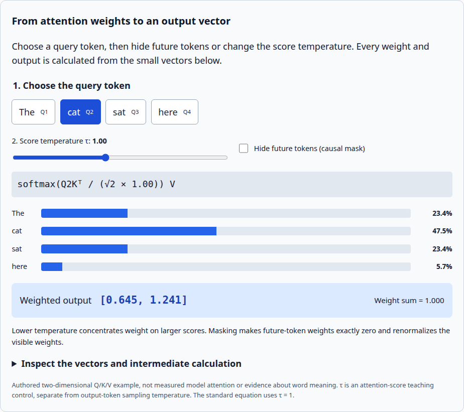

# Foundation Model Engineering

**Understand the model. Measure the trade-offs. Build a system you can test.**

A free textbook for AI engineers, with interactive explanations, PyTorch examples, and CPU labs. Read in **[English](https://sungeuns.github.io/foundation-model-engineering/)** or **[한국어](https://sungeuns.github.io/foundation-model-engineering/ko/)**. No account required.

[](https://sungeuns.github.io/foundation-model-engineering/chapter-3/self-attention-mathematics/)

*Screenshot of the book's calculated toy-attention demo. [Try it](https://sungeuns.github.io/foundation-model-engineering/chapter-3/self-attention-mathematics/): choose a query, mask future tokens, and inspect the weighted output. These are authored vectors, not measurements from a trained model.*

## Start with one question

You do not need to read the whole book first.

| Your question | Start here | What you can do |
| --- | --- | --- |
| The weights fit. Why does serving run out of memory? | [KV cache management](https://sungeuns.github.io/foundation-model-engineering/chapter-12/kv-cache-management/) | Calculate memory as context, batch size, and KV heads change. |
| What does an attention weight actually do? | [Self-attention mathematics](https://sungeuns.github.io/foundation-model-engineering/chapter-3/self-attention-mathematics/) | Follow query/key scores through masking, softmax, and a weighted sum. |
| My RAG answer is wrong. Which stage should I fix? | [RAG failure modes](https://sungeuns.github.io/foundation-model-engineering/chapter-14/rag-failure-modes-and-operational-design/) | Trace retrieval, reranking, context packing, and generation separately. |
| Does a higher evaluation score justify a release? | [Experimental design and uncertainty](https://sungeuns.github.io/foundation-model-engineering/chapter-17/experimental-design-and-uncertainty/) | Run a paired evaluation and inspect the decision boundary. |
| Can I train a model, break it, and resume it exactly? | [Tiny decoder lab](https://sungeuns.github.io/foundation-model-engineering/chapter-7/tiny-decoder-lab/) | Run a CPU experiment with a causal check, an ablation, and checkpoint replay. |

## What is inside

20 chapters connect architectures, pre-training, post-training, inference, retrieval, agents, evaluation, safety, and interpretability. Each lesson ends with reasoning questions and references. The [learning paths](https://sungeuns.github.io/foundation-model-engineering/chapter-1/learning-path-and-mastery/) help you check prerequisites and choose a route.

Expect Python, linear algebra, and probability. Examples identify their simplifications; teaching simulations are not benchmark results. Time-sensitive comparisons identify their source and snapshot date. A provider's claim is kept separate from independently measured evidence.

### Try a CPU lab

The [setup and experiment guide](https://sungeuns.github.io/foundation-model-engineering/chapter-7/tiny-decoder-lab/) explains dependencies, expected outputs, and limitations. Lab source is also in [`public/labs/`](public/labs/). These small experiments teach mechanics, not natural-language model quality.

### Follow and contribute

- Bookmark the project with a GitHub star if it is useful. Share a specific lesson with someone facing the same engineering problem.
- Subscribe to chapter updates: [English RSS](https://sungeuns.github.io/foundation-model-engineering/feed.xml) · [한국어 RSS](https://sungeuns.github.io/foundation-model-engineering/ko/feed.xml).
- [Report a correction](https://github.com/sungeuns/foundation-model-engineering/issues/new/choose): include the page, the claim or behavior, and a source or reproducible example.
- [Contribute](CONTRIBUTING.md): technical corrections, clearer examples, Korean phrasing, and accessible interactions are welcome.

This is an independent project by Seongeun So, developed with AI assistance. English and Korean pages are maintained together. Review records describe what was actually inspected; they are not a guarantee that every claim or example is error-free.

---

## Tech Stack
- **Framework:** Astro 6
- **Content:** MDX
- **Styling:** Vanilla CSS (Book-like theme)
- **Fonts:** Pretendard (Korean/English), Noto Sans CJK (Chinese/Japanese)

## Getting Started

To run this project locally, you need Node.js v22.12.0 or higher.

### Prerequisites

If you are using `nvm`, you can switch to Node 22:

```bash
source ~/.nvm/nvm.sh
nvm use 22
```

If you don't have Node 22 installed via nvm:

```bash
nvm install 22
```

### Installation

Install dependencies:

```bash
npm ci
```

### Development

Start the development server:

```bash
npm run dev
```

The site will be available at `http://localhost:4321`.

### Build

To build the static site:

```bash
npm run build
```

The output will be in the `dist/` directory.

To preview the production build locally, use:

```bash
npm run preview
```

If you use `serve`, run `serve dist` instead of `serve -s dist`. This project is a static multi-page Astro site, not a single-page app. The `-s` option forces all routes back to the root `index.html`, which breaks page navigation and locale switching.

## GitHub Pages

For local development and normal local builds, the site uses the root path `/`.

Repository:

`https://github.com/sungeuns/foundation-model-engineering`

For GitHub Pages repo hosting under:

`https://sungeuns.github.io/foundation-model-engineering/`

build with:

```bash
SITE_BASE=/foundation-model-engineering/ npm run build
```

That sets Astro's `base` only for the deployment build, so local `npm run dev` routing stays normal while GitHub Pages still gets the correct subpath links.

## ⚖️ License & Disclaimer

This project is licensed under the [MIT License](LICENSE).
For more information regarding the project's status as a personal, non-affiliated open-source resource, please see the [DISCLAIMER](DISCLAIMER.md) file.
