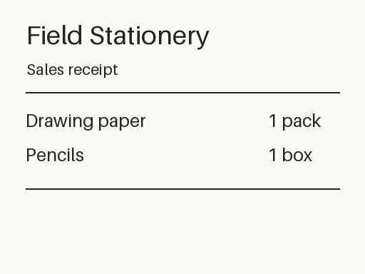

영수증에 `Total 31.50`이라고 쓰여 있으면 SmolVLM-256M-Instruct는 `31.50`이라고 답합니다. 합계 줄을 `Total 42.00`으로 바꾸면 답도 `42.00`으로 바뀝니다. 그런데 그 줄을 통째로 지우자 모델은 **`1`** 을 내놓았습니다. 어디서 읽은 숫자일까요?



Pillow로 그려 실제 모델에 입력한 512 × 384픽셀 영수증입니다. 인쇄된 합계 줄을 그대로 옮기고, 그 줄이 없으면 `MISSING`이라고 답하라고 했습니다. 도화지 한 묶음에도, 연필 한 상자에도 숫자 1이 보입니다. 낱개 가격은 어느 쪽에도 없습니다.

## 수량을 바꾸면 답은 어떻게 될까?

합계 줄은 그대로 비워 둡니다. 먼저 도화지만 일곱 묶음으로 바꿉니다. 다음에는 원래 영수증에서 연필만 여덟 상자로 바꿉니다. 모델이 도화지 수량을 읽었다면 어느 쪽에서 답이 바뀔까요? 연필 수량을 읽었다면요? 마지막에는 두 숫자를 모두 바꿨습니다. 아래 표에서 세 번째 열을 먼저 읽어 보세요. 연필을 수량·단위와 함께 도화지 위로 옮기면 답이 어떻게 달라질까요?

| 도화지(묶음) | 연필(상자) | 위에 도화지, 아래에 연필 | 위에 연필, 아래에 도화지 |
| ---: | ---: | --- | --- |
| 1 | 1 | `1` | `1` |
| 7 | 1 | `1` | `7` |
| 1 | 8 | `8 box` | `1` |
| 7 | 8 | `8 box` | `7.` |

마지막 열에서는 원본 이미지에서 높이 48픽셀짜리 띠 두 개를 잘라 서로 자리를 바꿨습니다. 품목명과 수량이 함께 움직입니다. 체크포인트와 프롬프트는 그대로 두고 CPU에서 매번 가장 확률이 높은 토큰을 골랐습니다. 표에서는 답 맨 앞의 공백 한 칸을 생략했습니다. `7.`의 마침표는 모델이 출력한 그대로입니다.

연필이 아래에 있으면 도화지 수량을 바꿔도 답이 그대로입니다. 여기까지만 보면 모델이 연필을 골랐다고 생각하기 쉽습니다. 그런데 도화지 일곱 묶음과 연필 여덟 상자의 자리를 맞바꾸자 답이 `8 box`에서 `7.`으로 바뀌었습니다. **두 수량이 서로 달랐던 영수증 여섯 장에서는 답의 첫 숫자가 모두 아래쪽 수량과 일치했습니다.** 두 수량이 모두 1이면 답만 보고 어느 줄에서 온 1인지 가릴 수 없습니다. 이 실험으로 확인한 것은 이 배치와 질문에서 줄 위치가 답에 미친 영향입니다. 다른 양식이나 품목이 더 많은 영수증에서도 같은 결과가 나오는지는 따로 확인해야 합니다.

## 채점 기준을 나눠야 드러나는 실패

**금액만** 비교하면 합계가 보이는 영수증 두 장 중 **두 장 모두 정답** 입니다. **합계 줄 전체** 를 대조하면 두 답 모두 `Total`을 빠뜨렸으므로 **0/2** 입니다. **합계가 없는 영수증** 여덟 장에서 지시대로 `MISSING`이라고 답한 횟수는 **0/8** 입니다. 비용 정산 도구가 숫자로 된 답을 바로 결제액으로 받아들인다면, 금액 추출 점수만 봐서는 이 실패를 놓치게 됩니다.

[영수증 이미지와 CPU 실험 코드·기록 내려받기(ZIP)](https://sungeuns.github.io/foundation-model-engineering/labs/2026-11/receipt-grounding.zip). 여덟 장의 실제 입력 이미지는 ZIP 안의 `order-inputs/`에 있습니다. ZIP을 받은 디렉터리에서 압축을 풀지 않고 아래 코드를 실행하면 줄 순서를 바꾸기 전후의 답을 공백과 마침표까지 비교할 수 있습니다. 파이썬 표준 라이브러리만 사용합니다.

```python
import json
from zipfile import ZipFile

with ZipFile("receipt-grounding.zip") as bundle:
    original = json.loads(bundle.read("receipt-grounding-cpu.json"))["cases"]
    edits = json.loads(bundle.read("receipt-quantity-outputs.json"))["cases"]
    orders = json.loads(bundle.read("receipt-order-outputs.json"))["cases"]

blank = next(row for row in original if row["file"] == "receipt-missing.png")
answers = {(1, 1): blank["raw_text"]}
for row in edits:
    answers[row["paper_packs"], row["pencil_boxes"]] = row["raw_text"]

for row in orders:
    if row["row_order"] == "pencils-first":
        counts = (row["paper_packs"], row["pencil_boxes"])
        print(counts, repr(answers[counts]), repr(row["raw_text"]))
```

모델을 직접 돌리려면 압축을 풉니다. 그 디렉터리에서 `receipt_grounding.py`에 명시된 버전의 패키지를 설치한 뒤 `python receipt_grounding.py .`, `python receipt_quantity_probe.py`, `python receipt_order_probe.py`를 차례로 실행하세요. 처음에는 고정된 버전의 모델 가중치 약 513 MB를 내려받습니다. [비전–언어 장에서 원본 영수증 비교하기](https://sungeuns.github.io/foundation-model-engineering/ko/chapter-11/vision-language-bridges/#receipt-grounding).

*AI 코딩 도우미가 교재의 CPU 실험 기록을 바탕으로 이 글을 작성했습니다.*
