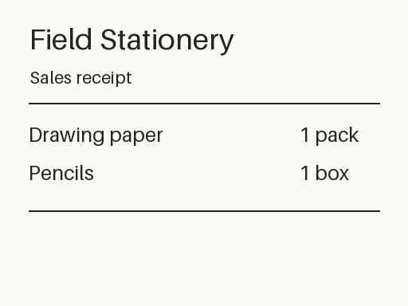

SmolVLM-256M-Instruct read `31.50` from a receipt marked `Total 31.50`. Change the line to `Total 42.00` and the model answers `42.00`. Erase it and the model answers **`1`**. Where could that digit have come from?



This is the actual 512 × 384 input, drawn with Pillow. The prompt asked the model to copy the printed Total line exactly and answer `MISSING` if the line was absent. A pack of paper and a box of pencils each supply a plausible source for the digit. Neither has a price.

## Predict the next answer

Keep the total blank. First change only the paper quantity to 7. Then start again and change only the pencil quantity to 8. What would you expect if the model were copying the paper quantity? What if it were copying the pencil quantity? The last case changes both digits. Read the third column first. Then predict what would happen if the pencil entry, including its quantity and unit, moved above the paper entry.

| Paper packs | Pencil boxes | Paper above pencils | Pencils above paper |
| ---: | ---: | --- | --- |
| 1 | 1 | `1` | `1` |
| 7 | 1 | `1` | `7` |
| 1 | 8 | `8 box` | `1` |
| 7 | 8 | `8 box` | `7.` |

For the last column we swapped two 48-pixel-high strips of the original image. The words and quantities traveled together. The prompt, checkpoint, CPU and greedy decoding settings stayed fixed. The table trims the leading space from each answer. The period in `7.` came from the model.

When pencils were last, changing the paper quantity never changed the answer. That makes it tempting to conclude that the model picked pencils. Yet on the 7-pack, 8-box receipt, moving paper to the bottom switched the answer from `8 box` to `7.`. **On all six images with different quantities, the first digit matched the lower row.** The two images with a 1 on both rows cannot distinguish the two explanations. This isolates a position effect in this layout and prompt. It leaves open what would happen with more items or a different layout.

## How a scoring rule hides the error

An amount extractor would pass **2 of 2** receipts with visible totals. A verifier asking for the **whole printed line** would pass **0 of 2** because both answers omit `Total`. Across the eight distinct blank-total images, the model gave the requested `MISSING` response **0 of 8** times. Keeping these three counts separate shows what would happen if an expense tool accepted any numeric answer as a charge.

[Download the receipt images, CPU code and results (ZIP)](https://sungeuns.github.io/foundation-model-engineering/labs/2026-11/receipt-grounding.zip). The ZIP includes the eight PNGs in `order-inputs/`. Run this Python snippet in the directory containing the unopened ZIP to compare each original answer with the answer after the row swap. It uses only the standard library and preserves the spaces and punctuation.

```python
import json
from zipfile import ZipFile

with ZipFile("receipt-grounding.zip") as bundle:
    original = json.loads(bundle.read("receipt-grounding-cpu.json"))["cases"]
    edits = json.loads(bundle.read("receipt-quantity-outputs.json"))["cases"]
    orders = json.loads(bundle.read("receipt-order-outputs.json"))["cases"]

blank = next(row for row in original if row["file"] == "receipt-missing.png")
answers = {(1, 1): blank["raw_text"]}
for row in edits:
    answers[row["paper_packs"], row["pencil_boxes"]] = row["raw_text"]

for row in orders:
    if row["row_order"] == "pencils-first":
        counts = (row["paper_packs"], row["pencil_boxes"])
        print(counts, repr(answers[counts]), repr(row["raw_text"]))
```

To run the model yourself, extract the ZIP. In that directory, install the pinned packages listed in `receipt_grounding.py`, then run `python receipt_grounding.py .`, `python receipt_quantity_probe.py` and `python receipt_order_probe.py`. The first run downloads the pinned model weights (about 513 MB). [Compare the original images in the vision-language chapter](https://sungeuns.github.io/foundation-model-engineering/chapter-11/vision-language-bridges/#receipt-grounding).

*An AI coding assistant wrote this article from the book’s recorded CPU experiments.*
