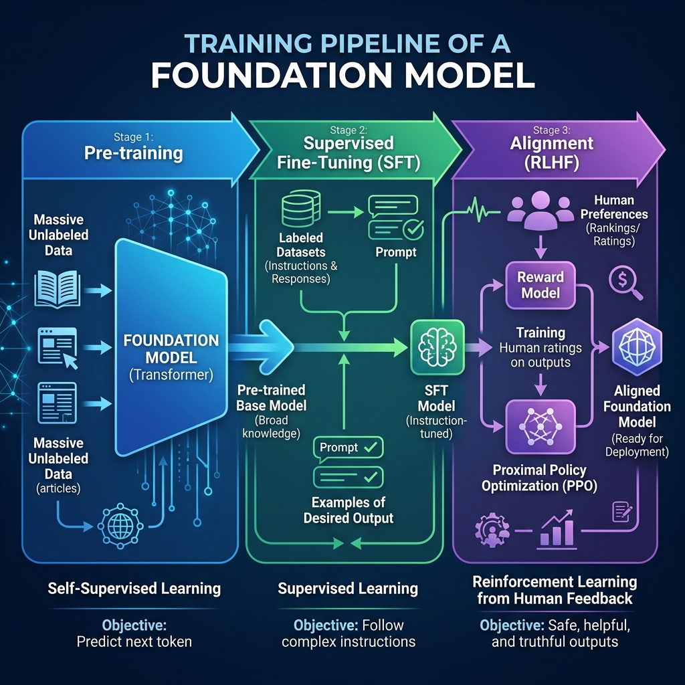

import { NextTokenVisualizer } from '../../components/chapter-1/NextTokenVisualizer.tsx';


# 1.3 Deep Learning Paradigms

To understand how foundation models are built and aligned, we must explore the three fundamental paradigms of machine learning and how they converge in modern AI systems.

---

### **Motivation: The Recipe for General Intelligence**
Why do we need different paradigms? Because no single method is sufficient to build a safe, useful AI:
*   **Scale requires Self-Supervision:** Human-labeled data is too scarce to build massive knowledge bases.
*   **Instruction following benefits from supervision:** Pure text completion doesn't make a good assistant.
* **Safety requires layered validation:** RL is one tool for improving behavior alongside SFT, preference optimization, access controls and deployment evaluation. It is neither necessary nor sufficient for safety.

Understanding these paradigms helps you navigate the complex training pipelines of modern LLMs.

---

### **The Metaphor: The Three Ways to Learn**

Imagine you are trying to learn how to play a complex strategy game.

1.  **Supervised Learning is like learning with a Coach.** The coach shows you a board state and tells you exactly what move to make. You learn by mimicking the expert.
2.  **Self-Supervised Learning is like reading every book ever written about the game.** You don't have a coach, but by reading millions of sentences, you figure out which words (and concepts) usually follow each other. You learn the *structure* of the game's world.
3.  **Reinforcement Learning is like playing the game yourself.** You make moves, sometimes you win, sometimes you lose. You adjust your strategy based on the feedback (rewards) from the game itself.

Many language-model pipelines combine self-supervised pre-training, supervised adaptation, and reinforcement learning. Not every foundation model uses all three, and the ordering depends on the objective and pipeline.

**Yann LeCun's Cake Analogy:** To explain the relative information content of these paradigms, AI pioneer Yann LeCun famously introduced a cake metaphor. He described machine learning as a cake where **self-supervised learning is the cake itself** (the massive bulk of information), **supervised learning is the icing** (a small amount of information), and **reinforcement learning is the cherry on top** (a tiny amount of information). This highlights that the vast majority of what a foundation model knows comes from self-supervised learning on massive datasets.

---

## A Brief History of Paradigm Shift

1.  **The Supervised Era (2012-2018):** Deep learning took off with supervised tasks like ImageNet classification. Models were brilliant but narrow specialists.
2.  **The Self-Supervised Revolution (2018-Present):** Models like BERT [[1]](#ref-1) and GPT showed that predicting missing words in unlabeled text leads to rich, general representations. This enabled the "Foundation" aspect.
3.  **The Alignment Era (2022-Present):** InstructGPT [[2]](#ref-2) popularized RLHF, showing that we can align these massive models to be helpful assistants rather than just text completers.

---

## Comparison: The Three Paradigms

| Feature | Supervised Learning | Self-Supervised Learning | Reinforcement Learning |
| :--- | :--- | :--- | :--- |
| **Data Type** | Labeled $(\mathbf{x}, y)$ | Unlabeled $\mathbf{x}$ (Self-labeled) | Environment interactions |
| **Feedback** | Direct correction | Predicting parts of data | Scalar rewards |
| **Pros** | High precision on clear tasks | Scales infinitely with data | Can learn complex policies |
| **Cons** | Expensive data labeling | May learn noise/bias | Highly unstable to train |
| **Role in LLMs** | Instruction tuning (SFT) | Core Pre-training | Human preference alignment |

---

<div style={{ display: 'flex', flexDirection: 'column', alignItems: 'center', width: '100%', margin: '20px 0' }}>

<div style={{ maxWidth: '600px', width: '100%' }}>

</div>

<em style={{ marginTop: '10px', color: '#7f8c8d' }}>Source: AI-generated illustration</em>

</div>

---

## The Convergence in Foundation Models

Modern foundation models are built using a staged pipeline that combines these paradigms:

1.  **Pre-training (Self-Supervised):** Train on massive text data to learn language structure and general knowledge. This is where the model becomes smart.
2.  **Supervised Fine-Tuning (SFT):** Fine-tune on high-quality instruction data to learn to follow prompts and behave as an assistant.
3.  **Alignment (RLHF):** Use reinforcement learning with a reward model trained on human preferences to make the model helpful, honest, and harmless [[2]](#ref-2).

---

## Autoregressive Loss Calculation

Let's look at the core loss function used in the Self-Supervised pre-training of LLMs. It is typically the **Cross-Entropy Loss** applied to predicting the next token.

Here is a PyTorch snippet demonstrating how this loss is calculated for a single step.

```python
import torch
import torch.nn as nn

# Vocabulary size and sequence length
vocab_size = 5000
seq_len = 5

# Simulated logits from a model (Batch_size, Seq_len, Vocab_size)
logits = torch.randn(2, seq_len, vocab_size)

# Target tokens (Batch_size, Seq_len) - the actual next tokens
targets = torch.randint(0, vocab_size, (2, seq_len))

# CrossEntropyLoss expects (N, C, ...) or (N, C)
# We flatten the batch and sequence dimensions
loss_fct = nn.CrossEntropyLoss()
loss = loss_fct(logits.view(-1, vocab_size), targets.view(-1))

print(f"Calculated Autoregressive Loss: {loss.item():.4f}")
```

---

## Example: Next Token Prediction

Experience how an Autoregressive model works. Select a prompt, and see the simulated probabilities for the next word. This is the core mechanism of Self-Supervised learning in LLMs.

<NextTokenVisualizer client:load />


---

## Quizzes

<details>
<summary>Quiz 1: Why is Self-Supervised Learning considered the breakthrough for LLMs?</summary>
*Because it removes the dependency on human-labeled data. SSL allows models to learn from raw, unlabeled text by creating its own labels (e.g., predicting the next word). This enables training on massive, internet-scale datasets, which is necessary for emergent capabilities.*
</details>

<details>
<summary>Quiz 2: How does Reinforcement Learning differ from Supervised Learning?</summary>
*In Supervised Learning, the model is given the correct output for every input. In Reinforcement Learning, the model is not told the correct action but must discover which actions yield the highest reward through trial and error interaction with an environment.*
</details>

<details>
<summary>Quiz 3: What role does Supervised Fine-Tuning (SFT) play after pre-training?</summary>
*Pre-training makes the model a powerful text completer, but not necessarily a good assistant. SFT trains the model on specific prompt-response pairs, teaching it to understand user intent and respond in a helpful, conversational manner.*
</details>

<details>
<summary>Quiz 4: Why use preference optimization after SFT?</summary>
*It can teach output preferences not captured adequately by imitation. RLHF and direct preference optimization are options, with reward bias and gaming requiring evaluation. Neither guarantees safety.*
</details>

<details>
<summary>Quiz 5: Why usually initialize language-model RL with self-supervised pretraining?</summary>
*Searching a large token action space from scratch is difficult, so pretraining supplies a practical initialization. This describes a common workflow, not a mathematical necessity for every possible RL method.*
</details>

<details>
<summary>Quiz 6: Does PPO clipping force policy probability ratios to stay inside the clipping interval?</summary>
*No. $L^{CLIP}=\mathbb E[\min(r_t\hat A_t,\operatorname{clip}(r_t,1-\epsilon,1+\epsilon)\hat A_t)]$ is a surrogate that limits incentives for excessive changes in the improving direction. Here $r_t=\pi_\theta(a_t|s_t)/\pi_{old}(a_t|s_t)$, $\hat A_t$ estimates advantage and $\epsilon$ sets the clip width. Shared parameters and repeated updates can move ratios outside the interval; monitor KL and clip fraction.*
</details>

---

## References

1. <a id="ref-1"></a>Devlin, J., Chang, M. W., Lee, K., & Toutanova, K. (2018). *BERT: Pre-training of deep bidirectional transformers for language understanding*. [arXiv:1810.04805](https://arxiv.org/abs/1810.04805).
2. <a id="ref-2"></a>Ouyang, L., et al. (2022). *Training language models to follow instructions with human feedback*. [arXiv:2203.02155](https://arxiv.org/abs/2203.02155).
