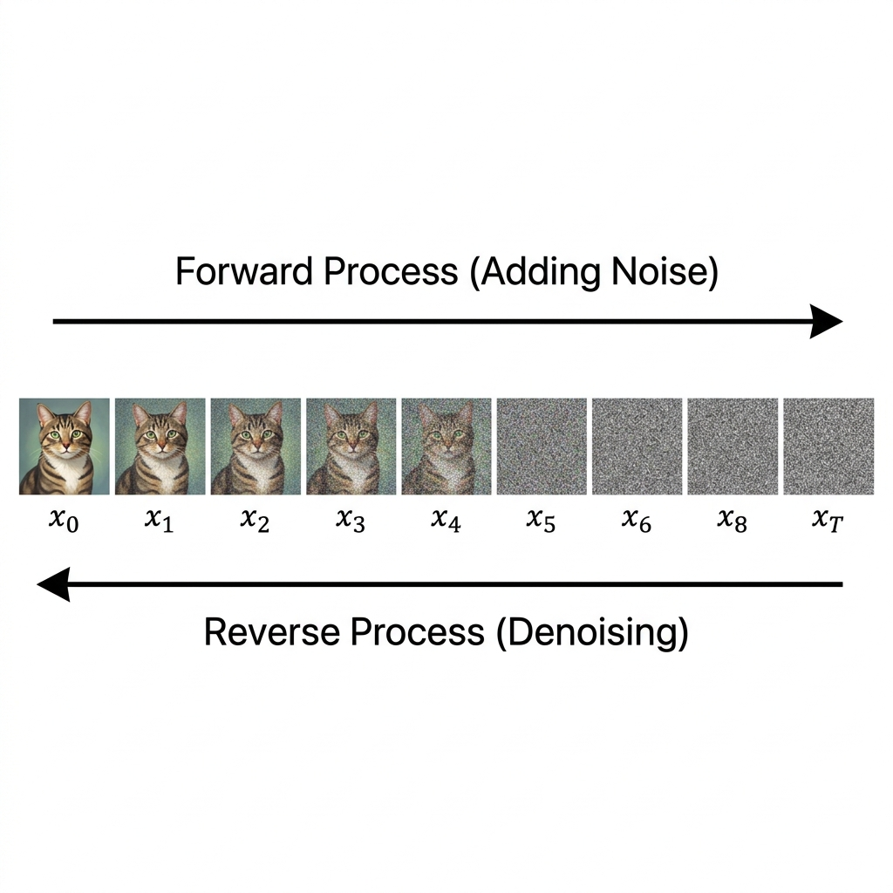

import DiffusionVisualizer from '../../components/chapter-11/DiffusionVisualizer.tsx';


# 11.4 Image Diffusion Models

While the previous sections focused on understanding and bridging different modalities, this section turns to **generation**: producing images from text prompts. Diffusion is one influential approach. The mechanisms below explain documented diffusion models; an image-generation API alone does not establish that its underlying model uses the same architecture or objective.

## 1. The Analogy: Clearing the Fog

Imagine looking through a window completely covered in thick, random fog. You cannot see anything outside. Now imagine you have a magical tool that can slightly clear the fog, step by step. If you know what you *want* to see (e.g., a cat in a garden), you can use that knowledge to guide the clearing process. At each step, you remove a bit of the random fog and add a bit of structure that looks like a cat. Eventually, the window is clear, and a beautiful image of a cat appears.

This is exactly how Diffusion Models work. They start with a canvas of pure random noise (the thick fog) and iteratively remove noise while adding structure, guided by a text prompt, until a clear image emerges.


<DiffusionVisualizer client:load locale="en" />

---

## 2. The Core Mechanics: Forward and Reverse Diffusion

Diffusion models learn to reverse a process that gradually corrupts data with noise. They have discrete- and continuous-time formulations; the DDPM equations below use a finite, discrete-time Gaussian Markov chain. [[1]](#ref-1)

### The Forward Process (Gaussian Diffusion)
In the forward process, we take a clean image $x_0 \sim q(x)$ and gradually add Gaussian noise to it over a series of time steps $T$.
This process is defined as a Markov chain:
$$ q(x_{1:T} | x_0) = \prod_{t=1}^T q(x_t | x_{t-1}) $$
$$ q(x_t | x_{t-1}) = \mathcal{N}(x_t; \sqrt{1 - \beta_t} x_{t-1}, \beta_t \mathbf{I}) $$
Where $\beta_t$ is a variance schedule.

A crucial property of this formulation is that it allows us to sample $x_t$ at any arbitrary time step $t$ directly from $x_0$ without iterating through the intermediate steps, using the reparameterization trick:
$$ x_t = \sqrt{\bar{\alpha}_t} x_0 + \sqrt{1 - \bar{\alpha}_t} \epsilon $$
Where $\alpha_t = 1 - \beta_t$, $\bar{\alpha}_t = \prod_{s=1}^t \alpha_s$, and $\epsilon \sim \mathcal{N}(0, \mathbf{I})$. When the schedule makes $\bar\alpha_T$ close to zero, the signal contribution becomes small and $x_T$ approaches standard Gaussian noise.

### The Reverse Process (Generative Denoising)
The goal of generative modeling is to learn the reverse process $q(x_{t-1} | x_t)$. If we can reverse this process, we can start from random noise $x_T \sim \mathcal{N}(0, \mathbf{I})$ and generate a sample from the true data distribution $x_0$.

While the true reverse distribution is intractable (as it depends on the entire data distribution), Ho et al. (2020) [[1]](#ref-1) showed that for small $\beta_t$, the reverse step $q(x_{t-1} | x_t)$ can also be approximated as a Gaussian. We train a neural network $p_\theta(x_{t-1} | x_t)$ to learn this reverse transition:
$$ p_\theta(x_{t-1} | x_t) = \mathcal{N}(x_{t-1}; \mu_\theta(x_t, t), \Sigma_\theta(x_t, t)) $$

A common DDPM parameterization predicts the added noise with $\epsilon_\theta(x_t, t)$ and uses it to construct the reverse mean. The simplified training objective is a Mean Squared Error (MSE) regression; it is a surrogate rather than exact maximization of image likelihood: [[1]](#ref-1)
$$ \mathcal{L}_{simple} = \mathbb{E}_{t, x_0, \epsilon} [ \| \epsilon - \epsilon_\theta(x_t, t) \|^2 ] $$

At a fixed noise level, the optimal noise prediction is related by a known scale factor to the score of the **noisy marginal distribution**, not directly to the score of the clean image distribution. This connects denoising to score matching and explains why timestep conditioning matters. [[1]](#ref-1)


*Figure: The forward diffusion process adding noise, and the reverse process removing it.*

---

## 3. Latent Diffusion Models (LDM): Solving the Resolution Crisis

Early diffusion models operated directly in pixel space. Processing large high-resolution tensors through deep U-Nets at every timestep made training and inference expensive.

The breakthrough that led to **Stable Diffusion** was **Latent Diffusion** [[2]](#ref-2). The key insight was to separate the learning process into two distinct stages:

### Stage 1: Perceptual Compression (VAE)
We train an autoencoder (specifically, a Variational Autoencoder or VAE). The encoder $\mathcal{E}$ maps a high-resolution image $x \in \mathbb{R}^{H \times W \times 3}$ into a lower-dimensional latent space $z = \mathcal{E}(x) \in \mathbb{R}^{h \times w \times c}$, where $h \ll H$ and $w \ll W$. The decoder $\mathcal{D}$ maps it back: $\tilde{x} = \mathcal{D}(z)$.
This is lossy perceptual compression, not a guarantee that only irrelevant details are removed. Reconstruction can lose fine textures, small text or other task-relevant information, so inspect decoded reconstructions before attributing every error to the denoiser. [[2]](#ref-2)

### Stage 2: Semantic Generation (Latent Diffusion)
The diffusion process (both forward and reverse) is performed entirely within this compressed latent space. The network now predicts noise in the latent space $z_t$, dramatically reducing computational cost.

### Conditioning via Cross-Attention
To enable text-to-image generation, LDM introduces cross-attention mechanisms into the denoising network. A text prompt $y$ is encoded using a pre-trained text encoder (like CLIP), and these embeddings are projected into the U-Net's attention layers:
$$ \text{Attention}(Q, K, V) = \text{softmax}\left(\frac{QK^T}{\sqrt{d}}\right)V $$
Where $Q$ is derived from the flattened latent representation, $K, V$ are derived from the text embeddings, and $d$ is the query/key dimension for one attention head. This conditions generation on the text representation; it does not guarantee correct object counts, spatial relations or exact lettering.

---

## 4. Diffusion and GANs: Different Optimization and Sampling Costs

DDPM replaces adversarial generator–discriminator training with a denoising objective. This avoids the adversarial game, but data quality, optimization, coverage and numerical stability still need validation. Its variational formulation and simplified noise loss do not guarantee that every data mode is learned. [[1]](#ref-1)

The cost also moves: iterative sampling can require many network evaluations, while latent compression reduces the size of each evaluation and introduces reconstruction error. Compare diversity, fidelity, prompt adherence and latency at matched data, resolution and compute budgets. A model-family label alone cannot settle those trade-offs. [[2]](#ref-2)

---

## 5. Public weights and license terms are separate

**As of 2026-11-15.** These two historically important variants illustrate access terms, not a current quality ranking. Sharing a model-family name does not imply identical permissions.

| Artifact | Release state and terms | What to check |
|---|---|---|
| FLUX.1-dev | Released weights with access conditions; non-commercial development license [[4]](#ref-4) | Separate commercial-use terms |
| FLUX.1-schnell | Released weights; Apache 2.0 [[5]](#ref-5) | Exact deployment artifact and distribution path |

### November API case: GPT-Image-2.6

**As of 2026-11-24.** OpenAI released **GPT-Image-2.6 Sunburst and Flare** on November 4 as **released/API-only** image generation and editing models. The model pages position Sunburst for detailed work and Flare for fast iteration; they do not disclose the denoiser, parameter count, or complete training recipe. These are product contracts, not additional examples of a verified diffusion architecture. [[6]](#ref-6) [[7]](#ref-7) [[8]](#ref-8)

The Image API separates `complexity`—planning effort before rendering—from `quality`. Both models accept low, medium and high complexity, with high as the default; higher effort can also increase latency or unwanted edits. SVG generation returns static vector content and is limited to the generation endpoint, while animated GIF output supports generation and editing. Neither output format demonstrates physical simulation. [[9]](#ref-9)

For a logo correction, compare whether the requested lettering changes while unrelated shapes and colors stay fixed. For an animation, inspect every frame and the loop boundary. Pin the model, source-image hash, prompt, markup, complexity, quality and output format; measure text correctness, edit preservation, render validity, latency and retry cost. A more elaborate result can be a worse edit.

## 6. U-Net and Transformer are design choices to evaluate

Latent diffusion moves repeated high-resolution pixel computation into a compressed latent space. Transformer denoisers apply attention to tokenized latent representations. [[2]](#ref-2) [[3]](#ref-3) Architecture names alone do not prove better prompt adherence, text rendering or anatomy. Match data, training budget, resolution, sampler and step count, and include VAE reconstruction loss and inference cost.

## 7. Code: Simple Noise Prediction Step

To understand the formulas above, here is a simple PyTorch simulation of a single step in a Denoising Diffusion Probabilistic Model (DDPM).

> **Educational shape and reverse-mean example.** The CNN is untrained and ignores timestep conditioning, so it cannot denoise meaningfully. The mean uses cumulative $\bar\alpha_t=\prod_{s=0}^{t}(1-\beta_s)$, while this example selects the fixed-large variance $\beta_t$. Production samplers must pin the training parameterization, variance schedule and precision.

```python
import torch
import torch.nn as nn

class SimpleDenoisingModel(nn.Module):
    def __init__(self, img_channels=3):
        super().__init__()
        # A simple CNN to predict noise
        self.net = nn.Sequential(
            nn.Conv2d(img_channels, 64, 3, padding=1),
            nn.ReLU(),
            nn.Conv2d(64, 64, 3, padding=1),
            nn.ReLU(),
            nn.Conv2d(64, img_channels, 3, padding=1)
        )

    def forward(self, x, t):
        # In a real model, 't' (time step) is embedded and injected into the network
        return self.net(x)

def ddpm_step(x_t, predicted_noise, t, beta_schedule):
    # Zero-based t; fixed-large variance beta_t, with no final-step noise.
    betas = beta_schedule.to(device=x_t.device, dtype=x_t.dtype)
    alpha_t = 1 - betas[t]
    alpha_bar_t = torch.cumprod(1 - betas, dim=0)[t]
    x_prev = (x_t - betas[t] / torch.sqrt(1 - alpha_bar_t) * predicted_noise) / torch.sqrt(alpha_t)
    if t > 0:
        x_prev = x_prev + torch.sqrt(betas[t]) * torch.randn_like(x_t)
    return x_prev

# Simulation
img = torch.randn(1, 3, 64, 64) # Start with pure noise
model = SimpleDenoisingModel()
beta_schedule = torch.linspace(0.0001, 0.02, 1000)

# One step of denoising
t = 999
pred_noise = model(img, t)
denoised_img = ddpm_step(img, pred_noise, t, beta_schedule)
print(f"Denoised image shape: {denoised_img.shape}")
```

---

## 8. Beyond Images: Diffusion-Based LLMs

As we will explore in **Chapter 20.6 (Diffusion-based LLMs)**, researchers are actively developing techniques to apply diffusion to language modeling. By performing diffusion in the continuous embedding space or using discrete diffusion processes, these models offer potential advantages over standard autoregressive LLMs, such as non-autoregressive generation and better controllability.

---

## Quizzes

<details>
<summary>Quiz 1: Why does Latent Diffusion use less compute than pixel-space diffusion?</summary>
*Because it operates in a lower-dimensional latent space compressed by a VAE, rather than processing massive high-resolution pixel tensors at every time step.*
</details>

<details>
<summary>Quiz 2: What is the purpose of the forward process in Diffusion models?</summary>
*The forward process creates noisy training examples at different timesteps. A suitable schedule makes the terminal distribution close to Gaussian noise, giving the learned reverse process a simple sampling starting point.*
</details>

<details>
<summary>Quiz 3: Does a Transformer denoiser alone establish better quality than a U-Net?</summary>
*No. Match data, training budget, resolution, sampling and quality-evaluation conditions; architecture is one part of the evaluated system.*
</details>

<details>
<summary>Quiz 4: Does SVG or animated GIF output establish that an image service uses a particular diffusion architecture?</summary>
*No. Output format and API controls describe observable interfaces. Architecture requires separate disclosure; evaluate vector validity, edit preservation and frame consistency without inventing internal mechanisms.*
</details>

---

## References

1. <a id="ref-1"></a>Ho, J., Jain, A., & Abbeel, P. (2020). *Denoising diffusion probabilistic models*. [arXiv:2006.11239](https://arxiv.org/abs/2006.11239).
2. <a id="ref-2"></a>Rombach, R., et al. (2022). *High-resolution image synthesis with latent diffusion models*. [arXiv:2112.10752](https://arxiv.org/abs/2112.10752).
3. <a id="ref-3"></a>Peebles, W., & Xie, S. (2023). *Scalable diffusion models with transformers*. [arXiv:2212.09748](https://arxiv.org/abs/2212.09748).

4. <a id="ref-4"></a>Black Forest Labs. [FLUX.1-dev model card and license](https://huggingface.co/black-forest-labs/FLUX.1-dev). Accessed 2026-11-15.
5. <a id="ref-5"></a>Black Forest Labs. [FLUX.1-schnell model card and license](https://huggingface.co/black-forest-labs/FLUX.1-schnell). Accessed 2026-11-15.
6. <a id="ref-6"></a>OpenAI. *API changelog: November 4, 2026 image release*. Verified 2026-11-24. [Changelog](https://developers.openai.com/api/docs/changelog).
7. <a id="ref-7"></a>OpenAI. *GPT-Image-2.6 Sunburst*. Verified 2026-11-24. [Model](https://developers.openai.com/api/docs/models/gpt-image-2.6-sunburst).
8. <a id="ref-8"></a>OpenAI. *GPT-Image-2.6 Flare*. Verified 2026-11-24. [Model](https://developers.openai.com/api/docs/models/gpt-image-2.6-flare).
9. <a id="ref-9"></a>OpenAI. *Image generation: GPT-Image-2.6, SVG and GIF output*. Verified 2026-11-24. [Guide](https://developers.openai.com/api/docs/guides/image-generation).
