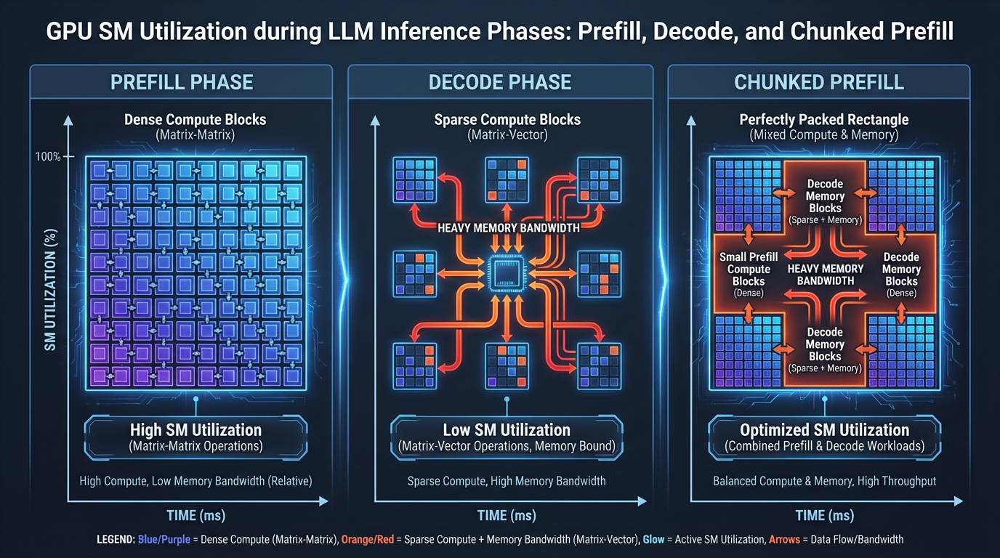

import ContinuousBatchingVisualizer from '../../components/chapter-12/ContinuousBatchingVisualizer.tsx';

# 12.3 Continuous Batching

While PagedAttention (discussed in the previous section) brilliantly solved the *spatial* problem of LLM inference—eliminating memory fragmentation and maximizing KV cache utilization—it did not address the *temporal* problem. Memory is only half the equation; how we schedule compute on the GPU determines the ultimate throughput of the system.

In traditional deep learning (e.g., classifying images with a ResNet), batching is straightforward: you group $N$ images, run a single forward pass, and get $N$ predictions simultaneously. All items in the batch take the exact same amount of time to process.

Autoregressive LLM inference, however, is highly dynamic. A user's prompt might be 10 tokens or 10,000 tokens. The generated response might be a single word ("Yes.") or a massive essay. This dynamic sequence length breaks traditional static batching paradigms, forcing modern inference engines to adopt OS-level scheduling concepts. The result is **Continuous Batching** (also known as iteration-level or in-flight batching), a technique that fundamentally altered the economics of LLM serving.

---

## 1. The Flaw of Static Batching: The Convoy Effect

Prior to 2022, inference frameworks like HuggingFace Transformers utilized **Static Batching**. In this paradigm, a batch of requests is formed, and the GPU processes them until *every single request* in the batch has emitted an `<EOS>` (End of Sequence) token or reached its maximum length.

Consider a batch of four requests:
- **Request A:** Generates 10 tokens.
- **Request B:** Generates 25 tokens.
- **Request C:** Generates 15 tokens.
- **Request D:** Generates 100 tokens.

In static batching, Requests A, B, and C finish very quickly. However, they cannot leave the batch, and their GPU memory cannot be freed, because the batch as a whole is waiting for Request D to finish generating its 100th token.

This phenomenon is known as the **Convoy Effect** or the *early termination problem*. The GPU ends up doing dummy computations (or masking) for A, B, and C for 90 iterations just to accommodate D. As a result, GPU compute utilization plummets, and new requests waiting in the queue experience severe head-of-line blocking.

---

## 2. The Paradigm Shift: Iteration-Level Scheduling

To solve the Convoy Effect, researchers introduced **Iteration-Level Scheduling** in the seminal 2022 paper *Orca: A Distributed Serving System for Transformer-Based Generative Models* [[1]](#ref-1).

Instead of scheduling at the granularity of a *request*, the engine schedules at the granularity of an *iteration* (the generation of a single token). After every forward pass—which generates exactly one token for all active requests—the scheduler pauses and evaluates the batch:
1. Did any request emit an `<EOS>` token? If yes, immediately evict it from the batch and free its logical KV cache blocks.
2. Is there space in the batch (and sufficient VRAM)? If yes, immediately pull a new request from the waiting queue and insert it into the active batch.

By continuously swapping requests in and out on a token-by-token basis, the GPU never waits for a long sequence to finish. The batch size remains artificially "full" at all times, maximizing throughput.

### Interactive: Static vs. Continuous Batching

Use the interactive visualizer below to observe the difference. In **Static Batching**, notice how empty slots (wasted compute) accumulate while waiting for the longest request to finish. In **Continuous Batching**, notice how new requests seamlessly slide into the batch the moment a slot opens up.

<ContinuousBatchingVisualizer client:load />

---

## 3. The Compute-Memory Dichotomy: Prefill vs. Decode

While continuous batching sounds conceptually simple, implementing it efficiently on GPU hardware is exceptionally difficult. This difficulty arises because LLM inference consists of two entirely different computational phases with conflicting hardware profiles:

1. **The Prefill Phase (Prompt Processing):** When a new request enters the batch, the model must process its entire input prompt simultaneously to compute the initial KV cache. Mathematically, this is a massive **Matrix-Matrix Multiplication (GEMM)**. It is highly parallelizable, heavily utilizes the GPU's Tensor Cores, and is **Compute-Bound**.
2. **The Decode Phase (Token Generation):** Once the prompt is processed, the model generates one token at a time. For each token, the model multiplies the new token's query vector against the entire historical KV cache. Mathematically, this is a **Matrix-Vector Multiplication (GEMV)**. It cannot fully utilize Tensor Cores and is severely **Memory-Bandwidth-Bound**.

When using continuous batching, the scheduler inevitably mixes these two phases. A newly inserted request must undergo its Prefill phase, while the existing requests in the batch are undergoing their Decode phase.

---

## 4. Modern SOTA: Chunked Prefill

Mixing prefill and decode creates a massive scheduling collision. Suppose you have 30 requests in the decode phase, generating tokens smoothly every 20 milliseconds. Suddenly, a new request with a massive 50,000-token prompt enters the batch.

Processing a 50k-token prefill might take the GPU 800 milliseconds of pure compute time. Because the GPU is occupied with this massive GEMM operation, the 30 decode requests are "stalled." They will not generate a token for 800ms. To the end users, the text generation will suddenly stutter and freeze. This violates strict Service Level Objectives (SLOs), specifically the **Time-Between-Tokens (TBT)** metric.

To solve this, modern inference engines (such as vLLM, SGLang, and TensorRT-LLM) implement **Chunked Prefill** (first popularized by systems like SARATHI [[2]](#ref-2)).

Instead of processing a massive prompt all at once, the scheduler splits the prompt into manageable chunks (e.g., 1,024 or 2,048 tokens). During each iteration, the scheduler "piggybacks" one or more budgeted prefill chunks alongside the ongoing decode requests.



Mixing decode with prefill can improve utilization, but they share bandwidth and kernel resources. Larger chunks may improve throughput while increasing inter-token delay for existing requests. Tune chunk size, token budget and priority against TTFT and inter-token tail-latency SLOs; neither full utilization nor stall-free decode is guaranteed.

---

## 5. Engineering the Scheduler (PyTorch Simulation)

To understand the mechanics of a modern iteration-level scheduler, we can simulate its core event loop in Python. The code below demonstrates how requests are transitioned between states (`waiting`, `prefill`, `decode`, `finished`) at every token generation step.

```python
import torch
from typing import List

class InferenceRequest:
    def __init__(self, req_id: int, prompt_length: int, max_new_tokens: int):
        self.req_id = req_id
        self.prompt_length = prompt_length
        self.max_new_tokens = max_new_tokens
        self.generated_tokens = 0
        self.status = "waiting" # States: waiting, prefill, decode, finished

class ContinuousBatchingScheduler:
    def __init__(self, max_batch_size: int):
        self.waiting_queue: List[InferenceRequest] = []
        self.running_batch: List[InferenceRequest] = []
        self.max_batch_size = max_batch_size

    def add_request(self, request: InferenceRequest):
        self.waiting_queue.append(request)

    def _evict_finished_requests(self):
        """Removes requests that have completed generation."""
        active = []
        for req in self.running_batch:
            # In reality, we also check for the <EOS> token ID here
            if req.generated_tokens >= req.max_new_tokens:
                req.status = "finished"
                print(f"Request {req.req_id} finished.")
            else:
                active.append(req)
        self.running_batch = active

    def _pull_new_requests(self):
        """Pulls requests from the queue if there is batch capacity."""
        available_slots = self.max_batch_size - len(self.running_batch)

        while available_slots > 0 and self.waiting_queue:
            new_req = self.waiting_queue.pop(0)
            new_req.status = "prefill"
            self.running_batch.append(new_req)
            available_slots -= 1

    def step(self, mock_model_forward):
        """Executes a single iteration (one token generation step)."""
        # 1. Clean up finished requests from the previous step
        self._evict_finished_requests()

        # 2. Fill empty slots with new requests
        self._pull_new_requests()

        if not self.running_batch:
            return # Engine is idle

        # 3. Separate requests by phase
        prefill_reqs = [r for r in self.running_batch if r.status == "prefill"]
        decode_reqs = [r for r in self.running_batch if r.status == "decode"]

        # 4. Execute Forward Pass
        # A real engine uses Custom CUDA kernels to fuse chunked prefills
        # with decodes into a single pass.
        mock_model_forward(prefill_reqs, decode_reqs)

        # 5. Update request states
        for req in self.running_batch:
            if req.status == "prefill":
                # After one iteration, prompt is processed, transition to decode
                req.status = "decode"
            elif req.status == "decode":
                req.generated_tokens += 1

# --- Simulation ---
def mock_forward(prefill, decode):
    # Simulates GPU execution time
    pass

scheduler = ContinuousBatchingScheduler(max_batch_size=4)
for i in range(6):
    # Mix of short and long generation requests
    scheduler.add_request(InferenceRequest(i, prompt_length=100, max_new_tokens=(i+1)*5))

iteration = 0
while scheduler.waiting_queue or scheduler.running_batch:
    print(f"Iteration {iteration} | Active Batch Size: {len(scheduler.running_batch)}")
    scheduler.step(mock_forward)
    iteration += 1
```

---

## 6. Summary and next steps

Replacing requests at iteration boundaries reduces idle slots caused by unequal generation lengths. Chunked prefill can bound interference with decoding but does not eliminate throughput/latency tradeoffs. KV capacity, token budgets, arrivals and kernel efficiency still determine utilization.

At small decode batches, active-weight and KV reads can dominate. Larger batches, long contexts and MoE change the bottlenecks and traffic. The next section examines the gains and costs of verifying several candidate tokens together through speculative decoding.

## Quizzes

<details>
<summary>Quiz 1: Why does static batching lead to a severe drop in GPU utilization during LLM inference?</summary>
*Because of the Convoy Effect (or early termination problem). If requests in a batch have varying generation lengths, the shorter requests finish early but cannot free their memory or exit the batch until the longest request finishes. The GPU wastes cycles waiting, rather than processing new requests.*
</details>

<details>
<summary>Quiz 2: When do prefill and decode bottlenecks differ?</summary>
*Prefill can have high arithmetic intensity by processing many tokens together; small-batch decode often stresses memory bandwidth. Batch size, context, architecture and kernels change this, so it is not universally a GEMM-versus-GEMV distinction.*
</details>

<details>
<summary>Quiz 3: How does chunked prefill manage decode latency?</summary>
*It breaks a long prompt into budgeted chunks placed among decode iterations. This can reduce interference, but chunk size and scheduling trade prefill completion against inter-token latency; stalls are not guaranteed to disappear.*
</details>

<details>
<summary>Quiz 4: In an iteration-level scheduler, at what exact point can a new request from the waiting queue enter the active GPU batch?</summary>
*At the boundary of any token generation step (iteration). Immediately after a forward pass completes, the scheduler evaluates the batch, evicts any requests that generated an EOS token, and pulls in new requests before the next forward pass begins.*
</details>

<details>
<summary>Quiz 5: How do static and continuous schedulers transition when requests finish?</summary>
*Define survivors as $C_t=\{r \in B_t : t<E(r)\}$. Static batching retains its batch while $C_t$ is nonempty, then admits a new batch from the queue when no survivors remain. Continuous batching retains $C_t$ and admits queued requests into free slots. A short queue leaves slots empty; real admission must also satisfy token and KV budgets.*
</details>

---

## References

1. <a id="ref-1"></a>Yu, G.-I., Jeong, J. S., Kim, G.-W., Kim, S., & Chun, B.-G. (2022). "Orca: A Distributed Serving System for Transformer-Based Generative Models". *16th USENIX Symposium on Operating Systems Design and Implementation (OSDI 22)*. [OSDI 2022](https://www.usenix.org/conference/osdi22/presentation/yu)
2. <a id="ref-2"></a>Agrawal, A., Panwar, A., Mohan, J., Kwatra, N., Gulavani, B. S., & Ramjee, R. (2023). *SARATHI: Efficient LLM Inference by Piggybacking Decodes with Chunked Prefills*. *arXiv preprint arXiv:2308.16369*. [arXiv:2308.16369](https://arxiv.org/abs/2308.16369)
