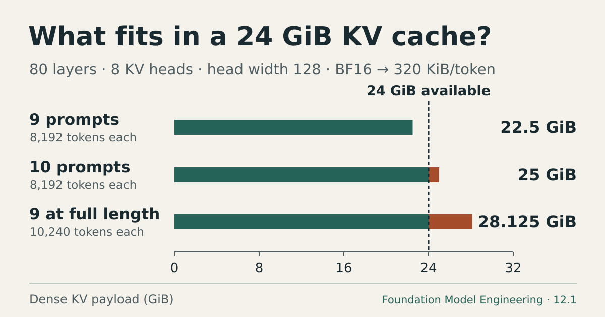

import { withBasePath } from '../../utils/paths.js';
import KVCacheCalculator from '../../components/chapter-12/KVCacheCalculator.tsx';

# 12.1 KV Cache: How It Works and Memory Use

**A KV cache stores the attention keys and values for tokens a language model has already processed.** During generation, the model reuses these tensors instead of recomputing the entire prefix at every step. This saves computation at the cost of memory that grows with the cached sequence length [[8]](#ref-8).

For example, after processing a four-token prompt, the model can reuse those four tokens' keys and values when processing the next token. The new token still reads the earlier state through attention; caching does not remove that work.

**Prefill** processes the prompt in parallel and populates the cache. **Decode** processes new tokens using the saved state. Prefill is often limited by matrix-multiplication throughput; decode often depends on memory bandwidth, cache capacity, and scheduling. This chapter derives the memory formula, provides a capacity calculator, and checks a small PyTorch cache against full recomputation.

## 1. What the Cache Actually Saves

At layer $l$, the matrices $W_Q$, $W_K$ and $W_V$ project the state $x_t$ of token $t$ into a query, key and value

$$
q_t=x_tW_Q,\qquad k_t=x_tW_K,\qquad v_t=x_tW_V.
$$

During causal decoding, keys and values of earlier tokens do not change. Retaining $\{k_i,v_i\}_{i\le t}$ means step $t+1$ computes only the new projections and attends to cached history:

$$
o_{t+1}=\operatorname{softmax}\left(
\frac{q_{t+1}K_{\le t+1}^{\top}}{\sqrt{d_h}}+M
\right)V_{\le t+1},
$$

Here $d_h$ is the head dimension, $K_{\le t+1}$ and $V_{\le t+1}$ include the new token, and $M$ masks positions the query cannot read.

### Why Cache K and V, but Not Q?

The current query asks which earlier positions matter for the current output. Future outputs use their own queries, so ordinary causal decoding does not need to retain old queries. It does need earlier keys for matching and earlier values for the weighted sum [[8]](#ref-8).

Model weights are shared across requests; KV state depends on the processed token sequence. KV caching also differs from saving a completed answer: a new continuation still requires model computation. Sharing state between requests needs a compatible artifact configuration and an exactly reusable prefix, not merely similar text.

Start with four prompt tokens. Process a fifth token, then a sixth. With a cache, the two new queries read five and six keys respectively, for **11 query–key pairs** in one attention head. Recompute the whole sequence each time and the five-token pass covers $1+2+3+4+5=15$ pairs. The six-token pass covers another 21, for **36 pairs**. Both counts exclude the initial prefill and count only pairs the causal mask permits.

For a prompt of length $P$ followed by $N$ single-token updates, cached attention reads $NP+N(N+1)/2$ pairs per head. At fixed $P$, this grows as $O(N^2)$. Recomputing all causal rows on every update takes $O(N^3)$ attention work and repeats token projections and MLP work for a total of $O(N^2)$. These counts describe the computation. Measured latency also depends on memory bandwidth and the kernel.

## 2. Capacity Model

For a dense cache with equal-length sequences,

$$
\text{bytes}_{KV}=2BSLH_{KV}d_hp,
$$

where $B$ is concurrent sequences, $S$ cached tokens per sequence, $L$ layers, $H_{KV}$ KV heads, $d_h$ values per head, and $p$ bytes per value. The factor two accounts for keys and values. For a one-layer example with 4,096 tokens, [compare the attention score matrix with the keys and values retained for decoding](/chapter-3/complexity-analysis/#attention-scores-vs-kv-cache).

For requests of different lengths, sum the token positions they occupy. Count shared blocks once. To estimate physical allocation, include slots lost to padding or block rounding. Also account for block metadata, workspace, extra speculative branches or beams, and the actual split or replication across devices.

For 32 sequences, 8,192 tokens each, 80 layers, 8 KV heads, $d_h=128$, and BF16:

$$
2\cdot32\cdot8192\cdot80\cdot8\cdot128\cdot2
=85{,}899{,}345{,}920\text{ bytes}=80\text{ GiB}.
$$

This is the aggregate for 32 equal-length sequences, not one request. Nor does the cache always exceed the weights. It can do so at large concurrency or context length, so both weights and peak live-cache occupancy belong in the capacity plan.

### Can the tenth request fit? A 24 GiB KV cache calculator example

With the same geometry, one cached token costs 327,680 bytes, or 320 KiB, across all 80 layers. One 8,192-token request therefore needs **2.5 GiB**. Suppose the serving pool has **24 GiB left for KV payload** after reserving weights, activations, workspaces, allocator overhead, and a failure margin. Nine such requests consume 22.5 GiB; ten require 25 GiB. This is a payload bound for that pool, not a measured GPU concurrency limit. If the cache is sharded, apply the actual per-device layout and account for any replicated heads.

Give each of the nine requests an output allowance of 2,048 tokens. At its full length of 10,240 tokens, one cache occupies 3.125 GiB. Keeping all nine full-length caches at once would take **28.125 GiB**. The 24 GiB payload budget can hold seven at that length.

Can all nine still finish? Suppose the scheduler decodes one request at a time while the other eight keep only their prompts. As the first request reaches its cap, the pool holds $3.125 + 8 \times 2.5 = 23.125$ GiB. Reclaim its cache as soon as it finishes, then decode the next request. Each round needs less space, so all nine can finish within the budget. The waiting requests pay for that choice in latency. This schedule assumes independent caches. Sharing an exact prefix can change the physical payload.

*Calculated from the lesson's 320 KiB per token and 24 GiB net KV budget.* [Open the full-size chart](../../social/kv-budget-en.png)

[Open the calculator with nine requests](?kv=1&batch=9&sequence=8192&generated=2048&layers=80&heads=8&dimension=128&precision=2&budget=24#kv-calculator). After changing the inputs, copy the link below the calculator to share the same workload and memory budget. Prompt caching leaves 1.5 GiB free. Before looking at the maximum-length result, predict how much extra memory the pool would need if every request added 2,048 tokens. To try a different budget, you can enter total memory, weights and other reservations for the same pool. For example, 80 GiB total minus 48 GiB of weights and 8 GiB reserved for other costs leaves 24 GiB for KV.

<KVCacheCalculator client:load lang="en" />

### What if the requests have different lengths?

Keep the 24 GiB pool, but give it five long prompts and four short ones at the same time. Each token still costs 320 KiB. Add the prompt and output allowance for each request, then sum across the queue.

| Request group | Count | Prompt per request | Output cap per request | KV for prompts | KV reserved through the caps |
| --- | ---: | ---: | ---: | ---: | ---: |
| Long | 5 | 8,192 tokens | 2,048 tokens | 12.5 GiB | 15.625 GiB |
| Short | 4 | 4,096 tokens | 1,024 tokens | 5 GiB | 6.25 GiB |
| Total | 9 | | | **17.5 GiB** | **21.875 GiB** |

Raise the output cap of just **one** long request from 2,048 to 12,288 tokens. Its prompt has not changed, so the prompts still use 17.5 GiB. The extra 10,240 token positions need 3.125 GiB, bringing the reservation to **25 GiB**. The pool is **1 GiB short** even though it received the same nine prompts.

<a href={withBasePath('/labs/kv-queue-en.xlsx')} download="kv-queue-en.xlsx">Download the mixed-request KV workbook (XLSX)</a>. It starts with nine equal-length requests. Edit the prompt and output cap in each row to reproduce the table or model a queue of up to 32 requests. The calculation reserves KV payload as if every request reached its cap at the same time. Actual allocation also depends on completion times, prefix sharing and [block rounding](/chapter-12/paged-attention-vllm/#2-the-os-inspiration-paging-and-block-tables).

If your engine pads requests to a common length, [measure how much KV space the shorter prompt occupies](#kv-batch-padding).

## 3. Reducing KV Width

Let $H_Q$ be query heads.

- **Multi-Head Attention (MHA):** $H_{KV}=H_Q$.
- **Multi-Query Attention (MQA):** one shared KV head.
- **Grouped-Query Attention (GQA):** $1<H_{KV}<H_Q$, with multiple query heads sharing each KV head.

Payload scales linearly with $H_{KV}$. GQA therefore exposes a quality–capacity–bandwidth trade-off. The original study reported quality close to MHA for its evaluated converted and trained models while retaining speed near MQA [[1]](#ref-1). That evidence does not guarantee that an arbitrary checkpoint can change head structure without retraining.

Use the **KV-head count**, not the query-head count, in the memory formula. To see the difference, hold the worked example's 80 layers, 8,192 tokens, head dimension 128, and BF16 storage fixed, and suppose there are 64 query heads:

| Layout | KV heads | Per request (GiB) | 32 requests (GiB) |
|---|---:|---:|---:|
| MHA | 64 | 20 | 640 |
| GQA | 8 | 2.5 | 80 |
| MQA | 1 | 0.3125 | 10 |

These are calculated payloads for illustrative architectures, not measured model benchmarks or interchangeable settings for one checkpoint. In the GQA row, substituting 64 query heads for eight KV heads overestimates the cache by **8×**. Quantizing model weights to four bits does not by itself make the KV cache four-bit; use the cache's configured bytes per value.

### Multi-Head Latent Attention

DeepSeek-V2 introduced **Multi-Head Latent Attention (MLA)** [[2]](#ref-2). MLA caches a low-rank latent $c_t^{KV}$, plus the position-dependent component required by decoupled RoPE, instead of a conventional per-head KV payload. Linear key/value up-projections can be absorbed algebraically into adjacent projections during decode. RoPE is separate because a position-dependent rotation breaks simple static absorption.

The DeepSeek-V2 report states a 93.3% KV-cache reduction and 5.76-times maximum generation throughput relative to its DeepSeek 67B comparison system. Those are reported system results for that architecture and implementation—not universal MLA multipliers. Kernel support, latent width, positional encoding, parallel layout, and traffic shape determine realized gain.

## 4. Cache Precision Is a Systems Trade-off

FP8 storage halves dense payload relative to FP16/BF16; four-bit storage quarters it. Capacity gains are deterministic, but latency and quality gains are not. A serving engine may spend instructions converting values, calculating scales, or moving metadata. Workloads that are not KV-bandwidth-bound may see little speedup.

Quantization also changes the numerical contract. Scale granularity, calibration data, format such as E4M3 versus E5M2, outliers, and accumulation precision matter. **As of 2026-11-25,** vLLM's documentation recommends estimating scales with a calibration dataset [[3]](#ref-3). Workload accuracy still needs its own evaluation.

A sound rollout compares:

- quality by context-length slice;
- prefill latency, p50/p95 time to first token, and p50/p95 inter-token latency;
- throughput at a fixed latency service-level objective;
- cache occupancy, allocation failures, and eviction or recomputation rate.

“Twice as many cache tokens fit” is not the same as “tokens are generated twice as fast.”

## 5. An Educational GQA Cache

The following kernel demonstrates cache shape and causal masking, including chunked decode where cached tokens precede several new tokens.

> **Deliberately simplified implementation.** It omits RoPE, padding masks, sliding windows, quantized storage, tensor parallelism, paged allocation, prefix sharing, and an in-place writer. It uses torch.cat, so it is unsuitable for production. The enable_gqa flag also depends on the installed PyTorch backend.

~~~python
import torch
import torch.nn as nn
import torch.nn.functional as F

KVCache = tuple[torch.Tensor, torch.Tensor]  # [B, H_kv, S, d_h] each

class CausalGQAAttention(nn.Module):
    def __init__(self, d_model: int = 4096, n_heads: int = 32, n_kv_heads: int = 8):
        super().__init__()
        if d_model % n_heads or n_heads % n_kv_heads:
            raise ValueError("d_model % n_heads and n_heads % n_kv_heads must be zero")
        self.n_heads = n_heads
        self.n_kv_heads = n_kv_heads
        self.d_head = d_model // n_heads
        self.q_proj = nn.Linear(d_model, n_heads * self.d_head, bias=False)
        self.k_proj = nn.Linear(d_model, n_kv_heads * self.d_head, bias=False)
        self.v_proj = nn.Linear(d_model, n_kv_heads * self.d_head, bias=False)
        self.o_proj = nn.Linear(d_model, d_model, bias=False)

    @torch.no_grad()
    def forward(self, x: torch.Tensor, cache: KVCache | None = None):
        batch, new_tokens, width = x.shape
        q = self.q_proj(x).view(batch, new_tokens, self.n_heads, self.d_head)
        k = self.k_proj(x).view(batch, new_tokens, self.n_kv_heads, self.d_head)
        v = self.v_proj(x).view(batch, new_tokens, self.n_kv_heads, self.d_head)
        q, k, v = (z.transpose(1, 2) for z in (q, k, v))

        past_tokens = 0
        if cache is not None:
            past_k, past_v = cache
            past_tokens = past_k.size(2)
            k = torch.cat((past_k, k), dim=2)
            v = torch.cat((past_v, v), dim=2)

        # True means “allowed” for PyTorch SDPA boolean masks.
        q_pos = torch.arange(past_tokens, past_tokens + new_tokens, device=x.device)
        k_pos = torch.arange(k.size(2), device=x.device)
        allowed = (k_pos[None, :] <= q_pos[:, None])[None, None, :, :]

        y = F.scaled_dot_product_attention(
            q, k, v, attn_mask=allowed, is_causal=False, enable_gqa=True
        )
        y = y.transpose(1, 2).contiguous().view(batch, new_tokens, width)
        return self.o_proj(y), (k, v)
~~~

The explicit position mask matters. Naively setting is_causal=True for a multi-token chunk with a non-empty cache can align the triangular mask to the wrong origin, depending on the kernel contract.

### Test the Cache Against Full Recalculation

A cache optimization should preserve the result, not merely produce the right shape. Run this after the class above. It compares the same weights and input under one full causal pass, token-by-token decoding, and uneven chunks. The test uses CPU float32 with no padding or dropout; it checks the educational layer, not GPU kernel performance or a complete language model.

~~~python
torch.manual_seed(7)
layer = CausalGQAAttention(d_model=64, n_heads=4, n_kv_heads=2).eval()
x = torch.randn(2, 9, 64)  # [batch, tokens, model width], CPU float32
full, _ = layer(x)

for chunk_sizes in ([1] * 9, [4, 3, 2]):
    cache, pieces, offset = None, [], 0
    for size in chunk_sizes:
        piece, cache = layer(x[:, offset:offset + size], cache)
        pieces.append(piece)
        offset += size
    decoded = torch.cat(pieces, dim=1)
    torch.testing.assert_close(decoded, full, rtol=1e-5, atol=1e-6)
    assert cache[0].shape == (2, 2, 9, 16)

changed = x.clone()
changed[:, 5:] += 10  # Future inputs must not change earlier outputs.
changed_out, _ = layer(changed)
torch.testing.assert_close(changed_out[:, :5], full[:, :5])
print("Full, token-wise, and chunked results agree; causality holds.")
~~~

The example was tested with PyTorch 2.15.0 on CPU. **API verification as of 2026-11-25:** PyTorch documents the boolean-mask convention and the upper-left causal alignment used when the attention matrix is not square [[7]](#ref-7). For a cached chunk, global query positions start at `past_tokens`; the explicit mask above encodes that offset. Extend the checks to padding, RoPE offsets, eviction, and each serving dtype before adapting the idea to a real engine.

### Measure the KV cache of a real checkpoint

SmolLM2-135M stores 46,080 bytes of keys and values per position per request in this CPU FP32 experiment. Put a three-token prompt and an eleven-token prompt in one dense batch. Both get eleven slots, so the first forward pass stores 1,013,760 bytes. Of those, 368,640 bytes belong to the shorter prompt’s eight padding positions.

[Run the English notebook in Colab](https://colab.research.google.com/github/sungeuns/foundation-model-engineering/blob/main/public/labs/kv-cache-payload-en.ipynb) or <a href={withBasePath('/labs/kv-cache-payload-en.ipynb')} download="kv-cache-payload-en.ipynb">download it for Jupyter</a>. Use a CPU runtime with PyTorch installed. The setup cell installs Transformers. The first run downloads the public checkpoint (about 270 MB). Add four tokens to each request and predict the new byte count before running the next cell. It also compares the next-token logits to a full recomputation after each step. This measures the K/V tensor contents. The process also holds model weights, temporary buffers and other memory.

### Does the padding cost grow as two requests decode?

On 2026-11-25 we paired “Water boils at” (3 tokens) with an 11-token prompt, and with another 3-token prompt as a control. For each pair, a single process advanced one left-padded batch and two independent, unpadded requests one step at a time. SmolLM2-135M has 30 layers, three KV heads per layer and 64 values per head [[9]](#ref-9). Summed across layers, the FP32 keys and values take 45 KiB per stored position.

| Prompt lengths (tokens) | When measured | Dense batch (KiB) | Two separate caches combined (KiB) | Difference (KiB) |
| --- | --- | ---: | ---: | ---: |
| 3 and 11 | After prefill | 990 | 630 | 360 |
| 3 and 11 | After four more tokens per request | 1,350 | 990 | 360 |
| 3 and 3 | After prefill | 270 | 270 | 0 |
| 3 and 3 | After four more tokens per request | 630 | 630 | 0 |

Why do the eight padding positions cost anything if attention masks them? The mask keeps real tokens from attending to padding. The dense K and V tensors still store all 22 positions for 14 real tokens. Both layouts grow by 90 KiB as the two requests add one token each, so the initial 360 KiB gap persists. The equal-length pair needs no padding. Latency and throughput require separate measurements on the serving engine.

Each request chose its next token greedily in both layouts. After prefill and after each of four appends, the real token IDs and their zero-based positions matched exactly. Every layer's K and V entries at those positions and the vocabulary logits at the last real position agreed within `atol=rtol=1e-4`. All 20 next-token choices matched. The largest absolute logit difference was $4.01 \times 10^{-5}$. We used one CPU thread and eager attention. The table excludes weights, allocator overhead and temporary buffers.

Download the script, install the packages listed at the top, then run `python kv_batch_padding.py`. <a href={withBasePath('/labs/kv_batch_padding.py')} download="kv_batch_padding.py">Python script</a> · <a href={withBasePath('/labs/2026-11/kv-batch-padding-cpu.json')}>Measurements and token IDs by step (JSON)</a>.

## 6. Production Cache Contract

An engine with a paged cache can reserve blocks and write new KV rows in place. PagedAttention applies virtual-memory-style block mapping so sequences do not require one contiguous allocation and blocks can be shared for common prefixes [[4]](#ref-4). [Section 12.2 explains how the block table maps each request to physical KV blocks](/chapter-12/paged-attention-vllm/#2-the-os-inspiration-paging-and-block-tables).

Before launch, record:

- **Artifact:** model, tokenizer, positional encoding, cache dtype/scales, kernel/engine versions, block size, parallel layout.
- **Capacity:** weights, cache, activations, workspace, CUDA graphs, fragmentation, and failure reserve separately.
- **Telemetry:** logical versus allocated tokens, block utilization, prefix hit rate, eviction/preemption, recomputed tokens, HBM use, batch tokens, TTFT, inter-token latency, output tokens/s.
- **Failure policy:** stop admission or shed low-priority work before allocation failure; roll back a format when quality slices regress or latency tails exceed the declared window.
- **Recovery:** verify token continuation after preemption or migration; do not assume a serialized KV tensor is portable across model or kernel revisions.

## Architecture-Specific Cache State: The October Evidence

**As of 2026-10-13.** DeepSeek V4.1 Flash's report gives a global HBM KV payload of **890 bytes per token**, using cross-layer reuse and FP4 cache storage [[5]](#ref-5). This is not the total memory of a request. Weights, local-window state, recurrent/lookup state where present, scales and allocator metadata, activations, workspaces, and speculative branches need separate accounting. Do not replace every architecture's cache estimate with this one model's reported payload.

A September GLM-5.3-Flash integration study found that a successful external cache transfer could still restore a state inconsistent with the scheduler's credited token position. Its repaired serial experiments compare continuations against a modified recomputation control; the result is confined to the tested revision and configuration [[6]](#ref-6). This suggests a practical recovery contract: checkpoint **all** attention/recurrent state at the same logical prefix, verify the effective tail token and per-rank numerical configuration, and compare continuation logits or tokens against cold recomputation. A cache-hit counter alone does not validate recovery. Add concurrency, partial hits, eviction, and migration tests before extrapolating a serial repair to production.

## 7. Takeaway

A capacity review needs three numbers from different places. Get the bytes per token from the architecture and cache format, the token counts from the active requests, and the free KV budget from the serving pool. Compare the estimate with allocated blocks as requests arrive and finish. If the estimate fits but the allocator runs out of space, the difference tells you where to look next.

## Quizzes

Quiz 1: Why is “KV caching changes generation from quadratic to linear” incomplete?

*At step $t$, cached attention still reads $O(t)$ history, so $N$ generated tokens incur $O(N^2)$ attention work in total. The cache removes full-prefix projection and $O(t^2)$ attention recomputation at each step.*

Quiz 2: With 16-token blocks and no sharing, how many slots do two 16-token requests occupy? What if the same 32 tokens are split 1 and 31?

*Two 16-token requests need two blocks, or 32 slots. The one-token request needs one block and the 31-token request needs two. The same 32 useful tokens now occupy 48 slots. Round each request separately when the blocks cannot be shared.*

Quiz 3: What is needed before attributing throughput gain to FP8 KV cache?

*Hold model, scheduler, traffic, latency objective, and output policy fixed; measure bandwidth, occupancy, conversion overhead, tail latency, throughput, and quality slices.*

Quiz 4: Why does MLA keep a position-related cache component separate?

*RoPE applies a position-dependent rotation that cannot be absorbed into static projection matrices like a purely linear up-projection.*

Quiz 5: What is wrong with appending cache tensors using torch.cat?

*Each append allocates and copies growing history. Production engines reserve blocks and write rows in place.*

## References

1. Ainslie, J., et al. (2023). *GQA: Training Generalized Multi-Query Transformer Models from Multi-Head Checkpoints*. [arXiv:2305.13245](https://arxiv.org/abs/2305.13245).
2. DeepSeek-AI. (2024). *DeepSeek-V2: A Strong, Economical, and Efficient Mixture-of-Experts Language Model*. [arXiv:2405.04434](https://arxiv.org/abs/2405.04434).
3. vLLM Project. *Quantized KV Cache*. [Official documentation](https://docs.vllm.ai/en/latest/features/quantization/quantized_kvcache/).
4. Kwon, W., et al. (2023). *Efficient Memory Management for Large Language Model Serving with PagedAttention*. [arXiv:2309.06180](https://arxiv.org/abs/2309.06180).
5. DeepSeek-AI. (2026). DeepSeek-V4.1-Flash technical report. [Source](https://arxiv.org/abs/2609.19969).
6. Li, F. (2026). Validating Hybrid-State Cache Recovery for GLM-5.3-Flash with vLLM and LMCache. [Source](https://arxiv.org/abs/2609.15030).
7. PyTorch Contributors. *Scaled Dot Product Attention*, PyTorch 2.15 documentation. [Mask and GQA API contract](https://docs.pytorch.org/docs/2.15/generated/torch.nn.functional.scaled_dot_product_attention.html).
8. Hugging Face. *How caching works*. [Transformers documentation](https://huggingface.co/docs/transformers/cache_explanation).
9. Hugging Face TB. *SmolLM2-135M checkpoint configuration*. [Model dimensions at revision `93efa2f`](https://huggingface.co/HuggingFaceTB/SmolLM2-135M/resolve/93efa2f097d58c2a74874c7e644dbc9b0cee75a2/config.json).
