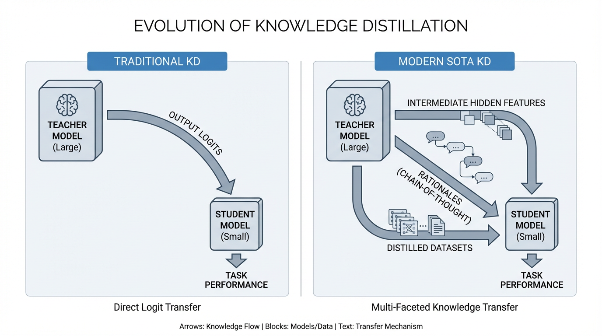

import KDVisualizer from '../../components/chapter-13/KDVisualizer.tsx';

# 13.4 Knowledge Distillation

If quantization is like shaving weight off a suitcase, **Knowledge Distillation (KD)** is like repacking the contents into a smaller bag. Instead of keeping the original model architecture and merely compressing its weights, KD trains a new, smaller **student** model to imitate a larger **teacher**.

That distinction matters in practice. Quantization and sparsification are constrained by the shape of the original network. Distillation is freer: the student can have different width, depth, and even a different architecture, as long as it learns the behavior we care about.

In the LLM era, KD has also become more ambitious. The goal is no longer just to copy output probabilities. Engineers increasingly try to transfer reasoning traces, hidden-state structure, and decoding behavior into smaller models that are cheap enough to serve widely.

---

## 1. The Evolution: From Logits to Rationales

Historically, KD relied on **Logit Matching**. Introduced by Geoffrey Hinton and colleagues in 2015 [[1]](#ref-1), the core idea was that the raw output logits of a teacher model contain "dark knowledge"—the relative probabilities of incorrect answers that reveal how the model generalizes.

By applying a high **Temperature ($T$)** to the Softmax function, the sharp probability distribution is smoothed out, forcing the student to learn these subtle relationships via Kullback-Leibler (KL) Divergence:

$$ \mathcal{L}_{KD} = T^2 \cdot \mathcal{D}_{KL}\left( \text{Softmax}\left(\frac{Z_{teacher}}{T}\right) \Big|\Big| \text{Softmax}\left(\frac{Z_{student}}{T}\right) \right) $$

While highly effective for classification, logit-only KD is often not enough for harder generative work. In LLMs, matching the final token distribution can teach the student *what* answer tends to appear, but not necessarily *how* the teacher arrived there. That is one reason small students sometimes mimic style well yet still lag on reasoning-heavy tasks.

### Richer Supervision in Modern KD

To reduce that gap, recent work adds supervision beyond final logits:

1. **Rationale-Based Distillation**: The teacher provides intermediate reasoning or step-by-step traces, not just the final answer [[2]](#ref-2).
2. **Feature-Based Alignment**: The student is nudged to match some internal hidden-state structure of the teacher, not just its output layer.

These methods do not magically guarantee “compressed reasoning,” but they often transfer more useful behavior than output matching alone.



---

## 2. Distribution Calibration for Generative Models: Forward KL vs Reverse KL

In knowledge distillation for autoregressive models that generate tokens sequentially, one of the most critical mathematical decisions is the direction of the Divergence function. Traditional knowledge distillation minimizes the **Forward KL Divergence** $\mathcal{D}_{KL}(P || Q)$ between the teacher distribution $P$ and the student distribution $Q$.

* **Forward KL (Mean-seeking)**: This is the classic choice. It encourages the student to cover the support of the teacher distribution. That can be helpful when broad coverage matters, but it can also spread probability mass too widely when the student is much smaller than the teacher.
* **Reverse KL (Mode-seeking)**: Work such as MiniLLM argues that for autoregressive generation, **Reverse KL Divergence** $\mathcal{D}_{KL}(Q || P)$ can be a better fit in some settings [[3]](#ref-3). It encourages the student to commit more strongly to modes the teacher itself prefers, which can improve fluency and reduce diffuse, low-confidence generations.

The key lesson is not that one direction is universally superior. It is that the divergence choice changes the student’s behavior, and generative KD often benefits from treating this as a design decision rather than a default.

---

## 3. On-Policy Distillation: Learning from Student's Mistakes

Fixed teacher trajectories and student-generated trajectories can differ in distribution. Teacher outputs can also contain errors, and one different student token does not necessarily cause failure. Evaluate errors in actual student states and design the training distribution to cover them.

One response is **On-Policy Distillation**. Instead of training only on teacher-generated trajectories, methods such as Generalized Knowledge Distillation (GKD) ask the teacher to score sequences that the student itself produced [[4]](#ref-4). That way, the teacher is not only showing the “ideal path.” It is also correcting the student in the situations the student is likely to create at inference time.

This matters operationally because deployed models do not fail on pristine examples. They fail after a slightly wrong turn, when the next token must be chosen from a bad local state.

---

## 4. Bridging Architectural Heterogeneity

A practical advantage of KD is that the student does not have to be a miniature copy of the teacher. You can distill from a larger Transformer into a smaller Transformer, and researchers are actively exploring how far these ideas can transfer across model families.

The catch is that hidden representations often live in different spaces. The teacher may have wider layers, different head counts, or different recurrence patterns. A common solution is to add **projection layers** so that student features can be mapped into the teacher’s latent space before alignment losses are applied.

This is where KD stops being a purely conceptual trick and becomes engineering. Which layers do you align? How often? With what loss weight? Those choices meaningfully affect stability and student quality.

### PyTorch Implementation: Feature-Based KD

The following code demonstrates how to engineer a custom KD loss that combines standard task loss, logit-matching (KL Divergence), and feature-based alignment using a learned projection layer.

> **Educational loss example.** Assumes aligned teacher/student outputs with identical tokenizers, vocabulary ordering and chat templates. Run the pinned teacher checkpoint in `eval()` and `inference_mode()`. Replace the synthetic mask with tokenizer-native assistant-span masks. Avoid duplicate BOS/EOS, match EOS inclusion, truncation and padding, and block cross-sample attention when packing. Full-model training, cross-tokenizer probability mapping and distributed normalization by global token count are omitted.

```python
import torch
import torch.nn as nn
import torch.nn.functional as F

class ModernKDLoss(nn.Module):
    def __init__(self, student_dim, teacher_dim, temp=2.0, alpha=0.5, beta=0.1):
        super().__init__()
        if temp <= 0 or not 0 <= alpha <= 1 or beta < 0:
            raise ValueError("invalid loss settings")
        self.temp, self.alpha, self.beta = temp, alpha, beta
        self.feature_projector = nn.Linear(student_dim, teacher_dim, bias=False)

    def forward(self, student_logits, teacher_logits, student_hidden,
                teacher_hidden, labels, assistant_mask):
        # Same tokenizer, vocabulary ordering and [B,S,V] positions required.
        if student_logits.shape != teacher_logits.shape or student_logits.ndim != 3:
            raise ValueError("teacher/student logit alignment mismatch")
        if labels.shape != student_logits.shape[:2] or assistant_mask.shape != labels.shape:
            raise ValueError("label/mask shape mismatch")
        if labels.shape[1] < 2:
            raise ValueError("at least one next-token target required")
        # Position t predicts token t+1; padding uses -100, prompts use mask=False.
        valid = assistant_mask[:, 1:].bool() & labels[:, 1:].ne(-100)
        if not valid.any():
            raise ValueError("no supervised assistant tokens")
        s = student_logits[:, :-1].float()[valid]
        t = teacher_logits[:, :-1].detach().float()[valid]
        targets = labels[:, 1:][valid]
        ce = F.cross_entropy(s, targets)
        log_s = F.log_softmax(s / self.temp, dim=-1)
        log_t = F.log_softmax(t / self.temp, dim=-1)
        kd = F.kl_div(log_s, log_t, log_target=True, reduction="none").sum(-1).mean()
        # Align the predictive hidden states at the same selected positions.
        projected = self.feature_projector(student_hidden[:, :-1][valid])
        target_hidden = teacher_hidden[:, :-1].detach()[valid].float()
        feature = F.mse_loss(projected.float(), target_hidden)
        return (1-self.alpha)*ce + self.alpha*self.temp**2*kd + self.beta*feature

# Small CPU smoke example. Teacher outputs are frozen and already aligned.
torch.manual_seed(0)
B, S, V, Ds, Dt = 2, 6, 32, 8, 12
s_logits = torch.randn(B, S, V, requires_grad=True)
t_logits = torch.randn(B, S, V)
s_hidden = torch.randn(B, S, Ds, requires_grad=True)
t_hidden = torch.randn(B, S, Dt)
labels = torch.randint(V, (B, S))
labels[1, -2:] = -100
assistant_mask = torch.zeros(B, S, dtype=torch.bool)
assistant_mask[:, 3:] = True  # template-derived in a real pipeline
criterion = ModernKDLoss(Ds, Dt)
loss = criterion(s_logits, t_logits, s_hidden, t_hidden, labels, assistant_mask)
loss.backward()
print("KD loss:", loss.item())
```

---

## 5. A Practical Distillation Playbook

If you are designing a distillation pipeline for a real product, the main questions are usually not philosophical. They are operational:

1. **What behavior matters most?** Accuracy, latency, format adherence, tool use, or safety all imply different teacher signals.
2. **Is the teacher the right teacher?** For specialized tasks, domain fit can matter more than raw parameter count.
3. **What failure modes do you evaluate?** A student that looks good on clean benchmarks may still drift in length, calibration, or refusal behavior.
4. **Where is the budget spent?** Teacher inference for rationale generation or on-policy scoring can dominate the total cost of the distillation pipeline.

This is why production distillation is rarely “train a small model on teacher outputs and stop.” It usually includes dataset curation, teacher quality checks, student-trajectory evaluation, and post-training release gates.

---

## 6. The geometric constraint of feature alignment

Matching outputs does not require a particular hidden coordinate system. The illustration shows the additional constraint imposed by feature alignment; it does not experimentally compare two training methods.

<KDVisualizer client:load />

---

## 7. Summary and Next Steps

Knowledge Distillation has grown from a simple logit-matching trick into a broader toolkit for transferring behavior from large models into smaller ones. The most effective pipelines now think carefully about teacher choice, divergence objectives, student-generated trajectories, and hidden-state alignment rather than treating KD as a single recipe.

Combined with quantization and sparsification, distillation is one of the most practical ways to make capable models deployable on tighter hardware and latency budgets. But smaller models still carry less knowledge internally. In **Chapter 14: RAG (Retrieval Augmented Generation)**, we will see how retrieval can compensate for that limitation at inference time.

---

## SteerDistill: learn from locally corrected behavior

**As of 2026-11-15 — emerging research.** SteerDistill restores an agent environment near a behavioral divergence and uses teacher guidance to elicit the quantized student's own correction. Locally verified revisions are distilled without the steering prompt: forward KL at corrected turns, reverse KL to the full-precision teacher elsewhere. The study covers three models and five agent benchmarks. Successful teacher references, restorable state and reliable local verification are required; a locally valid correction does not guarantee task success. [[5]](#ref-5)

Track verifier errors and final task outcomes separately. Preserve teacher/student versions, masks and environment snapshots, and quarantine evaluation tasks and their variants.

## Distillation run contract

Record provenance, permissions, filters, deduplication, evaluation quarantine and teacher/student/tokenizer/template hashes in the input manifest. Supervise valid next-token assistant positions; pin teacher checkpoint, decoding and response-length policy, projection parameters and loss weights together. The example is CPU FP32 tensor arithmetic. A real budget adds both models' weights, student gradients/optimizer/activations, teacher inference buffers, stored logits, collectives and evaluation.

Observe token-normalized CE/KL and domain-slice validation, nonfinite/overflow counts and norms, throughput/MFU, data wait/collectives and reconstructable batch IDs. Abort on nonfinite values, mask mismatches or critical-slice regression. Checkpoints include student/projection, optimizer/scheduler/precision state, step/tokens, RNG, sampler, exact data cursor and hashes. Promote only after isolated domain, base-capability retention, safety, format/tool, latency, cost and error-rate gates with paired uncertainty, plus rehearsal of restoring the last known-good bundle.

## Quizzes

<details>
<summary>Quiz 1: In traditional Knowledge Distillation, what is the mathematical purpose of the Temperature ($T$) parameter applied to the Softmax function?</summary>
*The Temperature parameter smooths out the probability distribution of the logits. A standard Softmax often produces a distribution heavily skewed towards a single class (e.g., [0.99, 0.005, 0.005]). By dividing logits by $T > 1$, the distribution flattens, amplifying the "dark knowledge" (the relative probabilities of incorrect answers) so the student can learn the teacher's generalization patterns.*
</details>

<details>
<summary>Quiz 2: Why can Reverse KL be appealing for autoregressive distillation compared with always using Forward KL?</summary>
*Forward KL encourages broad coverage of the teacher distribution, which can be useful but may spread probability mass too widely for a smaller student. Reverse KL is more mode-seeking, so it can encourage the student to commit more strongly to the teacher’s preferred continuations. That can improve fluency in some generative settings, though it is not automatically the right choice for every task.*
</details>

<details>
<summary>Quiz 3: What problem is On-Policy Distillation trying to solve?</summary>
*It addresses the mismatch between clean teacher trajectories seen during training and the imperfect trajectories the student generates at inference time. By letting the teacher score sequences produced by the student itself, on-policy methods teach the student how to recover after its own mistakes instead of only showing ideal examples.*
</details>

<details>
<summary>Quiz 4: Why are projection layers often introduced when distilling across different architectures?</summary>
*Because teacher and student hidden states may live in spaces with different dimensions or geometry. A projection layer maps the student representation into a compatible space so that alignment losses such as MSE can be applied in a meaningful way.*
</details>

<details>
<summary>Quiz 5: In a real distillation pipeline, why can teacher choice matter more than raw teacher size?</summary>
*Because the student only learns from the signal the teacher provides. A domain-aligned teacher often produces cleaner outputs, more relevant rationales, and more useful hidden-state structure for the target task than a much larger but more general model. Bigger is not automatically better if the teacher’s behavior is mismatched to the deployment goal.*
</details>

---

## References

1. <a id="ref-1"></a>Hinton, G., Vinyals, O., & Dean, J. (2015). *Distilling the Knowledge in a Neural Network.* [arXiv:1503.02531](https://arxiv.org/abs/1503.02531).
2. <a id="ref-2"></a>Hsieh, C. Y., et al. (2023). *Distilling Step-by-Step! Outperforming Larger Language Models with Less Training Data and Smaller Model Sizes.* [arXiv:2305.02301](https://arxiv.org/abs/2305.02301).
3. <a id="ref-3"></a>Gu, Y., Dong, L., Wei, F., & Huang, M. (2024). *MiniLLM: On-Policy Distillation of Large Language Models.* [arXiv:2306.08543](https://arxiv.org/abs/2306.08543).
4. <a id="ref-4"></a>Agarwal, R., et al. (2024). *On-Policy Distillation of Language Models: Learning from Self-Generated Mistakes.* [arXiv:2306.13649](https://arxiv.org/abs/2306.13649).
5. <a id="ref-5"></a>Research preprint (2026). [SteerDistill: Quantizing LLM Agents via Closed-Loop Teacher Steering](https://arxiv.org/html/2611.13410v1). Version pinned; accessed 2026-11-15.
