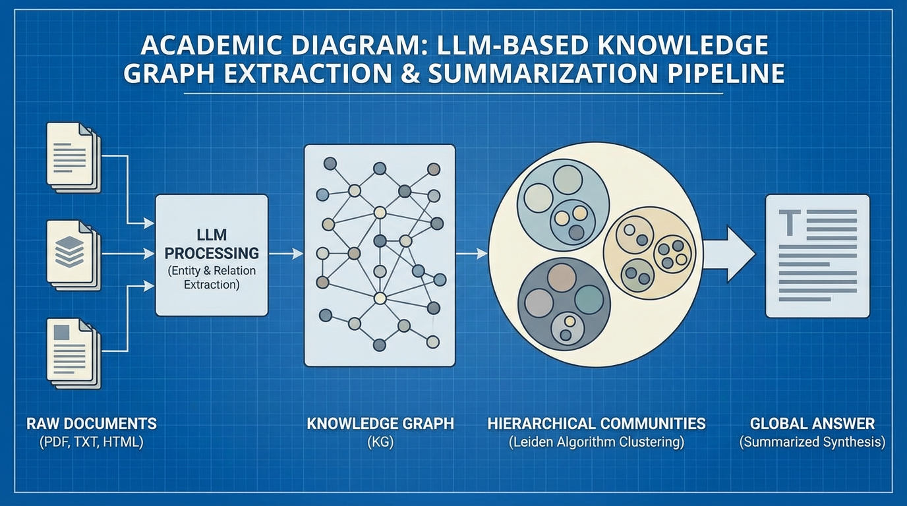

import GraphVisualizer from '../../components/chapter-14/GraphVisualizer.tsx';

# 14.5 GraphRAG & Ontology

Consider an enterprise assistant asked: *"Who is the CEO of the company that acquired the startup whose model we licensed?"* A vector retriever may return chunks about the startup, the acquisition, and several CEOs, yet still miss the answer. It is strong at semantic similarity, but weak at relational traversal.

This distinction is important because many real-world questions are not simply "find a similar paragraph" problems. They are entity-and-edge problems: ownership lineage, incident timelines, dependency provenance, contract relationships, or corpus-level theme discovery. To solve those, the system must move from semantic text matching to relational reasoning. This is the domain of **Knowledge Graphs (KGs)** and **GraphRAG**.

---

## 1. When GraphRAG Is Operationally Justified

GraphRAG is operationally heavier than plain vector RAG, so it should justify its additional cost and complexity. It is most useful when the workload is dominated by:

- **multi-hop questions** that require following relationships across documents
- **global summarization** over a corpus, not just local passage lookup
- **provenance-sensitive workflows** where you must show how an answer was assembled

If most user traffic still looks like "find the paragraph that says X," vector RAG is usually cheaper and simpler. GraphRAG becomes attractive when edges and communities, not just chunks, determine answer quality.

---

## 2. Ontology and extraction schemas

An ontology defines entity types, relations and semantic constraints. RDF/OWL and property graphs are different representation choices; using an LLM does not eliminate schema design or governance.

An LLM can propose relations from text. Attach source document/span, extractor version, validity interval and access controls to each candidate. A schema-valid edge can still be false. Resolve entities using identifiers, time, types and source evidence, not names or embedding similarity alone; retain a reversible merge record.


## 3. Practical Implementation: Extracting Entities and Relationships

To build a Knowledge Graph from unstructured text, we prompt an LLM to identify entities and their relationships, returning them in a structured format (like JSON).

The following offline Python example checks the structure of an authored extraction.

> **Educational offline example.** Validates an authored extraction structure only. It omits extraction, factual verification, authorization, validity checks and persistence.

```python
# Authored extraction output: this example does not call an LLM.
def validate_graph(graph):
    nodes = graph["entities"]
    ids = [node["id"] for node in nodes]
    if len(ids) != len(set(ids)):
        raise ValueError("duplicate entity IDs")
    allowed_relations = {"ACQUIRED_BY", "HAS_CEO"}
    for edge in graph["relationships"]:
        if edge["source"] not in ids or edge["target"] not in ids:
            raise ValueError("edge references an unknown entity")
        if edge["type"] not in allowed_relations or not edge["source_span"]:
            raise ValueError("unsupported relation or missing evidence")
    return graph  # Structural validation, not verification of factual truth.

graph = validate_graph({
    "entities": [{"id": "Orion"}, {"id": "Northstar"}, {"id": "Mina"}],
    "relationships": [
        {"source": "Orion", "target": "Northstar", "type": "ACQUIRED_BY",
         "source_span": "Fictional memo A: Northstar acquired Orion."},
        {"source": "Northstar", "target": "Mina", "type": "HAS_CEO",
         "source_span": "Fictional memo B: Mina is Northstar's CEO."},
    ],
})
print(len(graph["relationships"]))  # 2
```

---


## 4. Multi-hop traversal

Suppose fictional documents say Orion was acquired by Northstar and Mina is Northstar's CEO. Following `Orion → Northstar → Mina` provides candidate evidence for an answer. Validity dates and source passages still need checking, and the generator can still answer incorrectly.

The interaction contrasts retrieval paths. Vector retrieval can also find the right documents; a graph can fail because of missing or incorrect edges.

<GraphVisualizer client:load lang="en" />

### Engineering Graph Retrieval: Random Walk with Restart (RWR)

In production, we do not manually write Cypher queries for every possible multi-hop path. Instead, graph databases use mathematical algorithms to score the relevance of surrounding nodes. A standard approach is **Random Walk with Restart (RWR)**, a variant of PageRank.

Given a starting distribution $\mathbf{p}_0$ (the initial nodes found via vector search), the algorithm simulates a random walker traversing the graph's edges. To prevent the walker from drifting too far into irrelevant territory, it has a probability $c$ of "teleporting" back to the start.

$$ \mathbf{p}_{t+1}=(1-c)(\mathbf W\mathbf p_t+\mathbf p_0\mathbf d^T\mathbf p_t)+c\mathbf p_0. $$

Here $\mathbf W$ normalizes non-dangling adjacency columns and leaves dangling columns zero. Entry $d_j$ is 1 for a dangling node and 0 otherwise. The mass $\mathbf d^T\mathbf p_t$ is redistributed to the initial distribution $\mathbf p_0$. The code below implements this completed transition.

> **Educational dense CPU example.** Dangling mass returns to the initial distribution. Storage and each step cost $O(V^2)$ for $V$ nodes. Real graphs need sparse operators, device handling, permissions, convergence checks and provenance. Scores measure proximity, not truth.

```python
import torch

class GraphRetriever:
    """
    A PyTorch implementation of Graph Retrieval using Random Walk with Restart (RWR).
    This expands an initial vector search result into a highly relevant subgraph.
    """
    def __init__(self, num_nodes: int, edges: torch.Tensor, restart_prob: float = 0.15):
        """
        Args:
            num_nodes: Total number of entities in the knowledge graph.
            edges: Tensor of shape (2, num_edges). edges[0] is source, edges[1] is target.
            restart_prob: Probability (c) of teleporting back to the initial search nodes.
        """
        if num_nodes < 1 or not 0 < restart_prob <= 1:
            raise ValueError("Require nodes > 0 and restart probability in (0, 1]")
        self.num_nodes = num_nodes
        self.restart_prob = restart_prob

        # Initialize adjacency matrix
        self.adj_matrix = torch.zeros(num_nodes, num_nodes)

        # For a column-stochastic matrix where p_{t+1} = W * p_t,
        # columns represent source nodes, rows represent target nodes.
        self.adj_matrix[edges[1], edges[0]] = 1.0

        # Normalize adjacency matrix (column-stochastic)
        out_degree = self.adj_matrix.sum(dim=0, keepdim=True)
        self.dangling = (out_degree.squeeze(0) == 0)
        out_degree = out_degree.clamp_min(1.0)
        self.trans_matrix = self.adj_matrix / out_degree

    def retrieve_subgraph(self, initial_nodes: torch.Tensor, num_steps: int = 15) -> torch.Tensor:
        """
        Args:
            initial_nodes: Tensor (num_nodes, 1) representing the starting distribution
                           (e.g., nodes found via initial vector embedding search).
        Returns:
            Relevance scores for all nodes in the graph.
        """
        # Normalize initial distribution
        if initial_nodes.shape != (self.num_nodes, 1):
            raise ValueError("Expected initial_nodes shape [num_nodes, 1]")
        if not torch.isfinite(initial_nodes).all() or (initial_nodes < 0).any() or initial_nodes.sum() <= 0:
            raise ValueError("Initial distribution must have finite nonnegative positive mass")
        p_0 = initial_nodes / initial_nodes.sum()
        p_t = p_0.clone()

        # Power iteration to compute the stationary distribution
        for _ in range(num_steps):
            dangling_mass = p_t[self.dangling].sum()
            walk = self.trans_matrix @ p_t + dangling_mass * p_0
            p_t = (1 - self.restart_prob) * walk + self.restart_prob * p_0

        return p_t

# --- Example Execution ---
if __name__ == "__main__":
    # Simulate a small ontology graph with 5 nodes
    # e.g., 0: User Query, 1: Orion, 2: Northstar, 3: Mina, 4: OpenAI
    edges = torch.tensor([
        [1, 2, 2], # Source nodes
        [2, 3, 4]  # Target nodes
    ])

    retriever = GraphRetriever(num_nodes=5, edges=edges, restart_prob=0.2)

    # Simulate a vector search that highly ranks Node 1 (Orion)
    initial_dist = torch.zeros(5, 1)
    initial_dist[1, 0] = 1.0

    # Retrieve the multi-hop subgraph context
    relevance_scores = retriever.retrieve_subgraph(initial_dist, num_steps=20)

    # Select the top-k nodes to inject into the LLM context window
    top_k = torch.topk(relevance_scores.squeeze(), k=3)
    print(f"Top retrieved node indices: {top_k.indices.tolist()}")
    print(f"Node relevance scores: {top_k.values.tolist()}")
```

Recent graph-enhanced retrievers also push this idea further. HippoRAG, for example, combines knowledge graphs with Personalized PageRank-style retrieval to improve multi-hop recall while staying cheaper than iterative retrieval loops [[3]](#ref-3). The broader lesson is practical: once you have an entity graph, graph search becomes another retriever in your stack, not a completely separate world.

---

## 5. Microsoft's GraphRAG: Global Sensemaking

While traversing edges solves multi-hop questions (Local Search), it does not solve the hardest problem in RAG: **Global Sensemaking**.

A few top-k passages may not represent a corpus-wide theme question. This is a limitation of a simple retrieval setup, not proof that every vector-based method must fail.

In 2024, Microsoft Research introduced a novel architecture specifically named **GraphRAG** [[1]](#ref-1) designed to solve this global summarization problem. Rather than just using the graph for traversal at query time, Microsoft's approach uses the graph to precompute hierarchical summaries of the entire dataset.



### The Four Stages of Microsoft GraphRAG

1.  **Extraction:** An LLM processes all source documents, extracting entities and relationships to form a massive, unstructured knowledge graph $G = (V, E)$.
2.  **Community Detection:** The system applies the **Leiden algorithm** [[2]](#ref-2) to partition the graph into hierarchical, well-connected clusters (communities). Entities that interact frequently (e.g., all characters and locations in a specific subplot of a book) are grouped into a community $C_i$.
3.  **Pregenerated Summarization:** Before the user ever asks a question, the LLM generates a comprehensive summary $S_i$ for every single community in the graph.
4.  **Map-Reduce Querying:** When the global query arrives, the system does not search the raw text. Instead, it prompts the LLM to generate a partial answer using each community summary independently (Map). Finally, it rolls up all partial answers into a single, cohesive global response (Reduce).

Hierarchical summaries are one way to broaden coverage. Evaluate extraction errors, omitted minority themes, summary loss and propagation of changed permissions.

---

## 6. Summary and Next Steps

GraphRAG elevates retrieval from simple text matching to relational reasoning. By structuring knowledge into ontologies and hierarchical communities, systems can dynamically traverse edges to answer multi-hop queries and perform global sensemaking over massive datasets. The practical question is not whether graphs are appealing in principle, but whether the workload truly depends on relationships, provenance, and corpus-level structure.

However, even a well-designed graph pipeline can still fail operationally. Edges can be stale, entity resolution can be wrong, re-ranking can time out, and the generator can still ignore evidence. In **14.6 RAG Failure Modes and Operational Design**, we will look at how these systems break in practice and how to design for graceful degradation.

---

## Quizzes

<details>
<summary>Quiz 1: Why can a few top-k passages be insufficient for global summarization?</summary>
*Highly relevant passages may not represent the distribution of themes. Community summaries can broaden coverage but require separate omission and distortion checks.*
</details>

<details>
<summary>Quiz 2: Does LLM extraction replace schema design and validation?</summary>
*No. Types, entity identity, relation semantics, provenance, validity and permissions still need governance. Structurally valid output can be factually wrong.*
</details>

<details>
<summary>Quiz 3: What is the specific mathematical purpose of the Leiden algorithm in Microsoft's GraphRAG architecture?</summary>
*The Leiden algorithm is used for graph community detection. It partitions the massive, unstructured entity knowledge graph into hierarchical, well-connected clusters (communities). This allows the system to generate modular summaries for closely related entities prior to query time.*
</details>

<details>
<summary>Quiz 4: In the provided PyTorch Random Walk with Restart (RWR) implementation, what is the role of the `restart_prob` parameter?</summary>
*The `restart_prob` (restart probability) prevents the random walk from drifting infinitely far away from the initial search results. It forces the traversal to periodically "teleport" back to the starting nodes (found via vector search), ensuring the retrieved subgraph remains heavily biased toward the user's original query context.*
</details>

<details>
<summary>Quiz 5: Why is embedding similarity insufficient for entity merging?</summary>
*Similar names or descriptions can refer to different entities. Check identifiers, types, time and source passages, and preserve merge lineage. Define duplicate-edge and weight semantics before renormalizing transition probabilities.*
</details>

---

## References

1. <a id="ref-1"></a>Edge, D., et al. (2024). *From Local to Global: A Graph RAG Approach to Query-Focused Summarization.* [arXiv:2404.16130](https://arxiv.org/abs/2404.16130).
2. <a id="ref-2"></a>Traag, V. A., Waltman, L., & van Eck, N. J. (2019). *From Louvain to Leiden: guaranteeing well-connected communities.* [Scientific Reports](https://www.nature.com/articles/s41598-019-41695-z).
3. <a id="ref-3"></a>Gutiérrez, B. J., Shu, Y., Gu, Y., Yasunaga, M., & Su, Y. (2025). *HippoRAG: Neurobiologically Inspired Long-Term Memory for Large Language Models.* [arXiv:2405.14831](https://arxiv.org/abs/2405.14831).
