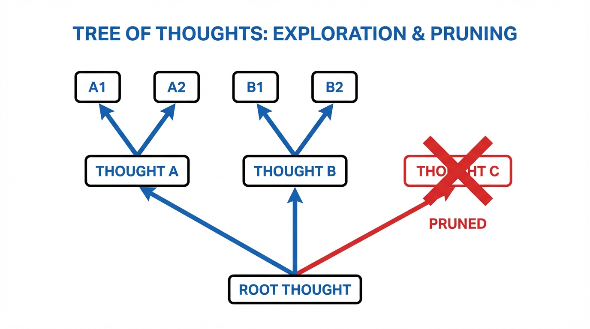

import ReasoningVisualizer from '../../components/chapter-15/ReasoningVisualizer.tsx';

# 15.2 Tree/Graph of Thoughts

An autoregressive Transformer conditions on the available prefix, not merely the previous state. A basic single-path decoder does not rewrite emitted tokens, but later text can correct earlier reasoning. ToT and GoT manage alternatives and evaluations as external search state, enabling explicit comparison and backtracking. The extra computation helps only if candidate evaluation is sufficiently reliable.

---

## 1. The Tree of Thoughts (ToT) Framework

Introduced by Yao et al. (2023) [[1]](#ref-1), **Tree of Thoughts (ToT)** reframes LLM inference as a heuristic search problem over a combinatorial space of reasoning steps.

Instead of generating a single continuous sequence, ToT decomposes the problem into discrete "thoughts" (intermediate reasoning steps). The model explores multiple branches of thoughts, evaluating them to decide which paths to pursue and which to prune.

### Mathematical Formulation

In standard CoT, we sample a sequence of thoughts $z_1, z_2, \dots, z_n$ to reach output $y$ given input $x$. The probability is simply:
$$ P(y, z_{1:n} | x) = \prod_{i=1}^{n} P(z_i | x, z_{1:i-1}) P(y | x, z_{1:n}) $$

In ToT, we define a state $s = [x, z_{1\dots i}]$ representing a partial reasoning path. The framework requires two critical components:

1.  **Thought Generator $G(p_{\theta}, s, k)$:** Generates $k$ candidate next thoughts given the current state. This can be done via sampling (temperature $> 0$) or proposing distinct steps via a specific prompt.
2.  **State Evaluator $V(p_{\theta}, s)$:** A heuristic function that scores the viability of a state. The LLM itself is typically prompted to act as the evaluator, assigning a scalar value or a categorical label (e.g., `sure`, `maybe`, `impossible`).

With $G$ and $V$ defined, ToT applies classic search algorithms like **Breadth-First Search (BFS)** or **Depth-First Search (DFS)**.

If using BFS with a beam width $b$, at each depth $d$, the algorithm keeps only the top $b$ states as ranked by $V(s)$. This prevents the exponential explosion of context while allowing the model to recover from localized errors by maintaining alternative branches.



---

## 2. Graph of Thoughts (GoT): Synergy and Recurrence

While ToT enables backtracking, it suffers from a structural flaw: **Trees cannot merge**. If two separate branches generate valuable, complementary partial solutions, ToT forces the system to choose one and discard the other.

**Graph of Thoughts (GoT)**, proposed by Besta et al. (2023) [[2]](#ref-2), elevates the reasoning structure to a **directed graph, potentially including feedback cycles**. In GoT, vertices represent thoughts, and edges represent dependencies. This seemingly simple structural upgrade unlocks powerful cognitive operations that trees cannot support.

### Core transformations

- **Generation:** Proposes candidates from the task and dependency history.
- **Aggregation:** Combines information from several candidates into a new one. Revalidate contradictions and lost evidence; an aggregate is not necessarily better.
- **Refinement:** Revises a candidate using feedback. An execution log can unroll revisions into a DAG even when the general GoT control flow includes cycles.

### Measure cost and quality together

The GoT paper reports gains for particular tasks and configurations. [[2]](#ref-2) Aggregation can reduce redundant work but adds evaluation/synthesis cost and can combine errors. Bounded-width ToT does not necessarily expand exponentially: generating $k$ candidates per retained state with beam width $b$ and depth $d$ evaluates roughly $O(dbk)$ candidates. Token and tool costs per candidate are additional factors.

<ReasoningVisualizer client:load lang="en" />

### When Tree or Graph Search Is Worth the Cost

ToT and GoT are not default decoding strategies for every prompt. They become attractive when all three of the following are true:

- the task has meaningful alternative solution paths
- partial progress can be evaluated or scored
- the cost of exploring extra branches is lower than the cost of committing early to a bad path

This is why they are a better fit for planning, constrained search, code repair, or synthesis tasks than for ordinary conversational turns. Search helps only when the problem actually has structure that can be searched.

---

## 3. Engineering the Orchestrator

Implementing GoT requires separating the system into a **Controller** (which manages the graph structure and search strategy) and an **Executor** (the LLM that generates and scores thoughts).

Below is a Python implementation demonstrating the core logic of a GoT Controller handling Generation and Aggregation.

> **Educational controller skeleton.** The LLM interface is a mock contract. Parsing, time/token budgets, recovery and final validation are omitted.

```python
from typing import List, Dict, Any

class GoTNode:
    def __init__(self, thought: str, parents: List['GoTNode'] = None):
        self.thought = thought
        self.parents = parents or []
        self.score = 0.0
        self.children = []

class GoTController:
    def __init__(self, llm_executor):
        self.llm = llm_executor # Mock LLM interface
        self.graph: List[GoTNode] = []

    def state_text(self, node):
        ordered, seen = [], set()
        def visit(current):
            if id(current) in seen:
                return
            seen.add(id(current))
            for parent in current.parents:
                visit(parent)
            ordered.append(current.thought)
        visit(node)
        return "\n".join(ordered)  # Root task plus dependency history.

    def generate_thoughts(self, node: GoTNode, k: int) -> List[GoTNode]:
        """Branches a node into k new thoughts."""
        prompt = f"Given the current state: {self.state_text(node)}\nGenerate {k} distinct next steps."
        responses = self.llm.generate(prompt, num_return_sequences=k)

        new_nodes = [GoTNode(thought=r, parents=[node]) for r in responses]
        node.children.extend(new_nodes)
        self.graph.extend(new_nodes)
        return new_nodes

    def score_nodes(self, nodes: List[GoTNode]):
        """Evaluates nodes using the LLM as a heuristic function."""
        for node in nodes:
            prompt = f"Evaluate the validity of this reasoning step: {self.state_text(node)}. Score from 0.0 to 1.0."
            score_str = self.llm.generate(prompt, max_tokens=5)[0]
            node.score = float(score_str)
            if not 0.0 <= node.score <= 1.0:
                raise ValueError("evaluator must return a finite score in [0,1]")

    def aggregate_thoughts(self, nodes: List[GoTNode]) -> GoTNode:
        """Proposes an aggregate; improvement requires separate validation."""
        combined_text = "\n".join([f"- {self.state_text(n)}" for n in nodes])
        prompt = f"Synthesize the following partial solutions into one optimal solution:\n{combined_text}"

        synergy_thought = self.llm.generate(prompt, max_tokens=256)[0]
        synergy_node = GoTNode(thought=synergy_thought, parents=nodes)

        for n in nodes:
            n.children.append(synergy_node)

        self.graph.append(synergy_node)
        return synergy_node

    def execute_search(self, initial_prompt: str):
        # 1. Initialize Root
        root = GoTNode(thought=initial_prompt)
        self.graph.append(root)

        # 2. Generate and Score (Branching)
        candidates = self.generate_thoughts(root, k=3)
        self.score_nodes(candidates)

        # 3. Select top 2 for Aggregation (Synergy)
        candidates.sort(key=lambda x: x.score, reverse=True)
        top_candidates = candidates[:2]

        # 4. Merge into final state
        final_node = self.aggregate_thoughts(top_candidates)
        return final_node.thought
```

### The KV Cache Challenge

At the systems level, ToT and GoT introduce severe memory fragmentation. Every branch shares a common prefix (the root prompt and early thoughts), but diverges later.

Compatible engines and requests can share KV blocks for an exact token prefix. Total memory still includes one shared prefix, divergent blocks and metadata. Model, cache format, permissions and token-prefix compatibility govern reuse; a newly aggregated prompt may not share the earlier prefix.

---

## 4. Adaptive decomposition

The 2025 AGoT study proposes dynamic DAG decomposition that selectively expands subproblems needing further analysis. [[3]](#ref-3) This does not make all GoT graphs DAGs. Its system-specific results should not be read as a model-independent or equal-cost comparison.

For deployment, bound total tokens, tool calls, time and nodes, and compare single paths, independent sampling and tree search. Evaluator bias and correlated errors can make more branches confidently wrong. Preserve provenance, state hashes, scores and stopping reasons.


## 5. Summary and Open Questions

The transition from Chains to Trees to Graphs represents a shift from treating LLMs as mere sequence predictors to utilizing them as engines within classical search architectures.

While GoT provides the structural capacity for human-like reasoning (synthesis and backtracking), it offloads the "thinking" policy entirely to external Python orchestrators. The next logical question—which we will explore in the next section on **Search-time Compute and o1**—is: *Can we train the model to internalize this graph search, learning to branch, prune, and merge natively within its own hidden states?*

---

## Quizzes

<details>
<summary>Quiz 1: When can GoT aggregation reduce cost?</summary>
*When avoided duplicate work exceeds evaluation and synthesis costs. Aggregation does not guarantee correctness, and bounded-width ToT does not necessarily expand exponentially.*
</details>

<details>
<summary>Quiz 2: Is beam width enough to determine KV memory?</summary>
*No. Prefix length, tokens per branch, cache format and sharing eligibility matter. Prefix sharing can reduce duplication; divergent branches and newly aggregated prompts still incur costs.*
</details>

<details>
<summary>Quiz 3: How does the State Evaluator function $V(s)$ in ToT differ fundamentally from a standard Reward Model used in RLHF?</summary>
*A Reward Model in RLHF typically evaluates the final, complete output sequence to align with human preference. The State Evaluator $V(s)$ in ToT evaluates partial, intermediate logical steps to serve as a heuristic for a search algorithm, determining if a current path is likely to lead to a correct final answer.*
</details>

<details>
<summary>Quiz 4: What is the primary risk of the "Aggregation" transformation in GoT if the LLM's synthesis capabilities are poorly calibrated?</summary>
*Hallucination compounding. If the model merges two partially correct but logically contradictory thoughts, it may synthesize a corrupted state. Because this aggregated node serves as the foundation for future generation, the error propagates and pollutes the entire downstream graph.*
</details>

<details>
<summary>Quiz 5: Why are autoregressive generation and graph cycles compatible?</summary>
*A model can condition on text describing earlier states, and a controller can revisit execution states and request new outputs. Cyclic control flow and a time-ordered token transcript are different representations.*
</details>

---

## References

1. <a id="ref-1"></a>Yao, S., et al. (2023). *Tree of Thoughts: Deliberate Problem Solving with Large Language Models.* [arXiv:2305.10601](https://arxiv.org/abs/2305.10601).
2. <a id="ref-2"></a>Besta, M., et al. (2023). *Graph of Thoughts: Solving Elaborate Problems with Large Language Models.* [arXiv:2308.09687](https://arxiv.org/abs/2308.09687).
3. <a id="ref-3"></a>Pandey, T., Ghukasyan, A., Goktas, O., & Radha, S. K. (2025). *Adaptive Graph of Thoughts: Test-Time Adaptive Reasoning Unifying Chain, Tree, and Graph Structures.* [arXiv:2502.05078](https://arxiv.org/abs/2502.05078).
