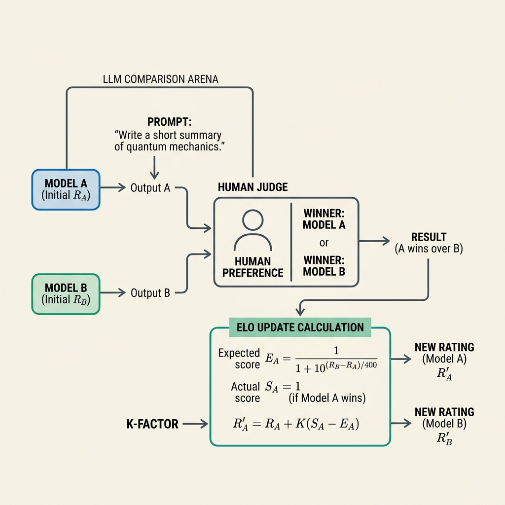

# 17.3 Elo Rating & Leaderboards

Human preference evaluation complements answer-based benchmarks. It asks which of two responses a judge prefers; preference is distinct from factuality, safety and task success. This section explains how Elo and Bradley–Terry summarize pairwise comparisons.

The 2023 Chatbot Arena study used crowdsourced votes on anonymous responses. Blinding reduces name-based bias; it does not remove style effects, sampling bias, repeated votes or evaluation contamination [[2]](#ref-2).

## The Mechanism: Crowdsourced Duels

The process of building an LLM leaderboard using Elo ratings involves:
1.  **Blind Duels**: A user enters a prompt. Two anonymous models (e.g., Model A and Model B) generate responses.
2.  **Human Judgment**: The user votes for the better response (or declares a tie).
3.  **Rating Update**: The system updates the Elo ratings of both models based on the outcome and their pre-existing ratings.


*Source: AI-generated illustration*

## The Mathematics of Elo

Originally designed for chess, the Elo rating system calculates the relative skill levels of players. In the context of LLMs, the "players" are the models.

### 1. Expected Score

Given two models with ratings $R_A$ and $R_B$, the expected score for Model A is calculated using a logistic curve:

$$E_A = \frac{1}{1 + 10^{(R_B - R_A)/400}}$$

Similarly, for Model B:
$$E_B = \frac{1}{1 + 10^{(R_A - R_B)/400}}$$

With half credit for a tie, $E_A=P(A\text{ wins})+0.5P(\text{tie})$ and $E_A+E_B=1$. A 400-point advantage gives an expected score of about 0.91, which is a win probability only when ties are absent. The scale 400 and rating origin are conventions; scores from different leaderboards are not directly comparable.

### 2. Rating Update

After a duel, the ratings are updated based on the actual score $S_A$ and the expected score $E_A$:

$$R'_A = R_A + K(S_A - E_A)$$

Where:
-   $R'_A$ is the new rating.
-   $K$ is a constant (K-factor) that determines how much a single game affects the rating (e.g., $K=32$).
-   $S_A$ is the actual score: $1$ for a win, $0.5$ for a tie, and $0$ for a loss.

If a highly-rated model loses to a low-rated model, the rating change is large because $(S_A - E_A)$ is large.

### Beyond Elo: The Bradley-Terry Model

Elo depends on match order. Bradley–Terry estimates latent score differences from a set of comparisons. Its basic form models binary wins: declare whether ties receive half credit or use an explicit tie model. Relative scores across disconnected comparison groups are not identified by the data, and complete separation can prevent a finite MLE. Record the reference-score constraint and regularization policy.

### Reading a leaderboard

Report uncertainty in the **score difference**, using a bootstrap or model that accounts for repeated users and prompts. Overlap of two marginal confidence intervals alone does not establish equivalence. Check prompt mix, style preference, model identity leakage, repeated voters and version changes. Public preference is a candidate-selection signal; private workflow, latency/cost and safety evaluations still gate deployment.

## Implementing Batch Elo Updates in PyTorch

For developers running internal model evaluations (e.g., comparing multiple fine-tuned versions), implementing a batch Elo update system in PyTorch can be highly efficient. Here is how to compute expected scores and updates for a batch of duels.

> **Educational example.** Each row updates an independent pair of ratings. This is not a shared rating registry or sequential Elo when a model appears in several rows. A real evaluator must manage model IDs, duplicate votes, update order, tie policy and uncertainty.

```python
import torch

def compute_batch_elo_update(ratings_a, ratings_b, outcomes, k_factor=32.0):
    """
    Compute Elo rating updates for a batch of duels.

    Args:
        ratings_a: Tensor of current ratings for Model A. Shape (batch_size,)
        ratings_b: Tensor of current ratings for Model B. Shape (batch_size,)
        outcomes: Tensor of outcomes for Model A (1.0 for win, 0.5 for tie, 0.0 for loss).
                  Shape (batch_size,)
        k_factor: The K-factor hyperparameter.

    Returns:
        new_ratings_a: Updated ratings for Model A.
        new_ratings_b: Updated ratings for Model B.
    """
    # Compute expected scores
    # We use torch.pow(10, ...) or exp with log(10)
    exponent = (ratings_b - ratings_a) / 400.0
    expected_a = 1.0 / (1.0 + torch.pow(10.0, exponent))
    expected_b = 1.0 - expected_a

    # Compute updates
    # outcomes are scores for A. For B, score is (1.0 - outcomes)
    update_a = k_factor * (outcomes - expected_a)
    update_b = k_factor * ((1.0 - outcomes) - expected_b)

    new_ratings_a = ratings_a + update_a
    new_ratings_b = ratings_b + update_b

    return new_ratings_a, new_ratings_b

# Example Usage
batch_size = 4
# Initial ratings
r_a = torch.tensor([1500.0, 1600.0, 1400.0, 1500.0])
r_b = torch.tensor([1400.0, 1700.0, 1400.0, 1500.0])

# Outcomes for A: Win, Loss, Tie, Win
outcomes = torch.tensor([1.0, 0.0, 0.5, 1.0])

new_a, new_b = compute_batch_elo_update(r_a, r_b, outcomes)

print("Original A:", r_a)
print("Updated A:", new_a)
print("Original B:", r_b)
print("Updated B:", new_b)
```

## A product leaderboard

Stratify prompts by task; ensure useful pair coverage; calibrate automated judges against humans; permit ties; and report severe failure categories separately from style preferences. If you weight comparisons by severity, predeclare the weights and resulting estimand. Pin model/system-prompt versions and retain auditable votes. These controls lead into the next sections on contamination and release gates.

## Quizzes

<details>
<summary>Quiz 1: Does blind preference evaluation replace correctness evaluation?</summary>
*No. Blinding can reduce name-based bias, but style effects, sampling bias and judge errors remain. Evaluate correctness, safety and workflow success separately.*
</details>

<details>
<summary>Quiz 2: Does a 400-point advantage mean a 91% win rate?</summary>
*Only without ties. With half credit for ties, about 0.91 is the expected score: win probability plus half the tie probability.*
</details>

<details>
<summary>Quiz 3: Can Bradley–Terry compare disconnected groups of models?</summary>
*Their relative scores are not identified by the observations alone. Connect the comparison graph; do not interpret a regularizer-imposed difference as observed evidence.*
</details>

<details>
<summary>Quiz 4: Why not deploy the top public model directly into a RAG product?</summary>
*Its prompt distribution and preference criteria may differ from the product. Check grounding, citations, security, cost and latency in private workflow evaluations and a canary.*
</details>

<details>
<summary>Quiz 5: What constraints and policies must an offline Bradley–Terry estimate record?</summary>
*Record the reference-score or zero-sum constraint, tie treatment, regularization, comparison-graph connectivity, sample weights and uncertainty method. Optimizing binary comparison likelihood does not automatically resolve bias or identification.*
</details>

## References

1. <a id="ref-1"></a>Elo, A. E. (1978). *The Rating of Chessplayers, Past and Present*. Arco.
2. <a id="ref-2"></a>Zheng, L., et al. (2023). *Judging LLM-as-a-Judge with MT-Bench and Chatbot Arena*. [arXiv:2306.05685](https://arxiv.org/abs/2306.05685).
