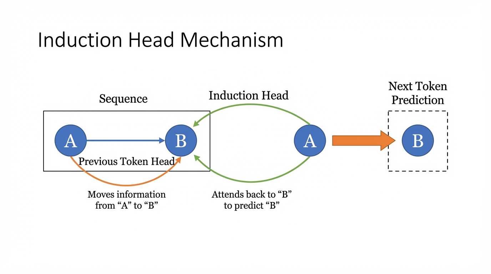

import InductionHeadVisualizer from '../../components/chapter-19/InductionHeadVisualizer.tsx';

# 19.1 Mechanistic Interpretability

Modern Large Language Models (LLMs) are often described as "black boxes." We feed them terabytes of data, optimize a simple objective function (next-token prediction) using gradient descent, and somehow, complex behaviors like logical reasoning, translation, and coding emerge. 

**Mechanistic Interpretability (MechInterp)** is the ambitious scientific endeavor to reverse-engineer these black boxes. Instead of treating the model as an opaque statistical engine, MechInterp views it as a compiled computer program. The goal is to decompile the billions of continuous weights back into human-understandable algorithms, data structures, and logical circuits.

Think of it as neuroscience for artificial brains, or reverse-engineering an alien spacecraft. We have the hardware (the weights), but we lack the source code.

---

## 1. Motivation and History

Historically, deep learning focused on *capability*—making models larger and more accurate. However, as models transition from research artifacts to critical infrastructure, understanding *how* they work can support debugging and safety research, alongside behavioral evaluation and execution controls.

### Why do we need Mechanistic Interpretability?
1. **Alignment and Safety**: Internal evidence can help investigate undesired behavior. Partial circuit explanations do not certify safety or establish the absence of deception.
2. **Debugging Hallucinations**: Interventions can test hypotheses about factual errors; knowledge edits may also disturb related capabilities.
3. **Auditing**: Mechanistic evidence can support technical audits but does not replace validation of the deployed system or its action controls.

The field traces its modern roots back to feature visualization in Convolutional Neural Networks (CNNs), spearheaded by researchers like Chris Olah (Distill, OpenAI, Anthropic). Early work visualized how early CNN layers detected edges, while deeper layers detected complex concepts like dog snouts or car wheels [[1]](#ref-1). 

With the advent of the Transformer, the focus shifted from spatial feature maps to residual streams and attention matrices. Anthropic's foundational paper, *A Mathematical Framework for Transformer Circuits* [[2]](#ref-2), established the modern lexicon of MechInterp, viewing Transformers not as monolithic blocks, but as networks of interacting "heads" communicating via a shared memory bandwidth (the residual stream).

---

## 2. The Linear Representation Hypothesis

Before we can find circuits, we must understand how a neural network stores concepts. One useful, empirically studied hypothesis is the **Linear Representation Hypothesis** [[4]](#ref-4). It is not a proof that every concept has one context-independent direction.

It posits that neural networks represent concepts (features) as **directions in the activation space**, rather than as individual neurons. 

If the residual stream of a Transformer is a high-dimensional vector space $\mathbb{R}^d$, a feature like "gender", "plurality", or "the concept of a dog" is a specific unit vector $v \in \mathbb{R}^d$. The presence or absence of this feature is determined by the projection of the activation vector $h$ onto this direction:

$$
\text{Activation of Feature } i = h \cdot v_i
$$

### The Problem of Arbitrary Basis
Because the residual stream is transformed by dense weight matrices (which can be rotated arbitrarily without changing the network's capacity), the individual basis dimensions (the literal neurons $h_1, h_2, \dots, h_d$) rarely correspond to clean, single concepts. 

This leads to **Polysemanticity**—a single neuron firing for multiple, unrelated concepts (e.g., a neuron that fires for both "spiders" and "the French language"). We will explore how to disentangle this using Sparse Autoencoders (SAEs) in Chapter 19.4, but for now, understand that *features are directions, not neurons*.

---

## 3. Circuits and Induction Heads

A **Circuit** is a subgraph of the neural network—a specific set of attention heads and MLP neurons—that implements a recognizable algorithm. 

The most famous and fundamental circuit discovered in LLMs is the **Induction Head** [[3]](#ref-3). Induction heads provide evidence for one mechanism supporting **In-Context Learning (ICL)**—adapting to a pattern in the prompt without weight updates. They do not explain all ICL behavior.

### The Algorithm of an Induction Head
An induction head looks for a simple pattern: `[A] [B] ... [A] -> [B]`. 
If it sees the token `[A]`, it searches the past context for previous instances of `[A]`, looks at the token that immediately followed it (`[B]`), and promotes `[B]` as the next predicted token.

A classic attention-only implementation coordinates two heads across layers:

1. **Previous Token Head (Layer $L_1$)**: 
   This head simply attends to the token immediately preceding the current one. It moves the information of `[A]` into the residual stream position of `[B]`. Now, the token `[B]` contains a feature saying "I am preceded by A".
   
2. **Induction Head (Layer $L_2$, where $L_2 > L_1$)**:
   When the model processes the second instance of `[A]`, the Induction Head's Query ($Q$) searches for Keys ($K$) that contain the feature "I am preceded by A". It finds the earlier `[B]`, attends to it, and its Value ($V$) projection copies the "B-ness" into the final residual stream to predict `[B]`.



*Repository teaching illustration of the mechanism described by Olsson et al. [[3]](#ref-3); not a measured attention map.*

### The QK and OV Circuits
MechInterp mathematically decomposes Attention into two independent operations:
* **The QK Circuit ($W_Q W_K^T$)**: Determines *where* to move information (the attention weights).
* **The OV Circuit ($W_V W_O$)**: Determines *what* information to move once attention is paid.

For an Induction Head, the QK circuit computes the match between "current token A" and "token preceded by A". The OV circuit acts as a copy operation, extracting the identity of `[B]` and writing it to the output logits.

---

## 4. Engineering the Interception: PyTorch Hooks

To perform Mechanistic Interpretability, we cannot just look at the final loss. We must extract the intermediate activations (the residual stream, attention matrices, and MLP hidden states) during the forward pass. 

A hook observes what a module actually returns. It cannot manufacture attention probabilities from a hidden-state tensor. Fused kernels may not materialize weights, and model-specific output tuples differ.

> **Educational limitation:** This helper is specific to `torch.nn.MultiheadAttention` with `batch_first=True`, explicit unaveraged weights, no padding, and one causal sequence batch. It is not a smoke-tested pretrained-model integration. Adapt the model API, padding and cache semantics, device/dtype, and memory budget before use. Materializing all attention weights costs $O(BHT^2)$ storage for batch size $B$, heads $H$, and sequence length $T$.

```python
import torch
from torch import nn

@torch.no_grad()
def capture_attention(module: nn.MultiheadAttention, x: torch.Tensor):
    # x: [B, T, D]; caller supplies matching dtype/device and eval mode.
    if not module.batch_first or x.ndim != 3:
        raise ValueError("Requires batch_first=True and [B, T, D] input")
    captured = []

    def hook(_module, _inputs, output):
        weights = output[1]
        if weights is None or weights.ndim != 4:
            raise RuntimeError("Expected unaveraged [B, H, T, T] weights")
        captured.append(weights.detach().cpu())

    handle = module.register_forward_hook(hook)
    try:
        length = x.shape[1]
        causal_mask = torch.ones(
            length, length, dtype=torch.bool, device=x.device
        ).triu(1)
        module(x, x, x, attn_mask=causal_mask,
               need_weights=True, average_attn_weights=False)
        return captured[0]
    finally:
        handle.remove()
```

An induction-like pattern is a candidate explanation. Compare clean and corrupted prompts, then ablate or patch the proposed head and measure the predicted output change with controls. Attention inspection alone does not establish causal responsibility for ICL.

---

## 5. Interactive: Visualizing an Induction Head

To truly grasp how an induction head operates, interact with the attention matrix below. This visualization simulates the attention weights of an Induction Head processing a repeating sequence.

Notice how the Query for the second occurrence of a token attends strongly to the token *following* its first occurrence.


<InductionHeadVisualizer client:load lang="en" />

*(This is a normalized teaching matrix, not a measurement from a trained model. A similar pattern in real attention is a hypothesis to test through interventions.)*

---

## 6. From Features to Circuit Tracing

**Research snapshot as of 2026-10-13.** Circuit tracing uses learned feature representations and attribution graphs to investigate how intermediate computations contribute to outputs. Anthropic's 2025 methods describe a replacement model and local attribution procedure, with explicit fidelity and coverage limitations [[5]](#ref-5). A readable graph is not a complete explanation of the original model.

Finding a feature is only the first step. Ask which inputs activate it, which downstream computations it affects, and whether controlled interventions change the behavior predicted by the graph.

Practical investigations include:

1. **Repeated factual errors:** compare intermediate candidate predictions, then test a proposed cause through patching or ablation.
2. **Over-refusal after tuning:** compare matched allowed and disallowed requests; measure behavioral changes rather than assigning a safety guarantee to a direction.
3. **Prompt-template differences:** use attention patterns as hypotheses and hold task content constant in intervention tests.
4. **RAG evidence use:** swap or remove evidence and test output sensitivity. Attention or attribution to a document alone does not prove that the answer depends on it.
5. **Editing and steering:** evaluate related capabilities and counterexamples before deploying an intervention.

These tools narrow hypotheses; they complement incident logs, controlled behavioral evaluations, and permission boundaries. Coverage, replacement-model fidelity, and generalization beyond the inspected prompt remain open limitations.

---

## 7. Summary and Open Questions

Mechanistic Interpretability provides a rigorous, mathematical framework for understanding the internal machinery of Large Language Models. By decomposing the network into the Linear Representation Hypothesis, QK/OV circuits, and algorithmic subgraphs like Induction Heads, we transition from treating AI as alchemy to treating it as software engineering.

However, as models scale to trillions of parameters, manual circuit discovery becomes computationally and cognitively intractable. 
* How can we automate the discovery of circuits? 
* How do we interpret the massive MLP layers that contain the bulk of the model's world knowledge?
* What happens when multiple concepts are crammed into the same set of neurons?

To answer these questions, we must look at advanced visualization techniques and the problem of Superposition, which we will explore next in **19.2 Logit Lens & Attention Visualization** and **19.4 Sparse Autoencoders (SAE)**.

## Quizzes

<details>
<summary>Quiz 1: According to the Linear Representation Hypothesis, why are concepts represented as directions in the residual stream rather than by individual neurons?</summary>
*Because the residual stream is a continuous vector space transformed by dense weight matrices. A neural network can represent more features than it has dimensions (superposition) by utilizing almost-orthogonal directions in high-dimensional space. Tying a concept to a single basis vector (neuron) is a highly inefficient use of the vector space capacity.*
</details>

<details>
<summary>Quiz 2: Does an induction-like attention pattern prove that a head causes in-context learning?</summary>
*No. Use controlled ablation or activation patching and test the predicted behavioral effect. Other heads and MLPs may contribute, and ICL includes mechanisms beyond the classic induction circuit.*
</details>

<details>
<summary>Quiz 3: Why is Mechanistic Interpretability currently much more successful at reverse-engineering Attention Heads compared to MLP layers?</summary>
*Attention heads have a natural, interpretable bottleneck: the attention matrix. The QK circuit explicitly tells us which tokens are communicating, and the OV circuit tells us what is being communicated. MLP layers, on the other hand, act as massive, dense key-value memories with highly polysemantic neurons, making their specific logical routing much harder to disentangle without advanced techniques like Sparse Autoencoders.*
</details>

<details>
<summary>Quiz 4: Why is inspecting QK alone insufficient to establish token copying?</summary>
*QK describes attention destinations. The value/output path and its composition with embeddings and unembeddings determine whether attended information promotes the copied token. A large attention weight alone does not prove the copy operation.*
</details>

---

## References

1. <a id="ref-1"></a>Olah, C., et al. (2020). *Zoom In: An Introduction to Circuits*. Distill. [Link](https://distill.pub/2020/circuits/zoom-in/).
2. <a id="ref-2"></a>Elhage, N., et al. (2021). *A Mathematical Framework for Transformer Circuits*. Anthropic. [Link](https://transformer-circuits.pub/2021/framework/index.html).
3. <a id="ref-3"></a>Olsson, C., et al. (2022). *In-context Learning and Induction Heads*. [arXiv:2209.11895](https://arxiv.org/abs/2209.11895).
4. <a id="ref-4"></a>Park, K., et al. (2023). *The Linear Representation Hypothesis and the Geometry of Large Language Models*. [arXiv:2311.03658](https://arxiv.org/abs/2311.03658).
5. <a id="ref-5"></a>Ameisen, E., et al. (2025). *Circuit Tracing: Revealing Computational Graphs in Language Models*. Transformer Circuits Thread. [Link](https://transformer-circuits.pub/2025/attribution-graphs/methods.html).
