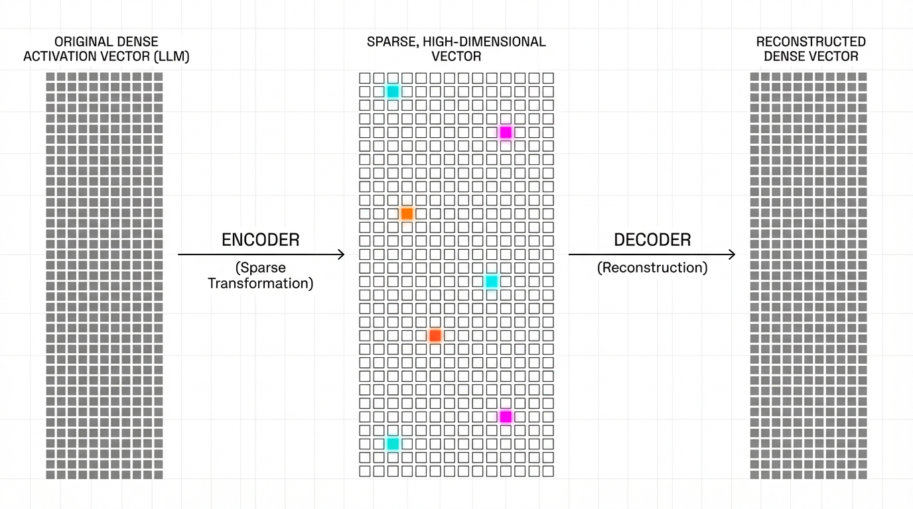

# 19.4 Sparse Autoencoders (SAE)

In the previous section, we used Probing Classifiers to detect specific concepts hidden in an LLM's residual stream. However, probing is fundamentally a supervised, hypothesis-driven task: we can only find what we explicitly look for. If we want to discover the *complete* set of concepts a model has learned—without relying on human-provided labels—we need an unsupervised approach.

**Sparse Autoencoders (SAEs)** learn sparse dictionaries from model activations. The GPT-4 and Claude 3 Sonnet studies below are dated research examples, not complete inventories of a model's concepts or proof that every learned feature is human-interpretable.

---

## 1. The Superposition Hypothesis and Polysemanticity

If we want to understand what a neural network is "thinking," the intuitive first step is to look at individual neurons. If a specific neuron fires every time the model processes the word "dog," we might label it the "dog neuron."

Unfortunately, this simple mapping fails in large language models. LLMs possess a finite number of dimensions in their residual stream (e.g., $d = 4096$), but they must represent millions of distinct concepts to understand human language. To solve this bottleneck, neural networks employ **Superposition**.

The Superposition Hypothesis suggests that models pack multiple unrelated concepts into the same representation space by utilizing almost-orthogonal vectors. Because high-dimensional spaces contain exponentially more almost-orthogonal directions than strictly orthogonal ones, the model can represent vastly more features than it has dimensions.

The side effect of superposition is that individual neurons become **polysemantic**. A single neuron might fire when processing the word "Apple" (the fruit), "Apple" (the tech company), and "Apple" (the record label). Looking at the raw neuron activation tells us nothing about *which* concept is currently active.

import PolysemanticVisualizer from '../../components/chapter-19/PolysemanticVisualizer.tsx';

<PolysemanticVisualizer client:load />

---

## 2. Dictionary Learning via Sparse Autoencoders

To untangle these polysemantic neurons, researchers treat the problem as **Dictionary Learning**. The goal is to find a set of sparse, overcomplete features (the dictionary) that linearly combine to form the model's dense activation vectors.

A Sparse Autoencoder achieves this by projecting the $d$-dimensional activation vector $x$ into a much larger $D$-dimensional feature space $f$ (where $D \gg d$, often 16x to 64x larger), and then reconstructing the original vector $\hat{x}$. 


*Source: AI-generated illustration*

The forward pass of a standard SAE is defined as:

$$ f = \text{ReLU}(W_{enc}(x - b_{pre}) + b_{enc}) $$
$$ \hat{x} = W_{dec} f + b_{dec} + b_{pre} $$

To encourage sparse feature decompositions, we force the network to use only a tiny fraction of the $D$ features for any given input. This is typically enforced by adding an $L_1$ regularization penalty to the reconstruction loss:

$$ \mathcal{L} = ||x - \hat{x}||_2^2 + \lambda ||f||_1 $$

Sparse dictionary learning can reveal interpretable directions, but reconstruction error, feature splitting, polysemantic latents, and dependence on training data remain.

---

## 3. The Dead Latent Problem

Training SAEs introduces severe engineering challenges. The most notorious is the **Dead Latent** (or Dead Neuron) problem. 

Because the feature space $D$ is massive and the sparsity penalty ($\lambda$) aggressively pushes activations to zero, many features in the SAE stop activating early in training. Once a feature stops activating, it receives zero gradient from the ReLU function, leaving it without a direct reconstruction gradient on those inputs. Measure inactivity over a declared sample window; recovery methods can alter this state.

State-of-the-art training pipelines employ several techniques to revive these dead latents:
1. **Ghost Gradients**: Artificially routing gradients to dead neurons during the backward pass to give them a "nudge" toward useful directions.
2. **Re-initialization**: Periodically identifying dead neurons and resetting their encoder weights to match the dense activation vectors ($x$) that currently have the highest reconstruction error.

---

## 4. Engineering the State-of-the-Art: Top-K SAEs

While the $L_1$ penalty enforces sparsity, it introduces a critical flaw: **Shrinkage**. The $L_1$ penalty constantly pulls all activations toward zero, meaning the SAE systematically underestimates the true magnitude of the features, degrading the reconstruction quality of $\hat{x}$.

In 2024, OpenAI researchers demonstrated a breakthrough by scaling a 16-million latent SAE on GPT-4 activations [[2]](#ref-2). To solve the shrinkage problem, they completely removed the $L_1$ penalty and replaced it with an explicit **Top-K activation function**.

Instead of relying on a loss penalty to push values to zero, a Top-K SAE simply computes the dense activations, strictly selects the $K$ highest values, and forcefully zeros out the rest. This directly controls the $L_0$ sparsity without distorting the activation magnitudes.

Here is how a Top-K SAE is implemented in PyTorch:

> **Deliberately simplified example.** It illustrates encoder/decoder shapes and top-K. Full training, decoder normalization, dead-latent recovery, activation sampling, and distributed execution are omitted. The large configuration below is a memory-planning illustration, not an executed experiment.

```python
import torch
import torch.nn as nn
import torch.nn.functional as F

class TopKSAE(nn.Module):
    """
    Top-K Sparse Autoencoder (Gao et al., 2024).
    Replaces L1 regularization with an explicit Top-K activation function
    to solve the shrinkage problem and improve the sparsity-reconstruction frontier.
    """
    def __init__(self, d_model: int, d_sae: int, k: int):
        super().__init__()
        self.d_model = d_model
        self.d_sae = d_sae
        self.k = k
        
        # Initialize encoder and decoder weights
        # Decoder weights are typically unit-normalized in practice
        self.W_enc = nn.Parameter(torch.randn(d_model, d_sae) / (d_model ** 0.5))
        self.b_enc = nn.Parameter(torch.zeros(d_sae))
        
        self.W_dec = nn.Parameter(torch.randn(d_sae, d_model) / (d_sae ** 0.5))
        self.b_dec = nn.Parameter(torch.zeros(d_model))
        
        # Pre-encoder bias to center the activations
        self.b_pre = nn.Parameter(torch.zeros(d_model))

    def encode(self, x: torch.Tensor) -> torch.Tensor:
        # Center the input and project to high-dimensional feature space
        pre_acts = (x - self.b_pre) @ self.W_enc + self.b_enc
        acts = F.relu(pre_acts)
        
        # Explicit Top-K routing: keep only the top K activations, zero out the rest
        topk_vals, topk_indices = torch.topk(acts, self.k, dim=-1)
        
        # Reconstruct the sparse tensor
        sparse_acts = torch.zeros_like(acts)
        sparse_acts.scatter_(-1, topk_indices, topk_vals)
        
        return sparse_acts

    def decode(self, sparse_acts: torch.Tensor) -> torch.Tensor:
        # Project back to the original residual stream dimension
        return (sparse_acts @ self.W_dec) + self.b_dec + self.b_pre

    def forward(self, x: torch.Tensor) -> tuple[torch.Tensor, torch.Tensor]:
        sparse_acts = self.encode(x)
        x_reconstructed = self.decode(sparse_acts)
        return x_reconstructed, sparse_acts

# Example instantiation for a 4096-dim LLM residual stream
# Expanded to 131,072 features (32x expansion), keeping exactly 32 active
# sae = TopKSAE(d_model=4096, d_sae=131072, k=32)
```

---

## 5. Scaling Monosemanticity: The Golden Gate Claude

Anthropic applied SAEs to their production model, Claude 3 Sonnet, successfully extracting millions of highly abstract features [[1]](#ref-1). Their findings fundamentally shifted how we view LLM representations.

They discovered that SAE features are **concept-centric**, not token-centric. For instance, a single feature representing the "Golden Gate Bridge" activates whether the model reads the English text "Golden Gate Bridge", the Japanese translation "ゴールデンゲートブリッジ", or even processes an image of the bridge.


*Source: AI-generated illustration*

More importantly, SAEs allow for **causal steering**. In a famous experiment, Anthropic researchers artificially clamped the activation of the Golden Gate Bridge feature to a high value during the model's forward pass. The result was "Golden Gate Claude"—a model that became obsessively fixated on the bridge. When asked "How do I spend a day in London?", the model suggested taking a flight to San Francisco to see the Golden Gate Bridge. 

Beyond tourist attractions, researchers identified features for sycophancy, bias, scam emails, and dangerous capabilities (like generating bioweapons). Steering or suppressing a feature can change behavior, but it does not guarantee selective removal of harmful behavior or preservation of general capabilities. Validate collateral effects, distribution shift, and adversarial bypass.

---

## 6. Auto-Interp and Codebook Saturation

When an SAE extracts 16 million features, human evaluation becomes impossible. To scale interpretability, researchers use **Automated Interpretability (Auto-Interp)**. 

In Auto-Interp, a separate, powerful LLM (like GPT-4) acts as a judge. The judge is fed dozens of text snippets that maximally activate a specific SAE feature and prompted to determine what they have in common. The judge generates a label (e.g., "Legal terminology related to breach of contract"). To verify the label's accuracy, the judge is then asked to predict how strongly the feature will activate on *unseen* text snippets.

One more speculative direction borrows ideas from qualitative analysis, especially **codebook reduction** and **saturation**, to ask whether an auto-interp workflow has stopped surfacing genuinely new categories [[3]](#ref-3). This is better understood as an auditing heuristic for feature dictionaries than as proof that an SAE has exhausted every meaningful concept in the model.

---

## From Features to Circuits: What a Label Does Not Prove

**Research context as of 2026-10-13.** Anthropic's circuit-tracing study uses attribution graphs to investigate mechanisms in Claude 3.5 Haiku, while documenting incomplete coverage and limits on the prompts and behaviors its method can explain [[5]](#ref-5). A feature label or a convincing generated explanation is not a causal circuit by itself.

Validate a proposed mechanism with controlled activation interventions, matched prompts, alternative hypotheses, reconstruction/behavioral fidelity, and held-out cases. Report which computations the surrogate preserves and which it misses. Causal steering establishes an effect of an intervention in the tested setting; it does not establish that a feature is the sole cause of a behavior or that suppressing it is a robust safety policy.


## 7. Engineering Decisions for SAE Use

Choose the analysis method to match the question. A production agent failure may first need better task evaluation, tool-policy controls, and tracing. A small-model mechanism question may be cheaper to investigate with activation patching, probes, or a logit lens than with a million-feature dictionary.

Evaluate reconstruction and **behavioral fidelity**, sparsity, dead-latent frequency over a declared window, held-out interpretability, and the breadth of causal effects. A low reconstruction MSE alone does not show that the surrogate preserves the computations you want to explain. Circuit tracing asks how features influence other features and output logits, while its methods paper documents the limits of that approximation [[4]](#ref-4).

## 8. Summary and Open Questions

Sparse Autoencoders provide a useful but incomplete view of activations. Sparse dictionaries can reveal interpretable structure; they do not guarantee clean single-meaning features or complete explanations. The shift from $L_1$ regularization to Top-K architectures has allowed these techniques to scale to frontier models like GPT-4 and Claude 3, enabling precise behavioral steering and safety interventions.

However, extracting features is only half the battle. If an LLM is a machine that "thinks," features are merely the nouns and verbs of its thoughts. The next frontier in mechanistic interpretability is understanding how these features wire together to perform complex logic. How does the "If-Then" feature interact with the "Python Code" feature to generate a working script? 

To answer this, we must map the **Circuits** of the LLM.


## Quizzes

<details>
<summary>Quiz 1: Why do neural networks utilize superposition, leading to polysemantic neurons?</summary>
*LLMs have a fixed, finite number of dimensions in their residual stream, but must represent millions of distinct linguistic and factual concepts. Superposition allows the model to pack multiple unrelated concepts into the same space using almost-orthogonal vectors, making individual neurons polysemantic (firing for multiple concepts).*
</details>

<details>
<summary>Quiz 2: What is the fundamental trade-off when tuning the $\lambda$ parameter for the $L_1$ penalty in a standard SAE?</summary>
*Increasing $\lambda$ improves the sparsity (and thus interpretability) of the features, but it worsens the reconstruction error (MSE) of the original activations. Furthermore, a high $L_1$ penalty causes "shrinkage," artificially pulling all feature magnitudes toward zero.*
</details>

<details>
<summary>Quiz 3: How does the Top-K SAE architecture solve the "shrinkage" problem inherent in standard $L_1$-regularized SAEs?</summary>
*A Top-K SAE completely removes the $L_1$ penalty. Instead, it computes the dense activations, explicitly selects only the Top $K$ highest values, and forcefully zeros out the rest. This bounds the number of nonzero activations by $K$; selected ReLU values can themselves be zero. It controls sparsity without applying a continuous mathematical penalty that shrinks the magnitude of the active features.*
</details>

<details>
<summary>Quiz 4: What does a cross-modal SAE activation establish?</summary>
*It supports a shared representation for the tested inputs. It does not prove universal concept understanding, complete feature discovery, or causal necessity.*
</details>

<details>
<summary>Quiz 5: Why should a feature intervention be compared with matched controls?</summary>
*Changing one activation can have broad downstream effects. Matched prompts, alternative features, and held-out cases help separate a specific mechanism from generic disruption.*
</details>

---

## References

1. <a id="ref-1"></a>Templeton, A., et al. (2024). *Scaling Monosemanticity: Extracting Interpretable Features from Claude 3 Sonnet*. Transformer Circuits Thread. [Link](https://transformer-circuits.pub/2024/scaling-monosemanticity/index.html).
2. <a id="ref-2"></a>Gao, L., et al. (2024). *Scaling and evaluating sparse autoencoders*. [arXiv:2406.04093](https://arxiv.org/abs/2406.04093).
3. <a id="ref-3"></a>De Paoli, S., & Mathis, W. S. (2025). *Codebook Reduction and Saturation: Novel observations on Inductive Thematic Saturation for Large Language Models and initial coding in Thematic Analysis.* [arXiv:2503.04859](https://arxiv.org/abs/2503.04859).
4. <a id="ref-4"></a>Ameisen, E., et al. (2025). *Circuit Tracing: Revealing Computational Graphs in Language Models.* [Source](https://transformer-circuits.pub/2025/attribution-graphs/methods.html).
5. <a id="ref-5"></a>Anthropic. (2025). On the Biology of a Large Language Model. [Source](https://transformer-circuits.pub/2025/attribution-graphs/biology.html).
