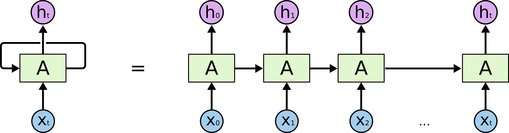

import RnnMemoryVisualizer from '../../components/chapter-2/RnnMemoryVisualizer';

# 2.1 Markov Chains to RNNs

<a id="motivation-the-arrow-of-time-in-data"></a>

Suppose a machine announces a color, says `wait` and `ready`, then repeats the color. You have two recordings, `red wait ready red` and `blue wait ready blue`. Pause each one just after `ready`. Which word comes next?

<a id="the-metaphor-the-conveyor-belt-with-memory"></a>

A model that looks back one word sees `ready` in both recordings. Looking back two words still gives the same clue, `wait ready`. A listener could answer both questions with a single bit of memory: “Did this recording start with red?” This is the difference between keeping the last few tokens and keeping a feature of the past.

## Markov Chains: The Simplest Sequence Models

In 1913, Andrey Markov examined 20,000 letters in Pushkin’s *Eugene Onegin*. He counted how often a vowel followed another vowel and how often one followed a consonant. The counts let him study dependence between neighboring letters. [[1]](#ref-1)

### The Markov Property

Let $X_t$ denote the state at step $t$ and $x_t$ its observed value. For a first-order Markov chain, knowing the current state is enough to specify the distribution of the next one.

$$P(X_{t+1}=x \mid X_1=x_1,\ldots,X_t=x_t)=P(X_{t+1}=x \mid X_t=x_t)$$

In a **bigram** language model, the state is the last token. In the two recordings, `red` and `blue` each follow `ready` once. Estimating by relative frequency gives $P(\text{red}\mid\text{ready})=1/2$ in both cases. A **trigram** conditions on the last two tokens, which also coincide here. A 4-gram has enough context to distinguish these recordings. Insert one more `wait` into each and its last three tokens coincide again.

### Why Markov Models Still Matter

A finite-order model can process a stream of any finite length by sliding its window one token at a time. The order limits which observed tokens can affect a prediction. With a vocabulary of $V$ tokens, a window of $k$ tokens has up to $V^k$ distinct histories. Many have few or no observations, so a count-based model can fall back to shorter histories when estimating probabilities.

The choice of state matters. A hand-built Markov model could store the announced color as its state across any number of `wait` tokens. An RNN lets the training objective shape which features the state carries forward. Elman demonstrated this idea by feeding hidden activations back into a network that predicted successive inputs. [[2]](#ref-2)

## Recurrent Neural Networks (RNNs): Adding Memory

<div style={{ maxWidth: '600px', margin: '20px auto' }}>



*Each copy uses the same weights. Figure by Christopher Olah.* [[3]](#ref-3)

</div>

<a id="the-mechanism"></a>

At step $t$, the input vector $\mathbf{x}_t$ and the previous hidden state $\mathbf{h}_{t-1}$ determine the new state $\mathbf{h}_t$. A separate output layer converts it into a distribution $\mathbf{y}_t$ over the next token.

$$\mathbf{h}_t=\tanh(\mathbf{W}_{hh}\mathbf{h}_{t-1}+\mathbf{W}_{xh}\mathbf{x}_t+\mathbf{b}_h)$$
$$\mathbf{y}_t=\operatorname{softmax}(\mathbf{W}_{hy}\mathbf{h}_t+\mathbf{b}_y)$$

The matrices $\mathbf{W}_{hh}$, $\mathbf{W}_{xh}$ and $\mathbf{W}_{hy}$ map the previous state, input and new state respectively. The vectors $\mathbf{b}_h$ and $\mathbf{b}_y$ are biases. At inference, a single cell needs just its current hidden vector to continue the stream. If two histories reach exactly the same hidden state, the network will give the same predictions for any identical continuation.

### Training Reality: Unrolling Through Time

During next-token training with **teacher forcing**, each input is the observed token from the training sequence. The following observed token is its target. All the inputs are available at the start, yet the cell must compute $\mathbf{h}_1$ before $\mathbf{h}_2$. Different recordings can run side by side in a batch.

With full **backpropagation through time** (BPTT), a prediction error after `ready` can affect the update that processed `red`. Its gradient passes through every intervening state update. If each update shrinks that gradient, the first token receives a weak learning signal. The network may be able to represent a memory that the optimizer struggles to learn. [Section 2.2](/chapter-2/vanishing-exploding-gradients/) works through this gradient product. [[4]](#ref-4)

## PyTorch RNN

Give the two recordings one hidden number each. Encode `red` as $+1$, `blue` as $-1$, and both `wait` and `ready` as zero. Set both recurrent-cell weights to one and omit biases. With $h_0=0$, the update becomes $h_t=\tanh(h_{t-1}+x_t)$. The code runs the two recordings as a batch on the CPU. The weights are chosen by hand so the calculation can be checked without fitting a model. [[5]](#ref-5)

```python
import torch
from torch import nn

cell = nn.RNNCell(input_size=1, hidden_size=1, bias=False)
steps = torch.tensor([[1., -1.], [0., 0.], [0., 0.]])
hidden = torch.zeros(2, 1)

with torch.no_grad():
    cell.weight_ih.fill_(1.)
    cell.weight_hh.fill_(1.)
    for inputs in steps:
        hidden = cell(inputs.reshape(2, 1), hidden)
        print([round(value, 3) for value in hidden[:, 0].tolist()])
```

The three rows printed are `[0.762, -0.762]`, `[0.642, -0.642]` and `[0.566, -0.566]`. After `ready`, the sign still identifies the first color. Try changing the recurrent weight to zero. Both states then become zero at `wait`, showing exactly where the earlier color was lost.

## Example: The Fading Memory of RNN

Follow both recordings to `wait`. With the recurrent weight set to 1, their states are still distinguishable. What will each state be at `ready` if the recurrent weight is 0 throughout the recording? Compare your answer with the trace.

<RnnMemoryVisualizer client:load lang="en" />

## Quizzes

<details>
<summary>Quiz 1: Why does a trigram give the same distribution in both recordings?</summary>
*After `ready` both histories end in `wait ready`. A trigram uses these last two tokens to choose one distribution for both histories.*
</details>

<details>
<summary>Quiz 2: Could a two-state Markov model remember the color across a thousand waits?</summary>
*Yes. Use one state for each color and have each wait leave the state unchanged. The choice of state determines which information survives.*
</details>

<details>
<summary>Quiz 3: If a cell can read a million tokens, what does that tell you about its prediction at the last token?</summary>
*The update can be applied a million times. To test whether the first token still matters, change it and replay the same remaining tokens. Compare the final predictions.*
</details>

<details>
<summary>Quiz 4: How could the output layer lose the color even if the two hidden states differ?</summary>
*If all its weights are zero, only the output bias affects the probabilities. Both hidden states then produce the same distribution.*
</details>

<details>
<summary>Quiz 5: Why can the two recordings run together, while the steps within each recording must run in order?</summary>
*Each recording has its own state, so its update is independent of the other recording. Within a recording each update needs the state produced by the previous step.*
</details>

<details>
<summary>Quiz 6: What is a sufficient condition for vanishing gradients in the BPTT Jacobian product?</summary>
*For column-vector states, let $J_j=\operatorname{diag}(1-h_j^2)W_{hh}$ be the derivative of step $j$ with respect to the previous state, with the square taken elementwise. The derivative from step $k$ to step $t$ is $J_t\cdots J_{k+1}$. If each operator norm satisfies $\|J_j\|_2\le\rho<1$, the product norm is at most $\rho^{t-k}$. Backpropagation applies the transpose of that product to the loss gradient.*
</details>

## References

1. <a id="ref-1"></a>Markov, A. A. (1913). [An Example of Statistical Investigation of the Text *Eugene Onegin* Concerning the Connection of Samples in Chains](https://doi.org/10.1017/S0269889706001074). English translation, *Science in Context* (2006).
2. <a id="ref-2"></a>Elman, J. L. (1990). [Finding Structure in Time](https://cogsci.ucsd.edu/~rik/courses/readings/elman90-fsit.pdf). *Cognitive Science*, 14, 179–211.
3. <a id="ref-3"></a>Olah, C. (2015). [Understanding LSTM Networks](https://colah.github.io/posts/2015-08-Understanding-LSTMs/).
4. <a id="ref-4"></a>Bengio, Y., Simard, P., & Frasconi, P. (1994). [Learning Long-Term Dependencies with Gradient Descent Is Difficult](https://pubmed.ncbi.nlm.nih.gov/18267787/). *IEEE Transactions on Neural Networks*, 5, 157–166.
5. <a id="ref-5"></a>PyTorch. [RNNCell](https://docs.pytorch.org/docs/2.15/generated/torch.nn.RNNCell.html).
