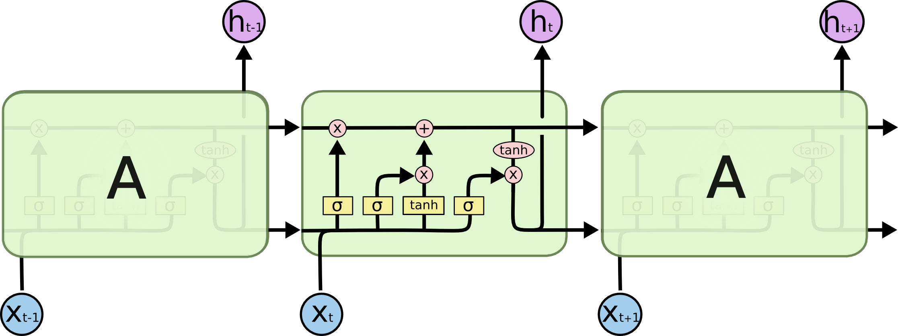
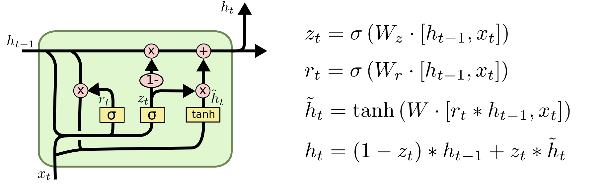

import { GradientVisualizer } from '../../components/chapter-2/GradientVisualizer.tsx';

# 2.2 Vanishing & Exploding Gradients

While Recurrent Neural Networks (RNNs) theoretically possess the ability to process long sequences, training them effectively proved to be one of the most significant challenges in deep learning due to the **Vanishing and Exploding Gradient** problems.

---

### **Motivation: The Difficulty of Long-Term Credit Assignment**
Imagine trying to solve a puzzle where the clue you need was given to you two hours ago, and you've been bombarded with new information ever since.
*   **Vanishing Gradients** make the model forget the distant past. The signal for updates becomes so small that the model stops learning from earlier parts of the sequence.
*   **Exploding Gradients** make the model overreact. A small change in the distant past causes a massive, chaotic change in the present, making training unstable.

This problem motivated the creation of LSTMs and eventually Transformers, which handle long-term dependencies much better.

---

### **The Metaphor: The Telephone Game (Vanishing) and The Snowball Effect (Exploding)**

Imagine a line of 50 people playing the **Telephone Game**.
*   **Vanishing Gradient** is like the message getting quieter and more garbled at each step. By the time it reaches the 50th person, it's just a faint, unintelligible whisper. The last person cannot learn anything useful from the first person's message.
*   **Exploding Gradient** is like a small rumor starting at the beginning ("It might rain"). As it passes down the line, each person exaggerates it. By the 50th person, it has become "A massive hurricane is destroying the city!" The signal has blown up out of proportion.

In RNNs, multiplying the same weight matrix over and over causes these exact effects on the gradients.

---

## The Root Cause: Backpropagation Through Time (BPTT)

RNNs are trained using an extension of backpropagation called **Backpropagation Through Time (BPTT)**. The network is unrolled across time steps, and gradients are calculated from the output back to the beginning.

Consider the update for the hidden state weight matrix $\mathbf{W}_{hh}$. The gradient involves a chain of matrix multiplications across time steps:
For column-vector states, define $z_k=W_{hh}h_{k-1}+W_{xh}x_k+b_h$ and the forward Jacobian $J_k=\operatorname{diag}(\sigma'(z_k))W_{hh}$. The ordered product is
$$\frac{\partial h_t}{\partial h_0}=J_tJ_{t-1}\cdots J_1.$$
Backpropagation applies its transpose to the output gradient. The bound $\|J_t\cdots J_1\|_2\le\prod_k\|J_k\|_2$ explains contraction when every factor is bounded below one. A growing upper bound does not prove actual growth: activation saturation, directions and non-normal matrices matter. The weight matrix's spectral radius alone is not a necessary-and-sufficient stability test [[3]](#ref-3).

### Consequences
- **Vanishing Gradients:** The network cannot learn long-term dependencies because the signal from early time steps becomes too weak to update the weights.
- **Exploding Gradients:** The updates become too large, causing the weights to oscillate or become `NaN` (Not a Number), leading to training instability.

---

## Simulating Vanishing Gradients

We can simulate how gradients vanish by repeatedly multiplying a weight value smaller than 1, mimicking the chain rule in BPTT.

```python
import torch

# Simulate a weight derivative (activation derivative * weight)
# If this value is < 1, it will vanish. If > 1, it will explode.
w_derivative = 0.9

# Sequence length
seq_len = 50

gradient = 1.0
gradients = []

for t in range(seq_len):
    gradient *= w_derivative
    gradients.append(gradient)

print(f"Gradient at step 1: {gradients[0]:.4f}")
print(f"Gradient at step 25: {gradients[24]:.4f}")
print(f"Gradient at step 50: {gradients[49]:.4f}")

import matplotlib.pyplot as plt
plt.plot(gradients)
plt.title("Vanishing Gradient Simulation")
plt.xlabel("Backprop Steps (Time)")
plt.ylabel("Gradient Magnitude")
plt.show()
```


---

## Example: Visualizing Gradient Flow

Adjust the weight magnitude to see how it affects the gradient as it flows back through time.
*   Values $< 1.0$ cause the gradient to **vanish**.
*   Values $> 1.0$ cause the gradient to **explode**.

<GradientVisualizer client:load lang="en" />

---

## The Solutions: LSTM and GRU - Controlling the Memory

To overcome the vanishing gradient problem, researchers needed a way to allow gradients to flow backwards without being repeatedly multiplied by shrinking weights. The breakthrough came with the introduction of specialized memory cells that can learn what to remember and what to forget. The most famous of these are the **Long Short-Term Memory (LSTM)** and **Gated Recurrent Unit (GRU)** networks.

### LSTM: Long Short-Term Memory

Proposed by Sepp Hochreiter and Jürgen Schmidhuber in 1997, LSTM was specifically designed to solve the vanishing gradient problem. Hochreiter had already identified the root cause of vanishing gradients in his 1991 diploma thesis.

#### Intuitive Interpretation: The Cell State as a Conveyor Belt
The key innovation of LSTM is the **Cell State ($c_t$)**. While the standard RNN's hidden state ($h_t$) undergoes complex non-linear transformations at every step (causing information to decay), the cell state acts like a **linear conveyor belt**. Information can run along it with only minor linear interactions, allowing it to persist far into the future.

LSTMs control the cell state using three "gates":
1.  **Forget Gate:** Decides what information to throw away from the cell state.
2.  **Input Gate:** Decides which new information to store in the cell state.
3.  **Output Gate:** Decides what part of the cell state to output as the hidden state.

<div style={{ display: 'flex', flexDirection: 'column', alignItems: 'center', width: '100%', margin: '20px 0' }}>
<div style={{ maxWidth: '600px', width: '100%' }}>

</div>
<em style={{ marginTop: '10px', color: '#7f8c8d' }}>Source: [colah's blog](https://colah.github.io/posts/2015-08-Understanding-LSTMs/)</em>
</div>

#### Mathematical Interpretation: How the Direct Path Helps
In a standard RNN, the gradient flow involves repeated multiplication of the weight matrix:
$$\frac{\partial \mathbf{h}_t}{\partial \mathbf{h}_{t-1}} = \operatorname{diag}(\sigma'(z_t))\mathbf{W}_{hh}$$

In contrast, the gradient flow through the cell state in an LSTM is:
Holding gate outputs fixed, the direct cell-state path has Jacobian $\operatorname{diag}(f_t)$, where each forget-gate value lies between zero and one. Values near one preserve this path's gradient. This is not the total derivative: gates depend on earlier hidden states and add other paths. LSTMs mitigate vanishing gradients but do not guarantee stable gradients for every sequence.

#### The Metaphor: The Diary
Think of an LSTM as a **diary**:
*   **Forget Gate**: "Erase the unimportant details from yesterday (like what I had for lunch)."
*   **Input Gate**: "Write down the important new formula I learned today."
*   **Output Gate**: "Based on what's in my diary, summarize it to tell my friend what I did."

---

### GRU: Gated Recurrent Unit

Proposed by Cho et al. in 2014, the GRU is a streamlined version of the LSTM.

#### Features
- It combines the forget and input gates into a single **update gate**.
- It merges the cell state and hidden state, simplifying the architecture.
- With fewer parameters, it is computationally more efficient and often performs on par with LSTMs, especially on smaller datasets.

<div style={{ display: 'flex', flexDirection: 'column', alignItems: 'center', width: '100%', margin: '20px 0' }}>
<div style={{ maxWidth: '600px', width: '100%' }}>

</div>
<em style={{ marginTop: '10px', color: '#7f8c8d' }}>Source: [colah's blog](https://colah.github.io/posts/2015-08-Understanding-LSTMs/)</em>
</div>

---

### RNN vs LSTM vs GRU Comparison

| Feature | Standard RNN | LSTM | GRU |
| :--- | :--- | :--- | :--- |
| **Structure** | Simple (1 tanh layer) | Complex (4 interacting layers) | Moderate (3 interacting layers) |
| **Memory Mechanism** | Hidden state only | Cell state + Hidden state | Hidden state only (merged) |
| **Gates** | None | 3 (Forget, Input, Output) | 2 (Reset, Update) |
| **Long-Term Dependencies**| Poor (Vanishing Gradients) | Excellent | Very Good |
| **Computation Speed** | Fast | Slow | Moderate |
| **Parameters** | Fewest | Most | Moderate |

---

## Quizzes

<details>
<summary>Quiz 1: Why can both recurrent and deep feed-forward networks lose long-range gradient signals?</summary>
*Both multiply many Jacobians. RNNs reuse parameters over time, but repeated use of the same matrix is not required for vanishing gradients; depth, activations and singular directions matter.*
</details>

<details>
<summary>Quiz 2: How does the Cell State in an LSTM help prevent vanishing gradients?</summary>
*The Cell State in an LSTM acts as a conveyor belt with linear interactions (controlled by gates), allowing gradients to flow back through time without being multiplied by shrinking derivatives at every step. This effectively mitigates the vanishing gradient problem.*
</details>

<details>
<summary>Quiz 3: What is Gradient Clipping and which problem does it solve?</summary>
*Gradient Clipping is a technique used to combat **exploding gradients**. If the norm of the gradient exceeds a certain threshold, it is scaled down to that threshold. This prevents updates from becoming too large and destabilizing training.*
</details>

<details>
<summary>Quiz 4: Why are activation functions like ReLU preferred over Sigmoid in deep networks regarding vanishing gradients?</summary>
*The derivative of the Sigmoid function peaks at 0.25. When multiplying these derivatives in the chain rule, they quickly drive the gradient to zero. The derivative of ReLU is 1 for positive inputs, which does not shrink the gradient when multiplied.*
</details>

<details>
<summary>Quiz 5: What is the main difference between LSTM and GRU?</summary>
*LSTM has three gates (forget, input, output) and maintains a separate cell state and hidden state. GRU is a simpler architecture with only two gates (reset, update) and merges the cell state and hidden state. GRU is computationally more efficient while often achieving similar performance.*
</details>

<details>
<summary>Quiz 6: Does a recurrent weight spectral radius greater than one prove exploding gradients?</summary>
*No. Activation derivatives can contract the actual ordered Jacobian product. A sufficient non-expansion bound is $\|J_k\|_2\le1$ at every step; an upper bound that grows is not a lower bound proving explosion. Even a spectral radius at most one does not rule out transient amplification in a non-normal matrix.*
</details>

---

## References

1. <a id="ref-1"></a>Hochreiter, S., & Schmidhuber, J. (1997). *Long short-term memory*. Neural computation, 9(8), 1735-1780.
2. <a id="ref-2"></a>Cho, K., et al. (2014). *Learning phrase representations using RNN encoder-decoder for statistical machine translation*. [arXiv:1406.1078](https://arxiv.org/abs/1406.1078).
3. <a id="ref-3"></a>Pascanu, R., Mikolov, T., & Bengio, Y. (2013). *On the difficulty of training recurrent neural networks*. [arXiv:1211.5063](https://arxiv.org/abs/1211.5063).
