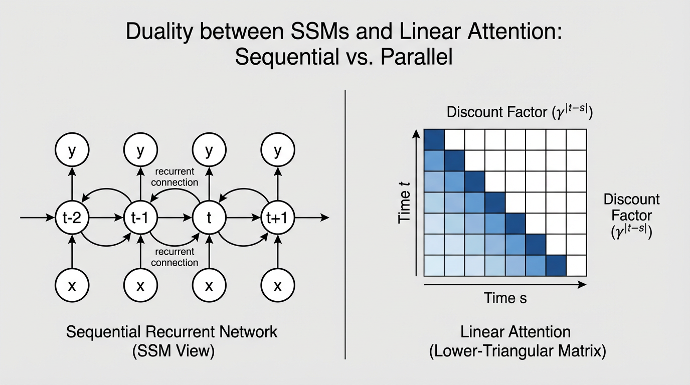

import SSMDualityVisualizer from '../../components/chapter-20/SSMDualityVisualizer.tsx';

# 20.2 Mamba & S6: The Technical Evolution

While the concept of State Space Models (SSMs) provided a theoretical pathway to linear-time sequence modeling, making it competitive with the Transformer required rigorous algorithm-hardware co-design. The Mamba line of work is best read as a rapid sequence of evolving ideas rather than a single finished destination.

This section dissects the progression from Mamba-1's **Selective Scan (S6)** to Mamba-2's **Structured State Space Duality (SSD)**, then briefly discusses later follow-on work reported in the cited preprint as **Mamba-3 (MIMO)**.

---

## 1. Mamba-1's selective scan

Mamba-1 uses input-dependent $B,C,\Delta$. [[1]](#ref-1) Its stored $A$ coefficients have shape $D\times N$, representing only the **diagonal entries** of an $N\times N$ diagonal transition for each channel. Here $D$ is channel count and $N$ state size per channel. The rectangular coefficient array itself is not a diagonal matrix.

Associative composition of affine transitions permits parallel scans for training/prefill and one-step recurrent decoding. The scan core and surrounding projections have different computational properties; Mamba as a whole does not avoid matrix multiplication.


## 2. Structured State Space Duality (Mamba-2)

In mid-2024, researchers introduced **Mamba-2**, built upon the theoretical framework of **Structured State Space Duality (SSD)** [[2]](#ref-2). SSD provided a profound mathematical revelation: *Selective SSMs and Linear Attention are two sides of the same coin.*

To bridge this gap, Mamba-2 made a deliberate architectural compromise: it restricted the diagonal matrix $A$ to a **scalar-times-identity** structure ($A = a \cdot I$). By forcing all elements on the diagonal to be identical, the state update becomes uniform across the state dimension $N$.

This slight reduction in expressivity unlocked a massive computational advantage. With a scalar $A$, the sequential SSM update can be perfectly rewritten as a specialized attention mechanism. Specifically, it is equivalent to Linear Attention applied over a sequence, but multiplied by a **semi-separable causal mask** $\mathbf{L}$, where the discount factor between token $i$ and token $j$ is the cumulative product of the state transitions:

$$ \mathbf{L}_{ij} = \begin{cases} \prod_{k=j+1}^i a_k, & j \le i, \\ 0, & j>i. \end{cases} $$

Here $a_k$ is a discrete scalar transition, distinct from continuous-time $A$; the diagonal uses the empty product, equal to one.

### The Tensor Core Unlock
Because SSD reformulates the recurrence as an attention matrix, the computation can be executed using **chunkwise matrix multiplication**. The sequence is divided into blocks (e.g., chunks of 64 tokens).
1. **Intra-chunk:** Token interactions *within* the chunk are computed using standard MatMul (Linear Attention).
2. **Inter-chunk:** Propagate state dependencies across chunk boundaries. A scan or structured matrix multiplication can parallelize this computation; the dependency does not require a serial implementation.

The Mamba-2 paper’s 2–8× result concerns the measured **SSM core**, not an identical whole-training speedup or 100% Tensor Core utilization. [[2]](#ref-2) Report sequence/batch/state dimensions, device, precision and kernel version together.




<SSMDualityVisualizer client:load />

---

## 3. Implementing the Duality in PyTorch

To understand exactly how Mamba-2 transforms a recurrent loop into a matrix multiplication, examine the educational PyTorch implementation below. It demonstrates the chunkwise intra-block attention mechanism derived from the SSD framework.

> **Incomplete educational intra-chunk calculation.** Inter-chunk state propagation is omitted, so this is neither a full Mamba-2 block nor equivalent to recurrence over the whole sequence. Memory resets at each chunk. Scan, caching, masking, numerical stabilization and distributed execution are omitted. Inspect only the intra-chunk matrix operation on small FP32 tensors.

```python
import torch
import torch.nn as nn
import torch.nn.functional as F

class SimplifiedSSD(nn.Module):
    """
    An educational implementation of Structured State Space Duality (Mamba-2).
    Demonstrates the chunkwise matrix multiplication (MatMul) approach.
    """
    def __init__(self, d_model: int, d_state: int, chunk_size: int = 64):
        super().__init__()
        self.d_model = d_model
        self.d_state = d_state
        self.chunk_size = chunk_size

        # Mamba-2 restricts A to a scalar-times-identity structure.
        # We learn one scalar per channel.
        self.A_log = nn.Parameter(torch.randn(d_model))

        # In Mamba-2, X, B, C, and dt are projected in parallel
        self.in_proj = nn.Linear(d_model, d_model * 2 + d_state * 2)
        self.out_proj = nn.Linear(d_model, d_model)

    def forward(self, x: torch.Tensor) -> torch.Tensor:
        B_batch, L, D = x.shape

        # Pad sequence length to be a multiple of chunk_size
        pad_len = (self.chunk_size - (L % self.chunk_size)) % self.chunk_size
        if pad_len > 0:
            x = F.pad(x, (0, 0, 0, pad_len))

        L_padded = x.shape[1]
        num_chunks = L_padded // self.chunk_size

        # 1. Parallel Projection
        proj = self.in_proj(x)
        x_proj, dt_raw, B_mat, C_mat = torch.split(
            proj,
            [self.d_model, self.d_model, self.d_state, self.d_state],
            dim=-1
        )
        dt = F.softplus(dt_raw)

        # 2. Discretize A (Scalar-times-identity)
        A = -torch.exp(self.A_log) # (D,)
        dA = torch.exp(dt * A)     # (B, L, D)

        # Reshape into chunks: (Batch, Chunks, ChunkSize, Dim)
        x_chunks = x_proj.view(B_batch, num_chunks, self.chunk_size, D)
        B_chunks = B_mat.view(B_batch, num_chunks, self.chunk_size, self.d_state)
        C_chunks = C_mat.view(B_batch, num_chunks, self.chunk_size, self.d_state)
        dA_chunks = dA.view(B_batch, num_chunks, self.chunk_size, D)

        # 3. Compute the semi-separable distance mask for the chunk
        # L_{i,j} = \prod_{k=j+1}^i dA_k
        # [NOTE]: In production, this O(C^2) operation is fused natively in Triton.
        mask = torch.ones(B_batch, num_chunks, self.chunk_size, self.chunk_size, D, device=x.device)
        for i in range(self.chunk_size):
            for j in range(i):
                mask[:, :, i, j, :] = torch.prod(dA_chunks[:, :, j+1:i+1, :], dim=2)

        # Apply causal masking (lower triangular)
        causal_mask = torch.tril(torch.ones(self.chunk_size, self.chunk_size, device=x.device))
        mask = mask * causal_mask.view(1, 1, self.chunk_size, self.chunk_size, 1)

        # 4. Discretize B and Compute State V
        dB_chunks = dt.view(B_batch, num_chunks, self.chunk_size, D).unsqueeze(-1) * B_chunks.unsqueeze(-2)
        V = dB_chunks * x_chunks.unsqueeze(-1) # (B, Chunks, ChunkSize, D, d_state)

        # 5. Intra-chunk Attention: Y = C * (Mask @ V)
        # We multiply V by the mask along the sequence dimension 'j'
        attn_out = torch.einsum('bnijd,bnjde->bnide', mask, V)
        Y_intra = torch.einsum('bnide,bnie->bnid', attn_out, C_chunks) # (B, Chunks, ChunkSize, D)

        # [NOTE]: Inter-chunk recurrence (passing the hidden state between chunks)
        # is omitted here for brevity, but follows a similar block-wise update.

        y = Y_intra.view(B_batch, L_padded, D)
        if pad_len > 0:
            y = y[:, :L, :]

        return self.out_proj(y)
```

---

## 4. Mamba-3 research case

**As of 2026-11-15, referring to the cited 2026 paper.** Mamba-3 combines a discretization-derived recurrence, complex state and MIMO to study state tracking and decode efficiency. [[3]](#ref-3) The reported 1.8 percentage-point gain at 1.5B is over Gated DeltaNet, not Mamba-2. Separate state-size experiments report similar perplexity to Mamba-2 with half its state size.

Those are distinct comparisons. Complex state and MIMO do not guarantee better quality at unchanged latency for every task. Validate under matched resources, including state precision, memory and kernels.


## 5. Compare design axes

| Design | Main choice | Costs and limitations to test |
| :--- | :--- | :--- |
| Mamba-1 | Per-channel diagonal transitions and selective scan | State capacity; scan versus projection work |
| Mamba-2 | Scalar transition across state coordinates and SSD | Intra/inter-chunk work; core versus whole-model speed |
| Mamba-3 | Complex state, MIMO and changed discretization | State tracking, precision and actual decode latency |


## 6. Choose for the workload

- **Long incoming streams:** Fixed-size state may help with logs, sensors or audio. Evaluate which information must survive in that state.
- **Exact retrieval:** Compare pure SSM, attention and hybrid candidates on the same recall tests. A hybrid does not guarantee a correct answer.
- **Decode cost:** If KV is the actual bottleneck, consider recurrence while including projections, state updates and kernel support.
- **General tasks:** Select by required quality, cost and latency rather than the architecture family name.

Check actual device arithmetic intensity, kernel maturity, batch/length distributions and exact recall alongside asymptotic complexity.

## 7. Practical takeaway

The common lesson is to design recurrence and hardware execution together. A fixed-size state does not provide infinite memory. Test exact recall, long-horizon state tracking, stability after quantization, prefix restoration and rollback for the intended workload.


## Quizzes

<details>
<summary>Quiz 1: Must Mamba-1 training execute tokens serially?</summary>
*No. Associative composition of affine transitions supports parallel scan. Distinguish one-step decoding from whole-sequence training execution.*
</details>

<details>
<summary>Quiz 2: Why can SSD use efficient matrix multiplication?</summary>
*Scalar transitions permit structured matrix formulations of within-chunk and boundary-state computations. Speed depends on shapes, hardware and kernels; full Tensor Core utilization is not guaranteed.*
</details>

<details>
<summary>Quiz 3: How should MIMO quality and speed be compared?</summary>
*Fix kernels, precision, batch and length, and match model/state sizes or an explicitly defined resource budget. Unchanged latency in one experiment is not a hardware- or task-independent guarantee.*
</details>

<details>
<summary>Quiz 4: Which state-tracking limitation do Mamba-3 complex transitions address?</summary>
*They address restrictions from real nonnegative transition eigenvalues. Complex rotations express sign/phase dynamics, evaluated on tasks such as parity and modular arithmetic. The limitation is not caused solely by Mamba-2’s scalar restriction.*
</details>

---

## References

1. <a id="ref-1"></a>Gu, A., & Dao, T. (2023). *Mamba: Linear-Time Sequence Modeling with Selective State Spaces*. [arXiv:2312.00752](https://arxiv.org/abs/2312.00752).
2. <a id="ref-2"></a>Dao, T., & Gu, A. (2024). *Transformers are SSMs: Generalized Models and Efficient Algorithms Through Structured State Space Duality*. [arXiv:2405.21060](https://arxiv.org/abs/2405.21060).
3. <a id="ref-3"></a>Lahoti, A., Li, K. Y., Chen, B., Wang, C., Bick, A., Kolter, J. Z., Dao, T., & Gu, A. (2026). *Mamba-3: Improved Sequence Modeling using State Space Principles*. [arXiv:2603.15569](https://arxiv.org/abs/2603.15569).
