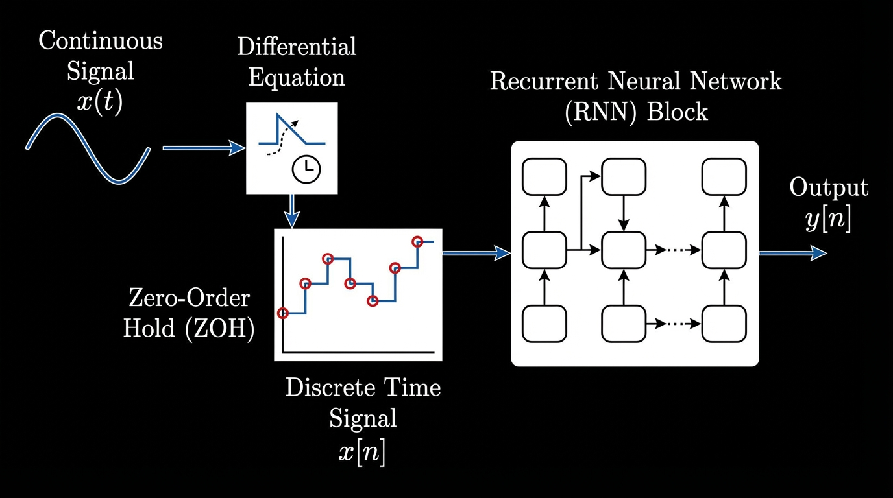

import SSMVsTransformerVisualizer from '../../components/chapter-20/SSMVsTransformerVisualizer.tsx';

# 20.1 State Space Models (SSM)

Long contexts make attention work and KV storage significant costs. State space models (SSMs) summarize history into a fixed-size recurrent state. With fixed width and state size, work can grow linearly with sequence length and decode state can remain independent of length, at the cost of compressing history. Constant memory refers to that recurrent state, not all model weights or training activations.

This chapter examines SSMs/Mamba, linear attention, models using programs, MTP, diffusion language models and world models as different design choices. None is assumed to replace the others universally.

## 1. From Continuous to Discrete: The Math of SSMs

State Space Models are not entirely new; they are foundational to control engineering (e.g., Kalman filters). The core idea is to map a 1-dimensional input signal $x(t)$ to an output signal $y(t)$ through an implicit latent state $h(t)$.

In continuous time, this is defined by a system of linear differential equations:

$$ h'(t) = \mathbf{A}h(t) + \mathbf{B}x(t) $$
$$ y(t) = \mathbf{C}h(t) + \mathbf{D}x(t) $$

Where:
*   $\mathbf{A}$ is the state transition matrix (how the hidden state evolves).
*   $\mathbf{B}$ projects the input into the state space.
*   $\mathbf{C}$ projects the state back to the output space.
*   $\mathbf{D}$ is a direct skip connection (often omitted or treated as a simple residual).

To use this in a neural network processing discrete tokens (like words in a sentence), we must discretize the continuous system. We introduce a timescale parameter $\Delta$, which represents the step size. Using a technique called **Zero-Order Hold (ZOH)**, we convert the continuous matrices $(\mathbf{A}, \mathbf{B})$ into discrete matrices $(\bar{\mathbf{A}}, \bar{\mathbf{B}})$:

$$ \bar{\mathbf{A}} = \exp(\Delta \mathbf{A}) $$
$$ \bar{\mathbf{B}} = \left(\int_0^\Delta \exp(\tau\mathbf{A})\,d\tau\right)\mathbf{B}. $$

The integral remains defined for singular $\mathbf A$. If invertible, it equals $\mathbf A^{-1}(\exp(\Delta\mathbf A)-\mathbf I)\mathbf B$. The expression $\bar{\mathbf B}\approx\Delta\mathbf B$ is a small-step first-order approximation, not the general exact ZOH formula.

This yields the discrete recurrent update rule:

$$ h_t = \bar{\mathbf{A}} h_{t-1} + \bar{\mathbf{B}} x_t $$
$$ y_t = \mathbf{C} h_t $$



S4 uses **bilinear discretization**, not the ZOH formula above. [[5]](#ref-5) A fixed linear time-invariant (LTI) core admits convolutional evaluation, but its transition does not change with token content. This does not mean an entire nonlinear network around that core cannot reason.

---

## 2. Input-dependent selection

Mamba makes $B_t,C_t,\Delta_t$ depend on input $x_t$. [[1]](#ref-1) $B_t$ controls writing, $C_t$ reading, and positive $\Delta_t$ the timescale of state change. A small step can limit change; it is not a universal rule to ignore particular words.

Input dependence prevents reuse of a fixed LTI convolution. But affine state transitions compose associatively, enabling parallel scans during training/prefill and single-step recurrence during decode. The original paper's up-to-5× result concerns measured **inference throughput**, not a guarantee about whole-run training speed.

<SSMVsTransformerVisualizer client:load lang="en" />


## 3. Mamba-2 and SSD

Mamba-2's structured state space duality (SSD) exploits connections between a restricted SSM and structured attention. [[2]](#ref-2) A transition scalar shared across state coordinates enables matrix-multiplication-heavy work within chunks. State propagation between chunks remains necessary. Mathematical equivalence, kernel speed and whole-model speed are separate claims.


## 4. Accounting for hybrid memory

Jamba and Nemotron illustrate mixing SSM and attention layers. [[3]](#ref-3) [[4]](#ref-4) Recurrence compresses history while attention accesses explicit KV representations; neither guarantees perfect recall.

Active parameters are not the total weight footprint. For example, 52B total BF16 parameters occupy $52\times10^9\times2=104$ GB. Activating only 12B does not make all weights fit on an 80 GB device without quantization, distribution or offloading. KV, recurrent state, activations, temporary buffers and metadata are additional.

| Stack | Sequence work at fixed width | Decode context state |
| :--- | :--- | :--- |
| Dense attention | Prefill $O(L^2)$; next-token attention $O(L)$ | KV grows as $O(L)$ |
| Pure selective SSM | $O(L)$ | $O(1)$ with respect to length |
| Hybrid retaining attention | Remaining dense-attention layers still cost $O(L^2)$ | Their KV still grows as $O(L)$ |

Here $L$ is sequence length. A hybrid can reduce constants without making every layer linear. Measure speed and memory at matched quality, batch and length, and test recall, prefix restoration and branch rollback.


## 5. Engineering the Dispatcher: The Selective Scan in PyTorch

> **Educational sequential calculation.** This is not a trained Mamba block. The input coefficient uses the $\Delta B$ approximation; convolution, gates, caching, padding, stable mixed precision and distributed kernels are omitted. Mamba-1 uses parallel scan and Mamba-2 uses SSD. This code illustrates small FP32 tensors.

```python
import torch
import torch.nn as nn
import torch.nn.functional as F

class SimplifiedSelectiveSSM(nn.Module):
    """
    A simplified, educational implementation of a Selective State Space Model.
    Shows input-dependent parameters, exact exp(dt*A), and first-order dt*B.
    """
    def __init__(self, d_model: int, d_state: int):
        super().__init__()
        self.d_model = d_model
        self.d_state = d_state

        # Projections for the input-dependent parameters (The "Selective" part)
        # dt: step size, B and C: state transition matrices
        self.dt_proj = nn.Linear(d_model, d_model)
        self.B_proj = nn.Linear(d_model, d_state)
        self.C_proj = nn.Linear(d_model, d_state)

        # A is typically initialized to a specific structure (e.g., HiPPO matrix)
        # for structured dynamics; here A_log is an ordinary trainable parameter.
        # We represent log(A) to ensure A remains strictly negative (for stability).
        self.A_log = nn.Parameter(torch.randn(d_model, d_state))

        # Skip connection
        self.D = nn.Parameter(torch.randn(d_model))

    def forward(self, x: torch.Tensor) -> torch.Tensor:
        # x shape: (batch_size, seq_len, d_model)
        B, L, D = x.shape

        # 1. Compute input-dependent parameters across the whole sequence
        # Softplus ensures the step size (\Delta) is strictly positive
        dt = F.softplus(self.dt_proj(x)) # (B, L, D)
        B_mat = self.B_proj(x)           # (B, L, d_state)
        C_mat = self.C_proj(x)           # (B, L, d_state)

        # Negative A contracts the homogeneous recurrence; input gains can still grow.
        A = -torch.exp(self.A_log)       # (D, d_state)

        # 2. Discretize and compute state updates
        # [EDUCATIONAL NOTE]: This loop is sequential for clarity.
        # Mamba-1 uses a parallel associative scan here. Mamba-2 uses SSD block-matmul.
        y = torch.zeros_like(x)
        h = torch.zeros(B, D, self.d_state, device=x.device, dtype=x.dtype) # Initial hidden state

        for t in range(L):
            x_t = x[:, t, :]       # (B, D)
            dt_t = dt[:, t, :]     # (B, D)
            B_t = B_mat[:, t, :]   # (B, d_state)
            C_t = C_mat[:, t, :]   # (B, d_state)

            # Exponential transition with a first-order input coefficient
            # \bar{A} = exp(dt * A)
            # \bar{B} \approx dt * B
            dA = torch.exp(dt_t.unsqueeze(-1) * A)                 # (B, D, d_state)
            dB = dt_t.unsqueeze(-1) * B_t.unsqueeze(1)             # (B, D, d_state)

            # State update: h_t = \bar{A} h_{t-1} + \bar{B} x_t
            h = dA * h + dB * x_t.unsqueeze(-1)                    # (B, D, d_state)

            # Output projection: y_t = C h_t + D x_t
            y_t = torch.sum(h * C_t.unsqueeze(1), dim=-1) + self.D * x_t # (B, D)
            y[:, t, :] = y_t

        return y

# Example usage simulating a forward pass
# Batch=2, Seq_len=128, D_model=512, D_state=16
model = SimplifiedSelectiveSSM(d_model=512, d_state=16)
dummy_input = torch.randn(2, 128, 512)
output = model(dummy_input)

print(f"Input shape: {dummy_input.shape}")   # torch.Size([2, 128, 512])
print(f"Output shape: {output.shape}")       # torch.Size([2, 128, 512])
```

---

## 6. Practical takeaway

A fixed-size state helps when its compressed history is sufficient for the task. Evaluate quality by length, state precision, continuation equivalence after restoration and actual device cost together. The next section examines how Mamba scans and SSD execute recurrences differently.


## Quizzes

<details>
<summary>Quiz 1: What differs between an LTI core and a selective SSM?</summary>
*An LTI core uses time-independent coefficients; a selective SSM can make coefficients input-dependent. This does not imply that a nonlinear network containing an LTI core cannot reason.*
</details>

<details>
<summary>Quiz 2: Which memory cost does a selective scan kernel reduce?</summary>
*Fusion and recomputation reduce repeated HBM writes of large intermediate states. This does not put all model state or the whole training run inside SRAM.*
</details>

<details>
<summary>Quiz 3: Does linear complexity determine actual speed?</summary>
*No. Batch, sequence and state dimensions, memory bandwidth, kernels and matrix-multiplication efficiency matter. SSD offers efficient matmul opportunities, but whole-model speed must be measured.*
</details>

<details>
<summary>Quiz 4: What must be accounted for when a hybrid retains attention layers?</summary>
*Count their length-dependent KV and quadratic prefill work separately. Distinguish total from active weights; constant recurrent-state size does not make total memory constant.*
</details>

---

## References

1. <a id="ref-1"></a>Gu, A., & Dao, T. (2023). *Mamba: Linear-Time Sequence Modeling with Selective State Spaces*. [arXiv:2312.00752](https://arxiv.org/abs/2312.00752).
2. <a id="ref-2"></a>Dao, T., & Gu, A. (2024). *Transformers are SSMs: Generalized Models and Efficient Algorithms Through Structured State Space Duality (Mamba-2)*. [arXiv:2405.21060](https://arxiv.org/abs/2405.21060).
3. <a id="ref-3"></a>Lieber, O., et al. (2024). *Jamba: A Hybrid Transformer-Mamba Language Model*. AI21 Labs. [arXiv:2403.19887](https://arxiv.org/abs/2403.19887).
4. <a id="ref-4"></a>NVIDIA. (2025). *Nemotron-Nano: An Accurate and Efficient Hybrid Mamba-Transformer Reasoning Model*. [arXiv:2504.03624](https://arxiv.org/abs/2504.03624).

5. <a id="ref-5"></a>Gu, A., Goel, K., & Ré, C. (2022). *Efficiently Modeling Long Sequences with Structured State Spaces.* [S4 paper](https://arxiv.org/abs/2111.00396).
