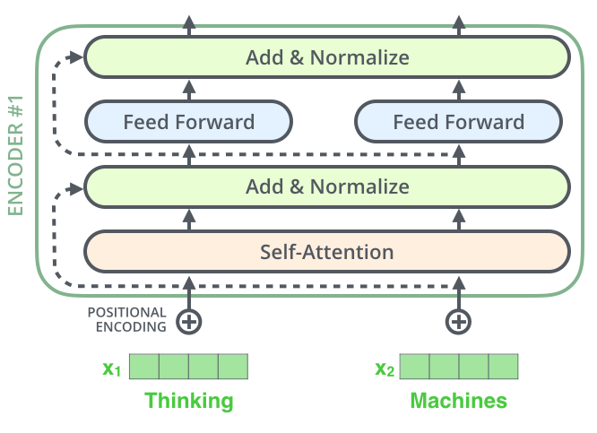

import LayerNormVisualizer from '../../components/chapter-3/LayerNormVisualizer';

# 3.4 Layer Normalization & Residuals

A token has two features, `[1, 3]`. Add 10 to both and you get `[11, 13]`. Which normalization can tell the two tokens apart? **LayerNorm** subtracts the feature mean, so both become `[-1, 1]` before rescaling. **RMSNorm** divides by the root mean square without subtracting that mean, so the offset changes its output. This distinction matters when reproducing a checkpoint whose residual stream feeds one of these operations at every layer. [[2]](#ref-2) [[7]](#ref-7)

<a id="motivation-the-deep-network-dilemma"></a>
<a id="the-metaphor-the-choir-and-the-shortcut"></a>
<a id="example-normalization-effect"></a>
<a id="normalization-example"></a>

## Try the offset and then the nearly constant token

Compare `[1, 3]` with `[11, 13]` at epsilon `0.00001`. LayerNorm gives approximately `[-0.999995, 0.999995]` for either one. RMSNorm changes from `[0.447213, 1.341639]` to `[0.913500, 1.079591]`. Each example uses unit gain and zero bias where applicable. You can [reproduce the numbers in PyTorch](#pytorch-normalization-check).

<LayerNormVisualizer client:load lang="en" />

<a id="layer-normalization-keeping-it-stable"></a>

## What does epsilon change?

For a Transformer tensor shaped `[batch, tokens, features]`, take one token's $d$ features $x_i$. Let $\mu$ be their mean and $v=\frac1d\sum_i(x_i-\mu)^2$ their population variance. Neither operation pools across tokens or batch items. With per-feature gain $\gamma_i$, LayerNorm bias $\beta_i$, and positive constant $\epsilon$, the two operations are [[2]](#ref-2) [[7]](#ref-7) [[8]](#ref-8)

$$
\begin{aligned}
\operatorname{LN}(x)_i &= \gamma_i\frac{x_i-\mu}{\sqrt{v+\epsilon}}+\beta_i,\\
\operatorname{RMSNorm}(x)_i &= \gamma_i\frac{x_i}{\sqrt{\frac1d\sum_j x_j^2+\epsilon}}.
\end{aligned}
$$

For the nearly constant token `[1, 1.002]`, the centered features are $-0.001$ and $+0.001$, so $v=10^{-6}$. At $\epsilon=10^{-5}$, LayerNorm divides by $\sqrt{0.000011}$ and returns approximately `[-0.30151, 0.30151]`. Raise epsilon to `0.001` and the magnitudes fall to `0.03161`. Putting epsilon outside the square root would produce different answers.

With unit gain and zero bias, the LayerNorm output has mean zero and variance $v/(v+\epsilon)$. In the first nearly constant case that variance is precisely $1/11$ in real arithmetic. For `[2, 2]` it is zero. A learned gain or bias can change the output statistics again. Floating-point checks should use a tolerance.

<a id="residual-connections-the-highway"></a>
<a id="pre-ln-vs-post-ln-the-architectural-shift"></a>

## What survives a zero residual branch?

He et al. trained deep image networks using residual blocks in which a branch learns an update to an existing representation. For an identity skip and a same-shape branch $F$, the sum is $x+F(x)$. Its derivative with respect to $x$ contains an identity term. The branch derivative can still amplify or cancel it. [[1]](#ref-1)

<a id="post-ln-original"></a>
<a id="pre-ln-modern-standard"></a>

Now set the branch output to zero and trace the two arrangements. The original Transformer placed LayerNorm after the addition. [[9]](#ref-9)

| One sublayer | Output | With a zero branch and input `[1, 3]` |
| --- | --- | --- |
| Pre-LN | $x+F(\operatorname{LN}(x))$ | `[1, 3]` |
| Post-LN | $\operatorname{LN}(x+F(x))$ | approximately `[-0.999995, 0.999995]` |

<figure>



<figcaption>Follow the dashed input around self-attention to the first addition. Normalization sees the sum. Figure by Jay Alammar, <a href="https://jalammar.github.io/illustrated-transformer/">The Illustrated Transformer</a>.</figcaption>
</figure>

Across $L$ Pre-LN blocks, suppose the branch updates are uncorrelated with each other and the starting state, each with variance $s^2$. Their variances then add, giving $\operatorname{Var}(x_L)=\operatorname{Var}(x_0)+Ls^2$ for one feature across examples. A trained network can have correlated updates.

In Pre-LN the residual stream can carry its input through this block unchanged when the branch contributes zero. In Post-LN the sum passes through the normalization Jacobian. Xiong et al. found large expected gradients near the output of their Post-LN models at initialization and studied when Pre-LN could train without warm-up. An optimizer schedule still needs validation for the chosen depth, data and precision. [[3]](#ref-3)

<a id="pytorch-implementation"></a>
<a id="pytorch-normalization-check"></a>

## Check both formulas on a CPU

Each row below is one token. The PyTorch 2.15 example uses float64 to make the discrepancy visible, omits learned affine parameters, and passes epsilon explicitly to both functions. `correction=0` uses the feature count as the variance denominator, as PyTorch LayerNorm does. [[8]](#ref-8)

```python
import torch
from torch.nn import functional as F

x = torch.tensor([[1, 3], [11, 13], [1, 1.002], [2, 2]], dtype=torch.float64)
mean = x.mean(dim=-1, keepdim=True)
variance = x.var(dim=-1, keepdim=True, correction=0)
for eps in (1e-5, 1e-3):
    ln = F.layer_norm(x, (2,), eps=eps)
    rms = F.rms_norm(x, (2,), eps=eps)
    torch.testing.assert_close(ln, (x - mean) / (variance + eps).sqrt())
    torch.testing.assert_close(rms, x / (x.square().mean(-1, keepdim=True) + eps).sqrt())
    torch.testing.assert_close(ln[0], ln[1])
    torch.testing.assert_close(ln[3], torch.zeros_like(ln[3]))
    assert not torch.allclose(rms[0], rms[1])
    print(eps, ln[2].tolist(), ln[2].var(correction=0).item())
```

The last number on each line is the nearly constant token's output variance, approximately `0.090909` and `0.000999`. When porting a block, compare the same hidden states before and after normalization. Check the feature axis, population variance, epsilon placement, affine weights and residual ordering before attributing a mismatch to precision.

<a id="research-update-routing-across-depth"></a>
<a id="simplehc-residual-access-is-a-systems-choice"></a>

## What recent residual designs change

**Research snapshot as of 2026-11-25.** Attention Residuals learns weights over earlier layer outputs. Its block variant groups layers to reduce the number of earlier states that must be read or communicated. Low-Rank Attention Residuals uses narrow keys to compute routing weights while preserving full-width residual values. Su reports results for 1B and 4B models. Both approaches make depth another selection axis alongside attention over token positions. [[4]](#ref-4) [[5]](#ref-5)

SimpleHC retains learned read and write gates, removes residual mixing, and shares a group-entry state across sublayers. The authors report comparable downstream performance to mHC on their 15B and 30B MoE models. To assess that trade-off on another training system, match data, depth and compute, then compare validation quality, gradient and activation norms, memory traffic and measured step time. [[6]](#ref-6)

## Quizzes

<details>
<summary>Quiz 1: Adding the same constant to both features leaves LayerNorm unchanged. Why does RMSNorm move?</summary>
*LayerNorm subtracts the shifted mean and preserves the original centered differences. RMSNorm rescales the uncentered token. Both its numerator and its denominator respond to the offset.*
</details>

<details>
<summary>Quiz 2: Is a LayerNorm output variance close to zero necessarily an implementation error?</summary>
*No. With unit gain and zero bias, the variance is v/(v+epsilon). For a constant input it is zero, and for variance much smaller than epsilon it is close to zero.*
</details>

<details>
<summary>Quiz 3: How can a zero branch distinguish Pre-LN from Post-LN?</summary>
*Pre-LN returns the original input through the skip path. Post-LN normalizes the input even when there is nothing to add. Choose an input such as [1, 3] whose normalized value differs from its original value.*
</details>

<details>
<summary>Quiz 4: Why does an identity skip fail to guarantee stable gradients at any depth?</summary>
*The branch derivative adds to the identity and can cancel or amplify it. In Post-LN the derivative of normalization acts on that residual sum. The resulting Jacobians compound across blocks.*
</details>

<details>
<summary>Quiz 5: What additional state must depth-wise attention read?</summary>
*It needs earlier sublayer or block representations to compute and combine their contributions. The number of states and the width of the routing keys affect storage, traffic and step time.*
</details>

## References

1. <a id="ref-1"></a>He, K., et al. (2016). [Deep Residual Learning for Image Recognition](https://openaccess.thecvf.com/content_cvpr_2016/html/He_Deep_Residual_Learning_CVPR_2016_paper.html).
2. <a id="ref-2"></a>Ba, J. L., Kiros, J. R., & Hinton, G. E. (2016). [Layer Normalization](https://arxiv.org/abs/1607.06450).
3. <a id="ref-3"></a>Xiong, R., et al. (2020). [On Layer Normalization in the Transformer Architecture](https://arxiv.org/abs/2002.04745).
4. <a id="ref-4"></a>Kimi Team. (2026). [Attention Residuals](https://arxiv.org/abs/2603.15031).
5. <a id="ref-5"></a>Su, J. (2026). [Low-Rank Attention Residuals](https://arxiv.org/abs/2607.09694).
6. <a id="ref-6"></a>Zhang, X., et al. (2026). [On the Design of Hyper-Connections: Simplification, Stability, and Scalability](https://arxiv.org/html/2611.05984v1).
7. <a id="ref-7"></a>Zhang, B., & Sennrich, R. (2019). [Root Mean Square Layer Normalization](https://arxiv.org/abs/1910.07467).
8. <a id="ref-8"></a>PyTorch 2.15 documentation. [LayerNorm](https://docs.pytorch.org/docs/2.15/generated/torch.nn.LayerNorm.html) and [RMSNorm](https://docs.pytorch.org/docs/2.15/generated/torch.nn.RMSNorm.html).
9. <a id="ref-9"></a>Vaswani, A., et al. (2017). [Attention Is All You Need, §3.1](https://arxiv.org/html/1706.03762).
