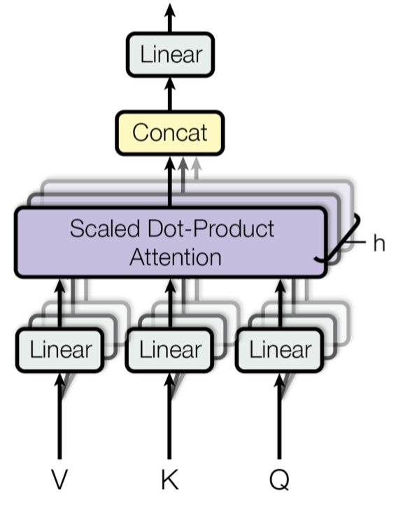

import MhaVisualizer from '../../components/chapter-3/MhaVisualizer.tsx';

# 3.2 Multi-head Attention (MHA)

For a given query, one attention head assigns each source position a weight. Every coordinate of its value vector uses that same set of weights. Suppose one part of the output needs a number from the first token while another needs a feature from the last. Two heads can give those reads separate distributions and then mix the two results. [[1]](#ref-1)

---

### **The Metaphor: The Committee of Experts**

Give two reviewers the same report. Each can point to a different passage and return a short note. An editor combines the notes. In multi-head attention, the projections determine which queries, keys and values each head sees. Training determines whether two heads learn different patterns. The architecture assigns neither reviewer a subject area.

---

## Why Multi-Head? (Representation Subspaces)

Consider a sequence with three input vectors, $A=(1,0)$, $B=(0,1)$ and $C=(1,1)$. Let the first head read the first coordinate for both its query and key, and let the second head read the second coordinate. Take C as the query. Both query coordinates are 1. The first head therefore gives A and C equal scores, while the second gives B and C equal scores. Both read all three inputs in this unmasked example.

Values decide what gets carried forward. For a token with coordinates $(x,y)$, let head 1 return the value $x-y$ and head 2 return $2y$. Head 1 reads the values $[1,-1,0]$, so two attended tokens can partially cancel. A high weight alone does not tell you the head's output. The [two-head calculation](#two-head-calculation) lets you trace these weights into the final vector.

---

## The Mathematics of Multi-Head Attention

Here $Q$, $K$ and $V$ denote the inputs to the three projections. In self-attention they can all be the same sequence matrix $X$. Each head has its own query and key width $d_k$ and value width $d_v$ in the equations below. Concatenation joins the $h$ results along the feature axis at each query position.

$$\text{MultiHead}(Q, K, V) = \text{Concat}(\text{head}_1, \dots, \text{head}_h)W^O$$

<div style={{ display: 'flex', flexDirection: 'column', alignItems: 'center', width: '100%', margin: '20px 0' }}>

<div style={{ maxWidth: '600px', width: '100%' }}>

</div>

<em style={{ marginTop: '10px', color: '#7f8c8d' }}>Vaswani et al., Figure 2 (right), reproduced in [Lilian Weng’s attention overview](https://lilianweng.github.io/posts/2018-06-24-attention/). [[1]](#ref-1)</em>

</div>

Where:
$$\text{head}_i = \text{Attention}(QW_i^Q, KW_i^K, VW_i^V)$$

And the projections are parameter matrices:
*   $W_i^Q \in \mathbb{R}^{d_{model} \times d_k}$
*   $W_i^K \in \mathbb{R}^{d_{model} \times d_k}$
*   $W_i^V \in \mathbb{R}^{d_{model} \times d_v}$
*   $W^O \in \mathbb{R}^{hd_v \times d_{model}}$

The original base Transformer used $h=8$ with $d_{model}=512$, giving $d_k=d_v=64$ per head [[1]](#ref-1). More generally, an implementation can choose $h$ to divide the model width evenly. At fixed width and sequence length, the leading score-matrix multiply count stays roughly constant as $h$ grows. A naive implementation that saves every attention weight still stores one sequence-by-sequence matrix per head.

---

## PyTorch Implementation

This CPU example exposes the intermediate weights. It takes batched float32 queries, keys and values of the same feature width. Keys and values have the same sequence length. The optional mask is one boolean query-by-key matrix shared across batches and heads. `True` allows the connection. The code rejects fully blocked rows, whose softmax would have no visible positions. It omits dropout, per-example padding masks, caching and fused kernels.

```python
import torch
from torch import nn


class MultiHeadAttention(nn.Module):
    def __init__(self, width, heads):
        super().__init__()
        if width < 1 or heads < 1 or width % heads:
            raise ValueError("width and heads must be positive, with width divisible by heads")
        self.heads = heads
        self.head_width = width // heads
        self.w_q = nn.Linear(width, width, bias=False)
        self.w_k = nn.Linear(width, width, bias=False)
        self.w_v = nn.Linear(width, width, bias=False)
        self.w_o = nn.Linear(width, width, bias=False)

    def split(self, x):
        batch, length, _ = x.shape
        return x.reshape(batch, length, self.heads, self.head_width).transpose(1, 2)

    def forward(self, q, k, v, allowed=None):
        queries = self.split(self.w_q(q))
        keys = self.split(self.w_k(k))
        values = self.split(self.w_v(v))
        scores = (queries @ keys.transpose(-2, -1)) / self.head_width**0.5
        if allowed is not None:
            if allowed.dtype != torch.bool or allowed.shape != scores.shape[-2:]:
                raise ValueError("expected a shared boolean [query, key] mask")
            if not allowed.any(dim=-1).all():
                raise ValueError("each query must have a visible key")
            scores = scores.masked_fill(~allowed, -torch.inf)
        weights = scores.softmax(dim=-1)
        context = weights @ values
        joined = context.transpose(1, 2).reshape(q.shape)
        return self.w_o(joined), weights


layer = MultiHeadAttention(width=2, heads=2)
x = torch.tensor([[[1., 0.], [0., 1.], [1., 1.]]])
with torch.no_grad():
    layer.w_q.weight.copy_(torch.eye(2))
    layer.w_k.weight.copy_(torch.eye(2))
    layer.w_v.weight.copy_(torch.tensor([[1., -1.], [0., 2.]]))
    layer.w_o.weight.copy_(torch.tensor([[1., 1.], [1., -1.]]))
    output, weights = layer(x, x, x)
    torch.testing.assert_close(output[0, 2], torch.tensor([1.956232, -1.422319]))
    visible = torch.ones(3, 3, dtype=torch.bool).tril()
    _, causal_weights = layer(x, x, x, visible)
    assert torch.count_nonzero(causal_weights.triu(1)) == 0
    torch.testing.assert_close(causal_weights.sum(-1), torch.ones(1, 2, 3))
```

The unmasked call reproduces the worked example at query C. The second call applies a causal mask. Its assertions check that future positions receive zero weight and the visible weights sum to one.

---

## Example: Diverse Perspectives

At C, the two heads return approximately $0.267$ and $1.689$. The output projection maps their concatenation $(u,v)$ to $(u+v,u-v)$, giving $(1.956,-1.422)$ after rounding. Predict which coordinates change if the second head's contribution is set to zero immediately before this projection. Then change the query from C to A and explain why only one head's weights change.

<MhaVisualizer client:load lang="en" />

---

## Quizzes

<details>
<summary>Quiz 1: When the query changes from C to A, why does head 2 give each token the same weight?</summary>
*Head 2 reads the query's second coordinate. At A it is zero, so all three scalar dot products are zero. Their softmax is uniform. Head 1 still reads 1 at both C and A.*
</details>

<details>
<summary>Quiz 2: What does muting head 2 at query C change?</summary>
*Its attention weights and raw weighted value stay the same. Its contribution to the concatenation becomes zero, so the output changes from about (1.956, −1.422) to (0.267, 0.267). Both output coordinates use the second head.*
</details>

<details>
<summary>Quiz 3: A layer has width 512 and eight equal-width heads. How many features are joined at one query position?</summary>
*Each head supplies 64 value coordinates. Concatenation supplies 8 × 64 = 512 features to the output projection.*
</details>

<details>
<summary>Quiz 4: Why can increasing the number of heads at fixed model width still increase memory use?</summary>
*Each dot product gets narrower, but a naive implementation stores a full query-by-key weight matrix per head. With a fixed batch and sequence length, doubling the head count doubles the number of stored weights. Kernels that avoid materializing those matrices have a different memory profile.*
</details>

<details>
<summary>Quiz 5: Why does this example reject a query whose entire mask row is false?</summary>
*Every key is blocked, leaving no distribution over visible keys. Filling every score with the same large finite negative value would silently give every blocked key the same weight.*
</details>

---

## References

1. <a id="ref-1"></a>Vaswani, A., et al. (2017). *Attention is all you need*. In Advances in neural information processing systems (pp. 5998-6008). [arXiv:1706.03762](https://arxiv.org/abs/1706.03762).
