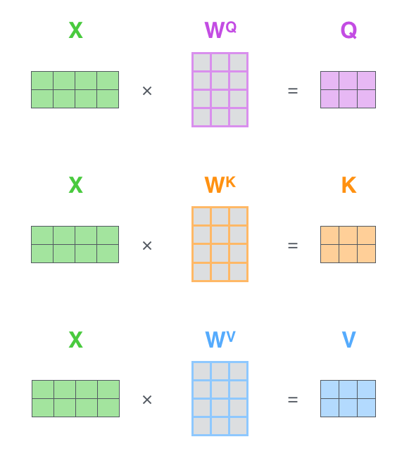

import AttentionVisualizer from '../../components/chapter-3/AttentionVisualizer';

# 3.1 Self-Attention Mathematics

A recurrent model passes information through a chain: to connect the first token to the hundredth, the computation traverses the intervening positions. Self-attention gives each position a direct, learned way to read other positions. In the original Transformer, this removed the recurrence that limited parallelism within training examples [[1]](#ref-1).

Consider “The key to the cabinets is missing.” The representation at “is” can combine information from “key” without first compressing the whole prefix into one recurrent state. That is a capability of the architecture, not proof that a particular head learns this grammatical relationship. A causal decoder can read only earlier positions and itself; parallel training does not make autoregressive generation parallel.

The mechanism has three parts: decide what to look for, score what is available, and mix the information found. The filing-cabinet analogy makes those roles concrete.

---

### **The Metaphor: The Filing Cabinet System**

Imagine you are doing research in a library with a highly efficient filing system.

*   **Query ($Q$):** This is what you are looking for. You have a topic in mind (e.g., "How do birds fly?").
*   **Key ($K$):** These are the labels or tags on the filing folders. Each folder has a summary of what's inside.
*   **Value ($V$):** This is the actual content inside the folder.

To find the information you need:
1.  You compare your **Query** against all the **Keys** to see which folders are relevant.
2.  You calculate a **relevance score** (Attention weight) for each folder.
3.  You extract the **Values** from the folders, giving more weight to the values from folders with high relevance scores.

In self-attention, each token position supplies a query, key, and value. The mask determines which other positions it may read; a causal decoder cannot inspect future tokens.

---

## From Embeddings to Q, K, V: Linear Projections

In practice, we don't use the input word embeddings directly as Queries, Keys, and Values. Instead, we project them into different spaces using learnable weight matrices.

Given an input sequence represented as a matrix $X \in \mathbb{R}^{T \times d_{model}}$, where $T$ is the sequence length and $d_{model}$ is the embedding dimension:

$$Q = XW_Q$$
$$K = XW_K$$
$$V = XW_V$$

Where the learnable weight matrices are:
*   $W_Q \in \mathbb{R}^{d_{model} \times d_k}$
*   $W_K \in \mathbb{R}^{d_{model} \times d_k}$
*   $W_V \in \mathbb{R}^{d_{model} \times d_v}$

**Why do we do this?**
Using $X$ for all three roles would tie “what to look for,” “how to be found,” and “what to return” to the same representation. Separate learned projections let those roles differ. In deeper layers, $X$ already contains contextual information from earlier layers; it is not necessarily a table of static word embeddings.

---

## The Mathematics of Scaled Dot-Product Attention

The core operation of Self-Attention is the **Scaled Dot-Product Attention**. Given a set of Queries, Keys, and Values packed into matrices $Q, K,$ and $V$, the operation is defined as:

$$\text{Attention}(Q, K, V) = \text{softmax}\left(\frac{QK^T}{\sqrt{d_k}}\right)V$$

<div style={{ display: 'flex', flexDirection: 'column', alignItems: 'center', width: '100%', margin: '20px 0' }}>

<div style={{ maxWidth: '600px', width: '100%' }}>

</div>

<em style={{ marginTop: '10px', color: '#7f8c8d' }}>Source: [The Illustrated Transformer by Jay Alammar](https://jalammar.github.io/illustrated-transformer/)</em>

</div>

Where:
*   $Q \in \mathbb{R}^{T \times d_k}$ (Matrix of Queries)
*   $K \in \mathbb{R}^{T \times d_k}$ (Matrix of Keys)
*   $V \in \mathbb{R}^{T \times d_v}$ (Matrix of Values)
*   $T$ is the sequence length.
*   $d_k$ is the dimension of the keys (and queries).
*   $\sqrt{d_k}$ is the scaling factor.

### Step-by-Step Breakdown

1.  **Dot Product ($QK^T$):** Measures the raw similarity between each query and all keys.
2.  **Scaling ($\frac{1}{\sqrt{d_k}}$):** Prevents the dot products from growing too large in magnitude, which would push the softmax function into regions with extremely small gradients.
3.  **Softmax:** Converts the scaled scores into probabilities (attention weights) that sum to 1.
4.  **Weighted Sum ($V$):** Multiplies the attention weights by the values to get the final output.

---

## PyTorch Implementation

This small implementation exposes the score matrix and weighted sum.

> **Deliberately simplified implementation.** The example uses CPU float32 and materializes the full attention matrix. It omits dropout, mixed-precision accumulation, fused kernels, and cache offsets. A supplied mask uses 1/True for allowed positions and must leave at least one key visible in every query row; otherwise this finite-mask implementation gives a meaningless distribution.

```python
import torch
import torch.nn as nn
import torch.nn.functional as F

def scaled_dot_product_attention(query, key, value, mask=None):
    """
    Compute Scaled Dot-Product Attention.
    """
    d_k = query.size(-1)
    
    # Step 1 & 2: Dot product and scaling
    # query shape: (batch, heads, seq_len, d_k)
    # key.transpose(-2, -1) shape: (batch, heads, d_k, seq_len)
    # scores shape: (batch, heads, seq_len, seq_len)
    scores = torch.matmul(query, key.transpose(-2, -1)) / (d_k ** 0.5)
    
    # Optional: Apply mask (e.g., for causal autoregressive decoding)
    if mask is not None:
        scores = scores.masked_fill(mask == 0, -1e9)
    
    # Step 3: Softmax to get attention weights
    attention_weights = F.softmax(scores, dim=-1)
    
    # Step 4: Weighted sum of values
    # output shape: (batch, heads, seq_len, d_v)
    output = torch.matmul(attention_weights, value)
    
    return output, attention_weights

# Example usage
batch_size = 1
seq_len = 4
d_k = 8
d_v = 8

# Random Tensors
Q = torch.randn(batch_size, 1, seq_len, d_k)
K = torch.randn(batch_size, 1, seq_len, d_k)
V = torch.randn(batch_size, 1, seq_len, d_v)

output, weights = scaled_dot_product_attention(Q, K, V)
print("Output Shape:", output.shape)
print("Attention Weights Shape:", weights.shape)
```

---

## Example: Attention Weight Matrix

Follow one attention row all the way to its output. The example below uses four tokens and explicitly authored two-dimensional Q, K, and V vectors. Select a query, compare the weights with and without a causal mask, and inspect how the weighted values add up. These are exact calculations on toy inputs, not attention measured from a trained model.

<AttentionVisualizer client:load lang="en" />

---

## Quizzes

<details>
<summary>Quiz 1: Why is the scaling factor $\sqrt{d_k}$ necessary in the attention formula?</summary>
*If query and key components are independent, zero-mean, and unit-variance, their dot product has variance $d_k$. Dividing by the square root of $d_k$ keeps its variance near one under those assumptions and reduces softmax saturation. Learned vectors need not satisfy them exactly, and this scaling alone does not guarantee stable training.*
</details>

<details>
<summary>Quiz 2: What is the difference between Self-Attention and standard Attention (like Bahdanau Attention)?</summary>
*Standard attention typically aligns a decoder state with encoder states (cross-attention). Self-attention relates different positions of a single sequence to compute a representation of the same sequence (e.g., words in a sentence attending to other words in the same sentence).*
</details>

<details>
<summary>Quiz 3: In the interactive example, why does the first token's output stop changing with temperature when the causal mask is enabled?</summary>
*Only the first token is visible to its own query. Its normalized weight is therefore 1 at every allowed temperature, and its output is exactly its value vector V₁ = [1, 0]. The other values cannot contribute because their masked weights are zero. These authored vectors demonstrate the calculation, not learned word meaning.*
</details>

<details>
<summary>Quiz 4: Why do we use linear projections to create Q, K, V instead of using the input embeddings directly?</summary>
*They let matching queries, matching keys, and returned values use different learned features. The input $X$ may already be contextual in deeper layers; the distinction is between roles, not between static and contextual representations.*
</details>

<details>
<summary>Quiz 5: How does Self-Attention handle variable-length sequences?</summary>
*Self-attention handles variable-length sequences naturally because the attention operation (weighted sum) does not depend on a fixed sequence length. The output dimension is determined by the input sequence length, and the same parameters (projection matrices) are used regardless of length.*
</details>

<details>
<summary>Quiz 6: Count parameters and dominant FLOPs for Q, K, V projections plus the attention core with sequence length $T$ and $d_k = d_v = d_{model}$. How does adding a square output projection change the count?</summary>
*Excluding biases and the output projection, the three projection matrices contain $3d_{model}^2$ parameters. Counting a multiply and add as two FLOPs, the projections cost $6Td_{model}^2$, while $QK^T$ and the weighted-value product together cost $4T^2d_{model}$. Thus the dominant total is $6Td_{model}^2 + 4T^2d_{model}$; scaling and softmax add $O(T^2)$ work. Adding $W_O \in \mathbb{R}^{d_{model} \times d_{model}}$ raises the parameter count to $4d_{model}^2$ and the dominant FLOPs to $8Td_{model}^2 + 4T^2d_{model}$. These counts exclude normalization and the feed-forward sublayer.*
</details>

---

## References

1. <a id="ref-1"></a>Vaswani, A., et al. (2017). *Attention is all you need*. In Advances in neural information processing systems (pp. 5998-6008). [arXiv:1706.03762](https://arxiv.org/abs/1706.03762).
