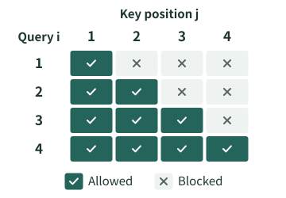

# 4.2 Decoder-only (GPT-style)

A training file contains `red blue`. A user has typed only `red`. In both cases a GPT-style decoder can predict what follows `red`. During training we can check how much probability it assigned to `blue`. When serving the user, we have to choose a token before we can continue.

<a id="the-metaphor-the-autoregressive-storyteller"></a>
<a id="shifted-target-example"></a>

## One sequence, three predictions

Suppose each color is one token. Add `BOS` for the beginning and `EOS` for the end of the sequence. The text `BOS red blue EOS` supplies three training targets.

| Prefix visible at this position | Target |
| --- | --- |
| `BOS` | `red` |
| `BOS red` | `blue` |
| `BOS red blue` | `EOS` |

The training batch contains the entire example. Within each layer, the model can compute all three rows in parallel because the correct prefixes are already known. This is **teacher forcing**. During generation the next prefix depends on the token actually selected. If the model generates another `red`, its next prediction must use `BOS red red`.

<a id="causal-self-attention-masking-the-future"></a>

## Which positions can a token read?

In **causal self-attention**, a query at position $i$ may read a key at position $j$ when $j \le i$. In the training example, the `red` position may read itself. Its target is the following token, `blue`, one position beyond that diagonal.

<figure>



<figcaption>At position 3, self-attention can use keys 1, 2 and 3. The diagram is drawn from the causal mask rule. The model computes the weights on the permitted positions from the query and key vectors.</figcaption>
</figure>

<a id="core-training-objective-causal-language-modeling-clm"></a>
<a id="the-mathematics-of-clm"></a>

## How much probability did the target receive?

Let $x_0$ be `BOS`, let $x_1,\ldots,x_T$ be the $T$ target tokens through `EOS`, and write $x_{0:t-1}$ for the visible prefix. A causal language model with parameters $\theta$ assigns the sequence this conditional probability:

$$P_\theta(x_{1:T}\mid x_0)=\prod_{t=1}^T P_\theta(x_t\mid x_{0:t-1}).$$

The mean training loss per target token is $-\frac{1}{T}\sum_{t=1}^T \log P_\theta(x_t\mid x_{0:t-1})$. Suppose the model assigns the three correct targets probabilities of 0.6, 0.5 and 0.7. The whole continuation gets probability $0.6\times0.5\times0.7=0.21$, giving a mean loss of about 0.520 nats per token.

<a id="pytorch-implementation-causal-mask"></a>

### Check the mask and the shifted labels in PyTorch

This CPU example uses one unpadded sequence and hand-written probabilities so you can check the loss by hand. The figure numbers four positions from 1. The code needs a three-by-three mask because `EOS` is the last target and has no following target of its own. The attention scores and vocabulary probabilities are separate quantities.

```python
import torch
import torch.nn.functional as F

bos, red, blue, eos = range(4)
sequence = torch.tensor([bos, red, blue, eos])
inputs, targets = sequence[:-1], sequence[1:]
positions = torch.arange(len(inputs))
allowed = positions[:, None] >= positions[None, :]
scores = torch.tensor([[1., 2., 3.], [0., 1., 2.], [2., 0., 1.]])
attention = scores.masked_fill(~allowed, -torch.inf).softmax(dim=-1)
assert attention[1, 2] == 0 and attention[1, 1] > 0

# One vocabulary distribution per prefix, in BOS/red/blue/EOS column order.
probs = torch.tensor([[.1, .6, .2, .1], [.1, .1, .5, .3], [.1, .1, .1, .7]])
loss = F.cross_entropy(probs.log(), targets)
print(f"{loss.item():.3f}")  # 0.520
assert probs[1].argmax().item() == blue
```

With the prompt `BOS red`, the last line illustrates greedy decoding: `blue` has the highest probability in the second row. Appending `blue` makes the third row applicable. Sampling could choose a different token, in which case we would need predictions for that different prefix.

<a id="evolution-and-key-models"></a>
<a id="1-gpt-3-2020"></a>
<a id="2-llama-3-2024"></a>
<a id="comparison-of-decoder-only-models"></a>

## Two published configurations

These are the configurations reported for the original releases, checked as of 2026-11-25. Their token counts use different tokenizers.

| Release | Pre-training tokens | Context length | Attention detail |
| --- | ---: | ---: | --- |
| GPT-3 175B (2020) [[1]](#ref-1) | 300 billion | 2,048 | Alternated dense and locally banded sparse attention layers |
| Llama 3 8B and 70B (April 2024) [[3]](#ref-3) | Over 15 trillion | 8,192 | Groups of query heads share key and value heads (GQA) |

Meta's later family report distinguishes the April Llama 3 models from the July Llama 3.1 release. A serving configuration needs the checkpoint version as well as the family name [[2]](#ref-2).

<a id="why-decoder-only-won-the-scaling-war"></a>
<a id="1-the-power-of-a-unified-objective"></a>
<a id="3-in-context-learning-and-prompting"></a>

## What scaling and prompting experiments measured

Kaplan et al. varied model size, training data and compute. Across the ranges they studied, held-out language-model loss followed approximate power laws. The loss measures how much probability the model assigns to text from the evaluation distribution. A translation error or a wrong answer to a reasoning problem needs its own evaluation [[4]](#ref-4).

Brown et al. gave GPT-3 instructions and, in the few-shot setting, worked examples in the prompt. The weights stayed fixed. The model could use demonstrations on tasks including translation, yet its reported few-shot accuracy on Word-in-Context was 49.4%, close to chance. That task asks whether a word has the same meaning in two sentences. The experiments establish task-specific behavior under those prompts and leave open how the model produced each answer [[1]](#ref-1).

To test in-context learning yourself, give a sentiment classifier two arbitrary labels, `A` and `B`, with a positive and a negative example. Swap both labels in the examples and classify the same held-out reviews again. How often do predictions change to match the new convention? Familiar labels such as `positive` and `negative` would make it harder to tell whether the demonstrations mattered.

<a id="2-architectural-simplicity-and-scaling"></a>
<a id="4-zero-overhead-for-task-specificity"></a>
<a id="5-kv-caching-efficiency"></a>

## What the server computes before and after the first token

A decoder-only model runs the prompt and its continuation through the same stack. In a 2,048-token window, a prompt of 1,800 tokens leaves room for 248 more, counting all special tokens in those totals. A shared text interface also works with separate stacks. For example, T5 encoded the input and generated the target text with a decoder for translation, classification and other tasks [[6]](#ref-6).

During **prefill**, a decoder-only server processes the prompt positions in parallel within each layer, stores their keys and values (K and V), and uses the final position to predict the first output token. During **decode**, it processes each selected token, appends its K and V, and uses its query to attend over the permitted history. Reusing cached projections saves computation. With full attention, the history that each new query must read still grows with the sequence.

An encoder-decoder server can also cache its decoder's self-attention K and V. For a fixed source, it runs the encoder once and can reuse the source-derived cross-attention K and V at every generation step [[5]](#ref-5). To compare two systems, hold the source and output lengths, batch size and hardware fixed. Measure time to the first token, time between subsequent tokens and peak memory. A long prompt and a long answer stress different phases. For a batch with unequal request lengths, [work through the KV memory budget in §12.1](/chapter-12/kv-cache-management/#mixed-request-budget).

## Quizzes

<details>
<summary>Quiz 1: Why can the position for `red` see itself without revealing its target?</summary>
*The target for that position is `blue`. The causal mask allows `BOS` and `red`, and blocks the position containing `blue`.*
</details>

<details>
<summary>Quiz 2: Why can we compute all three training losses together but cannot generate the three tokens independently?</summary>
*During training the example supplies each prefix. During generation, choosing the first token determines which prefix the next prediction must use.*
</details>

<details>
<summary>Quiz 3: A model labels a review correctly after seeing two examples. What would swapping the labels test?</summary>
*Evaluate the same held-out reviews with the swapped demonstrations. Following the new labels provides evidence that the mapping in the prompt influenced the answers. One correct answer under the original convention leaves that question open.*
</details>

<details>
<summary>Quiz 4: The allowed part of the mask is triangular. Must its attention weights all be equal?</summary>
*Each permitted key gets a weight from the query–key score and the row-wise softmax. Blocked keys get zero weight. Permitted keys can receive different weights, as in the second row of the code example.*
</details>

<details>
<summary>Quiz 5: When an encoder-decoder model generates a translation, which cache grows with the output?</summary>
*The decoder appends the generated token's keys and values to its self-attention cache when it processes that token. The source stays fixed, so the cached cross-attention keys and values keep the same length.*
</details>

<details>
<summary>Quiz 6: How much KV data does a full-attention decoder store for one 2,048-token sequence?</summary>
*For $L$ layers, $S$ cached tokens, $H$ KV heads per layer, head width $D$ and $p$ bytes per value, the payload is $2LSHDp$ bytes. The factor of two accounts for keys and values. With $L=32$, $S=2048$, $H=32$, $D=128$ and FP16 ($p=2$), the payload is 1,073,741,824 bytes, exactly 1 GiB. Allocator overhead and model weights are separate.*
</details>

## References

1. <a id="ref-1"></a>Brown, T. B., et al. (2020). *Language Models are Few-Shot Learners*. [Paper](https://arxiv.org/abs/2005.14165).
2. <a id="ref-2"></a>Grattafiori, A., et al. (2024). *The Llama 3 Herd of Models*. [Paper](https://arxiv.org/abs/2407.21783).
3. <a id="ref-3"></a>Meta (2024). *Llama 3 Model Card*. [April release](https://github.com/meta-llama/llama3/blob/main/MODEL_CARD.md).
4. <a id="ref-4"></a>Kaplan, J., et al. (2020). *Scaling Laws for Neural Language Models*. [Paper](https://arxiv.org/abs/2001.08361).
5. <a id="ref-5"></a>Hugging Face. *Transformers 4.57.1: EncoderDecoderCache*. [Cache documentation](https://huggingface.co/docs/transformers/v4.57.1/en/internal/generation_utils#transformers.EncoderDecoderCache).
6. <a id="ref-6"></a>Raffel, C., et al. (2020). *Exploring the Limits of Transfer Learning with a Unified Text-to-Text Transformer*. [Paper](https://jmlr.org/papers/v21/20-074.html).
