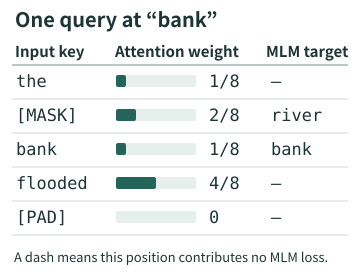

# 4.1 Encoder-only (BERT-style)

Compare *the bank flooded* with *the bank lent money*. At `bank`, the words to the left are identical. An encoder can use `flooded` or `lent` on the right to give `bank` a different representation. A classifier can read that representation to decide which sense fits. In a causal decoder, the representation **at `bank`** cannot use the later verb, though a position after the verb can use both words.

<a id="the-metaphor-the-detective-vs-the-storyteller"></a>
<a id="bidirectional-attention-all-to-all-connectivity"></a>
<a id="mlm-target-example"></a>

## Which words can `bank` read, and which words are graded?

Take `the river bank flooded` and append a padding position so that the row has five slots. For this example each word is one token. Choose `river` and `bank` as the two training targets. Replace `river` with `[MASK]` and leave `bank` unchanged. The encoder now reads `the [MASK] bank flooded [PAD]`.

In a dense BERT self-attention layer, the query at `bank` can read the key and value at **each real input position**, including its own position and `[MASK]`. All queries, keys and values for this operation come from the representations *entering* the layer. A padding mask excludes the `[PAD]` key. The query–key scores determine how much weight the other keys receive.

<figure style={{ margin: '1.5rem 0' }}>



<figcaption>For this hand-calculated head, the four permitted keys have scores of 0, ln 2, 0 and ln 4. Softmax turns their exponentials (1, 2, 1 and 4) into fractions of 8. The final column lists the original tokens chosen for prediction.</figcaption>
</figure>

`flooded` receives half this query's attention and has no target of its own. `[MASK]` remains visible to attention and has `river` as its target. The unchanged `bank` also has a target. An attention mask answers “which inputs may this query read?” A loss mask answers “which predictions do we score?”

<a id="core-training-objective-masked-language-modeling-mlm"></a>
<a id="how-mlm-works"></a>
<a id="the-mathematics-of-mlm"></a>

## How masked language modeling scores a prediction

For the original BERT recipe, Devlin et al. selected 15% of wordpiece positions for prediction. **Among the selected positions**, 80% were replaced with `[MASK]`, 10% with a random token and 10% kept their original token. All three groups were scored against their original IDs. The example above deliberately selects two positions to show two cases in one row [[2]](#ref-2).

Write $M$ for the selected positions, $x_i$ for the original token at position $i$, and $\tilde{x}$ for the input after replacements. For a nonempty $M$, the mean masked language modeling (MLM) loss is

$$
\mathcal L_{\rm MLM}=-\frac{1}{|M|}\sum_{i\in M}\log P_\theta(x_i\mid\tilde{x},i).
$$

The model with parameters $\theta$ predicts the token at the **same position**. Suppose the vocabulary head gives `river` probability 0.5 at `[MASK]` and `bank` probability 0.25 at the unchanged `bank`. The loss is $-(\log 0.5+\log 0.25)/2\approx1.040$ nats per target. Selecting rows with `input_id == mask_id` would silently drop the harder prediction in this example and report 0.693. For the one-position shift used by a causal language model, see [the three targets in §4.2](/chapter-4/decoder-only/#shifted-target-example).

<a id="pytorch-implementation-mlm-head"></a>

### Reproduce the two loss values in PyTorch

This CPU example represents one padded sequence. It supplies the attention scores and vocabulary logits directly so both calculations can be checked by hand. A trained encoder would compute the scores in each attention head and the logits from its final hidden states. Special boundary tokens, random corruption, optimizer updates and batching are omitted here.

```python
import math
import torch
import torch.nn.functional as F

pad, mask, the, river, bank, flooded = range(6)
original = torch.tensor([the, river, bank, flooded, pad])
inputs = original.clone()
inputs[1] = mask
selected = torch.tensor([False, True, True, False, False])
labels = original.masked_fill(~selected, -100)

# One query at bank, five keys. The last key is padding.
scores = torch.log(torch.tensor([1., 2., 1., 4., 100.]))
weights = scores.masked_fill(inputs == pad, -torch.inf).softmax(dim=0)
torch.testing.assert_close(weights, torch.tensor([1., 2., 1., 4., 0.]) / 8)

# Five positions, six vocabulary entries per position.
logits = torch.zeros(5, 6)
logits[1] = torch.tensor([.1, .1, .1, .5, .1, .1]).log()
logits[2] = torch.tensor([.15, .15, .15, .15, .25, .15]).log()
loss = F.cross_entropy(logits, labels, ignore_index=-100)
assert math.isclose(loss.item(), -(math.log(.5) + math.log(.25)) / 2, rel_tol=1e-6)
logits[4, pad] = 100  # The ignored padding position has no direct loss.
torch.testing.assert_close(F.cross_entropy(logits, labels), loss)
only_mask = inputs == mask
print(f"{loss.item():.3f}", f"{F.cross_entropy(logits[only_mask], labels[only_mask]).item():.3f}")
```

The output is `1.040 0.693`. Changing logits at an ignored padding position leaves the first loss unchanged. The one-token calculation keeps the inputs fixed and scores only the prediction at `[MASK]`. In a real batch, count the non-ignored labels across examples before reducing the loss. An all-ignored batch has no target over which to take a mean.

<a id="evolution-and-key-models"></a>
<a id="0-the-precursor-elmo-and-the-sesame-street-naming-trend"></a>

## From directional language models to bidirectional encoders

ELMo built a contextual vector from the states of two LSTM language models, one reading left to right and one right to left. BERT used a different construction: inside each encoder layer, the representation at a position can mix evidence from both directions. In our example, the `bank` query can read `flooded` directly in a dense layer [[1]](#ref-1) [[2]](#ref-2).

<a id="1-bert-2018"></a>
<a id="2-roberta-2019"></a>
<a id="3-modernbert-2024"></a>
<a id="comparison-of-encoder-only-models"></a>

### Three published training recipes

These historical configurations were checked as of 2026-11-25. Each paper tested a different question.

| Model | What the authors tested | What matters when using the model |
| --- | --- | --- |
| BERT (2018) [[2]](#ref-2) | Pre-trained a dense encoder with MLM and next sentence prediction (NSP), which classified whether a sentence pair was consecutive. | Its input budget was 512 wordpiece tokens including special tokens. A supervised span head can score the start and end positions of an answer. |
| RoBERTa (2019) [[3]](#ref-3) | Compared static with resampled corruption patterns, changed the way input sequences were constructed, removed NSP, and tested more data and longer training. | In their masking comparison, dynamic masking performed similarly or slightly better. The final recipe used about 160 GB of text versus 16 GB in the smaller-data condition. Its aggregate gains cannot be attributed to masking or NSP alone. |
| ModernBERT (2024) [[4]](#ref-4) | Trained for inputs up to 8,192 tokens with rotary positions, global attention every third layer and 128-token local windows in the other layers. | A local layer can see left and right within its window. Distant tokens can interact in a global layer. Unpadding avoids processing padded positions, so the benefit depends on the length distribution in a batch. |

<a id="why-encoder-only-models-still-matter"></a>

## Choose the output you need

To highlight an account number, you need a prediction at each candidate position. To find the right document, you need an embedding whose similarity to a query ranks relevant documents highly. An encoder can produce both kinds of features, but a raw `[CLS]` vector has no guarantee of retrieval quality. Check recall on held-out queries, including hard negatives, and state how tokens were pooled. A decoder's final prompt position can also represent preceding text in a single forward pass. Measure quality, latency and batch shapes on the intended workload before choosing an architecture.

## Quizzes

<details>
<summary>Quiz 1: Is the `[MASK]` position hidden from the query at `bank`?</summary>
*The encoder sees the `[MASK]` embedding there. In the example, that key gets 2/8 of the attention weight. The original token `river` is the training target and was replaced in the input.*
</details>

<details>
<summary>Quiz 2: Why does selecting training rows using only `input_id == mask_id` change the loss?</summary>
*It drops selected positions that were kept unchanged or replaced by another ordinary token. Here it drops the 0.25 probability for `bank` and retains only the 0.5 probability for `river`, reducing the reported loss to 0.693 nats.*
</details>

<details>
<summary>Quiz 3: If a token has no direct MLM loss, can it still affect a training update?</summary>
*Yes. The unselected token `flooded` is visible to the query at `bank`. Its value can influence a supervised prediction and receive gradient through that path. The padding key is excluded from attention, so it lacks that path to this query.*
</details>

<details>
<summary>Quiz 4: Does RoBERTa's final score tell you how much removing NSP helped?</summary>
*The final run changed multiple factors, including data volume and training duration. To isolate the NSP contribution, compare runs with the same data, sequence construction, corruption and training budget while varying that objective.*
</details>

<details>
<summary>Quiz 5: If two words are thousands of tokens apart, can one ModernBERT attention head connect them directly?</summary>
*Yes in a global layer, provided both are in the input and their keys are permitted. A head in a 128-token local layer can read only its own neighborhood. Information can also arrive indirectly through earlier layers.*
</details>

## References

1. <a id="ref-1"></a>Peters, M. E., et al. (2018). *Deep contextualized word representations*. [Paper](https://arxiv.org/abs/1802.05365).
2. <a id="ref-2"></a>Devlin, J., et al. (2018). *BERT: Pre-training of Deep Bidirectional Transformers for Language Understanding*. [Paper](https://arxiv.org/abs/1810.04805).
3. <a id="ref-3"></a>Liu, Y., et al. (2019). *RoBERTa: A Robustly Optimized BERT Pretraining Approach*. [Paper](https://arxiv.org/abs/1907.11692).
4. <a id="ref-4"></a>Warner, B., et al. (2024). *Smarter, Better, Faster, Longer: A Modern Bidirectional Encoder for Fast, Memory Efficient, and Long Context Finetuning and Inference*. [Paper](https://arxiv.org/abs/2412.13663).
