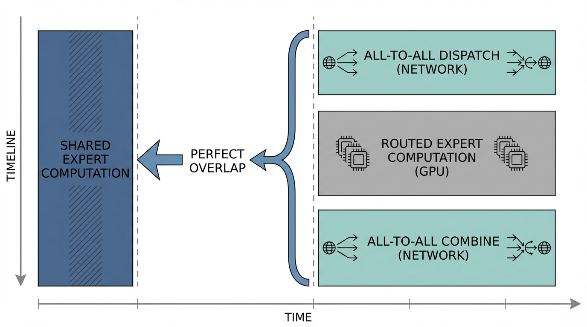

import { ExpertParallelismVisualizer } from '../../components/chapter-5/ExpertParallelismVisualizer.tsx';

# 5.3 Expert Parallelism

In the previous section, we established the mathematical elegance of routing algorithms. However, a perfect routing algorithm is useless if the hardware cannot physically store or compute the model.

For a hypothetical layer with 256 experts of 2 billion parameters each, FP16/BF16 weights occupy $256 \times 2\cdot10^9 \times 2=1.024$ TB in decimal units. Eight devices with 192GB each provide 1.536TB in aggregate, so the raw weights fit that aggregate capacity. Feasibility still depends on other layers, activations, communication buffers and, during training, gradients and optimizer state.

TP shards the matrices of selected experts; EP places different experts on different devices. TP does not require evaluating unselected experts. The choice depends on expert size, token count, communication and topology, and TP can be combined with EP.

The solution is **Expert Parallelism (EP)**. Instead of slicing the matrices of an expert, we shard the *experts themselves* across different GPUs. GPU 0 holds Experts 0-31, GPU 1 holds Experts 32-63, and so on. This isolates memory and compute, but introduces a massive distributed systems challenge: **The All-to-All Network Bottleneck**.

---

## 1. The Anatomy of Expert Parallelism

In a standard Transformer block within an MoE model, the self-attention mechanism is typically dense. Therefore, attention layers are processed using standard Data Parallelism or Tensor Parallelism. Every GPU holds a replica (or a TP shard) of the attention weights and processes its local batch of tokens.

The paradigm shifts when the tokens reach the MoE feed-forward layer. A token residing on GPU 0 might be routed to Expert 42, which physically resides on GPU 1.

To resolve this, Expert Parallelism requires a highly synchronized, two-phase network operation:

1.  **The Dispatch Phase (All-to-All):** Every GPU looks at its local tokens, groups them by their target expert, and transmits them across the network to the GPU that owns that expert.
2.  **The Compute Phase:** Each GPU receives a massive, unpredictable influx of tokens from all other GPUs. It processes these tokens through its locally stored experts.
3.  **The Combine Phase (All-to-All):** The computed token representations are transmitted *back* across the network to the original GPUs that generated them, allowing the next dense attention layer to proceed.


*Source: AI-generated illustration*

---

## 2. Engineering the Dispatcher

The core operation powering Expert Parallelism is the `All-to-All` collective communication primitive. Unlike an `All-Reduce` (where tensors are summed) or an `All-Gather` (where tensors are concatenated), an `All-to-All` is effectively a distributed matrix transpose. Every rank sends a *different* slice of data to every other rank.

Because routing is dynamic, GPU 0 does not know in advance how many tokens it will receive from GPU 1. Therefore, before we can send the actual high-dimensional token tensors, we must perform a metadata exchange to allocate the correct memory buffers.

> **Educational transport example.** Assumes an initialized distributed process group and one valid expert ID per token. It sends states and expert IDs only. Reverse combine, routing weights, top-k replication, autograd support and recovery are omitted; this has not been validated as distributed GPU training code. See GShard for the full system context. [[1]](#ref-1)

```python
import torch
import torch.distributed as dist

class ExpertParallelDispatcher:
    def __init__(self, ep_group, num_total_experts):
        """
        ep_group: The torch.distributed process group for Expert Parallelism.
        num_total_experts: Total number of experts across all GPUs.
        """
        self.ep_group = ep_group
        self.world_size = dist.get_world_size(ep_group)
        self.rank = dist.get_rank(ep_group)

        # Assume experts are distributed evenly across the EP group
        assert num_total_experts % self.world_size == 0
        self.local_experts = num_total_experts // self.world_size

    def dispatch(self, hidden_states, expert_indices):
        """
        hidden_states: [num_local_tokens, d_model]
        expert_indices: [num_local_tokens] (Global expert IDs chosen by the router)
        """
        device = hidden_states.device

        # 1. Determine which GPU (rank) owns which expert
        target_ranks = expert_indices // self.local_experts

        # 2. Sort tokens by their target rank to prepare for contiguous network transmission
        sort_idx = torch.argsort(target_ranks)
        sorted_states = hidden_states[sort_idx]
        sorted_target_ranks = target_ranks[sort_idx]

        # 3. Count how many tokens this GPU needs to send to each other GPU
        send_counts = torch.bincount(sorted_target_ranks, minlength=self.world_size)
        send_counts_list = send_counts.cpu().tolist()

        # 4. METADATA EXCHANGE: Inform other GPUs how many tokens to expect from us
        # We must know recv_counts to allocate the incoming memory buffer.
        recv_counts = torch.empty_like(send_counts)
        dist.all_to_all_single(recv_counts, send_counts, group=self.ep_group)
        recv_counts_list = recv_counts.cpu().tolist()

        # 5. Allocate the receive buffer for incoming tokens
        total_recv = sum(recv_counts_list)
        recv_buffer = torch.empty(
            (total_recv, hidden_states.size(1)),
            dtype=hidden_states.dtype,
            device=device
        )

        # 6. THE DISPATCH: Perform the actual All-to-All token transfer via NVLink/InfiniBand
        dist.all_to_all_single(
            recv_buffer,
            sorted_states,
            output_split_sizes=recv_counts_list,
            input_split_sizes=send_counts_list,
            group=self.ep_group
        )

        # recv_buffer now contains tokens from all over the cluster destined for our local experts.
        # Send expert identity with exactly the same permutation and splits.
        recv_experts = torch.empty(total_recv, device=device, dtype=torch.long)
        dist.all_to_all_single(
            recv_experts, expert_indices[sort_idx].contiguous(),
            output_split_sizes=recv_counts_list,
            input_split_sizes=send_counts_list, group=self.ep_group)
        local_ids = recv_experts % self.local_experts
        # Combine must reverse the splits, then undo sort_idx before weighting.
        return recv_buffer, local_ids, recv_counts_list, sort_idx, send_counts_list
```

---

## 3. Advanced Optimizations: Overlapping and GroupGEMM

The example covers transport only. Expert computation dependent on received data must wait, but independent work need not stop. Overlap depends on streams, dependencies and contention for network and SM resources.

To achieve state-of-the-art throughput, modern systems engineering relies on two critical optimizations pioneered by frameworks like DeepEP and architectures like DeepSeek-V3 [[2]](#ref-2).

### Optimization 1: Computation-Communication Overlap via Shared Experts
DeepSeek-V3 introduced a paradigm where the MoE layer consists of $N$ "Routed Experts" and 1 "Shared Expert". The Shared Expert is replicated across *all* GPUs (Data Parallel), while the Routed Experts are distributed (Expert Parallel).

Local shared-expert work can overlap routed-token transport. Replication or sharding depends on the deployment. If the independent work is shorter than communication, or competes for resources, overlap is incomplete; measure the timeline and exposed communication time.

### Optimization 2: GroupGEMM
Once the `recv_buffer` is populated with tokens from across the cluster, the GPU must process them. A naive approach would iterate through the local experts:
```python
# Naive, slow approach
outputs = []
for i in range(num_local_experts):
    expert_tokens = get_tokens_for_expert(recv_buffer, i)
    outputs.append(local_experts[i](expert_tokens))
```
Launching a separate CUDA kernel (GEMM) for every expert is highly inefficient, especially because the number of tokens per expert varies wildly. Modern MoE implementations use a **GroupGEMM** kernel (often written in CUTLASS or Triton). GroupGEMM fuses multiple matrix multiplications with different batch sizes into a single, massive kernel launch, maximizing SM occupancy and minimizing kernel launch overhead.

---

## Interactive Visualization: The EP Network Simulator

To build an intuition for how tokens physically move across a cluster during Expert Parallelism, use the interactive simulator below. It models a 4-GPU cluster where each GPU holds one specific expert.

<ExpertParallelismVisualizer client:load />


---

## Summary and Next Steps

Expert Parallelism is the critical infrastructure that allows MoE models to break the memory wall of single GPUs. By executing a massive, distributed All-to-All transpose, we can scale model capacity to trillions of parameters while keeping the active compute footprint small.

However, as you may have noticed in the PyTorch implementation and the visualizer, Expert Parallelism relies on an implicit assumption: **that the tokens are distributed relatively evenly across all experts**. If 90% of the tokens in a batch decide they want to go to Expert 0 on GPU 0, then GPU 0 will run out of memory (OOM), while GPUs 1-3 will sit idle.

In the next section, **5.4 Collapsing & Load Balancing**, we will explore the systems-level safety nets—such as Token Dropping, Capacity Factors, and Auxiliary Losses—that prevent a cluster from crashing when the routing algorithm fails to distribute the workload evenly.

---

## Quizzes

<details>
<summary>Quiz 1: How do EP and TP interact with sparse activation?</summary>
*EP places different experts; TP shards a selected expert. Both can skip unselected experts. Choose their combination by measuring communication and available parallel work; neither guarantees linear scaling.*
</details>

<details>
<summary>Quiz 2: In the provided PyTorch implementation, why is the first `dist.all_to_all_single` (which exchanges `send_counts` to calculate `recv_counts`) strictly necessary? Why can't a GPU just dynamically receive the incoming token tensors?</summary>
*Distributed communication primitives (like MPI, NCCL, or RCCL) operate via Remote Direct Memory Access (RDMA) to bypass the CPU and achieve maximum bandwidth. RDMA requires the receiving GPU to have a pre-allocated, contiguous block of memory ready *before* the transfer begins. Because MoE routing is dynamic, GPU 1 has no idea how many tokens GPU 0 has decided to send it. The metadata exchange ensures every GPU knows exactly how many bytes to expect so it can allocate the `recv_buffer` accurately before the massive data transfer starts.*
</details>

<details>
<summary>Quiz 3: Does shared-expert work always hide All-to-All latency?</summary>
*No. Independent local computation can overlap transport, but dependencies, duration and resource contention determine how much communication remains exposed.*
</details>

---

## References

1. <a id="ref-1"></a>Lepikhin, D., et al. (2020). *GShard: Scaling Giant Models with Conditional Computation and Automatic Sharding*. [arXiv:2006.16668](https://arxiv.org/abs/2006.16668).
2. <a id="ref-2"></a>DeepSeek-AI. (2024). *DeepSeek-V3 Technical Report*. [arXiv:2412.19437](https://arxiv.org/abs/2412.19437).
