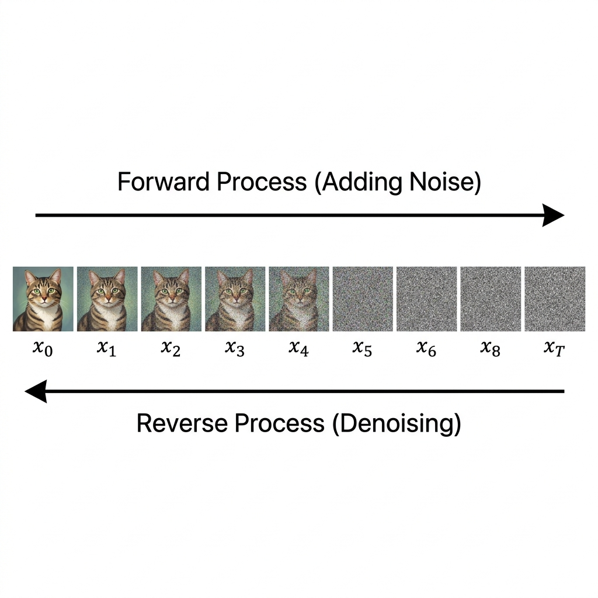

import DiffusionVisualizer from '../../../components/chapter-11/DiffusionVisualizer.tsx';


# 11.4 이미지 확산 모델 (Image Diffusion Models)

앞 절들이 서로 다른 모달리티를 이해하고 연결하는 데 집중했다면, 이번 절은 텍스트 프롬프트에서 이미지를 만드는 **생성** 을 다룹니다. 확산은 이를 위한 영향력 있는 접근법 중 하나입니다. 아래 메커니즘은 구조가 공개된 확산 모델을 설명합니다. 이미지 생성 API를 제공한다는 사실만으로 같은 아키텍처나 학습 목적을 쓴다고 볼 수는 없습니다.

## 1. 비유: 안개 걷어내기

두껍고 무작위로 낀 안개로 완전히 가려진 창문을 보고 있다고 상상해 보세요. 밖에는 아무것도 보이지 않습니다. 이제 여러분에게 이 안개를 한 번에 조금씩 걷어낼 수 있는 마법의 도구가 있다고 상상해 보세요. 만약 여러분이 무엇을 *보고 싶은지* (예: 정원의 고양이) 알고 있다면, 그 지식을 활용하여 안개를 걷어내는 과정을 안내할 수 있습니다. 각 단계마다 무작위 안개를 조금씩 제거하고 고양이처럼 보이는 구조를 조금씩 추가합니다. 결국 창문이 투명해지고, 아름다운 고양이 그림이 나타납니다.

이것이 바로 확산 모델이 작동하는 방식입니다. 이들은 순수한 무작위 노이즈(두꺼운 안개)의 캔버스에서 시작하여 텍스트 프롬프트의 안내에 따라 노이즈를 반복적으로 제거하고 구조를 추가하여 선명한 이미지가 나타날 때까지 진행합니다.


<DiffusionVisualizer client:load locale="ko" />

---

## 2. 핵심 메커니즘: 순방향 및 역방향 확산

확산 모델은 데이터에 노이즈를 점진적으로 더하는 과정을 거꾸로 되돌리도록 학습합니다. 이산 시간과 연속 시간 정식화가 모두 있으며, 아래 DDPM 수식은 유한한 이산 시간 가우시안 마르코프 체인을 사용합니다. [[1]](#ref-1)

### 순방향 프로세스 (가우시안 확산)
순방향 프로세스(Forward process)에서는 깨끗한 이미지 $x_0 \sim q(x)$ 에서 시작하여 일련의 타임스텝 $T$ 에 걸쳐 점진적으로 가우시안 노이즈(Gaussian noise)를 추가합니다.
이 과정은 다음과 같은 마르코프 체인(Markov chain)으로 정의됩니다:
$$ q(x_{1:T} | x_0) = \prod_{t=1}^T q(x_t | x_{t-1}) $$
$$ q(x_t | x_{t-1}) = \mathcal{N}(x_t; \sqrt{1 - \beta_t} x_{t-1}, \beta_t \mathbf{I}) $$
여기서 $\beta_t$ 는 분산 스케줄(Variance schedule)입니다.

이 공식의 매우 중요한 특성은 **재매개변수화 트릭(Reparameterization trick)** 을 사용하여 중간 단계를 거치지 않고 $x_0$ 로부터 임의의 타임스텝 $t$ 에서의 $x_t$ 를 직접 샘플링할 수 있다는 점입니다:
$$ x_t = \sqrt{\bar{\alpha}_t} x_0 + \sqrt{1 - \bar{\alpha}_t} \epsilon $$
여기서 $\alpha_t = 1 - \beta_t$ 이고, $\bar{\alpha}_t = \prod_{s=1}^t \alpha_s$ 이며, $\epsilon \sim \mathcal{N}(0, \mathbf{I})$ 입니다. 스케줄에 따라 $\bar\alpha_T$ 가 0에 가까워지면 원래 신호의 기여가 작아져 $x_T$ 는 표준 가우시안 노이즈에 가까워집니다.

### 역방향 프로세스 (생성적 노이즈 제거)
생성 모델링의 목표는 역방향 프로세스인 $q(x_{t-1} | x_t)$ 를 학습하는 것입니다. 이 과정을 역으로 돌릴 수 있다면, 무작위 노이즈 $x_T \sim \mathcal{N}(0, \mathbf{I})$ 에서 시작하여 실제 데이터 분포 $x_0$ 로부터 샘플을 생성할 수 있습니다.

진정한 역방향 분포는 다루기 어렵지만(전체 데이터 분포에 의존하므로), Ho et al. (2020) [[1]](#ref-1) 은 $\beta_t$ 가 작을 때 역방향 단계 $q(x_{t-1} | x_t)$ 역시 가우시안으로 근사될 수 있음을 보여주었습니다. 우리는 이 역방향 전이를 학습하기 위해 신경망 $p_\theta(x_{t-1} | x_t)$ 를 훈련시킵니다:
$$ p_\theta(x_{t-1} | x_t) = \mathcal{N}(x_{t-1}; \mu_\theta(x_t, t), \Sigma_\theta(x_t, t)) $$

일반적인 DDPM 파라미터화는 $\epsilon_\theta(x_t, t)$ 로 추가된 노이즈를 예측하고 이를 역방향 평균으로 변환합니다. 단순화한 학습 목적은 평균 제곱 오차(MSE) 회귀이며, 이미지 가능도를 정확히 최대화하는 식 자체는 아닙니다. [[1]](#ref-1)
$$ \mathcal{L}_{simple} = \mathbb{E}_{t, x_0, \epsilon} [ \| \epsilon - \epsilon_\theta(x_t, t) \|^2 ] $$

노이즈 수준이 고정되면 최적 노이즈 예측은 알려진 배율을 통해 **노이즈가 섞인 주변 분포** 의 스코어와 연결됩니다. 깨끗한 이미지 분포의 스코어를 직접 예측하는 것은 아닙니다. 이 관계가 노이즈 제거와 스코어 매칭을 연결하며, 타임스텝 조건이 필요한 이유를 설명합니다. [[1]](#ref-1)


*그림: 노이즈를 추가하는 순방향 확산 프로세스와 이를 제거하는 역방향 프로세스.*

---

## 3. 잠재 확산 모델 (Latent Diffusion Models, LDM): 해상도 위기의 해결

초기의 확산 모델은 픽셀 공간(Pixel space)에서 직접 작동했습니다. 고해상도 이미지의 큰 텐서를 매 타임스텝 깊은 U-Net으로 처리해야 하므로 학습과 추론 비용이 높았습니다.

**Stable Diffusion** 의 탄생으로 이어진 돌파구는 **잠재 확산(Latent Diffusion)** 이었습니다 [[2]](#ref-2). 핵심 아이디어는 학습 과정을 두 가지 뚜렷한 단계로 분리하는 것이었습니다:

### 1단계: 지각적 압축 (VAE)
먼저 오토인코더(특히 Variational Autoencoder, VAE)를 훈련시킵니다. 인코더 $\mathcal{E}$ 는 고해상도 이미지 $x \in \mathbb{R}^{H \times W \times 3}$ 를 더 낮은 차원의 잠재 공간 $z = \mathcal{E}(x) \in \mathbb{R}^{h \times w \times c}$ 로 매핑합니다 (여기서 $h \ll H$, $w \ll W$). 디코더 $\mathcal{D}$ 는 이를 다시 복원합니다: $\tilde{x} = \mathcal{D}(z)$.
이는 손실을 허용하는 지각적 압축이며 중요하지 않은 정보만 제거한다는 보장은 없습니다. 미세 질감·작은 글자 등 과제에 필요한 정보도 잃을 수 있으므로, 모든 오류를 노이즈 제거기 탓으로 돌리기 전에 디코딩한 복원 결과부터 검사합니다. [[2]](#ref-2)

### 2단계: 시맨틱 생성 (잠재 확산)
확산 프로세스(순방향 및 역방향 모두)는 이 압축된 잠재 공간 내에서만 수행됩니다. 이제 네트워크는 잠재 공간 $z_t$ 에서 노이즈를 예측하므로 연산 비용이 획기적으로 감소합니다.

### 크로스 어텐션을 통한 조건부 생성 (Conditioning)
텍스트-이미지 생성을 가능하게 하기 위해, LDM은 노이즈 제거 네트워크에 크로스 어텐션(Cross-attention) 메커니즘을 도입합니다. 텍스트 프롬프트 $y$ 는 사전 학습된 텍스트 인코더(예: CLIP)를 통해 인코딩되며, 이 임베딩들은 U-Net의 어텐션 레이어에 주입됩니다:
$$ \text{Attention}(Q, K, V) = \text{softmax}\left(\frac{QK^T}{\sqrt{d}}\right)V $$
여기서 $Q$ 는 평탄화된 잠재 표현에서, $K$ 와 $V$ 는 텍스트 임베딩에서 파생되며, $d$ 는 어텐션 헤드 하나의 query/key 차원입니다. 이는 텍스트 표현을 생성의 조건으로 넣는 방법이며, 객체 수·공간 관계·정확한 글자를 보장하지는 않습니다.

---

## 4. 확산과 GAN: 학습 방식과 샘플링 비용의 차이

DDPM은 생성자·판별자의 적대적 학습 대신 노이즈 제거 목적을 사용합니다. 적대적 게임을 피하지만 데이터 품질·최적화·분포 포괄성·수치 안정성은 여전히 검증해야 합니다. 변분 정식화와 단순화한 노이즈 손실이 모든 데이터 모드를 학습한다는 보장은 아닙니다. [[1]](#ref-1)

비용의 위치도 달라집니다. 반복 샘플링은 여러 차례의 신경망 평가가 필요할 수 있고, 잠재 압축은 각 평가의 크기를 줄이는 대신 복원 오차를 더합니다. 데이터·해상도·연산 예산을 맞춰 다양성·충실도·프롬프트 준수·지연을 비교해야 합니다. 모델 계열의 이름만으로 이 절충을 결정할 수는 없습니다. [[2]](#ref-2)

---

## 5. 공개 가중치와 라이선스는 별도 조건

**2026-11-15 기준.** 다음은 역사적으로 중요한 두 변형의 접근 조건이며 최신 품질 순위가 아닙니다. 같은 모델군의 이름을 공유해도 이용 조건은 같지 않습니다.

| 아티팩트 | 공개 상태와 이용 조건 | 확인할 점 |
|---|---|---|
| FLUX.1-dev | 가중치 공개·접근 조건 동의 필요, 비상업적 개발 라이선스 [[4]](#ref-4) | 상업적 사용 조건을 별도로 확인 |
| FLUX.1-schnell | 가중치 공개·Apache 2.0 [[5]](#ref-5) | 실제 배포 아티팩트와 제공 경로 확인 |

### 11월 API 사례: GPT-Image-2.6

**2026-11-24 기준.** OpenAI는 11월 4일 **GPT-Image-2.6 Sunburst와 Flare** 를 **출시됨/API 전용** 이미지 생성·편집 모델로 공개했습니다. 모델 문서는 Sunburst를 세밀한 작업, Flare를 빠른 반복 작업에 배치하지만, 노이즈 제거기·파라미터 수·전체 학습법을 공개하지는 않습니다. 이는 제품의 기능 계약이며 확산 아키텍처가 검증된 사례를 추가하는 것은 아닙니다. [[6]](#ref-6) [[7]](#ref-7) [[8]](#ref-8)

Image API는 렌더링 전 계획에 쓰는 `complexity`와 렌더링 품질을 정하는 `quality`를 구분합니다. 두 모델 모두 low·medium·high 복잡도를 지원하며 기본값은 high입니다. 높은 설정은 지연이나 원하지 않은 수정도 늘릴 수 있습니다. SVG는 생성 엔드포인트에서 정적 벡터로 출력하며, 애니메이션 GIF는 생성과 편집에서 지원합니다. 어느 형식도 물리 시뮬레이션을 입증하지는 않습니다. [[9]](#ref-9)

로고를 고칠 때는 요청한 글자가 바뀌면서 관련 없는 도형과 색은 유지되는지 비교하세요. 애니메이션은 모든 프레임과 반복 경계를 검사합니다. 모델·원본 이미지 해시·프롬프트·마크업·복잡도·품질·출력 형식을 고정하고, 글자 정확성·편집 보존·렌더링 유효성·지연·재시도 비용을 측정합니다. 더 화려한 결과가 더 나쁜 편집일 수도 있습니다.

## 6. U-Net과 Transformer는 검증할 설계 선택

Latent diffusion은 매 단계의 고해상도 픽셀 연산을 압축 잠재 공간으로 옮깁니다. Transformer 기반 denoiser는 토큰화한 잠재 표현에 어텐션을 적용합니다. [[2]](#ref-2) [[3]](#ref-3) 구조 이름만으로 프롬프트 준수·텍스트 렌더링·해부학적 정확성의 우위를 증명할 수는 없습니다. 데이터·학습 예산·해상도·샘플러·스텝 수를 맞추어 평가하고, VAE의 손실과 추론 비용도 포함하세요.

## 7. 코드: 간단한 노이즈 예측 단계

위의 수식을 이해하기 위해, Denoising Diffusion Probabilistic Model (DDPM) 의 단일 단계를 시뮬레이션하는 간단한 PyTorch 예제입니다.

> **텐서 형태와 역방향 평균을 보여 주는 교육용 예제입니다.** CNN은 학습하지 않았고 시간 조건도 무시하므로 의미 있는 노이즈 제거를 하지 못합니다. 평균에는 누적값 $\bar\alpha_t=\prod_{s=0}^{t}(1-\beta_s)$를 사용하고, 여기서는 fixed-large 분산 $\beta_t$를 선택합니다. 실제 샘플러는 학습 파라미터화, 분산 스케줄, 정밀도를 함께 고정해야 합니다.

```python
import torch
import torch.nn as nn

class SimpleDenoisingModel(nn.Module):
    def __init__(self, img_channels=3):
        super().__init__()
        # 노이즈를 예측하는 간단한 CNN
        self.net = nn.Sequential(
            nn.Conv2d(img_channels, 64, 3, padding=1),
            nn.ReLU(),
            nn.Conv2d(64, 64, 3, padding=1),
            nn.ReLU(),
            nn.Conv2d(64, img_channels, 3, padding=1)
        )

    def forward(self, x, t):
        # 실제 모델에서는 't' (타임스텝)가 임베딩되어 네트워크에 주입됩니다.
        return self.net(x)

def ddpm_step(x_t, predicted_noise, t, beta_schedule):
    # Zero-based t; fixed-large variance beta_t, with no final-step noise.
    betas = beta_schedule.to(device=x_t.device, dtype=x_t.dtype)
    alpha_t = 1 - betas[t]
    alpha_bar_t = torch.cumprod(1 - betas, dim=0)[t]
    x_prev = (x_t - betas[t] / torch.sqrt(1 - alpha_bar_t) * predicted_noise) / torch.sqrt(alpha_t)
    if t > 0:
        x_prev = x_prev + torch.sqrt(betas[t]) * torch.randn_like(x_t)
    return x_prev

# 시뮬레이션
img = torch.randn(1, 3, 64, 64) # 순수한 노이즈로 시작
model = SimpleDenoisingModel()
beta_schedule = torch.linspace(0.0001, 0.02, 1000)

# 노이즈 제거 한 단계
t = 999
pred_noise = model(img, t)
denoised_img = ddpm_step(img, pred_noise, t, beta_schedule)
print(f"Denoised image shape: {denoised_img.shape}")
```

---

## 8. 이미지를 넘어서: 확산 기반 LLM (Diffusion-Based LLMs)

**20.6장 (확산 기반 LLM)** 에서 살펴보겠지만, 연구자들은 언어 모델링에 확산을 적용하기 위한 기술들을 적극적으로 개발하고 있습니다. 연속적인 임베딩 공간에서 확산을 수행하거나 이산 확산 프로세스를 사용함으로써, 이러한 모델들은 표준 자기회귀 LLM에 비해 비자기회귀 생성 및 더 나은 제어 가능성과 같은 잠재적 이점을 제공합니다.

---

## Quizzes

<details>
<summary>Quiz 1: 잠재 확산 모델이 픽셀 공간 확산보다 연산량이 적은 이유는 무엇입니까?</summary>
*모든 타임스텝마다 거대한 고해상도 픽셀 텐서를 처리하는 대신, VAE에 의해 압축된 더 낮은 차원의 잠재 공간에서 작동하기 때문입니다.*
</details>

<details>
<summary>Quiz 2: 확산 모델에서 순방향 프로세스의 목적은 무엇입니까?</summary>
*순방향 프로세스는 여러 타임스텝의 노이즈가 섞인 학습 예제를 만듭니다. 적절한 스케줄은 마지막 분포를 가우시안 노이즈에 가깝게 하므로, 학습한 역방향 과정이 간단한 분포에서 샘플링을 시작할 수 있습니다.*
</details>

<details>
<summary>Quiz 3: Transformer denoiser라는 이유만으로 U-Net보다 품질이 높다고 할 수 있나요?</summary>
*아닙니다. 데이터·학습 예산·해상도·샘플링 설정과 품질 평가 조건을 맞추어야 하며 구조는 이 시스템의 한 요소입니다.*
</details>

<details>
<summary>Quiz 4: SVG나 애니메이션 GIF를 출력하면 특정 확산 아키텍처를 쓴다는 뜻인가요?</summary>
*아닙니다. 출력 형식과 API 제어는 관찰 가능한 인터페이스입니다. 아키텍처는 별도 공개 근거가 필요합니다. 내부 메커니즘을 추정하지 말고 벡터 유효성·편집 보존·프레임 일관성을 평가해야 합니다.*
</details>

---

## References

1. <a id="ref-1"></a>Ho, J., Jain, A., & Abbeel, P. (2020). *Denoising diffusion probabilistic models*. [arXiv:2006.11239](https://arxiv.org/abs/2006.11239).
2. <a id="ref-2"></a>Rombach, R., et al. (2022). *High-resolution image synthesis with latent diffusion models*. [arXiv:2112.10752](https://arxiv.org/abs/2112.10752).
3. <a id="ref-3"></a>Peebles, W., & Xie, S. (2023). *Scalable diffusion models with transformers*. [arXiv:2212.09748](https://arxiv.org/abs/2212.09748).

4. <a id="ref-4"></a>Black Forest Labs. [FLUX.1-dev model card and license](https://huggingface.co/black-forest-labs/FLUX.1-dev). Accessed 2026-11-15.
5. <a id="ref-5"></a>Black Forest Labs. [FLUX.1-schnell model card and license](https://huggingface.co/black-forest-labs/FLUX.1-schnell). Accessed 2026-11-15.
6. <a id="ref-6"></a>OpenAI. *API changelog: November 4, 2026 image release*. Verified 2026-11-24. [Changelog](https://developers.openai.com/api/docs/changelog).
7. <a id="ref-7"></a>OpenAI. *GPT-Image-2.6 Sunburst*. Verified 2026-11-24. [Model](https://developers.openai.com/api/docs/models/gpt-image-2.6-sunburst).
8. <a id="ref-8"></a>OpenAI. *GPT-Image-2.6 Flare*. Verified 2026-11-24. [Model](https://developers.openai.com/api/docs/models/gpt-image-2.6-flare).
9. <a id="ref-9"></a>OpenAI. *Image generation: GPT-Image-2.6, SVG and GIF output*. Verified 2026-11-24. [Guide](https://developers.openai.com/api/docs/guides/image-generation).
