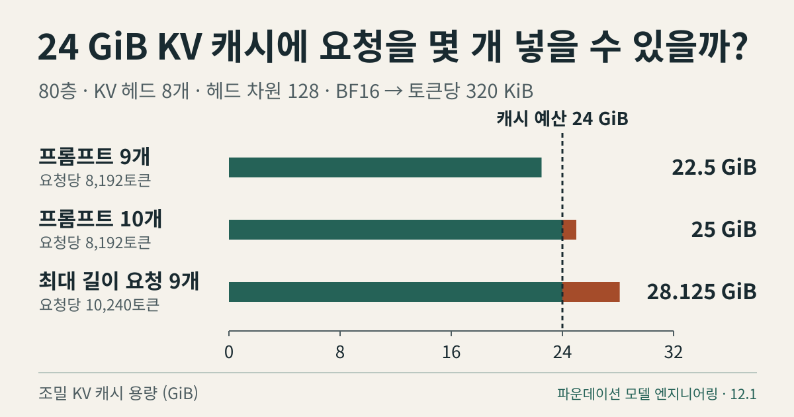

import { withBasePath } from '../../../utils/paths.js';
import KVCacheCalculator from '../../../components/chapter-12/KVCacheCalculator.tsx';

# 12.1 KV 캐시 원리와 메모리 계산

**KV 캐시(KV cache)는 언어 모델이 이미 처리한 토큰의 어텐션 키(Key)와 값(Value)을 저장하는 공간입니다.** 생성할 때마다 앞부분 전체를 다시 계산하는 대신 이 텐서를 재사용합니다. 중복 연산을 줄이는 대신, 저장한 시퀀스 길이에 따라 메모리 사용량이 늘어납니다 [[8]](#ref-8).

예를 들어 네 토큰의 프롬프트를 처리했다면, 다음 토큰을 처리할 때 앞선 네 토큰의 키와 값을 재사용할 수 있습니다. 새 토큰이 어텐션으로 이전 상태를 읽는 연산까지 없어지는 것은 아닙니다.

**Prefill** 은 프롬프트를 병렬 처리하며 캐시를 채웁니다. **Decode** 는 저장한 상태를 이용해 새 토큰을 처리합니다. Prefill에서는 행렬 곱셈 처리량이, decode에서는 메모리 대역폭·캐시 용량·요청 스케줄링이 병목인 경우가 많습니다. 이 장에서는 메모리 공식을 유도하고 용량 계산기를 사용한 뒤, 작은 PyTorch 캐시 구현을 전체 재계산과 비교합니다.

## 1. 캐시에 저장하면 어떤 연산이 줄어들까?

각 층에서 토큰은 쿼리·키·값으로 변환됩니다. 층 $l$ 에 들어온 토큰 $t$ 의 상태를 $x_t$, 세 투영의 가중치 행렬을 $W_Q$, $W_K$, $W_V$ 라고 쓰겠습니다.

$$
q_t=x_tW_Q,\qquad k_t=x_tW_K,\qquad v_t=x_tW_V.
$$

인과적 디코딩에서는 새 토큰을 붙여도 앞선 토큰의 키와 값이 그대로입니다. $t$ 번째까지의 키와 값을 보관하면 $t+1$ 단계에서는 새 토큰만 투영하고, 새 쿼리로 지금까지의 키와 값을 읽습니다.

$$
o_{t+1}=\operatorname{softmax}\left(
\frac{q_{t+1}K_{\le t+1}^{\top}}{\sqrt{d_h}}+M
\right)V_{\le t+1}.
$$

$d_h$ 는 헤드 하나의 차원입니다. $K_{\le t+1}$ 와 $V_{\le t+1}$ 는 새 토큰까지 포함한 키와 값이고, $M$ 은 볼 수 없는 위치를 가리는 마스크입니다.

### K와 V는 저장하면서 Q는 저장하지 않는 이유

새 토큰이 들어오면 그 토큰의 쿼리와 이전 키를 비교해 각 위치에 줄 가중치를 구합니다. 이 가중치로 이전 값들을 더해 출력을 만듭니다. 다음 토큰에는 새 쿼리가 생기므로 과거 쿼리는 버려도 되지만, 다시 읽어야 할 키와 값은 남겨 둡니다 [[8]](#ref-8).

모델 가중치는 여러 요청이 공유합니다. KV 캐시에는 특정 토큰열을 처리한 중간 결과가 들어 있습니다. 이미 계산한 접두사는 재사용할 수 있지만, 그 뒤의 답을 생성할 때는 모델을 다시 실행합니다. 두 요청의 모델 설정이 호환되고 접두사 토큰이 정확히 일치해야 같은 캐시를 쓸 수 있습니다.

프롬프트 네 토큰을 처리한 뒤 다섯 번째와 여섯 번째 토큰을 한 번씩 입력해 봅시다. 어텐션 헤드 하나에서 캐시를 사용하면 새 쿼리 두 개가 읽는 키는 각각 5개와 6개입니다. 따라서 쿼리와 키의 쌍은 총 **11개** 입니다. 캐시 없이 매번 전체 문장을 통과시키면 다섯 번째 위치까지 $1+2+3+4+5=15$ 쌍, 여섯 번째까지 21쌍을 계산해 총 **36개** 가 됩니다. 여기서는 두 방법이 공통으로 수행한 프리필을 제외하고, 인과 마스크가 허용한 쌍만 셉니다.

일반적으로 프롬프트 길이를 $P$, 그 뒤에 한 토큰씩 추가로 처리한 횟수를 $N$ 이라고 합시다. 캐시에 저장된 키와 새 키를 읽는 쌍의 합은 $NP+N(N+1)/2$ 입니다. $P$ 를 고정하고 $N$ 을 늘리면 캐시를 쓴 어텐션의 누적 연산량은 $O(N^2)$, 매번 전체를 재계산하면 $O(N^3)$ 입니다. 후자의 경우 토큰별 투영과 MLP 연산도 누적 $O(N^2)$ 만큼 반복됩니다. 쌍의 개수는 연산 구조를 설명하고, 실제 지연 시간은 메모리 대역폭과 커널 구현에도 좌우됩니다.

## 2. 용량 모델

길이가 같은 요청들이 같은 구조의 밀집 KV 캐시를 쓴다면, 필요한 바이트 수는

$$
\text{bytes}_{KV}=2BSLH_{KV}d_hp
$$

입니다. $B$ 는 동시 요청 수(요청당 시퀀스 하나), $S$ 는 요청마다 캐시한 토큰 수, $L$ 은 층 수, $H_{KV}$ 는 KV 헤드 수, $d_h$ 는 헤드 차원, $p$ 는 값 하나를 저장하는 바이트 수입니다. 각 위치에 키와 값을 모두 저장하므로 2를 곱합니다. [4,096토큰 예제](/ko/chapter-3/complexity-analysis/#attention-scores-vs-kv-cache)에서 한 층의 어텐션 점수 행렬과 디코딩을 위해 보관하는 키·값의 크기를 비교해 보세요.

요청마다 길이가 다르면 $BS$ 대신 각 요청에서 실제로 차지하는 토큰 자리 수를 합합니다. 공유되는 블록은 한 번만 세고, 패딩이나 블록 단위 반올림으로 생긴 빈자리도 할당량에 넣습니다. 블록 메타데이터와 작업 공간, 추측 디코딩의 분기나 빔 탐색 후보, 여러 장치에 복제된 상태는 별도로 계산합니다.

요청 32개가 각각 8,192토큰을 보관한다고 합시다. 80개 층에 KV 헤드가 8개씩 있고 $d_h=128$ 이며 BF16(값당 2바이트)을 쓰면 다음과 같습니다.

$$
2\cdot32\cdot8192\cdot80\cdot8\cdot128\cdot2
=85{,}899{,}345{,}920\text{ bytes}=80\text{ GiB}.
$$

80 GiB는 동시에 실행 중인 요청 32개의 캐시를 합한 크기입니다. 가중치는 한 번 올리면 여러 요청이 공유하지만 캐시가 차지하는 공간은 요청 수와 문맥 길이에 따라 달라집니다. 따라서 가중치를 올린 뒤 얼마가 남았는지부터 계산해야 합니다.

### 24 GiB KV 캐시 계산기로 열 번째 요청이 들어가는지 확인하기

같은 구조에서 토큰 하나를 캐시하려면 80개 층 전체에 327,680바이트, 즉 320 KiB가 필요합니다. 따라서 8,192토큰인 요청 하나는 **2.5 GiB** 를 차지합니다. 가중치, 활성값, 작업 공간, 할당기 부가 비용, 장애 대비 여유분을 제외하고 서빙 풀에 **KV 데이터용 24 GiB** 가 남았다고 합시다. 요청 9개는 22.5 GiB에 들어가지만 10개는 25 GiB가 필요합니다. 이는 해당 풀의 데이터 용량 상한이며, GPU에서 측정한 동시 처리 한도가 아닙니다. 캐시를 여러 장치로 나눈다면 실제 장치별 배치와 복제되는 헤드를 반영해야 합니다.

아홉 요청이 각각 2,048토큰을 더 생성할 수 있다고 합시다. 한 요청이 최대 길이인 10,240토큰에 이르면 캐시는 3.125 GiB입니다. 이 길이의 캐시 아홉 개를 동시에 두려면 **28.125 GiB** 가 필요합니다. KV 데이터에 쓸 수 있는 24 GiB에는 일곱 개까지 들어갑니다.

그래도 아홉 요청을 모두 끝낼 수 있을까요? 한 요청만 디코딩하고 나머지 여덟 개는 프롬프트만 캐시에 둔다고 합시다. 첫 요청이 출력 한도에 도달했을 때 필요한 공간은 $3.125 + 8 \times 2.5 = 23.125$ GiB입니다. 끝난 요청의 캐시를 바로 회수하고 다음 요청을 디코딩하면 매번 필요한 공간이 줄어들어 아홉 개 모두 처리할 수 있습니다. 다만 뒤에 있는 요청은 그만큼 기다려야 합니다. 여기서는 캐시를 공유하지 않는다고 가정했습니다. 정확히 일치하는 접두사를 공유하면 실제 사용량은 달라집니다.

*이 절의 토큰당 320 KiB와 KV 전용 예산 24 GiB로 계산한 그림입니다.* [그래프 크게 보기](../../../social/kv-budget-ko.png)

[요청 9개가 들어 있는 계산기를 열어 보세요](?kv=1&batch=9&sequence=8192&generated=2048&layers=80&heads=8&dimension=128&precision=2&budget=24#kv-calculator). 입력값을 바꾼 뒤 계산기 아래의 고유 링크를 복사하면 다른 사람도 같은 조건에서 결과를 확인할 수 있습니다. 프롬프트만 캐시하면 1.5 GiB가 남습니다. 요청마다 2,048토큰을 더 저장하면 몇 GiB가 부족할지 먼저 예상하고 최대 길이 결과를 확인하세요. 다른 예산을 계산하려면 전체 메모리에서 가중치와 기타 예약분을 빼는 입력 방식을 고를 수 있습니다. 예를 들어 같은 풀의 전체 용량이 80 GiB, 가중치가 48 GiB, 기타 예약분이 8 GiB라면 KV에 24 GiB가 남습니다.

<KVCacheCalculator client:load lang="ko" />

### 요청마다 길이가 다르면 몇 GiB가 필요할까?

같은 24 GiB 풀에서 긴 프롬프트 5개와 짧은 프롬프트 4개가 동시에 실행된다고 합시다. 토큰 하나는 여전히 320 KiB입니다. 이번에는 요청마다 프롬프트 길이와 출력 한도를 더한 뒤, 아홉 요청의 합을 구합니다.

| 요청 | 개수 | 요청당 프롬프트 | 요청당 출력 한도 | 프롬프트의 KV 합계 | 출력 한도까지 예약한 KV 합계 |
| --- | ---: | ---: | ---: | ---: | ---: |
| 긴 요청 | 5 | 8,192토큰 | 2,048토큰 | 12.5 GiB | 15.625 GiB |
| 짧은 요청 | 4 | 4,096토큰 | 1,024토큰 | 5 GiB | 6.25 GiB |
| 전체 | 9 | | | **17.5 GiB** | **21.875 GiB** |

긴 요청 하나의 출력 한도만 2,048토큰에서 12,288토큰으로 올려 보세요. 프롬프트는 그대로여서 처음에는 여전히 17.5 GiB입니다. 하지만 10,240토큰을 더 예약해야 해 3.125 GiB가 추가됩니다. 필요한 용량은 **25 GiB**, 부족분은 **1 GiB** 입니다. 요청 수와 프롬프트 길이가 그대로여도 받을 수 있는 작업이 달라졌습니다.

<a href={withBasePath('/labs/kv-queue-ko.xlsx')} download="kv-queue-ko.xlsx">혼합 요청 KV 캐시 계산표 내려받기(XLSX)</a>. 기본 예제에는 길이가 같은 요청 9개가 들어 있습니다. 각 행의 프롬프트 길이와 출력 한도를 바꿔 위 표를 재현하거나, 최대 32개 요청으로 자신의 대기열을 계산해 보세요. 이 계산은 모든 요청이 동시에 출력 한도까지 자랄 경우의 KV 데이터 예약량을 구합니다. 실제 할당량을 추정하려면 요청 종료 시점, 접두사 공유, [블록 단위 할당](/ko/chapter-12/paged-attention-vllm/#2-the-os-inspiration-paging-and-block-tables)도 반영해야 합니다.

요청들을 패딩으로 같은 길이에 맞추는 엔진이라면 [짧은 프롬프트가 KV 캐시에서 실제로 몇 자리를 차지하는지](#kv-batch-padding) 측정해 보세요.

## 3. KV 폭 줄이기

$H_Q$ 는 쿼리 헤드 수입니다. 구조에 따라 키와 값을 공유하는 방식이 달라집니다.

- **Multi-Head Attention (MHA):** $H_{KV}=H_Q$
- **Multi-Query Attention (MQA):** 모든 쿼리 헤드가 하나의 KV 헤드를 공유
- **Grouped-Query Attention (GQA):** $1<H_{KV}<H_Q$, 같은 그룹의 쿼리 헤드들이 하나의 KV 헤드를 공유

다른 조건이 같으면 캐시 크기는 $H_{KV}$ 에 비례합니다. GQA 논문에서는 기존 체크포인트를 변환해 추가 학습한 결과, 평가한 설정에서 품질은 MHA에 가깝고 속도는 MQA에 가까웠습니다 [[1]](#ref-1). 서빙할 때 기존 체크포인트의 헤드 수만 바꿔도 같은 결과가 나온다고 볼 수는 없습니다.

메모리 공식에는 쿼리 헤드가 아니라 **KV 헤드 수** 를 넣어야 합니다. 앞의 예제처럼 80개 층, 8,192토큰, 헤드 차원 128, BF16 저장을 고정하고 쿼리 헤드가 64개라고 가정해 봅시다.

| 구조 | KV 헤드 수 | 요청당 (GiB) | 요청 32개 (GiB) |
|---|---:|---:|---:|
| MHA | 64 | 20 | 640 |
| GQA | 8 | 2.5 | 80 |
| MQA | 1 | 0.3125 | 10 |

이는 설명을 위한 아키텍처의 데이터 용량 계산이며, 모델 벤치마크 측정치나 같은 체크포인트에서 자유롭게 바꾸는 설정이 아닙니다. GQA 행에서 KV 헤드 8개 대신 쿼리 헤드 64개를 넣으면 캐시를 **8배** 크게 추정합니다. 모델 가중치를 4비트로 양자화해도 KV 캐시까지 자동으로 4비트가 되지는 않습니다. 캐시에 실제로 설정한 값당 바이트 수를 사용해야 합니다.

### Multi-Head Latent Attention

DeepSeek-V2는 **Multi-Head Latent Attention (MLA)** 를 도입했습니다 [[2]](#ref-2). 키와 값을 헤드별로 그대로 저장하는 대신, 더 작은 잠재 벡터 $c_t^{KV}$ 와 위치 정보를 담은 성분을 저장합니다. 디코딩할 때 키와 값을 복원하는 선형 변환은 앞뒤의 투영 행렬과 대수적으로 합칠 수 있습니다. RoPE는 토큰 위치에 따라 회전이 바뀌므로 위치 성분을 따로 처리합니다.

DeepSeek-V2 보고서는 자사의 DeepSeek 67B 시스템과 비교해 KV 캐시가 93.3% 줄고 최대 생성 처리량이 5.76배로 늘었다고 보고했습니다. 이 수치에는 모델과 구현 양쪽의 차이가 반영돼 있습니다. 다른 시스템에서는 커널 지원, 잠재 벡터의 차원, 병렬화 방식, 요청 길이 분포에 따라 효과가 달라집니다.

## 4. 캐시 정밀도를 낮추면 무엇이 달라질까?

키와 값의 저장 형식을 FP16이나 BF16에서 FP8로 바꾸면 같은 토큰을 보관하는 데 필요한 데이터 크기가 절반이 됩니다. 4비트면 4분의 1입니다. 하지만 값을 변환하고 스케일과 메타데이터를 읽는 데도 시간이 듭니다. 원래 KV 데이터를 읽는 속도가 병목이 아니었다면 용량은 줄어도 응답은 별로 빨라지지 않을 수 있습니다.

E4M3와 E5M2 중 어떤 형식을 쓸지, 어느 단위로 스케일을 정할지, 이상값과 누산 정밀도를 어떻게 처리할지 정해야 합니다. **2026-11-25 기준** vLLM 문서는 데이터셋으로 스케일을 보정하는 방식을 권장합니다 [[3]](#ref-3). 실제 서비스의 긴 문맥에서도 답의 품질을 확인하세요.

같은 요청을 보내며 다음을 전후 비교합니다.

- 문맥 길이별 답변 품질
- 프리필 지연 시간, 첫 토큰까지 걸린 시간과 이후 토큰 간격의 중앙값과 95백분위수
- 같은 지연 시간 목표를 지킬 때의 처리량
- 캐시 점유량, 할당 실패 횟수, 캐시 축출·재계산 빈도

## 5. PyTorch로 GQA 캐시 검증하기

아래 레이어는 KV 텐서의 축을 보여 줍니다. 앞서 처리한 토큰 뒤에 새 토큰을 여러 개 붙일 때도 각 쿼리가 자신의 위치까지 볼 수 있도록 마스크를 만듭니다.

> 이 교육용 예제는 RoPE, 패딩 마스크, 슬라이딩 윈도, 양자화 저장, 텐서 병렬화, 페이지 할당, 접두사 공유를 생략합니다. 새 행을 제자리에 기록하는 대신 매번 `torch.cat`으로 텐서를 복사합니다. `enable_gqa` 지원 여부는 설치한 PyTorch 백엔드에서 확인해야 합니다.

~~~python
import torch
import torch.nn as nn
import torch.nn.functional as F

KVCache = tuple[torch.Tensor, torch.Tensor]  # 각각 [B, H_kv, S, d_h]

class CausalGQAAttention(nn.Module):
    def __init__(self, d_model: int = 4096, n_heads: int = 32, n_kv_heads: int = 8):
        super().__init__()
        if d_model % n_heads or n_heads % n_kv_heads:
            raise ValueError("d_model % n_heads와 n_heads % n_kv_heads는 0이어야 합니다")
        self.n_heads = n_heads
        self.n_kv_heads = n_kv_heads
        self.d_head = d_model // n_heads
        self.q_proj = nn.Linear(d_model, n_heads * self.d_head, bias=False)
        self.k_proj = nn.Linear(d_model, n_kv_heads * self.d_head, bias=False)
        self.v_proj = nn.Linear(d_model, n_kv_heads * self.d_head, bias=False)
        self.o_proj = nn.Linear(d_model, d_model, bias=False)

    @torch.no_grad()
    def forward(self, x: torch.Tensor, cache: KVCache | None = None):
        batch, new_tokens, width = x.shape
        q = self.q_proj(x).view(batch, new_tokens, self.n_heads, self.d_head)
        k = self.k_proj(x).view(batch, new_tokens, self.n_kv_heads, self.d_head)
        v = self.v_proj(x).view(batch, new_tokens, self.n_kv_heads, self.d_head)
        q, k, v = (z.transpose(1, 2) for z in (q, k, v))

        past_tokens = 0
        if cache is not None:
            past_k, past_v = cache
            past_tokens = past_k.size(2)
            k = torch.cat((past_k, k), dim=2)
            v = torch.cat((past_v, v), dim=2)

        # PyTorch SDPA boolean mask에서 True는 attention 허용입니다.
        q_pos = torch.arange(past_tokens, past_tokens + new_tokens, device=x.device)
        k_pos = torch.arange(k.size(2), device=x.device)
        allowed = (k_pos[None, :] <= q_pos[:, None])[None, None, :, :]

        y = F.scaled_dot_product_attention(
            q, k, v, attn_mask=allowed, is_causal=False, enable_gqa=True
        )
        y = y.transpose(1, 2).contiguous().view(batch, new_tokens, width)
        return self.o_proj(y), (k, v)
~~~

명시적인 position mask가 중요합니다. Cache가 비어 있지 않은 multi-token chunk에 is_causal=True를 순진하게 적용하면 kernel 계약에 따라 triangular mask 원점이 잘못 정렬될 수 있습니다.

### 전체 재계산과 캐시 결과를 비교한다

캐시 최적화는 출력의 모양만 맞추는 것이 아니라 계산 결과를 보존해야 합니다. 위 클래스 다음에 아래 코드를 실행하세요. 같은 가중치와 입력을 사용해 전체 인과적 계산, 토큰 단위 디코딩, 길이가 다른 청크를 비교합니다. 패딩과 드롭아웃이 없는 CPU float32 검사이며, 교육용 층을 확인할 뿐 GPU 커널 성능이나 완전한 언어 모델을 검증하지는 않습니다.

~~~python
torch.manual_seed(7)
layer = CausalGQAAttention(d_model=64, n_heads=4, n_kv_heads=2).eval()
x = torch.randn(2, 9, 64)  # [batch, tokens, model width], CPU float32
full, _ = layer(x)

for chunk_sizes in ([1] * 9, [4, 3, 2]):
    cache, pieces, offset = None, [], 0
    for size in chunk_sizes:
        piece, cache = layer(x[:, offset:offset + size], cache)
        pieces.append(piece)
        offset += size
    decoded = torch.cat(pieces, dim=1)
    torch.testing.assert_close(decoded, full, rtol=1e-5, atol=1e-6)
    assert cache[0].shape == (2, 2, 9, 16)

changed = x.clone()
changed[:, 5:] += 10  # Future inputs must not change earlier outputs.
changed_out, _ = layer(changed)
torch.testing.assert_close(changed_out[:, :5], full[:, :5])
print("Full, token-wise, and chunked results agree; causality holds.")
~~~

이 예제는 PyTorch 2.15.0 CPU에서 스모크 테스트했습니다. **2026-11-25 기준 API 확인:** PyTorch 문서는 불리언 마스크의 의미와 어텐션 행렬이 정사각형이 아닐 때 사용하는 왼쪽 위 기준의 인과적 정렬을 명시합니다 [[7]](#ref-7). 캐시 뒤에 붙는 청크의 전역 쿼리 위치는 `past_tokens`에서 시작하며, 위의 명시적 마스크는 이 오프셋을 반영합니다. 실제 엔진에 적용하기 전에는 패딩, RoPE 위치 오프셋, 캐시 퇴출, 서빙 정밀도별로 검사를 확장해야 합니다.

### 실제 체크포인트에서 KV 캐시 용량 재기

노트북에 고정한 SmolLM2-135M의 `config.json`을 열어 보세요. 어텐션 층은 30개(`num_hidden_layers`), 쿼리 헤드는 9개(`num_attention_heads`), KV 헤드는 3개(`num_key_value_heads`)입니다. 이 모델은 은닉 차원 576을 쿼리 헤드 9개로 균등하게 나누므로 헤드 차원은 64입니다. 노트북에서는 모델을 FP32로 실행합니다. 요청 하나에서 토큰 한 자리의 키와 값을 보관하는 데 $2 \times 30 \times 3 \times 64 \times 4 = 46{,}080$ 바이트, 즉 45 KiB가 듭니다 [[9]](#ref-9).

다른 모델의 용량을 구하려면 각 층이 저장하는 K·V의 모양과 실행 시 캐시의 자료형부터 확인하세요. 설정에 `head_dim`이 명시돼 있으면 그 값을 씁니다. 은닉 차원을 쿼리 헤드 수로 나누는 계산은 어텐션 구현이 실제로 그 방식으로 차원을 나눌 때만 맞습니다. 슬라이딩 윈도를 쓰는 층에서는 윈도 안에 남겨 두는 자리만 셉니다. 예를 들어 [GLM-5.4의 두 번째 패스](/ko/chapter-4/various-llm-architectures/#glm-54-cache-positions)는 첫 패스의 전역 키·값을 공유하고 자체 로컬 윈도를 유지합니다. MLA에서는 저장하는 잠재 벡터와 위치 성분의 크기를 구합니다.

[실측한 요청 두 개의 설정으로 계산기를 열어 보세요](?kv=1&batch=2&sequence=11&generated=4&layers=30&heads=3&dimension=64&precision=4&budget=24#kv-calculator). 프롬프트 길이는 각각 3토큰과 11토큰입니다. 왼쪽에 패딩을 넣으면 각 층의 키 텐서 모양은 `[2, 3, 11, 64]`가 됩니다. 차례대로 요청 2개, KV 헤드 3개, 토큰 자리 11개, 헤드당 좌표 64개입니다. 값 텐서도 모양이 같습니다. 프리필 직후 30개 층 전체에서 $2 \times 11 \times 45 = 990$ KiB를 씁니다. 각 요청에서 토큰을 네 개씩 더 처리하면 행마다 15자리가 되어 1,350 KiB(약 1.318 MiB)를 씁니다. 계산기에는 예시 예산으로 24 GiB가 들어 있습니다. CPU 실험에서는 키·값 텐서의 크기를 직접 잽니다.

**실행 결과 읽기.** 한 단계마다 요청 두 개에 각각 한 자리씩 추가됩니다. 출력에서 다음 줄로 갈 때마다 캐시가 $2 \times 46{,}080$ 바이트씩 늘어나는지 확인해 보세요. 네 번째 단계에서는 1,382,400바이트가 됩니다. 각 줄에는 캐시를 사용했을 때와 입력 전체를 다시 계산했을 때의 다음 토큰 로짓이 얼마나 다른지도 표시됩니다. 수치는 두 결과 사이의 최대 절대 차이입니다. [로그인 없이 네 단계의 실측 결과 보기](https://nbviewer.org/urls/sungeuns.github.io/foundation-model-engineering/labs/2026-11/kv-cache-payload-worked-ko.ipynb#cell-id=83af943d) · <a href={withBasePath('/labs/2026-11/kv-cache-payload-worked-ko.ipynb')} download="kv-cache-payload-worked-ko.ipynb">출력이 저장된 11월 25일 노트북 내려받기</a>.

**직접 재현하기.** Google 계정으로 로그인해 [Colab에서 실습용 노트북을 실행하거나](https://colab.research.google.com/github/sungeuns/foundation-model-engineering/blob/main/public/labs/kv-cache-payload-ko.ipynb) <a href={withBasePath('/labs/kv-cache-payload-ko.ipynb')} download="kv-cache-payload-ko.ipynb">로컬 Jupyter용 파일을 내려받으세요</a>. PyTorch가 설치된 CPU 런타임을 사용합니다. 첫 셀이 Transformers를 설치하고, 처음 실행할 때 공개 체크포인트 약 270 MB를 내려받습니다.

### 두 요청이 토큰을 생성할수록 패딩 비용도 늘어날까?

계산기에서 프롬프트 길이를 3과 11의 평균인 7로 바꿔 보세요. 프리필 용량이 630 KiB로 줄어듭니다. 어떤 방식으로 처리해야 실제로 이 값이 나올까요? 2026-11-25에 “Water boils at”(3토큰)을 11토큰짜리 프롬프트와 짝지었습니다. 대조군에서는 같은 문장을 다른 3토큰짜리 프롬프트와 묶었습니다. 각 쌍을 CPU 프로세스 하나에서 두 방식으로 처리했습니다. 왼쪽에 패딩을 넣은 밀집 배치 하나와 패딩 없는 개별 요청 두 개를 매 단계 함께 진행했습니다.

| 프롬프트 길이(토큰) | 측정 시점 | 밀집 배치(KiB) | 개별 캐시 두 개의 합(KiB) | 차이(KiB) |
| --- | --- | ---: | ---: | ---: |
| 3, 11 | 프리필 직후 | 990 | 630 | 360 |
| 3, 11 | 요청마다 4토큰 추가 후 | 1,350 | 990 | 360 |
| 3, 3 | 프리필 직후 | 270 | 270 | 0 |
| 3, 3 | 요청마다 4토큰 추가 후 | 630 | 630 | 0 |

패딩은 마스크로 가리는데 왜 여덟 자리의 비용이 들까요? 마스크는 실제 토큰이 패딩 위치를 참조하지 못하게 합니다. 그래도 밀집 K·V 텐서에는 실제 토큰 14개를 위해 22자리가 들어갑니다. 두 요청이 토큰을 하나씩 더 생성하면 어느 쪽이든 캐시가 90 KiB씩 늘어나므로 처음 생긴 360 KiB 차이가 유지됩니다. 길이가 같은 쌍에는 패딩이 필요 없습니다. 지연 시간과 처리량은 실제 서빙 엔진에서 별도로 측정해야 합니다.

각 요청은 배치와 개별 실행 양쪽에서 자기 로짓이 가장 높은 다음 토큰을 골랐습니다. 프리필 직후와 토큰을 하나씩 네 번 추가한 각 시점에 실제 토큰 ID와 0부터 센 위치가 정확히 일치했습니다. 모든 층에서 유효한 위치의 K·V 값과 마지막 유효 위치의 전체 어휘 로짓도 허용 오차 `atol=rtol=1e-4` 안에서 일치했습니다. 다음 토큰은 스무 번 모두 같았고, 로짓의 최대 절대 차이는 $4.01 \times 10^{-5}$ 였습니다. CPU 스레드 하나에서 eager 어텐션으로 실행했고, 표의 용량에서 가중치와 할당기 부가 비용, 임시 버퍼는 제외했습니다.

파일을 내려받아 맨 위에 적힌 패키지를 설치한 뒤 `python kv_batch_padding.py`를 실행하세요. <a href={withBasePath('/labs/kv_batch_padding.py')} download="kv_batch_padding.py">파이썬 코드</a> · <a href={withBasePath('/labs/2026-11/kv-batch-padding-cpu.json')}>단계별 측정값과 토큰 ID(JSON)</a>.

## 6. 서비스에 적용하기 전에 확인할 항목

페이지 단위 캐시를 쓰는 엔진은 블록을 미리 확보해 새 키와 값을 그 자리에 기록할 수 있습니다. PagedAttention은 가상 메모리와 비슷하게 블록 위치를 대응시킵니다. 한 시퀀스의 캐시를 연속된 메모리에 둘 필요가 없고, 조건이 맞으면 여러 요청이 공통 접두사의 블록도 공유합니다 [[4]](#ref-4). [12.2절에서는 블록 테이블로 요청과 물리 KV 블록을 연결하는 방법](/ko/chapter-12/paged-attention-vllm/#2-the-os-inspiration-paging-and-block-tables)을 다룹니다.

- **실행 조건** — 모델과 토크나이저, 위치 인코딩, 캐시 정밀도와 스케일, 커널과 엔진 버전, 블록 크기, 병렬화 방식.
- **메모리 예산** — 가중치, 캐시, 활성값, 작업 공간, CUDA 그래프, 단편화, 장애 대비 여유분을 각각 집계합니다.
- **관측 지표** — 실제 토큰 수와 할당된 자리 수, 블록 이용률, 접두사 적중률, 축출·선점 횟수와 재계산한 토큰 수를 기록합니다. HBM 사용량과 배치별 토큰 수를 첫 토큰 지연, 토큰 간격, 초당 출력 토큰 수와 함께 봅니다.
- **과부하 대응** — 할당 실패 전에 새 요청을 대기시킬 조건을 정합니다. 캐시 형식을 바꾼 뒤 특정 요청군의 품질이나 지연 시간 상위 백분위수가 기준을 벗어나면 이전 형식으로 되돌립니다.
- **복구 검증** — 요청을 선점하거나 다른 장치로 옮긴 뒤에도 이후 토큰이 맞는지 확인합니다. 저장한 텐서를 다른 모델·커널 버전에서 쓰려면 호환성을 별도로 검증해야 합니다.

## 아키텍처별 캐시 상태: 10월의 근거

**2026-10-13 기준.** DeepSeek V4.1 Flash 보고서는 층 사이의 캐시 재사용과 FP4 저장을 적용한 뒤, 전역 HBM에 저장되는 KV 데이터가 **토큰당 890바이트** 라고 보고합니다 [[5]](#ref-5). 요청 전체의 메모리를 구하려면 가중치, 로컬 어텐션 윈도의 상태, 순환·조회 연산의 상태, 양자화 스케일과 할당 메타데이터, 활성값과 작업 공간, 추측 디코딩의 분기까지 따로 더해야 합니다. 다른 구조의 캐시 용량에는 그 구조의 실제 저장 형식을 적용하세요.

9월의 GLM-5.3-Flash 통합 연구에서는 외부 캐시를 성공적으로 전송했는데도, 복원한 상태와 스케줄러가 처리했다고 기록한 토큰 위치가 어긋났습니다. 연구진은 구현을 수정한 뒤 같은 보정을 적용한 재계산 대조군과 후속 토큰을 비교했습니다. 이 결과는 해당 리비전과 직렬 실행 조건에서 얻은 것입니다 [[6]](#ref-6).

복구를 검증할 때는 어텐션 상태와 순환 상태를 같은 접두사에서 저장하고, 마지막으로 처리한 토큰과 병렬 프로세스별 수치 설정을 확인하세요. 그런 다음 복원 후의 로짓이나 생성 토큰을 처음부터 계산한 결과와 비교합니다. 캐시 적중률만 보면 한 토큰의 어긋남을 놓칠 수 있습니다. 운영 환경에서는 동시 요청, 부분 적중, 축출, 장치 간 이동도 따로 시험해야 합니다.

## 7. 핵심 정리

용량을 판단하려면 세 곳에서 숫자를 가져와야 합니다. 토큰당 바이트 수는 모델 구조와 캐시 형식에서, 토큰 수는 실제로 실행 중인 요청에서, KV에 쓸 수 있는 예산은 서빙 풀에서 구합니다. 요청이 들어오고 끝날 때의 추정치를 실제 블록 할당량과 비교하세요. 계산상 들어가는데도 메모리가 부족하다면 그 차이가 다음 조사 대상입니다.

## Quizzes

Quiz 1: KV 캐시를 쓰면 생성 비용이 제곱에서 선형으로 줄어든다는 설명에 무엇이 빠졌을까요?

*새 토큰 하나의 쿼리만 계산해도 앞선 키와 값은 읽어야 합니다. 프롬프트 길이를 고정하면 $N$ 번의 디코딩을 합한 어텐션 연산량은 $O(N^2)$ 입니다. 캐시가 줄이는 것은 매 단계에서 이전 토큰까지 다시 투영하고 전체 어텐션을 계산하는 일입니다.*

Quiz 2: 블록 하나는 16토큰이고 요청끼리 공유할 수 없습니다. 요청 길이가 각각 16과 16일 때, 그리고 1과 31일 때 필요한 토큰 자리는 몇 개일까요?

*16토큰짜리 요청 두 개는 블록 두 개, 곧 32자리를 씁니다. 1토큰짜리 요청에는 블록 하나, 31토큰짜리에는 두 개가 필요해 총 48자리를 씁니다. 실제 토큰 수는 둘 다 32개지만 할당량을 계산할 때는 요청별로 올림해야 합니다.*

Quiz 3: FP8 캐시 덕분에 처리량이 늘었다고 판단하려면 무엇을 비교해야 할까요?

*모델, 스케줄러, 요청 구성, 지연 목표와 출력 정책을 고정합니다. 대역폭, 캐시 점유량, 변환 비용, 지연 시간의 상위 백분위수, 처리량과 요청군별 품질을 함께 측정합니다.*

Quiz 4: MLA가 위치 정보를 따로 저장하는 이유는 무엇일까요?

*RoPE는 위치마다 회전이 달라집니다. 키와 값을 복원하는 선형 변환처럼 고정된 투영 행렬에 합칠 수 없기 때문입니다.*

Quiz 5: 토큰마다 `torch.cat`으로 캐시를 늘리면 어떤 비용이 생길까요?

*텐서를 새로 할당하고 지금까지 저장한 키와 값을 복사해야 합니다. 블록을 미리 확보한 엔진은 새 행만 그 자리에 기록할 수 있습니다.*

## References

1. Ainslie, J., et al. (2023). *GQA: Training Generalized Multi-Query Transformer Models from Multi-Head Checkpoints*. [arXiv:2305.13245](https://arxiv.org/abs/2305.13245).
2. DeepSeek-AI. (2024). *DeepSeek-V2: A Strong, Economical, and Efficient Mixture-of-Experts Language Model*. [arXiv:2405.04434](https://arxiv.org/abs/2405.04434).
3. vLLM Project. *Quantized KV Cache*. [공식 문서](https://docs.vllm.ai/en/latest/features/quantization/quantized_kvcache/).
4. Kwon, W., et al. (2023). *Efficient Memory Management for Large Language Model Serving with PagedAttention*. [arXiv:2309.06180](https://arxiv.org/abs/2309.06180).
5. DeepSeek-AI. (2026). DeepSeek-V4.1-Flash technical report. [Source](https://arxiv.org/abs/2609.19969).
6. Li, F. (2026). Validating Hybrid-State Cache Recovery for GLM-5.3-Flash with vLLM and LMCache. [Source](https://arxiv.org/abs/2609.15030).
7. PyTorch Contributors. *Scaled Dot Product Attention*, PyTorch 2.15 documentation. [Mask and GQA API contract](https://docs.pytorch.org/docs/2.15/generated/torch.nn.functional.scaled_dot_product_attention.html).
8. Hugging Face. *How caching works*. [Transformers documentation](https://huggingface.co/docs/transformers/cache_explanation).
9. Hugging Face TB. *SmolLM2-135M 체크포인트 설정*. [리비전 `93efa2f`의 모델 차원](https://huggingface.co/HuggingFaceTB/SmolLM2-135M/resolve/93efa2f097d58c2a74874c7e644dbc9b0cee75a2/config.json).
