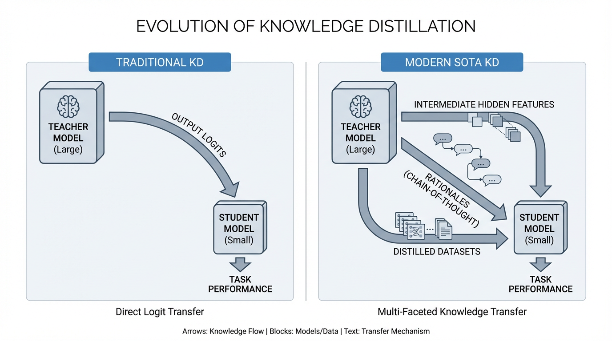

import KDVisualizer from '../../../components/chapter-13/KDVisualizer.tsx';

<a id="134-knowledge-distillation"></a>

# 13.4 지식 증류

양자화가 기존 모델의 무게를 줄이는 작업이라면, **지식 증류(Knowledge Distillation, KD)** 는 아예 짐을 다시 싸는 일에 가깝습니다. 원래 모델 구조를 유지한 채 가중치만 압축하는 대신, 더 큰 **교사(teacher)** 모델의 행동을 따라 하도록 더 작은 **학생(student)** 모델을 새로 학습시키기 때문입니다.

이 차이는 실무에서 중요합니다. 양자화와 희소화는 원래 네트워크의 구조에 묶여 있지만, 증류는 더 자유롭습니다. 학생은 폭과 깊이가 달라도 되고, 경우에 따라서는 아키텍처 계열 자체가 달라도 됩니다. 중요한 것은 우리가 원하는 행동을 얼마나 잘 옮겨오느냐입니다.

LLM 시대의 증류도 더 야심차게 바뀌었습니다. 이제는 단순히 출력 확률을 흉내 내는 데서 그치지 않고, reasoning trace, hidden-state structure, decoding behavior까지 더 작은 모델로 옮기려는 시도가 많아졌습니다.

---

## 1. 로짓 매칭에서 추론 과정으로의 진화

역사적으로 지식 증류는 **로짓 매칭 (Logit Matching)** 에 의존했습니다. 2015년 Geoffrey Hinton 등이 제안한 [[1]](#ref-1) 이 방식의 핵심은, 교사 모델의 출력 로짓(Logits)에 숨겨진 '어두운 지식(Dark Knowledge)'—즉, 정답이 아닌 오답 클래스들 간의 상대적 확률 분포—을 학생이 학습하게 만드는 것입니다.

출력층의 소프트맥스(Softmax) 함수에 높은 **온도 (Temperature, $T$)** 를 적용하면, 날카로운 확률 분포가 부드러워지며 학생 모델은 쿨백-라이블러 발산(KL Divergence)을 통해 이 미세한 관계를 학습합니다.

$$ \mathcal{L}_{KD} = T^2 \cdot \mathcal{D}_{KL}\left( \text{Softmax}\left(\frac{Z_{teacher}}{T}\right) \Big|\Big| \text{Softmax}\left(\frac{Z_{student}}{T}\right) \right) $$

이 방식은 분류 작업에서는 매우 효과적이지만, 생성과 추론이 핵심인 LLM에서는 한계가 드러납니다. 최종 토큰 분포만 맞추면 학생은 “무슨 답이 자주 나오는지”는 배울 수 있어도, 교사가 그 답에 도달한 과정까지는 배우지 못할 수 있습니다. 그래서 작은 학생 모델이 문체는 비슷하게 흉내 내지만 reasoning-heavy task에서는 여전히 약한 경우가 많습니다.

### 더 풍부한 supervision으로 가는 흐름

이 간극을 줄이기 위해 최근 연구는 최종 로짓 바깥의 신호를 더 적극적으로 활용합니다.

1. **Rationale-Based Distillation**: 교사가 최종 답만이 아니라 중간 reasoning step까지 제공합니다 [[2]](#ref-2).
2. **Feature-Based Alignment**: 학생이 출력뿐 아니라 내부 hidden-state 구조 일부까지 교사와 비슷해지도록 유도합니다.

이 방법들이 “작은 모델도 곧바로 큰 모델처럼 생각하게 만든다”는 뜻은 아닙니다. 다만, 출력만 맞추는 방식보다 더 유용한 행동을 옮겨오는 데 도움이 되는 경우가 많습니다.


*출처: AI 생성 이미지. 로짓 매칭에서 단계별 추론(CoT) 증류 및 특징 정렬로 진화한 지식 증류의 패러다임 변화를 보여주는 개념도.*

---

## 2. 생성 모델을 위한 분포 교정: Forward KL vs Reverse KL

토큰을 순차적으로 생성하는 자기회귀(Auto-regressive) 모델의 지식 증류에서 가장 중요한 수학적 결정 중 하나는 발산(Divergence) 함수의 방향입니다. 전통적인 지식 증류는 교사 분포 $P$ 와 학생 분포 $Q$ 사이의 **Forward KL Divergence** $\mathcal{D}_{KL}(P || Q)$ 를 최소화합니다.

* **Forward KL (Mean-seeking)**: 전통적인 선택입니다. 교사 분포가 확률을 두는 영역을 학생도 넓게 덮도록 유도합니다. coverage가 중요할 때는 장점이 있지만, 학생이 훨씬 작을 경우 확률 질량을 너무 넓게 퍼뜨리는 부작용이 생길 수 있습니다.
* **Reverse KL (Mode-seeking)**: MiniLLM 같은 연구는 자기회귀 생성에서는 **Reverse KL Divergence** $\mathcal{D}_{KL}(Q || P)$ 가 더 잘 맞을 수 있다고 봅니다 [[3]](#ref-3). 학생이 교사가 선호하는 모드에 더 강하게 집중하게 만들기 때문에, 일부 설정에서는 더 또렷하고 유창한 출력을 만들 수 있습니다.

핵심은 어느 한쪽이 항상 우월하다는 이야기가 아닙니다. divergence 방향이 학생의 성격을 바꾸기 때문에, 생성형 증류에서는 이것을 기본값이 아니라 설계 선택으로 봐야 한다는 점이 중요합니다.

---

## 3. On-Policy 증류: 학생의 실수로부터 배우기

고정된 교사 궤적과 학생이 생성하는 궤적 사이에는 분포 차이가 생길 수 있습니다. 교사 출력도 오류를 포함하며, 학생이 한 토큰을 다르게 쓴다고 반드시 실패하는 것은 아닙니다. 중요한 것은 실제 학생 상태에서의 오류를 평가하고 학습 분포가 이를 다루도록 설계하는 것입니다.

이에 대한 대응이 **On-Policy Distillation** 입니다. 일반화된 지식 증류(GKD) 같은 방법은 교사가 만든 이상적인 경로만 보여주는 대신, 학생이 실제로 생성한 시퀀스를 교사가 다시 채점하게 만듭니다 [[4]](#ref-4). 즉, 학생이 자주 빠지는 나쁜 상태에서 다음 토큰을 어떻게 골라야 하는지까지 배우게 하는 방식입니다.

실무적으로 중요한 이유는 분명합니다. 배포된 모델은 깨끗한 예제에서 실패하기보다, 한 번 살짝 틀어진 뒤 그 상태를 회복하지 못해서 실패하는 경우가 많기 때문입니다.

---

## 4. 아키텍처 비동질성과 특징 정렬

증류의 실질적인 장점 중 하나는 학생이 교사의 축소판일 필요가 없다는 점입니다. 더 큰 Transformer에서 더 작은 Transformer로 옮길 수도 있고, 이런 아이디어를 다른 모델 계열로까지 얼마나 넓힐 수 있는지도 활발히 탐구되고 있습니다.

문제는 hidden representation이 서로 다른 공간에 놓여 있다는 점입니다. 교사는 더 넓은 레이어를 가질 수 있고, head 수나 recurrence 구조도 다를 수 있습니다. 그래서 흔히 **projection layer** 를 추가해 학생의 표현을 교사의 latent space로 매핑한 뒤 alignment loss를 적용합니다.

여기서부터 증류는 개념 설명을 넘어 진짜 엔지니어링 문제가 됩니다. 어느 레이어를 맞출지, 얼마나 자주 맞출지, 손실 가중치를 어떻게 둘지가 학습 안정성과 학생 품질에 직접 영향을 주기 때문입니다.

---

### PyTorch 구현: 특징 기반 지식 증류

아래의 PyTorch 코드는 구조적 비동질성(Heterogeneity)을 극복하기 위해 표준 태스크 손실, 로짓 기반 KL 발산, 그리고 투영 레이어를 활용한 특징 정렬(Feature Alignment) 손실을 하나로 결합한 최신 지식 증류 파이프라인을 보여줍니다.

> **교육용 loss 예제.** 같은 토크나이저·어휘 순서·채팅 템플릿을 사용하는 정렬된 교사/학생 출력을 가정합니다. 실제 교사는 고정된 체크포인트로 `eval()` 및 `inference_mode()`에서 실행해야 합니다. 아래 합성 마스크는 실제 템플릿의 assistant span 마스크로 대체하세요. BOS/EOS 중복을 피하고 EOS 포함 정책·절단·패딩을 일치시키며, 패킹 시 샘플 간 attention을 차단해야 합니다. 전체 모델 학습, 다른 토크나이저의 분포 매핑, 전역 토큰 수를 사용하는 분산 loss 정규화는 구현하지 않습니다.

```python
import torch
import torch.nn as nn
import torch.nn.functional as F

class ModernKDLoss(nn.Module):
    def __init__(self, student_dim, teacher_dim, temp=2.0, alpha=0.5, beta=0.1):
        super().__init__()
        if temp <= 0 or not 0 <= alpha <= 1 or beta < 0:
            raise ValueError("invalid loss settings")
        self.temp, self.alpha, self.beta = temp, alpha, beta
        self.feature_projector = nn.Linear(student_dim, teacher_dim, bias=False)

    def forward(self, student_logits, teacher_logits, student_hidden,
                teacher_hidden, labels, assistant_mask):
        # Same tokenizer, vocabulary ordering and [B,S,V] positions required.
        if student_logits.shape != teacher_logits.shape or student_logits.ndim != 3:
            raise ValueError("teacher/student logit alignment mismatch")
        if labels.shape != student_logits.shape[:2] or assistant_mask.shape != labels.shape:
            raise ValueError("label/mask shape mismatch")
        if labels.shape[1] < 2:
            raise ValueError("at least one next-token target required")
        # Position t predicts token t+1; padding uses -100, prompts use mask=False.
        valid = assistant_mask[:, 1:].bool() & labels[:, 1:].ne(-100)
        if not valid.any():
            raise ValueError("no supervised assistant tokens")
        s = student_logits[:, :-1].float()[valid]
        t = teacher_logits[:, :-1].detach().float()[valid]
        targets = labels[:, 1:][valid]
        ce = F.cross_entropy(s, targets)
        log_s = F.log_softmax(s / self.temp, dim=-1)
        log_t = F.log_softmax(t / self.temp, dim=-1)
        kd = F.kl_div(log_s, log_t, log_target=True, reduction="none").sum(-1).mean()
        # Align the predictive hidden states at the same selected positions.
        projected = self.feature_projector(student_hidden[:, :-1][valid])
        target_hidden = teacher_hidden[:, :-1].detach()[valid].float()
        feature = F.mse_loss(projected.float(), target_hidden)
        return (1-self.alpha)*ce + self.alpha*self.temp**2*kd + self.beta*feature

# Small CPU smoke example. Teacher outputs are frozen and already aligned.
torch.manual_seed(0)
B, S, V, Ds, Dt = 2, 6, 32, 8, 12
s_logits = torch.randn(B, S, V, requires_grad=True)
t_logits = torch.randn(B, S, V)
s_hidden = torch.randn(B, S, Ds, requires_grad=True)
t_hidden = torch.randn(B, S, Dt)
labels = torch.randint(V, (B, S))
labels[1, -2:] = -100
assistant_mask = torch.zeros(B, S, dtype=torch.bool)
assistant_mask[:, 3:] = True  # template-derived in a real pipeline
criterion = ModernKDLoss(Ds, Dt)
loss = criterion(s_logits, t_logits, s_hidden, t_hidden, labels, assistant_mask)
loss.backward()
print("KD loss:", loss.item())
```

---

## 5. 실무 증류 설계의 질문

실제 제품의 증류 파이프라인을 설계할 때는 다음 운영상의 질문이 중요합니다.

1. **어떤 행동이 가장 중요한가요?** 정확도, 지연 시간, 형식 준수, 도구 사용, 안전성에 따라 적합한 교사 신호가 달라집니다.
2. **적합한 교사인가요?** 전문 작업에서는 파라미터 수보다 도메인 적합성이 중요할 수 있습니다.
3. **어떤 실패를 평가하나요?** 정제된 벤치마크 성적이 좋아도 응답 길이, 확률 보정, 거절 행동이 달라질 수 있습니다.
4. **어디에 예산이 쓰이나요?** 추론 과정 생성이나 on-policy 채점을 위한 교사 추론이 전체 증류 비용의 큰 부분을 차지할 수 있습니다.

따라서 실무 증류에는 교사 출력으로 학생을 학습하는 것 외에도 데이터 선별, 교사 품질 검사, 학생 궤적 평가와 릴리스 기준이 필요합니다.

---

## 6. 표현 정렬의 기하학적 제약

출력 일치는 은닉 공간의 특정 좌표를 요구하지 않습니다. 아래 그림은 특징 정렬이 추가하는 제약을 설명하며 두 학습 방법의 우열을 실험하지 않습니다.

<KDVisualizer lang="ko" client:load />

---

## 7. 요약 및 다음 단계

지식 증류는 단순한 로짓 매칭 기법에서, 큰 모델의 행동을 작은 모델로 옮기는 더 넓은 도구 상자로 발전했습니다. 지금 중요한 것은 “KD를 썼다”가 아니라, 어떤 teacher를 선택했고, 어떤 divergence를 썼고, 학생이 실제로 만드는 궤적까지 평가했는지입니다.

양자화와 희소화와 함께 쓰면, 지식 증류는 더 작은 하드웨어와 더 빡빡한 latency budget 안에서도 꽤 강한 모델을 배포하게 해 주는 가장 실용적인 수단 중 하나입니다. 하지만 작은 모델은 내부에 담을 수 있는 지식량이 제한적입니다. 다음 장인 **Chapter 14: RAG (Retrieval Augmented Generation)** 에서는 그 한계를 retrieval로 어떻게 보완하는지 보겠습니다.

---

## SteerDistill: 국소적으로 교정한 행동에서 배우기

**2026-11-15 기준 — 초기 연구.** SteerDistill은 행동이 어긋난 지점 부근의 환경을 복원한 뒤, 교사의 지침으로 양자화 학생이 스스로 수정하도록 유도합니다. 국소 검증을 통과한 수정은 지침 없는 학생에 증류합니다. 교정 턴에는 순방향 KL, 다른 턴에는 원 정밀도 교사에 대한 역방향 KL을 씁니다. 실험 범위는 모델 3개와 에이전트 벤치마크 5개입니다. 성공한 교사 궤적·복원 가능한 상태·신뢰할 국소 검증이 필요하며, 국소 수정이 전체 성공을 보장하지는 않습니다. [[5]](#ref-5)

검증기 오류와 최종 성공을 따로 측정하세요. 버전·마스크·환경 스냅샷을 보존하고 평가 과제와 변형은 격리해야 합니다.

## 증류 실행 계약

입력 manifest에 데이터 출처·권한·필터·중복 제거·평가 격리와 교사/학생·토크나이저·템플릿 hash를 기록합니다. 증류 대상은 assistant의 유효 다음 토큰이며 교사 checkpoint, 생성 설정·길이 정책, projection 레이어와 loss 가중치를 함께 고정합니다. 예제는 CPU FP32 텐서 계산이며 실제 예산에는 두 모델의 가중치, 학생 그래디언트·옵티마이저·활성화, 교사 추론 버퍼, 로짓 저장, collective·평가 비용이 추가됩니다.

토큰 정규화 CE/KL과 도메인별 검증 지표, nonfinite/overflow·norm, 처리량·MFU·데이터 대기·collective와 batch ID를 관측합니다. 비유한 값, 마스크 불일치나 중요 슬라이스 악화 시 중단하세요. 체크포인트는 학생·projection·옵티마이저·스케줄러·정밀도 상태, step·토큰 수·RNG·sampler·데이터 cursor·hash를 포함해야 합니다. 격리된 도메인·기본 능력 유지·안전·형식/도구·지연·비용·오류율 평가를 짝지은 불확실성과 함께 통과하고 이전 정상 번들 복귀를 시험한 뒤에만 승격합니다.

## Quizzes

<details>
<summary>Quiz 1: 전통적인 로짓 기반 지식 증류에서 소프트맥스 함수에 적용되는 온도(Temperature, $T$) 파라미터의 수학적 역할은 무엇입니까?</summary>
*일반적인 소프트맥스 함수는 정답 클래스에 확률이 극단적으로 쏠리는 매우 날카로운(Sharp) 분포를 만듭니다. 온도를 1보다 큰 값으로 설정하여 로짓을 나누면 확률 분포가 평평해지며(Smoothed), 이를 통해 정답이 아닌 오답 클래스들 간의 미세한 확률 차이(Dark Knowledge)가 증폭됩니다. 학생 모델은 이 부드러워진 분포를 학습함으로써 교사 모델의 일반화(Generalization) 패턴을 더 잘 흡수할 수 있습니다.*
</details>

<details>
<summary>Quiz 2: 생성형 증류에서 Reverse KL이 항상은 아니지만 종종 매력적인 선택이 되는 이유는 무엇입니까?</summary>
*Forward KL은 교사 분포를 넓게 덮도록 유도하기 때문에, 작은 학생에게는 확률 질량이 너무 퍼질 수 있습니다. Reverse KL은 더 mode-seeking해서 교사가 선호하는 연속에 학생이 더 강하게 집중하게 만들 수 있습니다. 그래서 일부 생성 설정에서는 더 또렷하고 유창한 출력을 만들 수 있습니다.*
</details>

<details>
<summary>Quiz 3: On-Policy Distillation이 해결하려는 문제는 무엇입니까?</summary>
*훈련 때 본 깨끗한 teacher trajectory와, 실제 추론에서 학생이 만들어 내는 imperfect trajectory 사이의 간극을 줄이려는 것입니다. 학생이 직접 만든 시퀀스를 교사가 다시 채점하게 하면, 학생은 이상적인 경로뿐 아니라 자신이 실제로 빠지는 나쁜 상태에서 어떻게 회복할지도 배울 수 있습니다.*
</details>

<details>
<summary>Quiz 4: 아키텍처가 다른 teacher와 student 사이에서 projection layer를 자주 넣는 이유는 무엇입니까?</summary>
*teacher와 student의 hidden state는 차원 수도 다르고 기하학도 다를 수 있습니다. projection layer는 student 표현을 교사 latent space와 비교 가능한 공간으로 옮겨 주기 때문에, MSE 같은 alignment loss를 의미 있게 적용할 수 있게 해 줍니다.*
</details>

<details>
<summary>Quiz 5: 실제 distillation pipeline에서 teacher의 파라미터 수보다 teacher 선택 자체가 더 중요한 이유는 무엇입니까?</summary>
*학생은 teacher가 주는 신호만 배울 수 있기 때문입니다. 도메인에 잘 맞는 teacher는 target task에 더 적합한 출력, rationale, hidden-state structure를 제공합니다. 반대로 훨씬 더 큰 일반 모델이라도 배포 목표와 신호가 어긋나면 좋은 teacher가 아닐 수 있습니다.*
</details>

---

## References

1. <a id="ref-1"></a>Hinton, G., Vinyals, O., & Dean, J. (2015). *Distilling the Knowledge in a Neural Network.* [arXiv:1503.02531](https://arxiv.org/abs/1503.02531).
2. <a id="ref-2"></a>Hsieh, C. Y., et al. (2023). *Distilling Step-by-Step! Outperforming Larger Language Models with Less Training Data and Smaller Model Sizes.* [arXiv:2305.02301](https://arxiv.org/abs/2305.02301).
3. <a id="ref-3"></a>Gu, Y., Dong, L., Wei, F., & Huang, M. (2024). *MiniLLM: On-Policy Distillation of Large Language Models.* [arXiv:2306.08543](https://arxiv.org/abs/2306.08543).
4. <a id="ref-4"></a>Agarwal, R., et al. (2024). *On-Policy Distillation of Language Models: Learning from Self-Generated Mistakes.* [arXiv:2306.13649](https://arxiv.org/abs/2306.13649).
5. <a id="ref-5"></a>Research preprint (2026). [SteerDistill: Quantizing LLM Agents via Closed-Loop Teacher Steering](https://arxiv.org/html/2611.13410v1). Version pinned; accessed 2026-11-15.
