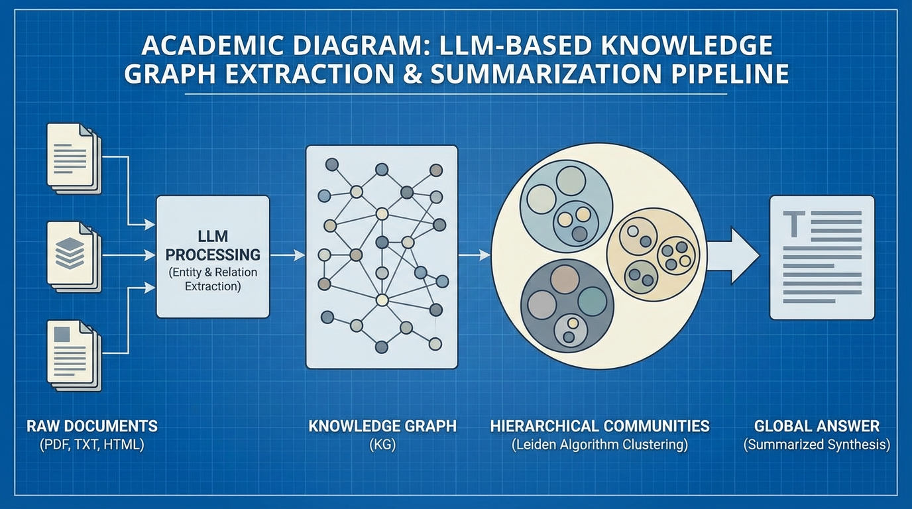

import GraphVisualizer from '../../../components/chapter-14/GraphVisualizer.tsx';

# 14.5 GraphRAG 및 온톨로지

한 엔터프라이즈 어시스턴트가 다음과 같은 질문을 받았다고 생각해 봅시다. *"우리가 라이선스를 받은 모델을 만든 스타트업을 인수한 회사의 CEO는 누구인가?"* 벡터 검색기는 스타트업, 인수, CEO가 등장하는 문서 조각들을 어느 정도 찾아올 수는 있습니다. 하지만 정답에 이르는 관계 자체를 따라가지는 못할 수 있습니다. 벡터 검색은 의미적 유사성에는 강하지만, 관계형 탐색에는 약하기 때문입니다.

이 차이는 중요합니다. 실제 현업의 많은 질문은 "비슷한 문단을 찾아줘"가 아니라 엔티티와 엣지를 따라가야 하는 문제이기 때문입니다. 소유 관계 추적, 장애 타임라인 분석, 의존성 출처 파악, 계약 관계 탐색, 코퍼스 전체의 주제 파악이 모두 여기에 속합니다. 이런 질문을 잘 풀려면 시스템을 단순한 의미론적 텍스트 매칭에서 관계형 추론으로 업그레이드해야 합니다. 이것이 바로 **지식 그래프 (Knowledge Graphs)** 와 **GraphRAG** 의 영역입니다.

---

## 1. 언제 GraphRAG가 운영 비용을 정당화하는가

GraphRAG는 일반적인 벡터 RAG보다 운영 비용과 복잡성이 높기 때문에, 그만한 값을 해야 합니다. 다음과 같은 트래픽이 많을 때 특히 유리합니다.

- **다중 홉 질문:** 문서 사이의 관계를 따라가야 정답이 나오는 경우
- **전역 요약:** 특정 passage가 아니라 코퍼스 전체의 구조와 주제를 묻는 경우
- **출처 민감 워크플로우:** 답이 어떻게 조립되었는지를 보여 줘야 하는 경우

반대로 사용자 질문의 대부분이 "문서 어디에 X가 적혀 있나?"에 가깝다면, 일반적인 벡터 RAG가 더 싸고 단순한 선택인 경우가 많습니다. GraphRAG는 청크 자체보다 관계와 커뮤니티 구조가 답의 품질을 결정할 때 더 적합합니다.

---

## 2. 온톨로지와 추출 스키마

온톨로지는 엔터티의 유형, 관계와 의미 제약을 정의합니다. RDF/OWL과 property graph는 서로 다른 표현 선택이며, LLM을 사용한다고 스키마 설계나 관리가 사라지지는 않습니다.

LLM은 텍스트에서 관계 후보를 제안할 수 있습니다. 각 후보에는 원본 문서·구절, 추출기 버전, 유효 시간, 접근 권한을 연결해야 합니다. 형식 검사를 통과한 관계도 사실과 다를 수 있습니다. 엔터티 병합은 이름이나 임베딩 유사도만으로 확정하지 말고 식별자, 시간, 유형, 원문 근거를 검증하며 되돌릴 수 있게 기록합니다.


## 3. 실용적 구현: 엔티티 및 관계 추출 (Extracting Entities and Relationships)

비구조화된 텍스트에서 지식 그래프를 구축하기 위해, 우리는 LLM에 엔티티와 그들의 관계를 식별하도록 프롬프트를 주고, 이를 구조화된 형식(예: JSON)으로 반환하도록 합니다.

아래 Python 예제는 미리 작성한 추출 결과의 구조를 검사합니다.

> **교육용 오프라인 예제.** 추출 결과의 구조만 검사합니다. 실제 추출, 사실 검증, 권한·유효 시간 검사와 영속 저장은 구현하지 않습니다.

```python
# Authored extraction output: this example does not call an LLM.
def validate_graph(graph):
    nodes = graph["entities"]
    ids = [node["id"] for node in nodes]
    if len(ids) != len(set(ids)):
        raise ValueError("duplicate entity IDs")
    allowed_relations = {"ACQUIRED_BY", "HAS_CEO"}
    for edge in graph["relationships"]:
        if edge["source"] not in ids or edge["target"] not in ids:
            raise ValueError("edge references an unknown entity")
        if edge["type"] not in allowed_relations or not edge["source_span"]:
            raise ValueError("unsupported relation or missing evidence")
    return graph  # Structural validation, not verification of factual truth.

graph = validate_graph({
    "entities": [{"id": "Orion"}, {"id": "Northstar"}, {"id": "Mina"}],
    "relationships": [
        {"source": "Orion", "target": "Northstar", "type": "ACQUIRED_BY",
         "source_span": "Fictional memo A: Northstar acquired Orion."},
        {"source": "Northstar", "target": "Mina", "type": "HAS_CEO",
         "source_span": "Fictional memo B: Mina is Northstar's CEO."},
    ],
})
print(len(graph["relationships"]))  # 2
```

---


## 4. 다중 홉 탐색

가상 문서에서 Orion은 Northstar에 인수되었고 Mina가 Northstar의 CEO라고 합시다. 검색한 엔터티에서 `Orion → Northstar → Mina` 관계를 따라가면 답의 근거 후보를 얻습니다. 그래도 유효 날짜와 원문 근거를 확인해야 하며 생성기가 잘못 답할 수 있습니다.

아래 예제는 서로 다른 검색 경로를 비교합니다. 벡터 검색도 적절한 문서를 찾을 수 있고, 그래프도 누락되거나 잘못된 간선 때문에 실패할 수 있습니다.

<GraphVisualizer client:load lang="ko" />

### 그래프 검색 엔지니어링: 재시작이 있는 무작위 보행 (Random Walk with Restart, RWR)

프로덕션 환경에서는 가능한 모든 다중 홉 경로에 대해 수동으로 Cypher 쿼리를 작성하지 않습니다. 대신 그래프 데이터베이스는 수학적 알고리즘을 사용하여 주변 노드의 관련성 점수를 매깁니다. 표준적인 접근법은 PageRank의 변형인 **재시작이 있는 무작위 보행 (Random Walk with Restart, RWR)** 입니다.

시작 분포 $\mathbf{p}_0$ (벡터 검색을 통해 찾은 초기 노드들)가 주어지면, 알고리즘은 그래프의 엣지를 탐색하는 무작위 보행자(Random walker)를 시뮬레이션합니다. 보행자가 무관한 영역으로 너무 멀리 표류하는 것을 방지하기 위해, 시작점으로 다시 "순간 이동(Teleporting)"할 확률 $c$ 를 갖습니다.

$$ \mathbf{p}_{t+1}=(1-c)(\mathbf W\mathbf p_t+\mathbf p_0\mathbf d^T\mathbf p_t)+c\mathbf p_0. $$

여기서 $\mathbf W$ 는 나가는 간선이 있는 열을 정규화하고 dangling 열은 0으로 둔 인접 행렬입니다. $d_j$ 는 노드 $j$ 가 dangling이면 1, 아니면 0입니다. $\mathbf d^T\mathbf p_t$ 는 그 노드들에 놓인 확률 질량이며 초기 분포 $\mathbf p_0$ 로 재분배됩니다. 아래는 이 규칙의 교육용 구현입니다.

> **교육용 밀집 CPU 예제.** 나가는 간선이 없는 노드의 질량은 초기 분포로 재분배합니다. 노드 수 $V$ 에 대해 저장과 단계당 연산은 $O(V^2)$ 입니다. 실제 그래프에는 희소 연산, 장치 처리, 접근 권한, 수렴 검사와 출처가 필요합니다. 점수는 근접도이지 진실성이 아닙니다.

```python
import torch

class GraphRetriever:
    """
    재시작이 있는 무작위 보행(RWR)을 사용한 그래프 검색의 PyTorch 구현체입니다.
    초기 벡터 검색 결과를 고도로 관련성 있는 하위 그래프로 확장합니다.
    """
    def __init__(self, num_nodes: int, edges: torch.Tensor, restart_prob: float = 0.15):
        """
        Args:
            num_nodes: 지식 그래프 내 전체 엔티티 수.
            edges: (2, num_edges) 형태의 텐서. edges[0]은 소스, edges[1]은 타겟.
            restart_prob: 초기 검색 노드로 다시 순간 이동할 확률 (c).
        """
        if num_nodes < 1 or not 0 < restart_prob <= 1:
            raise ValueError("Require nodes > 0 and restart probability in (0, 1]")
        self.num_nodes = num_nodes
        self.restart_prob = restart_prob

        # 인접 행렬 초기화
        self.adj_matrix = torch.zeros(num_nodes, num_nodes)

        # p_{t+1} = W * p_t 인 열 추계적(Column-stochastic) 행렬을 위해,
        # 열은 소스 노드를, 행은 타겟 노드를 나타냅니다.
        self.adj_matrix[edges[1], edges[0]] = 1.0

        # 인접 행렬 정규화 (열 추계적)
        out_degree = self.adj_matrix.sum(dim=0, keepdim=True)
        self.dangling = (out_degree.squeeze(0) == 0)
        out_degree = out_degree.clamp_min(1.0)
        self.trans_matrix = self.adj_matrix / out_degree

    def retrieve_subgraph(self, initial_nodes: torch.Tensor, num_steps: int = 15) -> torch.Tensor:
        """
        Args:
            initial_nodes: 시작 분포를 나타내는 텐서 (num_nodes, 1)
                           (예: 초기 벡터 임베딩 검색을 통해 찾은 노드들).
        Returns:
            그래프 내 모든 노드에 대한 관련성 점수 (Relevance scores).
        """
        # 초기 분포 정규화
        if initial_nodes.shape != (self.num_nodes, 1):
            raise ValueError("Expected initial_nodes shape [num_nodes, 1]")
        if not torch.isfinite(initial_nodes).all() or (initial_nodes < 0).any() or initial_nodes.sum() <= 0:
            raise ValueError("Initial distribution must have finite nonnegative positive mass")
        p_0 = initial_nodes / initial_nodes.sum()
        p_t = p_0.clone()

        # 정상 분포(Stationary distribution)를 계산하기 위한 거듭제곱 연산(Power iteration)
        for _ in range(num_steps):
            dangling_mass = p_t[self.dangling].sum()
            walk = self.trans_matrix @ p_t + dangling_mass * p_0
            p_t = (1 - self.restart_prob) * walk + self.restart_prob * p_0

        return p_t

# --- 실행 예시 ---
if __name__ == "__main__":
    # 5개의 노드를 가진 작은 온톨로지 그래프 시뮬레이션
    # 예: 0: 사용자 쿼리, 1: Orion, 2: Northstar, 3: Mina, 4: OpenAI
    edges = torch.tensor([
        [1, 2, 2], # 소스 노드
        [2, 3, 4]  # 타겟 노드
    ])

    retriever = GraphRetriever(num_nodes=5, edges=edges, restart_prob=0.2)

    # 노드 1(Orion)의 순위가 높게 나온 벡터 검색 시뮬레이션
    initial_dist = torch.zeros(5, 1)
    initial_dist[1, 0] = 1.0

    # 다중 홉 하위 그래프 컨텍스트 검색
    relevance_scores = retriever.retrieve_subgraph(initial_dist, num_steps=20)

    # LLM 컨텍스트 윈도우에 주입할 상위 k개의 노드 선택
    top_k = torch.topk(relevance_scores.squeeze(), k=3)
    print(f"상위 검색된 노드 인덱스: {top_k.indices.tolist()}")
    print(f"노드 관련성 점수: {top_k.values.tolist()}")
```

최근의 그래프 강화 검색 연구는 이 아이디어를 더 발전시키고 있습니다. 예를 들어 HippoRAG는 지식 그래프와 Personalized PageRank 계열 검색을 결합해, 반복적인 retrieval loop보다 더 낮은 비용으로 multi-hop recall을 끌어올리는 방향을 보여 줍니다 [[3]](#ref-3). 실무 관점에서 중요한 교훈은, 엔티티 그래프를 갖추는 순간 그래프 검색도 별도 세계가 아니라 retrieval stack 안의 또 하나의 retriever가 된다는 점입니다.

---

## 5. Microsoft의 GraphRAG: 전역적 의미 파악 (Global Sensemaking)

엣지를 탐색하는 것이 다중 홉 질문(로컬 검색)을 해결해 주지만, RAG에서 가장 어려운 문제인 **전역적 의미 파악 (Global Sensemaking)** 을 해결해 주지는 못합니다.

전역적인 주제 질문은 소수의 top-k 문서만으로 대표성을 확보하기 어렵습니다. 이것은 단순 검색 설정의 한계이며, 모든 벡터 기반 방법이 반드시 실패한다는 뜻은 아닙니다.

2024년, Microsoft 리서치(Microsoft Research)는 이러한 전역적 요약 문제를 해결하기 위해 특별히 설계된 **GraphRAG** [[1]](#ref-1) 라는 새로운 아키텍처를 발표했습니다. Microsoft의 접근 방식은 질의 시점에 단순히 그래프를 탐색하는 데 그치지 않고, 그래프를 사용하여 전체 데이터셋의 계층적 요약을 사전 계산(Precompute)합니다.


*Source: Edge, D., et al. (2024). "From Local to Global: A Graph RAG Approach to Query-Focused Summarization." [[1]](#ref-1)*

### Microsoft GraphRAG의 4단계

1.  **추출 (Extraction):** LLM이 모든 소스 문서를 처리하여 엔티티와 관계를 추출하고 거대한 비구조화 지식 그래프 $G = (V, E)$ 를 형성합니다.
2.  **커뮤니티 탐지 (Community Detection):** 시스템은 **Leiden 알고리즘** [[2]](#ref-2) 을 적용하여 그래프를 계층적이고 잘 연결된 클러스터(커뮤니티)로 분할합니다. 자주 상호작용하는 엔티티들(예: 책의 특정 서브플롯에 등장하는 모든 캐릭터와 장소)은 하나의 커뮤니티 $C_i$ 로 그룹화됩니다.
3.  **사전 생성 요약 (Pregenerated Summarization):** 사용자가 질문을 던지기도 전에, LLM은 그래프 내의 모든 단일 커뮤니티에 대해 포괄적인 요약 $S_i$ 를 생성합니다.
4.  **맵리듀스 질의 (Map-Reduce Querying):** 전역 쿼리가 도착하면 시스템은 원시 텍스트를 검색하지 않습니다. 대신 LLM에 각 커뮤니티 요약을 독립적으로 사용하여 부분적인 답변을 생성하도록 프롬프트를 줍니다(Map). 마지막으로 모든 부분 답변을 단일하고 응집력 있는 전역 응답으로 병합합니다(Reduce).

계층 요약은 넓은 범위를 다루는 한 방법입니다. 추출 오류, 소수 주제의 누락, 요약 손실과 변경된 권한의 전파를 평가해야 합니다.

---

## 6. 요약 및 다음 단계

**GraphRAG** 는 검색을 단순한 텍스트 매칭에서 관계형 추론으로 한 차원 끌어올립니다. 지식을 온톨로지와 계층적 커뮤니티로 구조화함으로써, 시스템은 엣지를 동적으로 탐색하여 다중 홉 쿼리에 답하고 방대한 데이터셋에 대한 전역적 의미 파악을 수행할 수 있습니다. 실무에서 중요한 질문은 그래프가 흥미로운가가 아니라, 실제 워크로드가 관계, 출처, 코퍼스 구조에 크게 의존하느냐입니다.

하지만 잘 설계된 그래프 파이프라인도 운영에서는 여전히 실패할 수 있습니다. 엣지가 오래됐을 수도 있고, entity resolution이 틀릴 수도 있으며, re-ranking이 timeout 날 수도 있고, 생성 모델이 근거를 무시할 수도 있습니다. 다음 절인 **14.6 RAG 실패 모드와 운영 설계** 에서는 이런 시스템이 실제로 어디서 깨지고, 어떻게 graceful degradation을 설계할지 살펴보겠습니다.

---

## Quizzes

<details>
<summary>Quiz 1: 소수의 top-k 문서가 전역 요약에 부족할 수 있는 이유는 무엇인가요?</summary>
*관련성이 높은 일부 문서가 전체 주제 분포를 대표하지 않을 수 있습니다. 군집 요약은 범위를 넓힐 수 있지만 누락과 왜곡을 별도로 평가해야 합니다.*
</details>

<details>
<summary>Quiz 2: LLM 추출이 스키마와 검증을 대체하나요?</summary>
*아닙니다. 형식, 엔터티 식별, 관계 의미, 출처, 유효 시간과 권한을 관리해야 합니다. 형식이 맞아도 내용은 틀릴 수 있습니다.*
</details>

<details>
<summary>Quiz 3: Microsoft의 GraphRAG 아키텍처에서 Leiden 알고리즘의 구체적인 수학적 목적은 무엇입니까?</summary>
*Leiden 알고리즘은 그래프 커뮤니티 탐지(Community detection)에 사용됩니다. 거대하고 비구조화된 엔티티 지식 그래프를 계층적이고 잘 연결된 클러스터(커뮤니티)로 분할합니다. 이를 통해 시스템은 질의 시간 전에 밀접하게 관련된 엔티티들에 대한 모듈화된 요약을 생성할 수 있습니다.*
</details>

<details>
<summary>Quiz 4: 제공된 PyTorch의 재시작이 있는 무작위 보행(RWR) 구현에서 `restart_prob` 매개변수의 역할은 무엇입니까?</summary>
*`restart_prob` (재시작 확률)는 무작위 보행이 초기 검색 결과에서 무한히 멀리 표류하는 것을 방지합니다. 탐색이 주기적으로 (벡터 검색을 통해 찾은) 시작 노드로 다시 "순간 이동"하도록 강제함으로써, 검색된 하위 그래프가 사용자의 원래 쿼리 컨텍스트에 강하게 편향되도록 보장합니다.*
</details>

<details>
<summary>Quiz 5: 임베딩 유사도만으로 엔터티를 병합하면 어떤 문제가 생기나요?</summary>
*비슷한 이름이나 설명이 같은 대상을 뜻하지는 않습니다. 식별자·유형·시간·원문을 확인하고 병합 이력을 보존해야 합니다. 병합 후에는 중복 간선과 가중치 의미를 정한 다음 전이 확률을 다시 정규화합니다.*
</details>

---

## References

1. <a id="ref-1"></a>Edge, D., et al. (2024). *From Local to Global: A Graph RAG Approach to Query-Focused Summarization.* [arXiv:2404.16130](https://arxiv.org/abs/2404.16130).
2. <a id="ref-2"></a>Traag, V. A., Waltman, L., & van Eck, N. J. (2019). *From Louvain to Leiden: guaranteeing well-connected communities.* [Scientific Reports](https://www.nature.com/articles/s41598-019-41695-z).
3. <a id="ref-3"></a>Gutiérrez, B. J., Shu, Y., Gu, Y., Yasunaga, M., & Su, Y. (2025). *HippoRAG: Neurobiologically Inspired Long-Term Memory for Large Language Models.* [arXiv:2405.14831](https://arxiv.org/abs/2405.14831).
