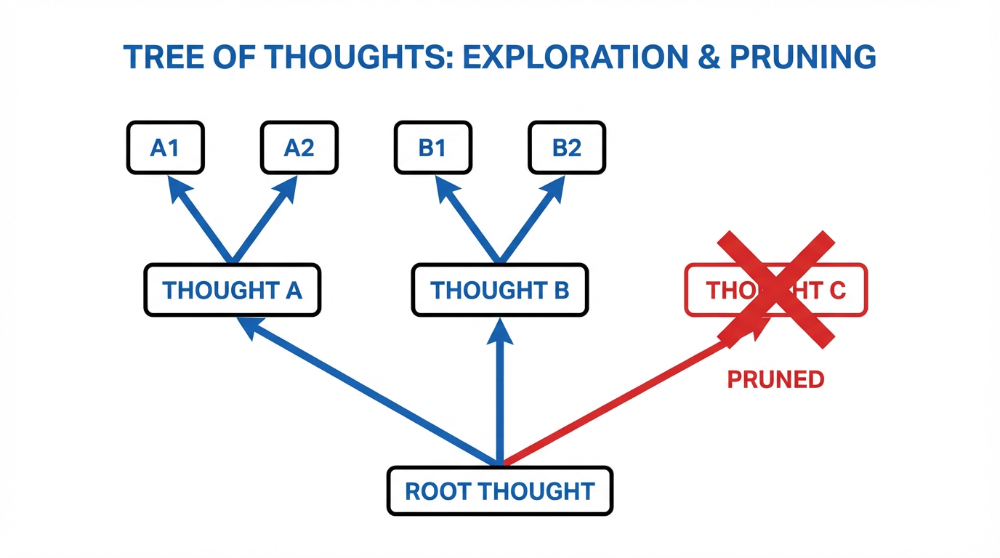

import ReasoningVisualizer from '../../../components/chapter-15/ReasoningVisualizer.tsx';

# 15.2 생각의 트리와 그래프 (Tree/Graph of Thoughts)

자기회귀 Transformer는 한 단계 전의 상태만이 아니라 사용 가능한 접두사 전체에 조건화됩니다. 기본적인 단일 생성 경로에서는 이미 출력한 토큰을 다시 쓰지 않지만, 뒤의 텍스트에서 앞선 실수를 수정할 수 있습니다. ToT와 GoT는 여러 후보와 평가를 외부 탐색 상태로 관리해 대안을 비교하고 되돌아갈 수 있게 합니다. 이 추가 계산이 유용하려면 후보 평가가 충분히 신뢰할 만해야 합니다.

---

## 1. 생각의 트리(ToT) 프레임워크

Yao et al. (2023) [[1]](#ref-1) 이 제안한 **Tree of Thoughts (ToT)** 는 LLM 추론을 추론 단계들의 조합 공간(combinatorial space)에 대한 휴리스틱 탐색(heuristic search) 문제로 재정의합니다.

단일한 연속 시퀀스를 생성하는 대신, ToT는 문제를 개별적인 "생각(thoughts)"(중간 추론 단계)으로 분해합니다. 모델은 여러 생각의 갈래(branches)를 탐색하고, 이를 평가하여 어떤 경로를 계속 파고들지, 혹은 어떤 경로를 가지치기(prune)할지 결정합니다.

### 수학적 정식화

표준 CoT에서는 입력 $x$ 가 주어졌을 때 출력 $y$ 에 도달하기 위해 생각의 시퀀스 $z_1, z_2, \dots, z_n$ 를 샘플링합니다. 이때의 확률은 단순히 다음과 같습니다:
$$ P(y, z_{1:n} | x) = \prod_{i=1}^{n} P(z_i | x, z_{1:i-1}) P(y | x, z_{1:n}) $$

ToT에서는 부분적인 추론 경로를 나타내는 상태(state) $s = [x, z_{1\dots i}]$ 를 정의합니다. 이 프레임워크는 두 가지 핵심 컴포넌트를 요구합니다:

1.  **Thought Generator $G(p_{\theta}, s, k)$:** 현재 상태가 주어졌을 때 $k$ 개의 후보 다음 생각들을 생성합니다. 이는 샘플링(temperature $> 0$)을 통해 이루어지거나, 특정 프롬프트를 통해 서로 다른 접근 방식을 제안하도록 유도할 수 있습니다.
2.  **State Evaluator $V(p_{\theta}, s)$:** 해당 상태의 생존 가능성을 점수화하는 휴리스틱 함수입니다. 일반적으로 LLM 자체가 평가자 역할을 하도록 프롬프팅되며, 스칼라 값을 부여하거나 범주형 레이블(예: `sure`, `maybe`, `impossible`)을 할당합니다.

$G$ 와 $V$ 가 정의되면, ToT는 **Breadth-First Search (BFS)** 나 **Depth-First Search (DFS)** 와 같은 고전적인 탐색 알고리즘을 적용합니다.

빔 너비(beam width)가 $b$ 인 BFS를 사용할 경우, 각 깊이 $d$ 에서 알고리즘은 $V(s)$ 에 의해 평가된 상위 $b$ 개의 상태만을 유지합니다. 이는 컨텍스트가 기하급수적으로 폭발하는 것을 방지하는 동시에, 대안적인 브랜치를 유지함으로써 모델이 국소적인 오류(localized errors)로부터 회복할 수 있게 해줍니다.


*Source: Yao et al., 2023 [[1]](#ref-1)*

---

## 2. 생각의 그래프(GoT): 시너지와 반복 정제

ToT는 백트래킹(backtracking)을 가능하게 하지만, 구조적인 결함을 안고 있습니다. 바로 **트리(Trees)는 병합될 수 없다** 는 점입니다. 만약 두 개의 서로 다른 브랜치가 가치 있고 상호 보완적인 부분 해답을 생성했다 하더라도, ToT는 시스템이 둘 중 하나만을 선택하고 나머지는 버리도록 강제합니다.

Besta et al. (2023) [[2]](#ref-2) 가 제안한 **Graph of Thoughts (GoT)** 는 추론 구조를 **피드백 순환도 포함할 수 있는 방향 그래프** 로 격상시킵니다. GoT에서 정점(vertices)은 생각을 나타내고, 간선(edges)은 종속성을 의미합니다. 겉보기에는 단순한 이 구조적 업그레이드가 트리는 지원할 수 없는 강력한 인지적 연산을 해제(unlock)합니다.

### 핵심 변환

- **Generation:** 현재 작업과 의존 이력에서 새 후보를 제안합니다.
- **Aggregation:** 여러 후보의 정보를 하나의 후보로 합칩니다. 서로 모순되는 부분이나 근거 손실이 없는지 다시 검증해야 합니다.
- **Refinement:** 피드백으로 후보를 수정합니다. 실행 기록은 수정을 별도 노드로 펼친 DAG로 남길 수 있지만, 일반 GoT의 제어 흐름은 순환을 포함할 수 있습니다.

### 비용과 품질은 함께 측정하기

GoT 논문은 특정 작업과 설정에서 이득을 보고합니다. [[2]](#ref-2) 병합은 중복 작업을 줄일 수 있지만 평가와 합성 비용을 추가하고 오류를 결합할 수도 있습니다. 너비가 제한된 ToT가 반드시 지수적으로 확장되는 것은 아닙니다. 상태마다 후보 $k$ 개를 만들고 빔 너비 $b$, 깊이 $d$ 를 유지하면 대략 $O(dbk)$ 개의 후보를 평가합니다. 각 후보의 토큰·도구 비용은 별도로 계산해야 합니다.

<ReasoningVisualizer client:load lang="ko" />

### 언제 트리/그래프 탐색 비용을 감수할 가치가 있는가

ToT와 GoT는 모든 프롬프트에 기본으로 켜 두는 디코딩 전략이 아닙니다. 다음 세 가지가 동시에 성립할 때 특히 가치가 커집니다.

- 문제에 의미 있는 대안 경로가 존재할 때
- 중간 상태를 평가하거나 점수화할 수 있을 때
- 초반에 잘못된 경로에 올인하는 비용보다, 여러 분기를 탐색하는 비용이 더 쌀 때

그래서 이 기법들은 일반적인 잡담보다 planning, constrained search, code repair, synthesis 같은 작업에 더 잘 맞습니다. 탐색할 만한 구조가 실제로 있는 문제에서만 search가 힘을 발휘합니다.

---

## 3. 오케스트레이터 구현

GoT를 구현하기 위해서는 시스템을 그래프 구조와 탐색 전략을 관리하는 **Controller** 와 생각들을 생성하고 채점하는 **Executor** (LLM)로 분리해야 합니다.

아래는 Generation과 Aggregation을 처리하는 GoT Controller의 핵심 로직을 보여주는 Python 구현 예시입니다.

> **교육용 컨트롤러 골격.** LLM 인터페이스는 모의 인터페이스이며 입력 파싱, 시간·토큰 예산, 상태 복구와 최종 검증을 생략했습니다.

```python
from typing import List, Dict, Any

class GoTNode:
    def __init__(self, thought: str, parents: List['GoTNode'] = None):
        self.thought = thought
        self.parents = parents or []
        self.score = 0.0
        self.children = []

class GoTController:
    def __init__(self, llm_executor):
        self.llm = llm_executor # Mock LLM interface
        self.graph: List[GoTNode] = []

    def state_text(self, node):
        ordered, seen = [], set()
        def visit(current):
            if id(current) in seen:
                return
            seen.add(id(current))
            for parent in current.parents:
                visit(parent)
            ordered.append(current.thought)
        visit(node)
        return "\n".join(ordered)  # Root task plus dependency history.

    def generate_thoughts(self, node: GoTNode, k: int) -> List[GoTNode]:
        """Branches a node into k new thoughts."""
        prompt = f"Given the current state: {self.state_text(node)}\nGenerate {k} distinct next steps."
        responses = self.llm.generate(prompt, num_return_sequences=k)

        new_nodes = [GoTNode(thought=r, parents=[node]) for r in responses]
        node.children.extend(new_nodes)
        self.graph.extend(new_nodes)
        return new_nodes

    def score_nodes(self, nodes: List[GoTNode]):
        """Evaluates nodes using the LLM as a heuristic function."""
        for node in nodes:
            prompt = f"Evaluate the validity of this reasoning step: {self.state_text(node)}. Score from 0.0 to 1.0."
            score_str = self.llm.generate(prompt, max_tokens=5)[0]
            node.score = float(score_str)
            if not 0.0 <= node.score <= 1.0:
                raise ValueError("evaluator must return a finite score in [0,1]")

    def aggregate_thoughts(self, nodes: List[GoTNode]) -> GoTNode:
        """Proposes an aggregate; improvement requires separate validation."""
        combined_text = "\n".join([f"- {self.state_text(n)}" for n in nodes])
        prompt = f"Synthesize the following partial solutions into one optimal solution:\n{combined_text}"

        synergy_thought = self.llm.generate(prompt, max_tokens=256)[0]
        synergy_node = GoTNode(thought=synergy_thought, parents=nodes)

        for n in nodes:
            n.children.append(synergy_node)

        self.graph.append(synergy_node)
        return synergy_node

    def execute_search(self, initial_prompt: str):
        # 1. Initialize Root
        root = GoTNode(thought=initial_prompt)
        self.graph.append(root)

        # 2. Generate and Score (Branching)
        candidates = self.generate_thoughts(root, k=3)
        self.score_nodes(candidates)

        # 3. Select top 2 for Aggregation (Synergy)
        candidates.sort(key=lambda x: x.score, reverse=True)
        top_candidates = candidates[:2]

        # 4. Merge into final state
        final_node = self.aggregate_thoughts(top_candidates)
        return final_node.thought
```

### KV 캐시 문제

시스템 관점에서 볼 때, ToT와 GoT는 심각한 메모리 단편화(memory fragmentation)를 유발합니다. 모든 브랜치는 공통된 접두사(초기 프롬프트 및 초기 생각들)를 공유하지만 이후에 분기됩니다.

호환되는 엔진과 요청에서는 동일한 토큰 접두사의 KV 블록을 공유할 수 있습니다. 총 메모리에는 공유 접두사 한 벌, 분기별 블록과 메타데이터가 남습니다. 모델·캐시 형식·권한·실제 토큰 접두사가 공유 조건을 만족해야 하며, 여러 생각을 합쳐 만든 새 프롬프트는 공유되지 않을 수도 있습니다.

---

## 4. 적응형 분해

2025년 AGoT 연구는 추가 분석이 필요한 하위 문제를 선택적으로 확장하는 동적 DAG 분해를 제안합니다. [[3]](#ref-3) 이는 일반 GoT가 반드시 DAG라는 뜻은 아닙니다. 논문의 특정 시스템 결과를 다른 모델이나 동일 비용의 비교로 해석하면 안 됩니다.

실무에서는 총 토큰·도구 호출·시간·노드 수 제한을 두고 한 경로 생성, 독립 샘플링, 트리 탐색과 비교합니다. 평가기의 편향과 오류 상관관계 때문에 가지가 많아질수록 자신 있게 틀릴 수도 있습니다. 출처, 상태 해시, 평가 점수와 중단 이유를 보존해야 합니다.


## 5. 요약과 열린 질문

Chains에서 Trees로, 그리고 Graphs로의 전환은 LLM을 단순한 시퀀스 예측기로 취급하던 것에서 벗어나, 고전적인 탐색 아키텍처 내부의 엔진으로 활용하는 패러다임의 변화를 나타냅니다.

GoT는 인간과 유사한 추론(합성 및 백트래킹)을 위한 구조적 역량을 제공하지만, "생각하는(thinking)" 정책을 전적으로 외부 Python 오케스트레이터에 위임한다는 한계가 있습니다. 이어지는 **Search-time Compute and o1** 섹션에서 탐구할 다음의 논리적 질문은 다음과 같습니다: *모델이 이러한 그래프 탐색을 내재화하여, 자신의 은닉 상태(hidden states) 내부에서 네이티브하게 브랜칭하고, 가지치기하고, 병합하는 방법을 학습하도록 훈련시킬 수 있을까요?*

---

## Quizzes

<details>
<summary>Quiz 1: GoT의 병합은 언제 비용을 줄일 수 있나요?</summary>
*중복 작업을 합쳐 절약한 비용이 평가·합성 비용보다 클 때입니다. 병합은 정확성을 보장하지 않으며 너비 제한 ToT가 반드시 지수적으로 확장되는 것도 아닙니다.*
</details>

<details>
<summary>Quiz 2: 빔 너비만 알면 KV 메모리를 계산할 수 있나요?</summary>
*아닙니다. 접두사 길이, 가지별 생성 토큰, 캐시 형식과 공유 가능 여부가 필요합니다. 공통 접두사 공유는 중복 저장을 줄일 수 있지만 서로 다른 가지와 병합된 새 프롬프트의 비용은 남습니다.*
</details>

<details>
<summary>Quiz 3: ToT의 State Evaluator 함수 $V(s)$ 는 RLHF에서 사용되는 표준적인 Reward Model과 근본적으로 어떻게 다릅니까?</summary>
*RLHF의 Reward Model은 일반적으로 인간의 선호도에 맞추기 위해 최종적으로 완성된 출력 시퀀스 전체를 평가합니다. 반면 ToT의 State Evaluator $V(s)$ 는 탐색 알고리즘을 위한 휴리스틱으로 기능하기 위해 부분적이고 중간 단계의 논리적 단계를 평가하며, 현재 경로가 올바른 최종 정답으로 이어질 가능성이 있는지를 판단합니다.*
</details>

<details>
<summary>Quiz 4: LLM의 합성(synthesis) 능력이 제대로 조정되지 않았을 때, GoT의 "Aggregation" 변환이 가지는 주요 위험성은 무엇입니까?</summary>
*할루시네이션의 복리화(Hallucination compounding)입니다. 모델이 부분적으로는 맞지만 논리적으로 모순되는 두 개의 생각을 병합할 경우, 손상된 상태를 합성할 수 있습니다. 이 병합된 노드가 이후 생성 과정의 기초 역할을 하기 때문에, 오류가 전파되어 다운스트림 그래프 전체를 오염시키게 됩니다.*
</details>

<details>
<summary>Quiz 5: 자기회귀 생성과 그래프의 순환은 왜 모순되지 않나요?</summary>
*모델은 이전 상태에 관한 텍스트를 포함한 접두사에 조건화할 수 있습니다. 컨트롤러는 실행 상태를 재방문하고 새 출력을 요청할 수 있습니다. 순환형 제어 흐름과 시간 순서의 토큰 기록은 서로 다른 표현입니다.*
</details>

---

## References

1. <a id="ref-1"></a>Yao, S., et al. (2023). *Tree of Thoughts: Deliberate Problem Solving with Large Language Models.* [arXiv:2305.10601](https://arxiv.org/abs/2305.10601).
2. <a id="ref-2"></a>Besta, M., et al. (2023). *Graph of Thoughts: Solving Elaborate Problems with Large Language Models.* [arXiv:2308.09687](https://arxiv.org/abs/2308.09687).
3. <a id="ref-3"></a>Pandey, T., Ghukasyan, A., Goktas, O., & Radha, S. K. (2025). *Adaptive Graph of Thoughts: Test-Time Adaptive Reasoning Unifying Chain, Tree, and Graph Structures.* [arXiv:2502.05078](https://arxiv.org/abs/2502.05078).
