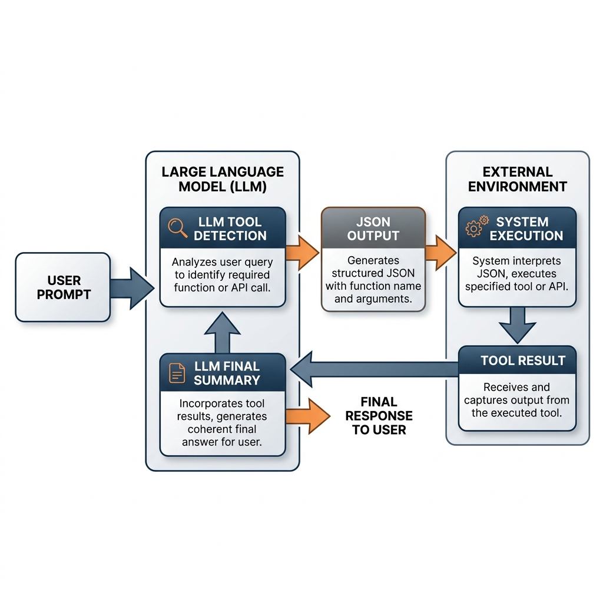

# 16.1 함수 호출과 도구 사용

언어 모델은 계산·데이터 조회·파일 수정을 제안할 수 있습니다. 도구를 사용하는 애플리케이션은 이를 실제로 실행하고 관측 가능한 근거를 돌려줍니다. **함수 호출** 은 제안을 구조화하며, 유효성과 권한은 애플리케이션의 실행기가 판단합니다. 유창한 의도·유효한 JSON·행동 권한은 서로 다른 속성입니다.

OpenAI의 2023년 API 공개는 구조화된 함수 인터페이스의 중요한 역사적 사례입니다 [[1]](#ref-1). 모든 제공사가 현재 같은 메시지 형식을 쓴다는 뜻은 아닙니다. 모델 리비전에 따라 도구 프로토콜과 추론 조건도 바뀔 수 있습니다. 날짜를 명시한 [17.6절](/ko/chapter-17/commercial-model-benchmarks)의 조건을 참고하세요.

## 1. 도구 사용 루프

1. 서빙 모델 고유의 프로토콜로 사용자 요청과 도구 정의를 렌더링합니다.
2. 도구 이름·인자·call ID를 포함한 assistant 호출 제안을 받습니다.
3. schema·권한·목적지·예산·선행 조건을 검사합니다.
4. 제한된 도구 adapter로 실행하고 실제 효과를 기록합니다.
5. native tool-result 형식으로 해당 호출에 연결된 결과나 typed error를 반환합니다.
6. 정책이 계획·답을 수정하게 하고 최종 결과를 별도로 검증합니다.

호출 제안은 모델이 보낸 실행 가능한 코드가 아닙니다. 좁은 typed adapter로 처리할 수 있다면 임의 문자열을 평가하지 않습니다. 병렬 호출은 상태 의존성과 부수 효과가 허용할 때만 안전하며, 반복 호출에는 idempotency나 상태 확인이 필요합니다.

*출처: 제안–실행–결과 루프를 설명하는 AI 생성 이미지. 권한 검사는 실행기의 책임입니다.*

## 2. schema 유효성과 행동 권한

schema 검증은 타입·필수 필드·enum·범위·추가 속성 규칙을 검사합니다. 양 끝점을 포함하는 숫자 구간은 다음과 같습니다.

$$
V_{range}(x)=\mathbb I(a\le x\le b),
$$

$a$ 와 $b$ 는 선언한 최솟값·최댓값이며 $\mathbb I$ 는 지시 함수입니다. 끝점을 제외하면 strict inequality가 필요합니다. 허용 집합 $\mathcal E$ 의 enum 검사는 $V_{enum}(x)=\mathbb I(x\in\mathcal E)$ 입니다. 실제 JSON Schema validator의 의미를 사용해야 합니다. Python boolean, 정수 형변환, null, 문자열 숫자는 수동 검사와 자주 어긋납니다.

schema에 맞는 이체도 잘못된 계좌를 사용하거나 허가한 금액을 넘기거나 미승인 endpoint에 도달할 수 있습니다. 이는 정책·선행 조건 검사입니다. 프롬프트 작성 시점뿐 아니라 실행 시점의 신뢰된 상태로 강제합니다. 알 수 없는 도구와 예상하지 못한 인자는 명시한 계약에 따라 차단합니다.

credential이나 특권 상태를 노출하지 않는 제한된 오류 정보를 돌려줍니다. 형식이 잘못된 읽기 요청 재시도와 완료 여부가 불명확한 결제 재시도는 다릅니다. 쓰기를 반복하기 전에 거래 상태를 확인하고 idempotency key를 사용합니다.

## 3. 프로토콜 학습

도구 사용 SFT는 assistant 제안·외부 결과·후속 assistant 응답을 고유의 다중 턴 대화로 표현합니다. `<call>` 구분자를 새로 만들거나 다른 토크나이저의 role 토큰을 복사하지 않습니다. Toolformer는 반환 정보가 후속 텍스트 예측을 개선할 때 후보 호출을 남기는 초기 자기지도 접근을 보여 줍니다 [[2]](#ref-2). 그 필터 조건은 권한 정책도, 에이전트 안전성의 증거도 아닙니다.

학습에는 입력 정책/adapter·토크나이저/템플릿·도구 schema·출처·불변 manifest를 고정합니다. 관련 대화를 묶어 분할하고 평가 프롬프트와 파생 예시를 격리합니다. 호출 문법·응답을 포함한 의도된 assistant 생성 구간을 학습하며, 사용자 프롬프트·외부 도구 결과·padding·종료 이후는 제외합니다. BOS/EOS·`add_generation_prompt`·잘림·응답 cap·packing 격리를 확인하고, 가변 길이 배치 집계에는 유효 토큰 수를 사용합니다.

LoRA는 학습 상태 비용을 줄일 수 있지만 기존 추론·안전성의 보존을 보장하지 않습니다. target module·rank/scaling·optimizer schedule·시퀀스 길이·정밀도/sharding을 밝히고 파라미터·gradient·optimizer·activation·임시 버퍼·collective·checkpoint·평가 메모리를 계산합니다. 전체 학습·checkpoint·출시 계약은 [9.1절](/ko/chapter-9/sft-fundamentals)과 [15.5절](/ko/chapter-15/reasoning-post-training-rlvr)을 따릅니다. 도구 능력을 얻었다고 이 계약을 생략할 수는 없습니다.

## 4. 도구 출력은 신뢰되지 않은 근거다

검색한 페이지·이메일·저장소 파일·도구 오류에는 지시가 들어갈 수 있습니다. 출처를 가진 근거로 다루며 과업이나 권한을 바꾸는 허가로 읽지 않습니다. escaping이나 JSON 강제만으로 간접 prompt injection이 없어지지 않습니다. 실행기가 별도로 행동 경계를 강제해야 합니다.

가능하면 비밀 정보는 모델 문맥 밖에 둡니다. 도구 credential을 허용 자원으로 제한하고 network 목적지·redirect를 통제하며 code 실행을 격리하고 행동에 필요한 권한을 확인합니다. 요청 실패가 새 목적지·도구의 사용 허가를 만들지는 않습니다. [16.6절](/ko/chapter-16/agent-reliability-recovery-and-guardrails)에서 복구와 대체 경로에 관한 최근 근거를 다룹니다.

## 5. 전체 workflow 평가

유효·형식 오류·범위 초과·모호·적대적 호출로 schema와 정책 강제를 단위 검사합니다. 이어 도구 오류·지연·중복 호출·오래된 상태·악성 출력이 있는 전체 과업을 평가합니다. 올바른 제안, 권한 밖 행동 시도, 실행기 차단, 실제 효과, 검증된 과업 성공을 구분합니다.

호출/인자 유효성, 정책 위반, 복구율, 반복 신뢰도, 토큰, 지연, 비용, 기존 역량·안전 구간을 관측합니다. 학습에는 토큰 정규화 손실, nonfinite/overflow, gradient/activation norm, 처리량, MFU, 데이터 대기, collective/straggler와 재구성 가능한 batch ID가 추가됩니다. 모델/템플릿/도구/안전/code 묶음을 고정하고 정확한 데이터·대화 커서를 checkpoint합니다.

abort 경계·관측 구간·책임자·정상 동작이 확인된 이전 묶음을 사전에 정합니다. 이미 완료된 외부 거래는 모델 rollback만으로 되돌릴 수 없으며 상태 확인이나 보상 조치가 필요합니다. 짝지은 오프라인 근거와 제한된 canary를 사용하고 접근을 넓히기 전에 rollback을 훈련합니다. 목표는 문법에 맞는 JSON이 아니라 **허가된 과업의 올바른 완료** 입니다.

## Quizzes

Quiz 1: 유효한 JSON 도구 호출이 안전한 행동의 증거가 아닌 이유는 무엇인가요?

*schema 필드를 모두 만족하면서도 권한·목적지·자원·상태 조건을 위반할 수 있습니다. 실행기에 독립적인 정책 검사가 필요합니다.*

Quiz 2: inclusive 범위는 양 끝점을 허용하나요?

*네. 조건은 a ≤ x ≤ b입니다. 부호 함수의 곱은 등호를 잘못 거절할 수 있습니다. exclusive 범위에는 다른 계약이 필요합니다.*

Quiz 3: 도구 사용 SFT의 정책 손실에서 보통 제외해야 할 구간은 무엇인가요?

*사용자 프롬프트·외부 도구 결과·padding·종료 이후입니다. native template을 사용해 assistant 제안과 의도한 응답의 마스크를 명시적으로 유지합니다.*

Quiz 4: timeout이 난 쓰기 작업을 재시도 전에 확인해야 하는 이유는 무엇인가요?

*timeout은 쓰기 실패의 증거가 아닙니다. 반복하면 효과가 중복될 수 있어 거래 상태와 idempotency 계약을 확인해야 합니다.*

Quiz 5: 악성 도구 내용이 새 권한을 요구할 때 무엇을 측정해야 하나요?

*모델의 행동 시도, 실행기의 정책 결정, 실제 효과입니다. 최종 답이 맞아도 권한 밖 시도가 사라지지는 않습니다.*

## References

1. OpenAI. (2023). *Function Calling and Other API Updates*. [OpenAI](https://openai.com/index/function-calling-and-other-api-updates/).
2. Schick, T., et al. (2023). *Toolformer: Language Models Can Teach Themselves to Use Tools*. [arXiv:2302.04761](https://arxiv.org/abs/2302.04761).
