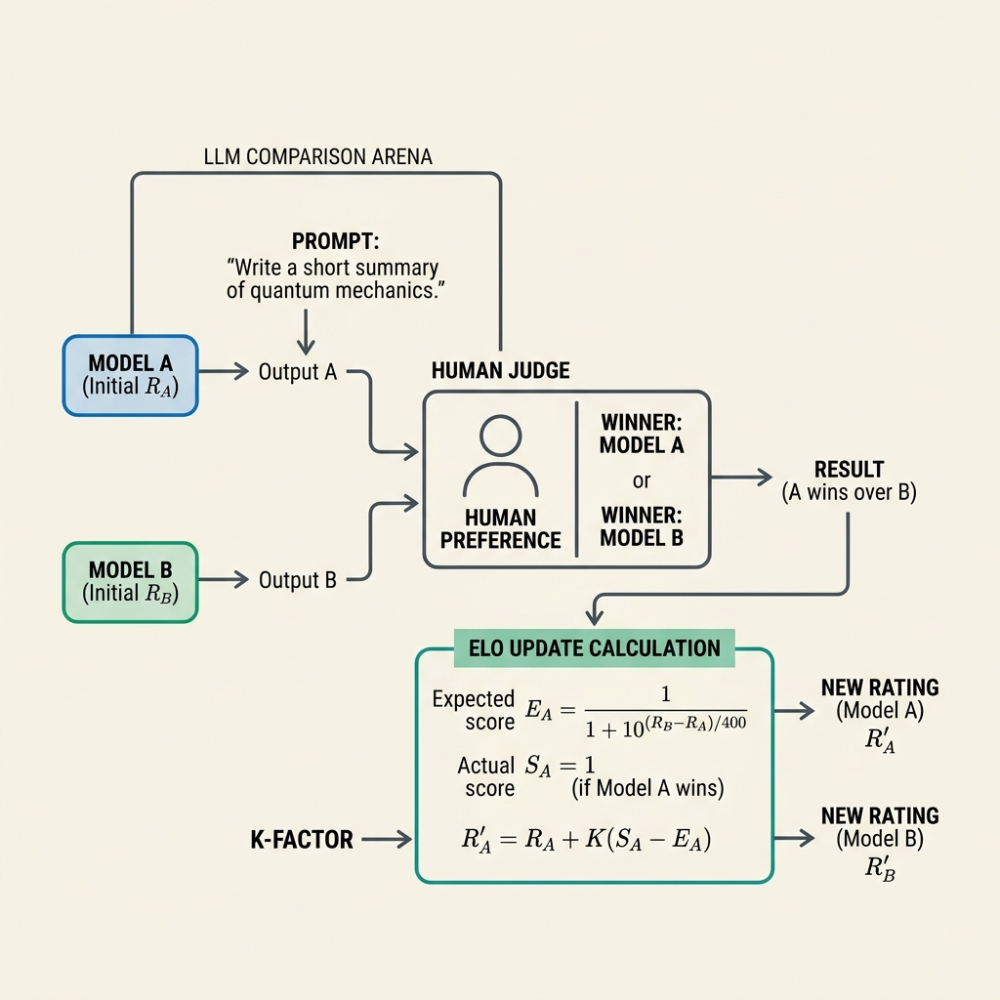

# 17.3 Elo 평점 및 리더보드 (Elo Rating & Leaderboards)

인간 선호도 평가는 정답 기반 벤치마크를 보완합니다. 두 응답 중 어느 쪽을 선호하는지 묻되, 선호가 사실성·안전성·업무 성공률과 같지는 않다는 점을 구분해야 합니다. 이 절에서는 Elo와 Bradley–Terry가 쌍대 비교를 요약하는 방식을 다룹니다.

2023년 Chatbot Arena 연구는 익명 응답에 대한 크라우드소싱 투표를 활용했습니다. 블라인드는 이름에서 생기는 편향을 줄이지만 문체, 표본 선택, 반복 투표와 평가 데이터 오염을 없애지는 않습니다 [[2]](#ref-2).

## 메커니즘: 크라우드소싱 기반의 듀얼 (Crowdsourced Duels)

Elo 평점을 사용하여 LLM 리더보드를 구축하는 프로세스는 다음과 같습니다:
1.  **블라인드 듀얼 (Blind Duels)**: 사용자가 프롬프트를 입력합니다. 두 개의 익명 모델(예: 모델 A와 모델 B)이 응답을 생성합니다.
2.  **인간의 판단 (Human Judgment)**: 사용자는 더 나은 응답에 투표합니다 (또는 무승부 선언).
3.  **평점 업데이트 (Rating Update)**: 시스템은 결과와 기존 평점을 기반으로 두 모델의 Elo 평점을 업데이트합니다.


*출처: AI 생성 이미지*

## Elo의 수학

원래 체스를 위해 설계된 Elo 평점 시스템은 플레이어의 상대적인 실력 수준을 계산합니다. LLM의 맥락에서 "플레이어"는 모델입니다.

### 1. 기대 점수 (Expected Score)

평점이 $R_A$ 와 $R_B$ 인 두 모델이 주어졌을 때, 모델 A의 기대 점수는 로지스틱 곡선을 사용하여 계산됩니다:

$$E_A = \frac{1}{1 + 10^{(R_B - R_A)/400}}$$

마찬가지로 모델 B의 기대 점수는 다음과 같습니다:
$$E_B = \frac{1}{1 + 10^{(R_A - R_B)/400}}$$

무승부를 반 점으로 처리하면 $E_A=P(\text{A의 승리})+0.5P(\text{무승부})$ 입니다. 평점 차이 400점은 기대 점수 약 0.91에 해당합니다. 무승부가 없는 경우에만 이를 약 91%의 승률로 읽을 수 있습니다. 척도 400과 기준 평점은 관례이므로 서로 다른 리더보드의 점수를 직접 비교하지 않습니다.

### 2. 평점 업데이트 (Rating Update)

듀얼 후, 실제 점수 $S_A$ 와 기대 점수 $E_A$ 를 기반으로 평점이 업데이트됩니다:

$$R'_A = R_A + K(S_A - E_A)$$

여기서:
-   $R'_A$ 는 새로운 평점입니다.
-   $K$ 는 단일 게임이 평점에 미치는 영향을 결정하는 상수(K-factor)입니다 (예: $K=32$).
-   $S_A$ 는 실제 점수입니다: 승리는 $1$, 무승부는 $0.5$, 패배는 $0$ 입니다.

평점이 높은 모델이 평점이 낮은 모델에 패배하면, $(S_A - E_A)$ 가 커지기 때문에 평점 변화가 큽니다.

### Elo를 넘어서: Bradley-Terry 모델

Elo는 경기 순서에 따라 달라집니다. Bradley–Terry는 전체 비교에서 잠재 점수 차이를 추정합니다. 기본 모델은 이진 승패를 다루므로 무승부에 반 점을 줄지, 별도의 무승부 모형을 사용할지 명시해야 합니다. 연결되지 않은 비교 집단 사이의 상대 점수는 데이터만으로 식별할 수 없으며, 완전 분리에서는 유한한 MLE가 존재하지 않을 수 있습니다. 기준 점수 고정과 정규화 정책도 기록합니다.

점수와 함께 불확실성을 보고합니다. 동일 사용자·프롬프트의 반복 평가를 고려한 bootstrap 또는 적절한 통계 모형으로 **점수 차이** 의 신뢰구간을 계산하세요. 개별 점수 구간이 겹친다는 사실만으로 두 모델이 동등하다고 결론 내릴 수는 없습니다.

### 리더보드 숫자를 읽을 때의 함정

개발자와 AI engineer에게 중요한 것은 순위 자체보다 **내 제품의 트래픽과 얼마나 비슷한 평가인가** 입니다.

- **Prompt mix drift:** Arena에는 창의적 글쓰기, 코딩, 번역, 잡담이 섞입니다. 우리 서비스가 법률 문서 요약이라면 전체 Elo보다 해당 도메인 평가가 중요합니다.
- **Style preference:** 사용자는 긴 답변, 자신감 있는 답변, 보기 좋은 Markdown을 선호할 수 있습니다. 이것이 항상 정확성을 뜻하지는 않습니다.
- **Model identity leakage:** 블라인드 평가라도 특정 문체나 refusal 패턴으로 모델을 알아볼 수 있습니다. 이 경우 완전한 blind test가 아닙니다.
- **Repeated user bias:** 같은 사용자 집단이 특정 모델을 자주 평가하면 투표가 독립 표본이 아닐 수 있습니다.
- **Version churn:** API 모델은 silent update가 있을 수 있습니다. leaderboard의 모델 이름과 실제 배포 모델이 같은 가중치/시스템 프롬프트인지 확인해야 합니다.

따라서 리더보드는 “모델 선택의 출발점”이지 “릴리스 승인서”가 아닙니다. 후보를 좁힌 뒤에는 private eval, latency/cost profile, safety regression, 실제 workflow canary를 반드시 거쳐야 합니다.

## PyTorch를 이용한 배치 Elo 업데이트 구현

내부 모델 평가(예: 여러 미세 조정 버전 비교)를 실행하는 개발자의 경우, PyTorch에서 배치 Elo 업데이트 시스템을 구현하면 매우 효율적일 수 있습니다. 다음은 배치 듀얼에 대한 기대 점수와 업데이트를 계산하는 방법입니다.

> **교육용 예제.** 각 행은 독립적인 두 평점의 업데이트입니다. 같은 모델이 여러 행에 등장하는 평점 레지스트리나 순차 Elo를 구현하지 않습니다. 실제 시스템은 모델 ID, 중복 투표, 업데이트 순서, 무승부 정책과 불확실성을 관리해야 합니다.

```python
import torch

def compute_batch_elo_update(ratings_a, ratings_b, outcomes, k_factor=32.0):
    """
    배치 듀얼에 대한 Elo 평점 업데이트를 계산합니다.

    Args:
        ratings_a: 모델 A의 현재 평점 텐서. 형태: (batch_size,)
        ratings_b: 모델 B의 현재 평점 텐서. 형태: (batch_size,)
        outcomes: 모델 A의 결과 텐서 (승리는 1.0, 무승부는 0.5, 패배는 0.0).
                  형태: (batch_size,)
        k_factor: K-factor 하이퍼파라미터.

    Returns:
        new_ratings_a: 모델 A의 업데이트된 평점.
        new_ratings_b: 모델 B의 업데이트된 평점.
    """
    # 기대 점수 계산
    # torch.pow(10, ...) 또는 log(10)과 함께 exp를 사용합니다.
    exponent = (ratings_b - ratings_a) / 400.0
    expected_a = 1.0 / (1.0 + torch.pow(10.0, exponent))
    expected_b = 1.0 - expected_a

    # 업데이트 계산
    # outcomes는 A에 대한 점수입니다. B의 경우 점수는 (1.0 - outcomes)입니다.
    update_a = k_factor * (outcomes - expected_a)
    update_b = k_factor * ((1.0 - outcomes) - expected_b)

    new_ratings_a = ratings_a + update_a
    new_ratings_b = ratings_b + update_b

    return new_ratings_a, new_ratings_b

# 예제 사용법
batch_size = 4
# 초기 평점
r_a = torch.tensor([1500.0, 1600.0, 1400.0, 1500.0])
r_b = torch.tensor([1400.0, 1700.0, 1400.0, 1500.0])

# A에 대한 결과: 승리, 패배, 무승부, 승리
outcomes = torch.tensor([1.0, 0.0, 0.5, 1.0])

new_a, new_b = compute_batch_elo_update(r_a, r_b, outcomes)

print("Original A:", r_a)
print("Updated A:", new_a)
print("Original B:", r_b)
print("Updated B:", new_b)
```

## 제품 팀을 위한 Leaderboard 설계 패턴

내부에서 여러 모델 후보를 비교한다면, 공개 Arena를 그대로 복제하기보다 제품 목적에 맞춘 작은 arena를 만드는 편이 낫습니다.

1. **Task-stratified sampling:** 프롬프트를 업무 유형별로 나눕니다. 예를 들어 `support_summary`, `sql_generation`, `policy_refusal`, `code_review` 처럼 태그를 둡니다.
2. **Pair coverage control:** 인기 모델끼리만 많이 붙지 않도록, 각 모델 쌍이 최소 대결 수를 갖게 합니다.
3. **Human + judge hybrid:** 고비용 인간 평가는 calibration set과 hard cases에 집중하고, 나머지는 calibrated judge로 확장합니다.
4. **Tie를 허용:** 억지 승자는 leaderboard를 불안정하게 만듭니다. 실제 사용자가 차이를 느끼지 못하는 샘플은 tie로 두는 것이 더 정직합니다.
5. **Severity weighting:** 모든 승패를 동일하게 보지 않습니다. harmless한 문체 차이보다 결제 금액 오류, 의료 정보 오류, 보안 취약점 누락에 더 높은 가중치를 둡니다.

한 줄로 말하면, 좋은 리더보드는 “누가 더 똑똑한가”를 묻지 않습니다. “이 제품의 중요한 상황에서 어느 모델이 더 덜 위험하고 더 유용한가”를 묻습니다.

## 17.4와 17.5로 이어지는 관점

Elo와 Bradley-Terry는 선호도 데이터를 숫자로 압축하는 훌륭한 도구입니다. 하지만 이 숫자는 데이터 오염, judge 편향, prompt mix, 운영 비용을 자동으로 해결해 주지 않습니다. 다음 절에서는 평가셋 자체가 오염되는 문제를 다루고, 그 다음에는 이런 신호들을 실제 릴리스 게이트로 묶는 방법을 봅니다.

## Quizzes

<details>
<summary>Quiz 1: 블라인드 선호도 평가가 정확성 평가를 대체하나요?</summary>
*아닙니다. 이름에 의한 편향은 줄일 수 있지만, 문체 선호·표본 편향·평가자 오류가 남습니다. 정확성·안전성·업무 성공률을 별도로 평가합니다.*
</details>

<details>
<summary>Quiz 2: 400점 우위는 91% 승률을 의미하나요?</summary>
*무승부가 없다면 그렇습니다. 무승부에 반 점을 주는 경우에는 승률과 무승부 확률의 절반을 더한 기대 점수가 약 0.91입니다.*
</details>

<details>
<summary>Quiz 3: Bradley–Terry는 연결되지 않은 모델 집단을 비교할 수 있나요?</summary>
*데이터만으로 집단 사이의 상대 점수를 식별할 수 없습니다. 비교를 연결해야 하며, 정규화가 만들어낸 차이를 실제 관측 근거처럼 해석하면 안 됩니다.*
</details>

<details>
<summary>Quiz 4: 공개 순위가 높은 모델을 RAG 제품에 바로 배포하면 안 되는 이유는 무엇인가요?</summary>
*평가 프롬프트와 선호 기준이 제품과 다릅니다. 근거 충실도, 인용, 보안, 비용과 지연 시간을 private workflow 평가와 canary에서 확인해야 합니다.*
</details>

<details>
<summary>Quiz 5: 오프라인 Bradley–Terry 추정에서 어떤 제약과 정책을 기록해야 하나요?</summary>
*기준 점수 또는 합이 0인 제약, 무승부 처리, 정규화, 비교 그래프의 연결성, 표본 가중치와 불확실성 추정법을 기록합니다. 이진 관측의 로그 우도를 최적화한다고 편향과 식별 문제가 자동 해결되지는 않습니다.*
</details>

## References

1. <a id="ref-1"></a>Elo, A. E. (1978). *The Rating of Chessplayers, Past and Present*. Arco.
2. <a id="ref-2"></a>Zheng, L., et al. (2023). *Judging LLM-as-a-Judge with MT-Bench and Chatbot Arena*. [arXiv:2306.05685](https://arxiv.org/abs/2306.05685).
