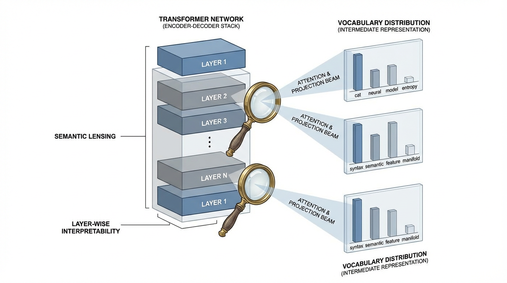
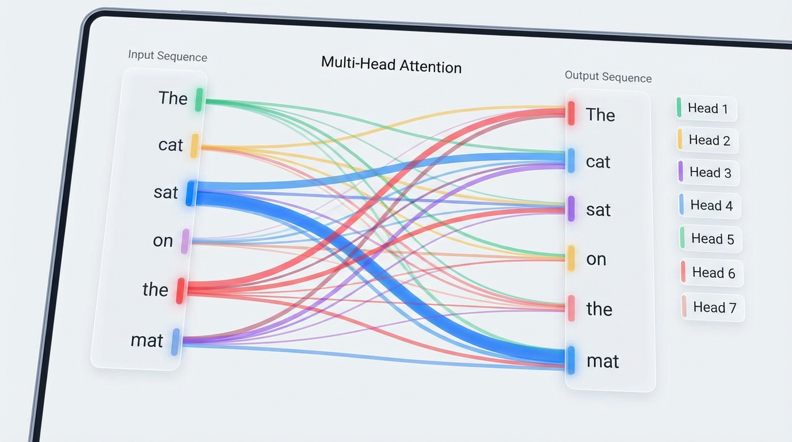

import LogitLensVisualizer from '../../../components/chapter-19/LogitLensVisualizer.tsx';

# 19.2 Logit Lens & Attention Visualization

중간 readout은 순전파에서 출력 분포가 어떻게 바뀌는지 진단하는 데 도움이 됩니다. Logit lens는 잔차 상태를 어휘 공간에 투영하고 어텐션 시각화는 토큰 위치 사이의 가중치 패턴을 보여 줍니다. 실험의 단서가 되지만 인간과 같은 믿음이나 인과적 설명을 단독으로 드러내지는 않습니다. 추출 관례를 고정하고 개입으로 가설을 검증해야 합니다.

---

## 1. The Logit Lens: Reading the Residual Stream

표준 Decoder-only Transformer 에서 최종 예측은 아주 단순한 과정을 거칩니다. 가장 마지막 레이어의 Residual Stream ($h_L$) 을 가져와 최종 Layer Normalization 을 적용한 뒤, Unembedding 행렬 ($W_U$) 을 통해 투영(Projection)하여 전체 어휘(Vocabulary)에 대한 확률 분포를 얻습니다.

$$
P(x_{t+1}) = \text{softmax}(W_U \cdot \text{LN}(h_L))
$$

2020년, *nostalgebraist* 라는 이름으로 활동하는 독립 AI 정렬(Alignment) 연구자는 급진적일 만큼 단순한 아이디어를 제안했습니다 [[1]](#ref-1). Residual Stream 이 정보가 덧셈 형태로 누적되는 중앙 통신 채널 역할을 한다면, 이 최종 Unembedding 행렬을 *중간(Intermediate)* 레이어에 바로 적용해보면 어떨까 하는 것이었습니다.

$$
P_l(x_{t+1}) = \text{softmax}(W_U \cdot \text{LN}(h_l)) \quad \text{for } l < L
$$

이 기법을 **Logit Lens** 라고 부릅니다. 이는 밀집 벡터 $h_l \in \mathbb{R}^d$ 를 임의의 레이어 $l$ 에서 다시 어휘 공간(Vocabulary space)으로 번역해 주는 해독기 역할을 합니다.

### 무엇을 관찰할까?

1. 최대 토큰뿐 아니라 전체 확률 분포를 비교합니다. 안정된 argmax가 뒷계층의 정보 전달이 그대로라는 뜻은 아닙니다.
2. 계층·프롬프트 변형에 따라 엔터티 readout이 정교해지거나 뒤집히는지 봅니다. 구문에서 의미로의 진행은 검증할 가설이며 보편적 계층 시간표가 아닙니다.
3. 투영의 해독 능력과 상태에 담긴 정보를 구분합니다. 다음 토큰 readout이 입력 표현의 소거를 입증하지는 않습니다.


*출처: AI 생성 이미지*

---

## 2. Engineering the Extraction (PyTorch)

Logit Lens 를 구현하려면 순전파(Forward pass) 중에 중간 은닉 상태(Hidden states)를 추출해야 합니다. 표준 HuggingFace API 는 보통 `output_hidden_states=True` 플래그를 제공하지만, 전체 연산 그래프를 메모리에 저장하고 싶지 않은 환경이나 커스텀 아키텍처를 다룰 때는 PyTorch Hook 을 사용하여 수동으로 추출하는 엔지니어링 패턴을 이해하는 것이 필수적입니다.

아래는 중간 로짓 추출의 구조를 설명하는 PyTorch 예제입니다.

> **의도적으로 단순화한 예제이며 여기서 스모크 테스트하지 않았습니다.** 충분한 메모리가 있는 BF16 지원 단일 CUDA 장치, 호환되는 LLaMA 계열 layer/norm/head 구조, 패딩 없는 단일 프롬프트를 가정합니다. 모든 계층 상태와 전체 어휘 로짓을 보관하며 청크화·패딩/packing 배치·양자화/분산 배치·버전별 hook·메모리 절약 스트리밍은 생략합니다. 실제 모델 구현을 고정·검증한 뒤 적용하세요.

```python
import torch
import torch.nn as nn
from transformers import AutoModelForCausalLM, AutoTokenizer
from typing import List

def compute_logit_lens(model_name: str, prompt: str) -> List[torch.Tensor]:
    """
    LLM의 모든 중간 레이어에서 어휘(Vocabulary) 로짓을 추출합니다.
    """
    tokenizer = AutoTokenizer.from_pretrained(model_name)
    model = AutoModelForCausalLM.from_pretrained(
        model_name, torch_dtype=torch.bfloat16
    ).to("cuda").eval()

    inputs = tokenizer(prompt, return_tensors="pt").to(model.device)
    hidden_states = []

    # 각 트랜스포머 블록의 출력을 캡처하기 위한 Hook 정의
    def hook_fn(module, input, output):
        # output[0]은 (batch, seq_len, hidden_dim) 형태의 은닉 상태를 포함합니다.
        state = output[0] if isinstance(output, tuple) else output
        hidden_states.append(state.detach())

    # 모든 레이어에 Hook 등록
    # 참고: 아키텍처 경로는 모델마다 다릅니다. LLaMA/Mistral의 경우 `model.model.layers` 입니다.
    # GPT-2의 경우 `model.transformer.h`가 됩니다.
    hooks = []
    for layer in model.model.layers:
        hooks.append(layer.register_forward_hook(hook_fn))

    # 순전파 (해석 가능성 추출을 위해 Gradient는 필요하지 않음)
    try:
        with torch.no_grad():
            _ = model(**inputs)
    finally:
        for hook in hooks:
            hook.remove()

    intermediate_logits = []

    # 각 중간 상태를 어휘 공간으로 투영(Projection)
    for h in hidden_states:
        # 매우 중요: lm_head를 통과하기 전에 최종 LayerNorm을 적용해야 합니다.
        # LLaMA의 경우: model.model.norm(h)
        h_norm = model.model.norm(h)

        # Unembedding 행렬을 사용한 투영
        logits = model.lm_head(h_norm)
        intermediate_logits.append(logits)

    return intermediate_logits

# 사용 예시:
# logits_per_layer = compute_logit_lens("meta-llama/Llama-2-7b-hf", "The capital of France is")
# logits_per_layer[10] -> 10번째 레이어에서의 어휘 확률 분포를 포함합니다.
```

---

## 3. The Tuned Lens: Overcoming Basis Shift

최종 출력 헤드로 중간 잔차 상태를 항상 올바르게 읽을 수는 없습니다. 기저·분포 이동이 직접 readout을 왜곡할 수 있습니다. 입출력 임베딩을 공유해도 중간 정렬이 보장되지는 않습니다. 보류 데이터에서 최종 예측과 비교해야 합니다.

이 문제를 해결하기 위해 Belrose et al. (2023) 은 **Tuned Lens** 를 도입했습니다 [[2]](#ref-2). 이들은 $W_U$ 를 직접 적용하는 대신, 각 레이어 $l$ 에 대해 행렬 $A_l$ 과 편향 $b_l$ 로 구성된 작은 어파인 변환(Affine transformation, 일종의 번역기)을 학습시킵니다.

$$
P_l(x_{t+1}) = \text{softmax}(W_U \cdot (A_l h_l + b_l))
$$

### 목적 함수 (The Objective Function)
여기서 매우 중요한 점은, Tuned Lens 가 실제 정답 토큰(Ground-truth next token)을 예측하도록 학습되지 **않는다** 는 것입니다. 대신, 중간 예측값과 **최종 레이어의 예측값** 사이의 KL 발산(KL divergence)을 최소화하도록 학습됩니다.

$$
\mathcal{L} = D_{KL}(P_L \parallel P_l)
$$

목표는 정답이 아니라 오류까지 포함한 고정 모델의 최종 분포입니다. 예측용 probe를 학습하는 것이며 최종 예측과의 일치만으로 계층의 믿음이나 인과적 역할을 입증하지는 못합니다. 더 강한 주장에는 통제된 개입이 필요합니다.

---

## 4. Attention Visualization: The "Where" of Information

Logit Lens 가 모델이 *무엇을* 생각하고 있는지 알려준다면, **Attention Visualization** (어텐션 시각화) 은 모델이 그러한 생각을 형성하기 위해 *어디를* 보고 있는지 알려줍니다.

BertViz [[3]](#ref-3) 와 같은 도구를 사용하면 연구자들은 불투명한 $QK^V$ 행렬 곱셈을 직접 검사할 수 있습니다. 어텐션 시각화는 일반적으로 세 가지 규모(Scale)에서 이루어집니다.

1. **Neuron View**: 특정 Query 와 Key 벡터 간의 내적(Dot product)을 시각화합니다. 어떤 특징(Feature)이 어텐션 매칭을 유발하는지 정확히 확인하는 데 유용합니다.
2. **Head View**: 특정 헤드의 어텐션 가중치 $\alpha_{ij}$ 를 기반으로 입력 토큰과 컨텍스트 토큰을 연결하는 이분 그래프(Bipartite graph)를 표시합니다. 여기서 우리는 Induction Head 나 문법적 라우팅(예: 대명사가 명사에 어텐션을 주는 현상)을 발견할 수 있습니다.
3. **Model View**: 모든 레이어의 모든 헤드에 걸친 어텐션 패턴을 동시에 보여주는 거시적인 그리드입니다.


*출처: AI 생성 이미지*

### "어텐션은 설명이 아니다" (Attention is Not Explanation)
어텐션을 시각화하는 것은 강력하지만, 어텐션 가중치를 특징의 중요도(Feature importance)와 직접적으로 동일시하는 것은 흔한 함정입니다. Jain & Wallace (2019)는 어텐션 가중치를 설명과 직접 동일시하는 데 대한 반례를 제시합니다 [[4]](#ref-4).

헤드 $H$ 가 `apple` 이라는 토큰에 강한 어텐션을 준다고 해서, 모델이 "사과"의 의미론적(Semantic) 의미를 추출하고 있다는 뜻은 아닙니다.
* 모델은 `apple` 을 순전히 위치적인 앵커(Positional anchor)로만 사용하고 있을 수 있습니다.
* 어텐션이 **Attention Sink** (예: `<s>` 또는 `[BOS]` 토큰) 로 향하고 있을 수 있습니다. 정규화된 가중치가 초기 토큰에 집중될 수 있지만, 이 패턴만으로 value/output 기여나 헤드의 무해함을 판정하지는 못합니다.

어텐션은 우리에게 라우팅 토폴로지(Routing topology)를 알려주지만, 라우팅되고 있는 *페이로드(Payload)* 가 무엇인지 이해하려면 여전히 Logit Lens 나 SAE(Sparse Autoencoders) 가 필요합니다.

---

## 5. Interactive: The Logit Lens in Action

레이어를 거치며 예측이 어떻게 진화하는지 직관적으로 이해하기 위해 아래의 대화형 Logit Lens 시각화 도구를 살펴보세요. 이 도구는 *"The capital of France is"* 라는 프롬프트를 처리하는 실제 체크포인트를 측정하지 않고 직접 작성한 13개 인덱스 상태(0–12)의 최대 토큰 예측을 보여 줍니다.

깊이가 깊어짐에 따라 최종 토큰에 대한 예측이 일반적인 구문론적(Syntactic) 추측에서 구체적인 사실적(Factual) 답변으로 어떻게 전환되는지 주목하십시오.


<LogitLensVisualizer client:load locale="ko" />

---

## 6. Readout으로 검증 가능한 가설 만들기

체크포인트·프롬프트/템플릿·토큰 위치·잔차 지점·정규화·출력 헤드를 고정합니다. 의심스러운 RAG 답에서는 맞고 틀린 엔터티의 readout, 출처 제거, 반사실적 근거를 비교하세요. 중간 argmax의 변화는 진단 신호의 위치를 보여 주지만 그 원인이 사전 학습·instruction tuning·디코딩이라고 단독으로 판정하지는 못합니다.

어텐션은 value/output 기여와 통제된 개입을 함께 살펴야 합니다. 높은 BOS 어텐션이 attention sink와 맞을 수 있지만 가중치만으로 헤드가 무해하거나 사용되지 않는다고 증명하지 못합니다. 예쁜 heatmap에서 인과 경로를 추정하기보다 같은 위치·계층의 여러 사례를 비교하세요.

조기 종료·검증에서는 전체 정책의 과업 품질·보정·선택 위험·지연·비용을 측정합니다. 안정된 최대 토큰도 틀릴 수 있으므로 핵심 슬라이스 게이트와 정상 전체 깊이 경로를 두세요. 합성 표는 설명 도구이며 배포 모델의 계층 제거 근거가 아닙니다.

---

## 7. Summary and Open Questions

**Logit Lens** 와 **Attention Visualization** 은 토큰 예측의 생애 주기(Life cycle)를 관찰할 수 있는 거시적인 도구를 제공합니다. 우리는 Residual Stream 내에서 모델의 확신이 점진적으로 구축되는 과정을 지켜볼 수 있으며, 해당 예측을 내리는 데 필요한 컨텍스트를 운반하는 어텐션 고속도로(Attention highways)를 매핑할 수 있습니다.

MLP의 크기·기능은 아키텍처에 달려 있습니다. Lens readout만으로 사실의 저장 위치나 답변을 인과적으로 제어하는 구성요소를 판정할 수는 없습니다. 시각화에서 세운 가설은 표적 개입으로 검증해야 합니다.

* MLP 내부에 저장된 구체적인 지식을 어떻게 읽어낼 수 있을까요?
* 모델이 특정 사실을 출력하지 않기로 결정했더라도, 그 사실을 "알고 있는지" 테스트할 수 있을까요?

이러한 질문에 답하기 위해, 우리는 수동적인 렌즈(Lens)를 넘어 적극적인 개입(Intervention)을 도입해야 합니다. 이는 우리의 다음 주제인 **19.3 Probing Classifiers** 로 이어집니다.

## Quizzes

<details>
<summary>Quiz 1: 최대 토큰이 안정돼도 뒷계층을 제거할 근거가 되지 않는 이유는 무엇일까요?</summary>
*Argmax가 같아도 확률·표현은 바뀔 수 있고 안정된 예측도 틀릴 수 있습니다. 전체 조기 종료 품질·오류 비용을 측정해야 합니다.*
</details>

<details>
<summary>Quiz 2: 최종 로짓에 맞춘 tuned lens가 인과 메커니즘을 입증할까요?</summary>
*아닙니다. 최종 분포와의 예측적 일치를 측정합니다. 인과 주장에는 통제된 개입·반사실적 검사가 필요합니다.*
</details>

<details>
<summary>Quiz 3: Hook에서 tuple과 Tensor 출력을 모두 처리해야 하는 이유는 무엇일까요?</summary>
*모델 버전마다 블록 출력 계약이 다릅니다. Tensor에 [0]을 적용하면 tuple 원소 대신 배치 축을 조용히 없앨 수 있습니다.*
</details>

<details>
<summary>Quiz 4: 높은 BOS 어텐션을 보면 무엇을 해야 할까요?</summary>
*라우팅·sink 가설을 세우고 value/output 분석·통제된 개입을 진행합니다. 가중치만으로 무관함·안전함을 판정할 수 없습니다.*
</details>

## References

1. <a id="ref-1"></a>nostalgebraist. (2020). *interpreting GPT: the logit lens*. AI Alignment Forum. [Link](https://www.alignmentforum.org/posts/AcKRB8wDpdaN6v6ru/interpreting-gpt-the-logit-lens).
2. <a id="ref-2"></a>Belrose, N., et al. (2023). *Eliciting Latent Predictions from Transformers with the Tuned Lens*. [arXiv:2303.08112](https://arxiv.org/abs/2303.08112).
3. <a id="ref-3"></a>Vig, J. (2019). *A Multiscale Visualization of Attention in the Transformer Model*. [arXiv:1906.05714](https://arxiv.org/abs/1906.05714).
4. <a id="ref-4"></a>Jain, S., & Wallace, B. C. (2019). *Attention is not Explanation*. [arXiv:1902.10186](https://arxiv.org/abs/1902.10186).
