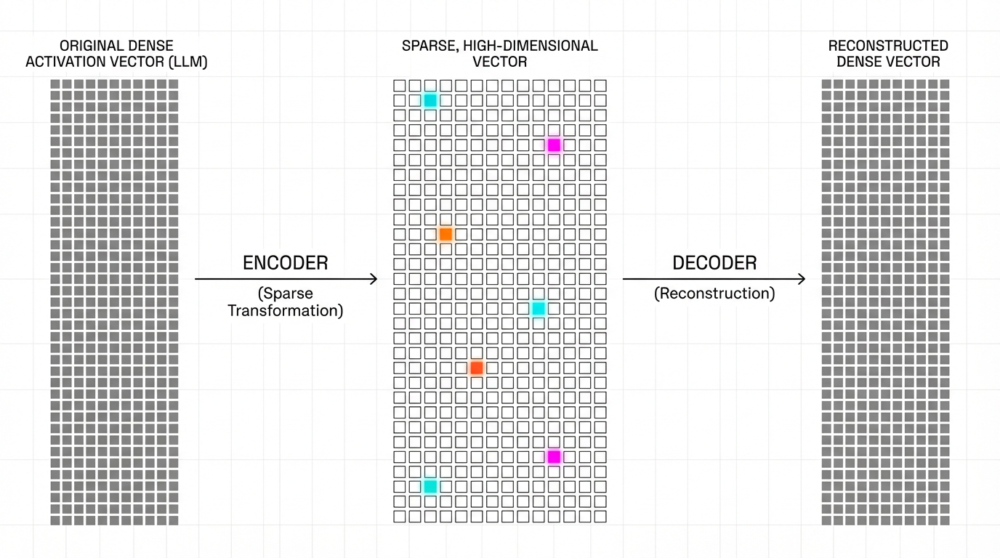

import PolysemanticVisualizer from '../../../components/chapter-19/PolysemanticVisualizer.tsx';

# 19.4 Sparse Autoencoders (SAE)

이전 절의 지도 탐침은 미리 정한 개념을 검사했습니다. 하지만 모든 탐침이 지도 학습인 것은 아닙니다. 예를 들어 CCS는 레이블 없이 논리적 일관성으로 활성화 방향을 찾습니다 [[3]](#ref-3). SAE는 재구성과 희소성으로 사전을 학습하는 다른 접근이며, 모델의 모든 개념을 발견한다는 보장은 없습니다.

**Sparse Autoencoders(SAE)** 는 모델 activation에서 희소 사전을 학습합니다. 아래 GPT-4·Claude 3 Sonnet 연구는 날짜가 있는 사례이며, 모든 개념을 발견했다거나 모든 특징이 사람이 해석 가능하다는 증명은 아닙니다.

---

## 1. The Superposition Hypothesis and Polysemanticity

신경망이 무엇을 "생각"하고 있는지 이해하고 싶다면, 직관적인 첫걸음은 개별 뉴런을 살펴보는 것입니다. 만약 특정 뉴런이 모델이 "dog(개)"라는 단어를 처리할 때마다 활성화된다면, 우리는 이를 "개 뉴런(Dog neuron)"이라고 부를 수 있을 것입니다.

일부 뉴런은 여러 입력 특성에 반응합니다. **중첩 가설** 은 활성 특징이 희소할 때 모델이 차원 수보다 많은 특징을 겹치는 방향에 저장할 수 있다고 설명합니다. 이는 모든 뉴런이나 개념에 대한 완전한 설명이 아니며, 실제 표현이 얼마나 이 가정에 부합하는지는 검증해야 합니다.

**Superposition Hypothesis** (중첩 가설)은 모델이 거의 직교(Almost-orthogonal)하는 벡터들을 사용하여 여러 관련 없는 개념들을 동일한 표현 공간에 압축해 넣는다고 설명합니다. 고차원 공간에는 완벽한 직교 방향보다 거의 직교하는 방향이 기하급수적으로 많기 때문에, 모델은 자신이 가진 차원 수보다 훨씬 더 많은 특징(Features)을 표현할 수 있습니다.

중첩의 부작용으로 개별 뉴런은 **Polysemantic** (다의적) 특성을 띠게 됩니다. 단일 뉴런이 "Apple"(과일), "Apple"(기술 기업), "Apple"(음반사)을 처리할 때 모두 활성화될 수 있습니다. 가공되지 않은 뉴런의 활성화 값만 봐서는 현재 *어떤* 개념이 활성화되었는지 전혀 알 수 없습니다.


<PolysemanticVisualizer client:load lang="ko" />

---

## 2. Dictionary Learning via Sparse Autoencoders

이러한 다의적 뉴런(Polysemantic neurons)들을 얽힌 상태에서 풀어내기 위해, 연구자들은 이 문제를 **Dictionary Learning** (사전 학습)으로 접근합니다. 목표는 모델의 밀집된(Dense) 활성화 벡터를 선형적으로 조합하여 만들어내는 희소하고 과완전한(Sparse, overcomplete) 특징들의 집합(사전)을 찾는 것입니다.

**Sparse Autoencoder** 는 $d$ 차원의 활성화 벡터 $x$ 를 훨씬 더 큰 $D$ 차원의 특징 공간 $f$ ($D \gg d$, 보통 16배에서 64배 더 큼)로 투영한 다음, 원본 벡터 $\hat{x}$ 를 재구성(Reconstruction)함으로써 이를 달성합니다.


*출처: AI 생성 이미지*

표준 SAE의 순전파(Forward pass)는 다음과 같이 정의됩니다.

$$ f = \text{ReLU}(W_{enc}(x - b_{pre}) + b_{enc}) $$
$$ \hat{x} = W_{dec} f + b_{dec} + b_{pre} $$

희소한 특징 분해를 유도하기 위해, 네트워크가 주어진 입력에 대해 $D$ 개의 특징 중 아주 작은 일부만 사용하도록 강제합니다. 이는 일반적으로 재구성 손실(Reconstruction loss)에 $L_1$ 정규화 페널티를 추가하여 구현됩니다.

$$ \mathcal{L} = ||x - \hat{x}||_2^2 + \lambda ||f||_1 $$

이 목적함수에는 디코더 특징 방향의 크기 제약이 필요합니다. 예를 들어 각 열을 단위 노름으로 유지합니다. 그렇지 않으면 특징을 축소하고 디코더를 반대로 확대하여 재구성을 유지한 채 L1 페널티만 줄일 수 있습니다. $W_{enc}$ 와 $W_{dec}$ 는 인코더·디코더 가중치, $b$ 는 편향, $\lambda$ 는 희소성 페널티 가중치입니다.

희소 사전 학습은 해석 가능한 방향을 드러낼 수 있지만 재구성 오차·특징 분할·다의적 latent·학습 데이터 의존성은 남습니다.

---

## 3. The Dead Latent Problem

SAE를 학습시키는 과정은 심각한 엔지니어링 과제를 동반합니다. 가장 악명 높은 것은 **Dead Latent** (죽은 잠재 변수, 또는 죽은 뉴런) 문제입니다.

특징 공간 $D$ 가 매우 방대하고 희소성 페널티($\lambda$)가 활성화 값을 0으로 강력하게 밀어붙이기 때문에, 학습 초기부터 많은 특징들이 활성화되지 않게 됩니다. 특징이 한 번 활성화되지 않기 시작하면 ReLU 함수로부터 기울기(Gradient)를 전혀 받지 못하게 되어 영원히 "죽은" 상태에 갇히게 됩니다. 비활성 비율은 선언한 sample window에서 측정해야 하며 복구 방법은 이 상태를 바꿀 수 있습니다.

최첨단 학습 파이프라인은 이러한 죽은 잠재 변수를 되살리기 위해 다음과 같은 기법들을 사용합니다.
1. **Ghost Gradients** (유령 기울기): 역전파(Backward pass) 과정에서 인위적으로 죽은 뉴런에 기울기를 전달하여 유용한 방향으로 "넛지(Nudge)"를 줍니다.
2. **Re-initialization** (재초기화): 주기적으로 죽은 뉴런을 식별하고, 현재 가장 높은 재구성 오차(Reconstruction error)를 가진 밀집 활성화 벡터($x$)와 일치하도록 인코더 가중치를 초기화합니다.

---

## 4. Engineering Top-K SAEs

$L_1$ 페널티는 희소성을 강제하지만, 치명적인 결함인 **Shrinkage** (수축) 문제를 일으킵니다. $L_1$ 페널티는 지속적으로 모든 활성화 값을 0 방향으로 끌어당깁니다. 즉, SAE가 특징들의 실제 크기(Magnitude)를 체계적으로 과소평가하게 만들어 $\hat{x}$ 의 재구성 품질을 저하시킵니다.

2024년, OpenAI 연구진은 GPT-4의 활성화 값 위에서 1,600만 개의 잠재 변수를 가진 SAE를 성공적으로 확장하며 돌파구를 마련했습니다 [[2]](#ref-2). 수축 문제를 해결하기 위해 이들은 $L_1$ 페널티를 완전히 제거하고 이를 명시적인 **Top-K** 활성화 함수로 대체했습니다.

손실 페널티에 의존하여 값을 0으로 미는 대신, Top-K SAE는 밀집 활성화 값을 계산한 뒤 가장 높은 $K$ 개의 값만 엄격하게 선택하고 나머지는 강제로 0으로 만듭니다. 이는 활성화 값의 크기를 왜곡하지 않으면서 $L_0$ 희소성을 직접적으로 제어합니다.

다음은 PyTorch로 구현된 Top-K SAE의 예시입니다.

> **의도적으로 단순화한 예제.** encoder·decoder shape와 top-K를 설명하며 전체 학습·decoder 정규화·dead-latent 복구·activation sampling·분산 실행은 생략합니다. 아래 대규모 설정은 메모리 예산 설명용이며 실제로 실행한 사례가 아닙니다.

```python
import torch
import torch.nn as nn
import torch.nn.functional as F

class TopKSAE(nn.Module):
    """
    Top-K Sparse Autoencoder (Gao et al., 2024).
    L1 정규화를 명시적인 Top-K 활성화 함수로 대체하여 Shrinkage(수축) 문제를 해결하고
    희소성-재구성(Sparsity-reconstruction) 경계를 개선합니다.
    """
    def __init__(self, d_model: int, d_sae: int, k: int):
        super().__init__()
        self.d_model = d_model
        self.d_sae = d_sae
        self.k = k

        # 인코더 및 디코더 가중치 초기화
        # 실제 구현에서 디코더 가중치는 일반적으로 단위 길이(Unit-normalized)로 정규화됩니다.
        self.W_enc = nn.Parameter(torch.randn(d_model, d_sae) / (d_model ** 0.5))
        self.b_enc = nn.Parameter(torch.zeros(d_sae))

        self.W_dec = nn.Parameter(torch.randn(d_sae, d_model) / (d_sae ** 0.5))
        self.b_dec = nn.Parameter(torch.zeros(d_model))

        # 활성화 값을 중앙에 맞추기 위한 사전 인코더 편향(Pre-encoder bias)
        self.b_pre = nn.Parameter(torch.zeros(d_model))

    def encode(self, x: torch.Tensor) -> torch.Tensor:
        # 입력을 중앙에 맞추고 고차원 특징 공간으로 투영
        pre_acts = (x - self.b_pre) @ self.W_enc + self.b_enc
        acts = F.relu(pre_acts)

        # 명시적인 Top-K 라우팅: 상위 K개의 활성화 값만 유지하고 나머지는 0으로 만듦
        topk_vals, topk_indices = torch.topk(acts, self.k, dim=-1)

        # 희소 텐서(Sparse tensor) 재구성
        sparse_acts = torch.zeros_like(acts)
        sparse_acts.scatter_(-1, topk_indices, topk_vals)

        return sparse_acts

    def decode(self, sparse_acts: torch.Tensor) -> torch.Tensor:
        # 원래의 잔차 스트림(Residual stream) 차원으로 다시 투영
        return (sparse_acts @ self.W_dec) + self.b_dec + self.b_pre

    def forward(self, x: torch.Tensor) -> tuple[torch.Tensor, torch.Tensor]:
        sparse_acts = self.encode(x)
        x_reconstructed = self.decode(sparse_acts)
        return x_reconstructed, sparse_acts

# 4096차원 LLM 잔차 스트림을 위한 인스턴스화 예시
# 131,072개의 특징으로 확장(32배 확장)하고 정확히 상위 32개만 활성화 상태로 유지
# sae = TopKSAE(d_model=4096, d_sae=131072, k=32)
```

---

## 5. Scaling Monosemanticity: The Golden Gate Claude

Anthropic 은 자사의 프로덕션 모델인 Claude 3 Sonnet에 SAE를 적용하여 수백만 개의 고도로 추상적인 특징들을 성공적으로 추출했습니다 [[1]](#ref-1). 이들의 발견은 우리가 LLM의 표현을 바라보는 방식을 근본적으로 바꿔놓았습니다.

Anthropic은 일부 특징이 언어와 텍스트·이미지 모달리티를 가로질러 반응한다고 보고했습니다. Golden Gate Bridge는 한 사례입니다. 이는 검사한 입력의 공통 표현에 대한 근거이며, 모든 개념의 완전한 분리나 보편적 이해를 입증하지는 않습니다 [[1]](#ref-1).


*출처: AI 생성 이미지*

더 중요한 것은 SAE가 **Causal Steering** (인과적 조향)을 가능하게 한다는 점입니다. 유명한 실험에서 Anthropic 연구진은 모델의 순전파 과정 중 금문교 특징의 활성화 값을 인위적으로 높게 고정(Clamping)했습니다. 그 결과 모델이 금문교에 강박적으로 집착하게 되는 "Golden Gate Claude"가 탄생했습니다. "런던에서 하루를 어떻게 보낼까?"라는 질문에 모델은 런던에서 비행기를 타고 샌프란시스코로 가서 금문교를 보라고 제안했습니다.

관광 명소 외에도 연구진은 아부(Sycophancy), 편향성(Bias), 스팸 이메일, 그리고 생화학 무기 생성과 같은 위험한 능력(Dangerous capabilities)에 대한 특징들을 식별했습니다. 특징을 조절·억제하면 행동이 달라질 수 있지만 유해 행동만 선택적으로 제거하거나 일반 역량을 보존한다는 보장은 없습니다. 부수 효과·분포 이동·적대적 우회를 검증해야 합니다.

---

## 6. Auto-Interp and Codebook Saturation

SAE가 1,600만 개의 특징을 추출할 때, 인간이 이를 일일이 평가하는 것은 불가능합니다. 해석 가능성을 확장하기 위해 연구자들은 **Automated Interpretability (Auto-Interp)** 를 사용합니다.

Auto-Interp 에서는 별도의 강력한 LLM(예: GPT-4)이 심판(Judge) 역할을 합니다. 심판 모델에게 특정 SAE 특징을 최대로 활성화시키는 수십 개의 텍스트 조각을 제공하고, 이들의 공통점이 무엇인지 판단하도록 프롬프팅합니다. 심판은 레이블(예: "계약 위반과 관련된 법률 용어")을 생성합니다. 레이블의 정확성을 검증하기 위해, 심판 모델은 *본 적 없는(Unseen)* 텍스트 조각에서 해당 특징이 얼마나 강하게 활성화될지 예측하도록 요구받습니다.

새로운 라벨이 더 이상 나오지 않는다고 해서 사전이 완전하다는 뜻은 아닙니다. holdout 입력, 낮은 활성화·반례, 특징 분할과 합침, 설명의 예측력을 검사해야 합니다.

---

## 특징에서 회로로: 이름 붙이기가 증명하지 못하는 것

**2026-10-13 기준 연구 맥락.** Anthropic의 circuit tracing 연구는 attribution graph로 Claude 3.5 Haiku의 메커니즘을 조사하면서, 설명 범위의 불완전성과 다룰 수 있는 프롬프트·행동의 한계도 명시합니다 [[5]](#ref-5). 특징 이름이나 그럴듯한 생성 설명만으로 인과적 회로가 되는 것은 아닙니다.

통제된 activation 개입, 조건을 맞춘 프롬프트, 대체 가설, 재구성/행동 충실도, holdout 사례로 메커니즘을 검증합니다. surrogate가 보존한 연산과 놓친 연산을 보고합니다. 인과적 steering은 검사한 조건에서 개입 효과를 보여 줄 뿐, 그 특징이 행동의 유일한 원인이라거나 억제가 강건한 안전 정책이라는 증명은 아닙니다.


## 7. SAE 활용을 위한 엔지니어링 결정

특징 후보, 반복 행동이나 활성화 개입을 연구할 때 SAE를 검토합니다. 이는 검증할 가설이며 안전성을 보장하는 제어 장치가 아닙니다. RAG 근거 누락은 주장 검증이, 코드 오류는 실행 테스트와 에이전트 추적이 더 직접적일 수 있습니다. 작은 메커니즘 연구는 탐침, 패칭, logit lens부터 시작할 수 있습니다.

기반 체크포인트, 토크나이저, 활성화 층·위치, 데이터 매니페스트와 격리된 평가 분할을 기록합니다. 학습 전에 사전 크기, 희소성 목표, 학습률과 디코더 정규화를 정합니다. 인코더·디코더 매개변수, 그래디언트, 옵티마이저 상태, 활성화 버퍼와 샘플링 비용을 각각 산정합니다. 위 밀집 예제는 메모리 효율적인 학습 시스템이 아닙니다.

재구성 오차와 **행동 보존도** 를 함께 측정합니다. 비정상 값, 그래디언트 노름, 처리량, 명시한 관측 구간의 비활성 특징 비율, 도메인별 희소성과 holdout 해석 가능성을 관찰합니다. 비정상 손실이나 허용 범위를 넘는 행동 저하가 나타나면 중단합니다. SAE·옵티마이저·스케줄러·RNG 상태, 데이터 커서, 기반 모델·설정 해시를 저장합니다. 개입은 대조군과 holdout 과제에서 검증한 뒤 배포하고 마지막 정상 아티팩트를 보존합니다.

특징의 이름만으로 메커니즘을 설명할 수는 없습니다. Circuit tracing은 특징 간 영향과 출력 logit에 대한 영향을 추적하며, 방법론 논문은 이 근사의 한계도 설명합니다 [[4]](#ref-4).

## 8. Summary and Open Questions

SAE는 활성화를 유용하지만 불완전하게 설명합니다. GPT-4 연구는 Top-K SAE를, Claude 3 Sonnet 연구는 L1 기반 SAE를 사용했습니다. 두 사례를 하나의 Top-K 발전사로 묶으면 안 됩니다. 특징 개입은 관찰한 행동에 영향을 줄 수 있지만 선택적인 안전 제어나 일반 능력 보존을 보장하지 않습니다.

하지만 특징을 추출하는 것은 절반의 성공에 불과합니다. 만약 LLM이 "생각"하는 기계라면, 특징(Features)은 그 생각의 명사와 동사에 불과합니다. 기계적 해석 가능성의 다음 과제는 이러한 특징들이 어떻게 서로 연결되어 복잡한 논리를 수행하는지 이해하는 것입니다. "If-Then" 특징은 작동하는 스크립트를 생성하기 위해 "Python Code" 특징과 어떻게 상호작용할까요?

이 질문에 답하기 위해, 우리는 LLM 내부의 **Circuits** (회로)를 매핑해야 합니다.


## Quizzes

<details>
<summary>Quiz 1: 중첩 가설은 무엇을 설명하며 무엇을 보장하지 않나요?</summary>
*희소한 특징들이 겹치는 방향을 사용하면 차원 수보다 많은 특징을 저장할 수 있습니다. 모든 뉴런의 기능이나 모델의 모든 개념을 밝혔다는 뜻은 아닙니다.*
</details>

<details>
<summary>Quiz 2: L1 가중치를 높이면 해석 가능성도 반드시 좋아지나요?</summary>
*아닙니다. 희소성과 재구성 사이의 균형을 바꾸고 수축을 유발할 수 있지만, 해석 가능성과 행동 보존도는 별도로 검증해야 합니다. 디코더 크기 제약도 필요합니다.*
</details>

<details>
<summary>Quiz 3: Top-K SAE 아키텍처는 표준 L1 정규화 SAE에 내재된 "수축(Shrinkage)" 문제를 어떻게 해결하나요?</summary>
*Top-K SAE는 $L_1$ 페널티를 완전히 제거합니다. 대신 밀집 활성화 값을 계산한 후, 명시적으로 상위 $K$ 개의 가장 높은 값만 선택하고 나머지는 강제로 0으로 만듭니다. 이는 nonzero activation 수를 K 이하로 제한합니다. 선택된 ReLU 값도 0일 수 있으므로 정확히 K개의 nonzero를 보장하지는 않습니다.*
</details>

<details>
<summary>Quiz 4: 여러 모달리티에서 같은 SAE 특징이 켜지면 무엇을 알 수 있나요?</summary>
*검사한 입력에서 공통 표현을 사용한다는 근거입니다. 보편적 개념 이해·모든 특징의 발견·인과적 필수성을 증명하지는 않습니다.*
</details>

<details>
<summary>Quiz 5: 특징 개입을 조건이 맞는 대조군과 비교해야 하는 이유는 무엇인가요?</summary>
*activation 하나를 바꿔도 후속 영향이 넓게 퍼질 수 있습니다. 조건을 맞춘 프롬프트·다른 특징·holdout으로 특정 메커니즘과 일반적 교란을 구분합니다.*
</details>

---

## References

1. <a id="ref-1"></a>Templeton, A., et al. (2024). *Scaling Monosemanticity: Extracting Interpretable Features from Claude 3 Sonnet*. Transformer Circuits Thread. [Link](https://transformer-circuits.pub/2024/scaling-monosemanticity/index.html).
2. <a id="ref-2"></a>Gao, L., et al. (2024). *Scaling and evaluating sparse autoencoders*. [arXiv:2406.04093](https://arxiv.org/abs/2406.04093).
3. <a id="ref-3"></a>Burns, C., et al. (2023). *Discovering Latent Knowledge in Language Models Without Supervision.* [Paper](https://arxiv.org/abs/2212.03827).
4. <a id="ref-4"></a>Ameisen, E., et al. (2025). *Circuit Tracing: Revealing Computational Graphs in Language Models.* Transformer Circuits Thread. [Link](https://transformer-circuits.pub/2025/attribution-graphs/methods.html).
5. <a id="ref-5"></a>Anthropic. (2025). On the Biology of a Large Language Model. [Source](https://transformer-circuits.pub/2025/attribution-graphs/biology.html).
