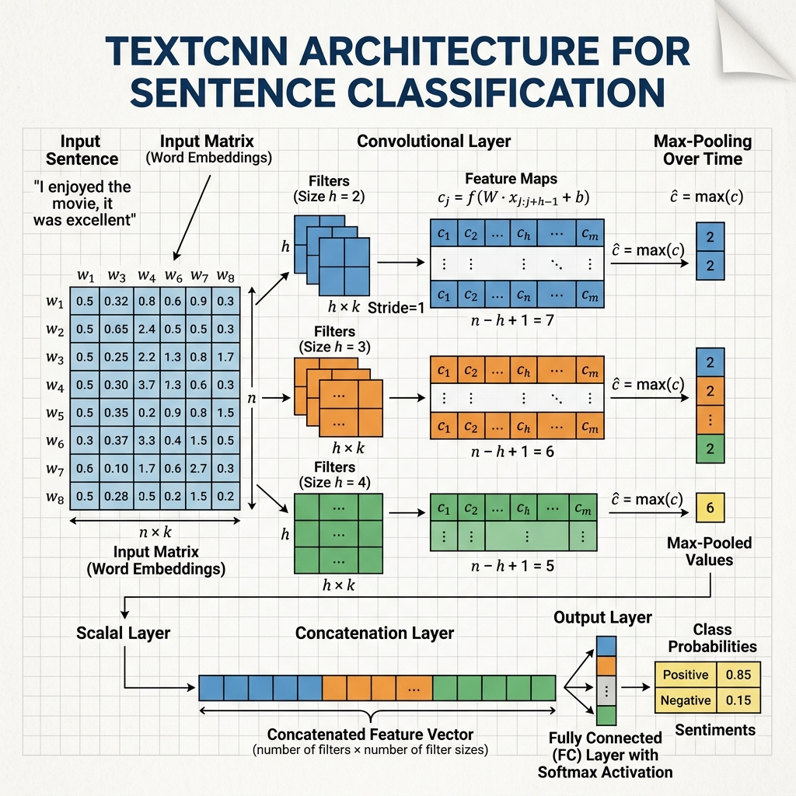

import CnnVisualizer from '../../../components/chapter-2/CnnVisualizer';

# 2.4 NLP를 위한 CNN (CNNs for NLP)

순환 신경망(RNN)이 시퀀스 데이터를 위한 자연스러운 선택으로 간주되었지만, 컴퓨터 비전에서의 성공으로 유명한 합성곱 신경망(CNN)도 자연어 처리(NLP)에 맞게 조정되었습니다.

## 동기: 속도와 병렬성

NLP에서 CNN을 사용하는 주된 동기는 **계산 효율성** 이었습니다.
- **RNN은 본질적으로 순차적입니다:** 단계 $t$를 계산하려면 먼저 단계 $t-1$을 계산해야 합니다. 이는 GPU에서 시간 단계에 따른 병렬 처리를 방해합니다.
- **CNN은 고도의 병렬화가 가능합니다:** 합성곱은 입력의 여러 부분에 동일한 필터를 동시에 적용합니다. 이로 인해 현대식 하드웨어에서 학습 속도가 훨씬 빠릅니다.

## 텍스트에서 1D 합성곱이 작동하는 방식

컴퓨터 비전에서 CNN은 픽셀에 대해 2D 합성곱을 사용합니다. NLP에서는 단어 임베딩 시퀀스에 대해 **1D 합성곱 (1D Convolutions)** 을 사용합니다.

<div style={{ display: 'flex', flexDirection: 'column', alignItems: 'center', width: '100%', margin: '20px 0' }}>

<div style={{ maxWidth: '600px', width: '100%' }}>

</div>

<em style={{ marginTop: '10px', color: '#7f8c8d' }}>출처: AI 생성 이미지. Kim, 2014에서 영감을 받은 개념도</em>

</div>

### 메커니즘
각 행이 단어 임베딩(예: $d=300$)인 행렬로 표현된 문장을 상상해 보세요.
1.  **필터:** $k \times d$ 크기의 필터 행렬(여기서 $k$는 윈도우 크기, 예: 3단어)이 문장을 따라 아래로 미끄러집니다.
2.  **합성곱:** 각 단계에서 요소별 곱셈을 수행하고 결과를 합산하여 단일 숫자(피처)를 생성합니다.
3.  **피처 맵:** 필터가 미끄러지면서 피처 벡터(피처 맵)를 생성합니다.
4.  **풀링:** 일반적으로 **Max-over-time Pooling** 이 적용되어 피처 맵에서 가장 큰 값을 취하여 전체 문장에서 가장 중요한 피처를 식별합니다.

이를 통해 네트워크는 "not good" 또는 "very fast"와 같은 로컬 패턴(n-gram)을 캡처할 수 있습니다.

## 획기적인 아키텍처들

- **TextCNN (Kim, 2014) [[1]](#ref-1):** 다양한 n-gram 길이를 캡처하기 위해 여러 필터 크기를 사용하고 이어서 맥스 풀링을 사용하는 단순하지만 효과적인 아키텍처입니다. 텍스트 분류 작업에서 탁월한 성능을 보였습니다.
ByteNet은 문자 단위 언어 모델링과 번역에서 해상도를 유지하며 수용장을 넓히는 확장 합성곱을 사용했습니다 [[3]](#ref-3). WaveNet은 원시 오디오 생성에서 관련된 인과적 합성곱 설계를 보였습니다 [[4]](#ref-4).

---

## PyTorch TextCNN

텍스트 분류를 위해 1D 합성곱을 사용하는 PyTorch에서의 유명한 TextCNN 아키텍처 (Kim, 2014) [[1]](#ref-1)의 단순화된 버전입니다.

```python
import torch
import torch.nn as nn
import torch.nn.functional as F

class TextCNN(nn.Module):
    def __init__(self, vocab_size, embed_dim, num_classes):
        super(TextCNN, self).__init__()
        self.embedding = nn.Embedding(vocab_size, embed_dim)

        # 3가지 다른 필터 크기: 3, 4, 5단어
        self.conv1 = nn.Conv1d(in_channels=embed_dim, out_channels=100, kernel_size=3)
        self.conv2 = nn.Conv1d(in_channels=embed_dim, out_channels=100, kernel_size=4)
        self.conv3 = nn.Conv1d(in_channels=embed_dim, out_channels=100, kernel_size=5)

        self.fc = nn.Linear(300, num_classes)

    def forward(self, x):
        # x shape: (batch_size, seq_len)
        embedded = self.embedding(x) # (batch, seq_len, embed_dim)

        # Conv1d는 (batch, channels, seq_len)을 기대합니다.
        embedded = embedded.transpose(1, 2)

        # 합성곱 및 ReLU 적용
        x1 = F.relu(self.conv1(embedded))
        x2 = F.relu(self.conv2(embedded))
        x3 = F.relu(self.conv3(embedded))

        # Max-over-time 풀링
        x1 = F.max_pool1d(x1, x1.shape[2]).squeeze(2)
        x2 = F.max_pool1d(x2, x2.shape[2]).squeeze(2)
        x3 = F.max_pool1d(x3, x3.shape[2]).squeeze(2)

        # 풀링 결과 연결
        combined = torch.cat((x1, x2, x3), dim=1)

        # 완전 연결 레이어
        logits = self.fc(combined)
        return logits

# 사용 예시
vocab_size = 1000
embed_dim = 50
num_classes = 2
model = TextCNN(vocab_size, embed_dim, num_classes)

# 10개 단어의 무작위 입력 시퀀스
x = torch.randint(0, vocab_size, (1, 10))
logits = model(x)
print("출력 로짓 형태:", logits.shape)
```

---

## 예제: 슬라이딩 윈도우 합성곱 (Sliding Window Convolution)

크기가 3인 필터가 문장 위를 미끄러지며 피처 맵을 생성하는 방법을 시각화해 보세요. 맥스 풀링은 가장 높은 값을 선택합니다.

<CnnVisualizer client:load lang="ko" />

---

## 국소 수용장에서 전역 attention으로

깊이 $L$, 커널 너비 $k$, stride 1이고 dilation이 없으면 수용장은 $1+L(k-1)$ 위치를 포함합니다. Dilation은 이를 더 빠르게 넓힙니다. 합성곱은 윈도우 안의 순서를 보존하지만 TextCNN의 max-over-time pooling은 가장 강한 반응의 위치를 버립니다. Dense self-attention은 마스크가 허용한 위치 사이에 내용에 따른 직접 연결을 제공하며, 밀집 attention 코어의 비용은 길이에 대해 이차적입니다. 이는 설계의 상충 관계이며 attention이 언제나 우월하다는 증명이 아닙니다.

## 다음 단계

다음 장에서는 recurrence와 국소 윈도우 대신 위치 간 내용 기반 연결을 사용하는 Transformer를 살펴봅니다.

## Quizzes

<details>
<summary>Quiz 1: CNN은 RNN과 어떤 병렬화 차이가 있나요?</summary>
*한 합성곱 층의 여러 위치를 병렬 계산할 수 있습니다. 전형적인 RNN은 시간축 상태 의존성이 있습니다. 실제 속도는 층 수·크기·커널·하드웨어에 달려 있습니다.*
</details>

<details>
<summary>Quiz 2: CNN은 텍스트에서 장기 종속성을 어떻게 포착합니까?</summary>
*CNN은 여러 합성곱 레이어를 층층이 쌓거나 확장된 합성곱(dilated convolutions)을 사용하여 장기 종속성을 포착합니다. 레이어가 깊어질수록 각 뉴런의 수용장(receptive field)이 커져 입력 시퀀스의 더 많은 부분을 볼 수 있게 됩니다.*
</details>

<details>
<summary>Quiz 3: Self-attention은 먼 위치와 어떻게 연결되나요?</summary>
*마스크가 허용하는 위치 사이에 내용 기반 연결을 직접 만듭니다. 인과 마스크는 미래를 차단합니다. 긴 수용장을 만드는 합성곱과 다른 비용·표현력의 상충 관계를 갖습니다.*
</details>

<details>
<summary>Quiz 4: TextCNN에서 Max-over-time Pooling의 목적은 무엇인가요?</summary>
*Max-over-time 풀링은 각 피처 맵에 대해 전체 시퀀스 길이에서 최대값을 취합니다. 이는 문장의 어느 위치에서든 특정 패턴의 가장 강력한 활성화를 식별하므로, 모델이 패턴의 정확한 위치에 구애받지 않도록(invariant) 만듭니다.*
</details>

<details>
<summary>Quiz 5: TextCNN에서 여러 필터 크기를 사용하는 것은 어떤 효과가 있나요?</summary>
*여러 필터 크기(예: 3, 4, 5)를 사용하면 모델이 다양한 길이의 n-gram을 동시에 캡처할 수 있습니다. 이는 텍스트에서 다양한 크기의 패턴(예: trigram, 4-gram, 5-gram)을 찾는 것과 유사하며, 입력에 대한 더 풍부한 표현을 제공합니다.*
</details>

<details>
<summary>Quiz 6: 각 레이어의 커널 크기를 $k_l$, 스트라이드를 $s_l$이라고 할 때, 다층으로 쌓인 1D CNN의 $l$번째 레이어에 대한 유효 수용장(Effective Receptive Field) $R_l$의 유도 공식을 기술하시오.</summary>
*레이어 $l$의 수용장 $R_l$은 이전 레이어의 수용장 $R_{l-1}$로부터 재귀적으로 계산할 수 있습니다. 기본 조건은 $R_0 = 1$ (입력 토큰 자체)입니다. 커널 크기 $k_l$과 스트라이드 $s_l$을 갖는 레이어에 대해 수용장은 다음과 같이 확장됩니다: $R_l = R_{l-1} + (k_l - 1) \times \prod_{i=1}^{l-1} s_i$. 이는 깊이가 깊어질수록 수용장이 커널 크기에 비례하여 선형적으로 증가하지만, 스트라이드가 적용되면 기하급수적으로 증가함을 보여줍니다. 만약 모든 레이어의 스트라이드가 $s=1$이고 커널 크기가 $k$로 동일하다면, 공식은 $R_l = l \times (k - 1) + 1$로 단순화됩니다.*
</details>

---

## References

1. <a id="ref-1"></a>Kim, Y. (2014). *Convolutional neural networks for sentence classification*. [arXiv:1408.5882](https://arxiv.org/abs/1408.5882).
2. <a id="ref-2"></a>**추천 영상**: [3Blue1Brown: But what is a convolution?](https://www.youtube.com/watch?v=IaSGqQa5O-M) 합성곱(Convolution)의 수학적 의미를 시각적으로 가장 완벽하게 설명한 영상입니다.
3. <a id="ref-3"></a>Kalchbrenner, N., et al. (2016). *Neural Machine Translation in Linear Time.* [Paper](https://arxiv.org/abs/1610.10099).
4. <a id="ref-4"></a>van den Oord, A., et al. (2016). *WaveNet: A Generative Model for Raw Audio.* [Paper](https://arxiv.org/abs/1609.03499).
