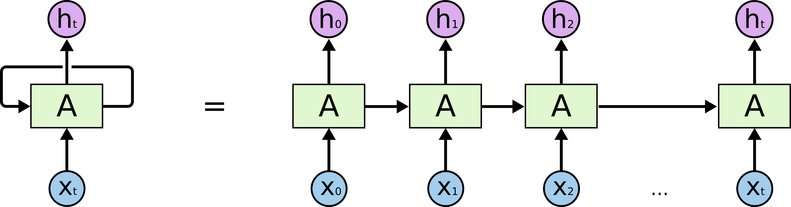

import RnnMemoryVisualizer from '../../../components/chapter-2/RnnMemoryVisualizer';

# 2.1 마르코프 체인에서 RNN까지 (Markov Chains to RNNs)

<a id="동기-데이터-속-시간의-화살"></a>

어떤 기계가 색깔 하나를 말하고, `wait`, `ready`를 차례로 말한 뒤 처음 색깔을 한 번 더 말합니다. 녹음은 두 개입니다. 하나는 `red wait ready red`, 다른 하나는 `blue wait ready blue`입니다. 각각 `ready`에서 멈춰 보면, 다음 단어를 어떻게 맞힐 수 있을까요?

<a id="비유-메모리가-있는-컨베이어-벨트"></a>

직전 단어는 둘 다 `ready`입니다. 두 단어를 거슬러 올라가도 `wait ready`로 같습니다. 사람은 “처음에 빨간색이라고 했나?”에 대한 답 하나만 기억해도 두 녹음에서 다음 단어를 맞힐 수 있습니다. 최근 단어 몇 개를 보관하는 것과, 나중에 쓸 단서 하나를 골라 기억하는 것의 차이입니다.

## 마르코프 체인: 가장 단순한 시퀀스 모델

1913년 안드레이 마르코프는 푸시킨의 《예브게니 오네긴》에서 글자 2만 개를 조사했습니다. 모음 뒤에 다시 모음이 오는 경우와 자음 뒤에 모음이 오는 경우를 따로 세어 이웃한 두 글자가 통계적으로 어떻게 연관되는지 살펴봤습니다. [[1]](#ref-1)

<a id="마르코프-속성"></a>

### 마르코프 성질

$X_t$는 $t$번째 시점의 상태를 나타내는 확률 변수이고, $x_t$는 관측한 값입니다. 1차 마르코프 체인에서는 현재 상태만 알면 다음 상태의 확률분포가 정해집니다.

$$P(X_{t+1}=x \mid X_1=x_1,\ldots,X_t=x_t)=P(X_{t+1}=x \mid X_t=x_t)$$

**바이그램(bigram)** 언어 모델은 직전 토큰을 상태로 삼습니다. 위 녹음에서는 `ready` 뒤에 `red`와 `blue`가 한 번씩 나옵니다. 빈도로 추정하면 어느 녹음에서든 $P(\text{red}\mid\text{ready})=1/2$입니다. **트라이그램(trigram)** 은 직전 두 토큰을 보지만, 여기서는 두 토큰 모두 같습니다. 4-그램이 되면 처음 색깔까지 볼 수 있습니다. 그러나 두 녹음에 `wait`를 하나씩 더 끼워 넣으면 마지막 세 토큰이 다시 같아집니다.

### 마르코프 모델이 여전히 중요한 이유

차수를 고정해도 토큰 하나를 읽을 때마다 창을 한 칸씩 옮기면 아무리 긴 문장이라도 끝까지 읽을 수 있습니다. 차수가 제한하는 것은 다음 예측에 반영할 수 있는 최근 토큰의 수입니다. 어휘가 $V$개이고 최근 $k$개 토큰을 본다면 가능한 조합은 최대 $V^k$개입니다. 관측 자료에서는 드물거나 아예 없던 조합이 많으므로, 빈도 기반 모델은 이런 경우 더 짧은 문맥의 빈도를 활용하기도 합니다.

마르코프 모델이라도 **무엇을 상태로 삼느냐** 에 따라 답이 달라집니다. 상태를 ‘처음 들은 색깔’로 설계하면 `wait`가 몇 번 반복되든 색깔을 기억할 수 있습니다. RNN에서는 예측 과제를 학습하면서 어떤 단서를 다음 시점까지 전달할지가 정해집니다. 엘먼은 다음 입력을 예측하는 신경망에 직전 시점의 은닉층 출력을 다시 입력해 이 방식을 실험했습니다. [[2]](#ref-2)

<a id="순환-신경망-rnn-메모리-추가"></a>

## 순환 신경망(RNN)의 은닉 상태

<div style={{ maxWidth: '600px', margin: '20px auto' }}>



*시간 순서대로 펼쳐 그린 셀은 모두 같은 가중치를 씁니다. 그림 출처는 Christopher Olah의 글입니다.* [[3]](#ref-3)

</div>

<a id="메커니즘"></a>

시점 $t$의 입력 벡터 $\mathbf{x}_t$와 직전 은닉 상태 $\mathbf{h}_{t-1}$로 새 은닉 상태 $\mathbf{h}_t$를 구합니다. 출력층은 이 값을 다음 토큰의 확률분포 $\mathbf{y}_t$로 바꿉니다.

$$\mathbf{h}_t=\tanh(\mathbf{W}_{hh}\mathbf{h}_{t-1}+\mathbf{W}_{xh}\mathbf{x}_t+\mathbf{b}_h)$$
$$\mathbf{y}_t=\operatorname{softmax}(\mathbf{W}_{hy}\mathbf{h}_t+\mathbf{b}_y)$$

$\mathbf{W}_{hh}$, $\mathbf{W}_{xh}$, $\mathbf{W}_{hy}$는 차례로 직전 상태, 현재 입력, 갱신된 상태에 곱하는 가중치 행렬입니다. $\mathbf{b}_h$와 $\mathbf{b}_y$는 편향 벡터입니다. 추론 중인 셀은 현재 은닉 벡터 하나만 보관하면 다음 토큰을 읽을 수 있습니다. 서로 다른 두 입력을 읽고도 은닉 상태가 정확히 같아졌다면, 이후에 같은 토큰을 넣는 한 두 예측은 계속 같습니다.

<a id="학습의-현실-시간을-따라-펼쳐지는-계산-그래프"></a>

### 시간 순서대로 펼쳐서 학습하기

**티처 포싱(teacher forcing)** 으로 다음 토큰을 예측하도록 학습할 때는 학습 자료에 있는 토큰을 입력하고 그다음 토큰을 정답으로 씁니다. 처음부터 입력 전체를 알고 있어도 셀은 $\mathbf{h}_1$을 구한 뒤에야 $\mathbf{h}_2$를 구할 수 있습니다. 녹음이 서로 다르면 한 배치에 담아 동시에 계산할 수 있습니다.

<a id="약속과-현실"></a>

시간을 따라 끝까지 **역전파(BPTT)** 하면 `ready` 뒤에서 틀린 예측이 첫 단어 `red`를 처리한 연산에까지 학습 신호를 보냅니다. 이 기울기는 중간의 상태 갱신을 하나씩 거슬러 갑니다. 매 단계에서 기울기가 줄어든다면 첫 시점에 도달하는 학습 신호는 약해집니다. 셀의 구조상 기억할 수 있는 단서도 실제 학습에서 놓칠 수 있다는 뜻입니다. [2.2절](/ko/chapter-2/vanishing-exploding-gradients/)에서 이때 기울기가 어떻게 달라지는지 계산합니다. [[4]](#ref-4)

## PyTorch RNN

녹음 한 개당 은닉 상태로 숫자 하나만 둡니다. `red`는 $+1$, `blue`는 $-1$, `wait`와 `ready`는 둘 다 0으로 입력합니다. 입력과 직전 상태에 곱하는 가중치를 각각 1로 두고 편향을 빼면, 초깃값 $h_0=0$에서 매번 $h_t=\tanh(h_{t-1}+x_t)$만 계산하면 됩니다. 아래 코드는 두 녹음을 한 배치에 담아 CPU에서 계산합니다. 학습 없이도 손으로 검산할 수 있게 가중치를 직접 정했습니다. [[5]](#ref-5)

```python
import torch
from torch import nn

cell = nn.RNNCell(input_size=1, hidden_size=1, bias=False)
steps = torch.tensor([[1., -1.], [0., 0.], [0., 0.]])
hidden = torch.zeros(2, 1)

with torch.no_grad():
    cell.weight_ih.fill_(1.)
    cell.weight_hh.fill_(1.)
    for inputs in steps:
        hidden = cell(inputs.reshape(2, 1), hidden)
        print([round(value, 3) for value in hidden[:, 0].tolist()])
```

출력은 차례로 `[0.762, -0.762]`, `[0.642, -0.642]`, `[0.566, -0.566]`입니다. `ready`까지 읽어도 부호만 보면 처음 색깔을 구분할 수 있습니다. 이번에는 직전 상태에 곱하는 가중치 `weight_hh`를 0으로 바꿔 보세요. `wait`가 들어오자마자 두 은닉 상태가 모두 0이 됩니다. 처음 색깔을 구별하던 단서가 이 시점에서 사라집니다.

<a id="예제-rnn의-흐려지는-기억-fading-memory"></a>

## 예제: RNN의 흐려지는 기억

두 녹음을 `wait`까지 따라가 보세요. 직전 상태에 곱하는 가중치가 1이면 이때도 두 녹음을 구별할 수 있습니다. 녹음의 처음부터 이 가중치를 0으로 두었다면 `ready`에서 두 상태의 값은 각각 얼마일까요? 먼저 답을 예상하고 아래에서 확인해 보세요.

<RnnMemoryVisualizer client:load lang="ko" />

## Quizzes

<details>
<summary>Quiz 1: 트라이그램이 두 녹음에서 똑같은 분포를 내놓는 이유는 무엇일까요?</summary>
*두 녹음 모두 마지막 두 토큰이 `wait ready`입니다. 트라이그램은 이 두 토큰으로 다음 토큰의 분포를 정하므로 두 녹음의 앞부분을 구별할 수 없습니다.*
</details>

<details>
<summary>Quiz 2: 상태가 두 개인 마르코프 모델로 천 번의 대기 신호 뒤에도 색깔을 기억할 수 있을까요?</summary>
*가능합니다. 색깔마다 상태를 하나씩 배정하고 대기 신호가 들어오면 현재 상태에 머물도록 합니다. 무엇을 상태에 담는지가 어떤 정보를 보존할지 결정합니다.*
</details>

<details>
<summary>Quiz 3: 셀이 백만 토큰을 읽을 수 있다면 마지막 예측에 대해 무엇을 알 수 있을까요?</summary>
*갱신 연산을 백만 번 반복할 수 있다는 점만 알 수 있습니다. 첫 토큰의 영향이 남는지 보려면 첫 토큰만 바꾸고 나머지는 그대로 다시 입력해 마지막 예측을 비교해야 합니다.*
</details>

<details>
<summary>Quiz 4: 두 은닉 상태가 다른데도 출력층이 처음 색깔을 구분하지 못하는 경우가 있을까요?</summary>
*출력층의 가중치가 전부 0이면 편향만으로 확률이 정해집니다. 은닉 상태가 달라도 예측 분포는 같습니다.*
</details>

<details>
<summary>Quiz 5: 녹음 두 개는 동시에 처리하면서 한 녹음의 토큰은 왜 차례로 처리할까요?</summary>
*녹음마다 은닉 상태가 따로 있어 다른 녹음의 계산을 기다릴 필요가 없습니다. 한 녹음 안에서는 직전 시점에 구한 상태가 있어야 다음 시점을 계산할 수 있습니다.*
</details>

<details>
<summary>Quiz 6: BPTT에서 야코비안의 곱이 작아지는 충분조건은 무엇일까요?</summary>
*은닉 상태를 열벡터로 쓰면 $j$번째 상태를 직전 상태로 미분한 야코비안은 $J_j=\operatorname{diag}(1-h_j^2)W_{hh}$입니다. 제곱은 원소별 연산입니다. $k$시점의 상태가 $t$시점까지 전달되는 경로를 미분하면 $J_t\cdots J_{k+1}$입니다. 각 행렬의 연산자 노름이 $\|J_j\|_2\le\rho<1$을 만족하면 곱의 노름은 최대 $\rho^{t-k}$입니다. 역전파에서는 이 곱을 전치해 손실의 기울기에 곱합니다.*
</details>

## References

1. <a id="ref-1"></a>Markov, A. A. (1913). [An Example of Statistical Investigation of the Text *Eugene Onegin* Concerning the Connection of Samples in Chains](https://doi.org/10.1017/S0269889706001074). 영어 번역본, *Science in Context* (2006).
2. <a id="ref-2"></a>Elman, J. L. (1990). [Finding Structure in Time](https://cogsci.ucsd.edu/~rik/courses/readings/elman90-fsit.pdf). *Cognitive Science*, 14, 179–211.
3. <a id="ref-3"></a>Olah, C. (2015). [Understanding LSTM Networks](https://colah.github.io/posts/2015-08-Understanding-LSTMs/).
4. <a id="ref-4"></a>Bengio, Y., Simard, P., & Frasconi, P. (1994). [Learning Long-Term Dependencies with Gradient Descent Is Difficult](https://pubmed.ncbi.nlm.nih.gov/18267787/). *IEEE Transactions on Neural Networks*, 5, 157–166.
5. <a id="ref-5"></a>PyTorch. [RNNCell](https://docs.pytorch.org/docs/2.15/generated/torch.nn.RNNCell.html).
