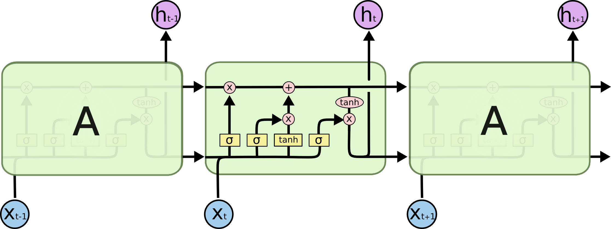
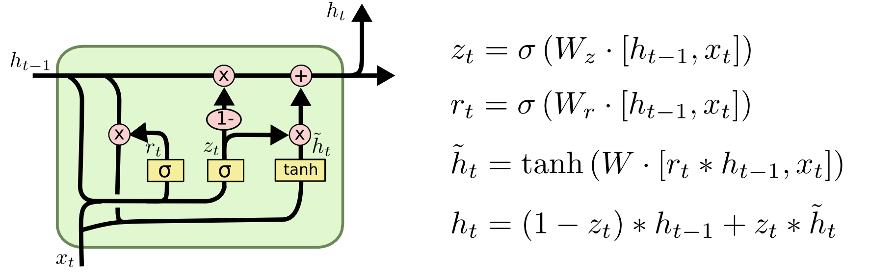

import { GradientVisualizer } from '../../../components/chapter-2/GradientVisualizer.tsx';

# 2.2 기울기 소실 및 폭주 (Vanishing & Exploding Gradients)

순환 신경망(RNN)은 이론적으로 긴 시퀀스를 처리할 수 있는 능력을 갖추고 있지만, **기울기 소실(Vanishing Gradient)** 및 **기울기 폭주(Exploding Gradient)** 문제로 인해 이들을 효과적으로 학습시키는 것은 딥러닝에서 가장 큰 과제 중 하나였습니다.

---

### **동기: 장기 신용 할당의 어려움 (The Difficulty of Long-Term Credit Assignment)**
2시간 전에 제공된 힌트가 필요한 퍼즐을 풀려고 하는데, 그 이후로 새로운 정보가 계속해서 쏟아진다고 상상해 보세요.
* **기울기 소실 (Vanishing Gradients)** 은 모델이 먼 과거를 잊게 만듭니다. 업데이트를 위한 신호가 너무 작아져서 모델이 시퀀스의 앞부분으로부터 학습하는 것을 멈춥니다.
* **기울기 폭주 (Exploding Gradients)** 는 모델이 과도하게 반응하게 만듭니다. 먼 과거의 작은 변화가 현재에 거대하고 혼란스러운 변화를 일으켜 학습을 불안정하게 만듭니다.

이 문제는 장기 종속성을 훨씬 더 잘 처리하는 LSTM과 결과적으로 트랜스포머의 탄생을 촉발했습니다.

---

### **비유: 전화 놀이(소실)와 눈덩이 효과(폭주)**
50명의 사람들이 줄을 서서 **전화 놀이(귓속말 전하기)** 를 하고 있다고 상상해 보세요.
* **기울기 소실** 은 메시지가 각 단계를 거칠 때마다 점점 더 작아지고 알아듣기 어렵게 되는 것과 같습니다. 50번째 사람에게 도달할 때쯤에는 그저 희미하고 이해할 수 없는 속삭임일 뿐입니다. 마지막 사람은 첫 번째 사람의 메시지로부터 유용한 정보를 전혀 배울 수 없습니다.
* **기울기 폭주** 는 처음에 작은 소문("비가 올지도 모른대")으로 시작하는 것과 같습니다. 줄을 따라 전달되면서 사람들이 각자 과장하기 시작합니다. 50번째 사람에게 도달했을 때는 "거대한 허리케인이 도시를 파괴하고 있대!"로 변해 있습니다. 신호가 겉잡을 수 없이 커져 버린 것입니다.

---

## 근본 원인: 시간에 따른 역전파 (BPTT)

RNN은 역전파의 확장인 **시간에 따른 역전파 (BPTT, Backpropagation Through Time)** 를 사용하여 학습됩니다. 네트워크는 시간 단계에 따라 펼쳐지고, 기울기는 출력에서부터 시작하여 처음으로 거슬러 올라가며 계산됩니다.

은닉 상태 가중치 행렬 $\mathbf{W}_{hh}$에 대한 업데이트를 고려해 보겠습니다. 기울기는 시간 단계에 따른 행렬 곱셈의 체인을 포함합니다:
열벡터 상태에 대해 $z_k=W_{hh}h_{k-1}+W_{xh}x_k+b_h$, 순방향 야코비안 $J_k=\operatorname{diag}(\sigma'(z_k))W_{hh}$를 정의합니다. 순서를 명시한 곱은
$$\frac{\partial h_t}{\partial h_0}=J_tJ_{t-1}\cdots J_1$$
입니다. 역전파는 이 곱의 전치를 출력 기울기에 적용합니다. $\|J_t\cdots J_1\|_2\le\prod_k\|J_k\|_2$이므로 모든 인자의 노름이 1보다 작은 상수로 제한되면 수축합니다. 그러나 상한이 증가한다고 실제 기울기가 증가하는 것은 아닙니다. 활성화 포화, 방향, 비정규 행렬의 성질도 영향을 줍니다. 가중치의 스펙트럼 반지름만으로 안정성의 필요충분조건을 판정할 수 없습니다 [[3]](#ref-3).

### 결과
- **기울기 소실:** 초기 시간 단계의 신호가 가중치를 업데이트하기에 너무 약해져서 네트워크가 장기 종속성을 학습할 수 없습니다.
- **기울기 폭주:** 업데이트가 너무 커져 가중치가 진동하거나 `NaN` (Not a Number)이 되어 학습이 불안정해집니다.

## 기울기 소실 시뮬레이션

BPTT에서 연쇄 법칙을 모방하여 1보다 작은 가중치 값을 반복적으로 곱함으로써 기울기가 어떻게 사라지는지 시뮬레이션할 수 있습니다.

```python
import torch

# 가중치 미분값 시뮬레이션 (활성화 함수 미분값 * 가중치)
# 이 값이 < 1이면 소실되고, > 1이면 폭주합니다.
w_derivative = 0.9

# 시퀀스 길이
seq_len = 50

gradient = 1.0
gradients = []

for t in range(seq_len):
    gradient *= w_derivative
    gradients.append(gradient)

print(f"1단계에서의 기울기: {gradients[0]:.4f}")
print(f"25단계에서의 기울기: {gradients[24]:.4f}")
print(f"50단계에서의 기울기: {gradients[49]:.4f}")

import matplotlib.pyplot as plt
plt.plot(gradients)
plt.title("Vanishing Gradient Simulation")
plt.xlabel("Backprop Steps (Time)")
plt.ylabel("Gradient Magnitude")
plt.show()
```


---

## 예제: 기울기 흐름 시각화

가중치 크기를 조절하여 시간이 지남에 따라 역전파되는 기울기에 어떤 영향을 미치는지 확인해 보세요.
*   $1.0$보다 작은 값은 기울기를 **소실** 시킵니다.
*   $1.0$보다 큰 값은 기울기를 **폭주** 시킵니다.

<GradientVisualizer lang="ko" client:load />

---

## 해결책: LSTM 및 GRU - 기억의 통제

기울기 소실 문제를 해결하기 위해 단순히 과거의 정보를 더 많이 전달하는 것뿐만 아니라, <strong>무엇을 기억하고 무엇을 잊을지</strong>를 스스로 학습하는 똑똑한 메모리 시스템이 필요했습니다. 이를 위해 개발된 대표적인 아키텍처가 **LSTM (Long Short-Term Memory)** 과 **GRU (Gated Recurrent Unit)** 입니다.

### LSTM: 장단기 메모리 (Long Short-Term Memory)

1997년 Sepp Hochreiter와 Jürgen Schmidhuber는 기울기 소실 문제를 해결하기 위해 LSTM을 제안했습니다. Sepp Hochreiter는 이미 1991년 그의 졸업 논문에서 기울기 소실 문제의 원인을 규명한 바 있습니다.

#### 직관적 해석: 컨베이어 벨트로서의 셀 상태
LSTM의 핵심 혁신은 **셀 상태(Cell State, $c_t$)** 의 도입입니다. 기존 RNN의 은닉 상태($h_t$)가 매 단계마다 복잡한 비선형 변환을 거치며 정보가 손실되거나 왜곡되는 것과 달리, 셀 상태는 일종의 **선형 컨베이어 벨트** 역할을 합니다. 정보는 이 벨트를 타고 큰 변화 없이 미래로 흘러갈 수 있습니다.

LSTM은 세 가지 "게이트"를 사용하여 셀 상태를 제어합니다:
1.  **망각 게이트 (Forget Gate):** 셀 상태에서 어떤 정보를 버릴지 결정합니다.
2.  **입력 게이트 (Input Gate):** 셀 상태에 어떤 새로운 정보를 저장할지 결정합니다.
3.  **출력 게이트 (Output Gate):** 셀 상태의 어떤 부분을 은닉 상태로 출력할지 결정합니다.

<div style={{ display: 'flex', flexDirection: 'column', alignItems: 'center', width: '100%', margin: '20px 0' }}>
<div style={{ maxWidth: '600px', width: '100%' }}>

</div>
<em style={{ marginTop: '10px', color: '#7f8c8d' }}>Source: [colah's blog](https://colah.github.io/posts/2015-08-Understanding-LSTMs/)</em>
</div>

#### 수학적 해석: 직접 경로가 기울기를 돕는 원리
기존 RNN에서는 기울기가 다음과 같이 가중치 행렬의 거듭제곱 형태로 전달되었습니다:
$$\frac{\partial \mathbf{h}_t}{\partial \mathbf{h}_{t-1}} = \operatorname{diag}(\sigma'(z_t))\mathbf{W}_{hh}$$

반면 LSTM에서 셀 상태의 역전파는 다음과 같습니다:
게이트 출력을 고정하면 셀 상태의 직접 경로 야코비안은 $\operatorname{diag}(f_t)$입니다. 망각 게이트의 값은 0과 1 사이이며 1에 가까우면 이 경로의 기울기를 유지합니다. 이것이 전체 미분은 아닙니다. 게이트가 이전 은닉 상태에 의존하므로 다른 경로도 있습니다. LSTM은 기울기 소실을 완화하지만 모든 시퀀스의 안정성을 보장하지 않습니다.

#### 비유로 이해하기
LSTM은 **일기장**과 같습니다.
*   **망각 게이트**: "어제 먹은 점심 메뉴처럼 사소한 건 지우자." (과거 기억 삭제)
*   **입력 게이트**: "오늘 새로 배운 중요한 공식은 기록하자." (새로운 정보 추가)
*   **출력 게이트**: "이 일기 내용을 바탕으로 오늘 일기를 요약해서 친구에게 말해주자." (현재 상태 출력)

---

### GRU: 게이트 순환 유닛 (Gated Recurrent Unit)

2014년 조경현 교수 등이 제안한 GRU는 LSTM의 복잡한 구조를 단순화한 모델입니다.

#### 특징
- 망각 게이트와 입력 게이트를 하나의 **업데이트 게이트**로 통합했습니다.
- 셀 상태와 은닉 상태를 하나로 합쳐 구조가 더 단순합니다.
- 파라미터 수가 적어 연산량이 적고, 데이터가 적은 상황에서 LSTM보다 우수한 성능을 보이기도 합니다.

<div style={{ display: 'flex', flexDirection: 'column', alignItems: 'center', width: '100%', margin: '20px 0' }}>
<div style={{ maxWidth: '600px', width: '100%' }}>

</div>
<em style={{ marginTop: '10px', color: '#7f8c8d' }}>Source: [colah's blog](https://colah.github.io/posts/2015-08-Understanding-LSTMs/)</em>
</div>

---

### RNN vs LSTM vs GRU 비교

| 특징 | 표준 RNN | LSTM | GRU |
| :--- | :--- | :--- | :--- |
| **구조** | 단순함 (1개의 tanh 레이어) | 복잡함 (4개의 상호작용 레이어) | 중간 (3개의 상호작용 레이어) |
| **메모리 메커니즘** | 은닉 상태만 존재 | 셀 상태 + 은닉 상태 | 은닉 상태만 존재 (통합됨) |
| **게이트 수** | 없음 | 3개 (Forget, Input, Output) | 2개 (Reset, Update) |
| **장기 종속성 해결**| 어려움 (기울기 소실) | 매우 우수 | 우수 |
| **연산 속도** | 빠름 | 느림 | 중간 |
| **파라미터 수** | 가장 적음 | 가장 많음 | 중간 |

---

## Quizzes

<details>
<summary>Quiz 1: 순환 신경망과 깊은 순방향 신경망 모두에서 먼 경로의 기울기가 약해질 수 있는 이유는?</summary>
*두 구조 모두 여러 야코비안을 곱합니다. RNN은 시간에 따라 파라미터를 재사용하지만 같은 행렬의 반복이 기울기 소실의 필수조건은 아닙니다. 깊이, 활성화, 특이벡터 방향이 중요합니다.*
</details>

<details>
<summary>Quiz 2: LSTM의 셀 상태(Cell State)는 기울기 소실을 방지하는 데 어떻게 도움이 됩니까?</summary>
*셀 상태 업데이트는 매 단계마다 비선형 활성화 함수를 거치지 않고 주로 선형적(망각 게이트의 곱셈과 입력의 덧셈)으로 이루어집니다. 이를 통해 기울기가 매 시간 단계마다 축소되는 미분값과 곱해지지 않고 셀 상태를 통해 역전파될 수 있습니다.*
</details>

<details>
<summary>Quiz 3: Gradient Clipping은 무엇이며 어떤 문제를 해결합니까?</summary>
*Gradient Clipping은 <strong>기울기 폭주</strong>를 방지하기 위해 사용되는 기술입니다. 기울기의 노름(norm)이 특정 임계값을 초과하면 해당 임계값으로 크기를 축소합니다. 이를 통해 업데이트가 너무 커져 학습이 불안정해지는 것을 방지합니다.*
</details>

<details>
<summary>Quiz 4: 기울기 소실과 관련하여 심층 신경망에서 시그모이드(Sigmoid)보다 ReLU와 같은 활성화 함수가 선호되는 이유는 무엇인가요?</summary>
*시그모이드 함수의 미분값은 최대 0.25입니다. 연쇄 법칙에서 이러한 미분값을 곱하면 기울기가 빠르게 0으로 수렴합니다. 반면 ReLU의 미분값은 양수 입력에 대해 1이므로, 곱해지더라도 기울기를 축소시키지 않습니다.*
</details>

<details>
<summary>Quiz 5: LSTM과 GRU의 가장 큰 차이점은 무엇인가요?</summary>
*LSTM은 세 가지 게이트(망각, 입력, 출력)를 가지며 셀 상태와 은닉 상태를 별도로 유지합니다. GRU는 두 개의 게이트(리셋, 업데이트)만을 가진 더 단순한 구조이며 셀 상태와 은닉 상태를 병합했습니다. GRU는 계산상 더 효율적이면서도 종종 유사한 성능을 달성합니다.*
</details>

<details>
<summary>Quiz 6: 순환 가중치의 스펙트럼 반지름이 1보다 크면 기울기 폭주가 증명되나요?</summary>
*아닙니다. 활성화 미분이 실제 야코비안 곱을 수축시킬 수 있습니다. 매 단계 $\|J_k\|_2\le1$이면 확대되지 않는 충분조건이지만, 증가하는 상한은 폭주를 증명하는 하한이 아닙니다. 스펙트럼 반지름이 1 이하여도 비정규 행렬의 일시적 증폭은 가능할 수 있습니다.*
</details>

---

## References

1. <a id="ref-1"></a>Hochreiter, S., & Schmidhuber, J. (1997). *Long short-term memory*. Neural computation, 9(8), 1735-1780.
2. <a id="ref-2"></a>Cho, K., et al. (2014). *Learning phrase representations using RNN encoder-decoder for statistical machine translation*. [arXiv:1406.1078](https://arxiv.org/abs/1406.1078).
3. <a id="ref-3"></a>Pascanu, R., Mikolov, T., & Bengio, Y. (2013). *On the difficulty of training recurrent neural networks*. [arXiv:1211.5063](https://arxiv.org/abs/1211.5063).
