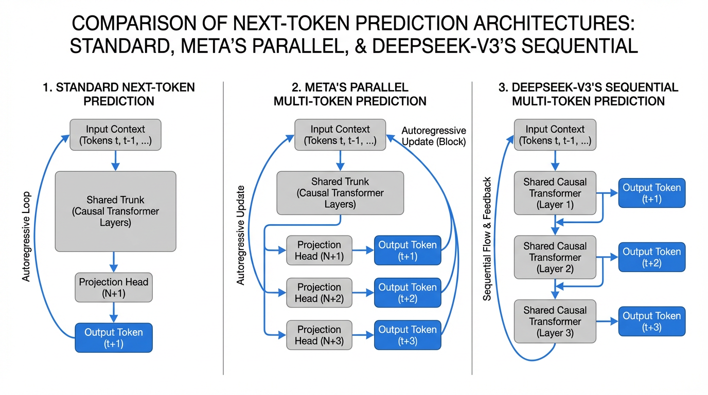

import MTPVisualizer from '../../../components/chapter-20/MTPVisualizer.tsx';

# 20.5 멀티 토큰 예측 (MTP)

다중 토큰 예측(MTP)은 같은 접두사에서 여러 미래 위치의 예측 손실을 학습에 추가합니다. 다음 토큰 예측(NTP)도 장기 의존성을 학습할 수 있으므로 MTP가 계획 능력을 처음 가능하게 한다고 보아서는 안 됩니다. 핵심 질문은 추가 감독이 주어진 모델·데이터·예산에서 표현과 실제 작업 성능을 개선하는지입니다. [[2]](#ref-2)

---

## 1. 아키텍처의 진화 (The Architectural Evolution)

MTP는 학습 목표이며, 여러 미래 예측을 추론 시 초안으로 사용할 수도 있습니다. 두 용도는 구분해서 평가해야 합니다. 보조 모듈을 학습에만 사용하고 추론에서는 제거하는 선택도 가능합니다.


*출처: AI 생성 이미지 (Conceptual comparison of Parallel vs Sequential MTP)*

### Meta의 병렬 헤드 (Parallel Heads) 구조
Meta FAIR 연구진은 여러 미래 토큰을 함께 예측하는 학습이 평가한 설정에서 개선을 보였다고 보고했습니다 [[2]](#ref-2). 이 아키텍처에서 메인 Transformer 트렁크(Trunk)는 은닉 상태 $h_t$ 를 출력합니다. 단일 LM 헤드 대신, 모델은 $n$ 개의 독립적인 프로젝션 블록을 갖습니다. 각 블록은 동일한 $h_t$ 를 입력받아 독립적으로 $x_{t+1}, x_{t+2}, \dots, x_{t+n}$ 을 예측합니다.

### DeepSeek-V3의 순차적 헤드 (Sequential Heads) 구조
DeepSeek-V3는 이를 더욱 정교하게 다듬어 순차적이고 인과적인(Causal) **MTP** 모듈을 도입했습니다 [[1]](#ref-1). 미래를 고립된 상태에서 독립적으로 예측하는 병렬 헤드와 달리, DeepSeek의 **MTP** 는 인과 사슬(Causal chain)을 유지합니다. $x_{t+2}$ 를 예측하기 위해, 모듈은 $x_{t+1}$ 을 예측하는 데 사용된 은닉 상태와 $x_{t+1}$ 의 실제 임베딩(학습 중에는 이미 알고 있음)을 결합하여 깊이별 Transformer 블록(임베딩과 출력 헤드는 공유)를 통과시킵니다 [[1]](#ref-1). 이를 통해 토큰 $t+k$ 의 예측이 선행하는 모든 토큰의 표현에 인과적으로 조건부화(Conditioned)되도록 보장합니다.

---

## 2. 수학적 정식화 및 PyTorch 구현 (Mathematical Formulation)

병렬 **MTP** 접근법을 수식화해 보겠습니다. 표준 **NTP** 에서 스텝 $t$ 의 교차 엔트로피 손실(Cross-entropy loss)은 다음과 같습니다.

$$ \mathcal{L}_{NTP} = -\log P(x_{t+1} | x_{1:t}) $$

$n$-토큰 **MTP** 설정에서는 다음 토큰에 대한 손실과 더불어, 미래의 $n-1$ 개 토큰에 대한 보조 손실(Auxiliary loss)을 하이퍼파라미터 $\lambda_k$ 로 가중치를 두어 합산합니다 (일반적으로 1.0으로 설정하거나 먼 토큰일수록 감쇠시킴) [[2]](#ref-2).

$$ \mathcal{L}_{MTP} = - \sum_{k=1}^{n} \lambda_k \log P(x_{t+k} | x_{1:t}) $$

아래 교육용 변형은 어휘 투영을 공유하고 미래 위치별 MLP 투영을 사용합니다. 원 논문의 헤드 구조나 처리량 결과를 재현하지 않습니다. 출력 로짓을 모두 저장하는 비용도 별도로 고려해야 합니다.

> **교육용 헤드와 손실 예제.** 원 논문의 Transformer 헤드나 전체 학습기를 재현하지 않습니다. 로짓 $[B,n,S,V]$ 를 모두 저장하므로 메모리가 $n$ 에 비례해 늘어납니다. 실제 구현은 헤드별 계산·융합 손실 등으로 메모리를 제한해야 합니다. 백본은 인과적 어텐션을 사용하고 패킹 경계를 격리해야 하며, 이 손실 마스크만으로 어텐션 누출이 방지되지는 않습니다.

```python
import torch
import torch.nn as nn
import torch.nn.functional as F

class ParallelMTPModule(nn.Module):
    """
    Educational parallel MTP head sketch; not a paper reproduction.
    """
    def __init__(self, d_model: int, vocab_size: int, num_future_tokens: int = 4):
        super().__init__()
        if num_future_tokens < 1:
            raise ValueError("at least one prediction head required")
        self.num_future_tokens = num_future_tokens

        # Shared LM head for all predictions to conserve VRAM
        self.shared_lm_head = nn.Linear(d_model, vocab_size, bias=False)

        # MTP projection blocks (for k=2 to n)
        # k=1 is the standard next-token prediction, handled directly by the trunk
        self.mtp_projections = nn.ModuleList([
            nn.Sequential(
                nn.RMSNorm(d_model),
                nn.Linear(d_model, d_model * 2, bias=False),
                nn.SiLU(),
                nn.Linear(d_model * 2, d_model, bias=False)
            ) for _ in range(num_future_tokens - 1)
        ])

    def forward(self, hidden_states: torch.Tensor) -> torch.Tensor:
        """
        hidden_states: [batch_size, seq_len, d_model] from the main trunk
        Returns: logits of shape [batch_size, num_future_tokens, seq_len, vocab_size]
        """
        # 1. Standard next-token prediction (k=1)
        logits_k1 = self.shared_lm_head(hidden_states) # [B, S, V]
        all_logits = [logits_k1]

        # 2. Future token predictions (k=2 to n)
        for proj in self.mtp_projections:
            # Project the trunk's hidden state for the k-th future token
            # We use a residual connection to anchor the representation
            z_k = proj(hidden_states) + hidden_states
            logits_k = self.shared_lm_head(z_k)
            all_logits.append(logits_k)

        return torch.stack(all_logits, dim=1) # [B, n, S, V]

def compute_mtp_loss(logits, targets, loss_weights, response_mask, segment_ids):
    # logits [B,n,S,V]; targets, response_mask, segment_ids [B,S].
    # Segment IDs are unique contiguous conversation IDs within each row.
    B, n, S, V = logits.shape
    if targets.shape != (B,S) or response_mask.shape != (B,S) or segment_ids.shape != (B,S):
        raise ValueError("target/mask/segment shape mismatch")
    if len(loss_weights) != n or any(not 0 <= w < float("inf") for w in loss_weights):
        raise ValueError("one finite nonnegative weight per head required")
    total = torch.zeros((), device=logits.device, dtype=torch.float32)
    used = False
    for k in range(n):
        shift = k + 1
        if shift >= S or loss_weights[k] == 0:
            continue
        tgt = targets[:, shift:]
        valid = response_mask[:, shift:].bool() & (tgt != -100)
        valid &= (segment_ids[:, :-shift] == segment_ids[:, shift:])
        valid &= segment_ids[:, shift:] >= 0
        if not valid.any():
            continue
        # Each head averages over its valid target tokens; then weighted sum.
        total = total + loss_weights[k] * F.cross_entropy(
            logits[:, k, :-shift, :][valid].float(), tgt[valid])
        used = True
    if not used:
        raise ValueError("no valid weighted future targets")
    return total
```

### 타겟 정렬(Target Alignment)의 엔지니어링 과제
손실 함수 코드에서 `shift = k + 1` 로직에 주목해야 합니다. 표준 자기회귀 학습에서는 인덱스 `t` 의 로짓이 `t+1` 의 타겟과 평가됩니다. 두 번째 **MTP** 헤드($k=1$)의 경우, 인덱스 `t` 의 로짓은 `t+2` 의 타겟과 평가되어야 합니다. 이러한 시프트(Shift)로 인해 $k$ 가 증가할수록 시퀀스 끝에서 $k+1$ 개의 유효한 학습 위치을 잃게 됩니다. 시퀀스 길이가 4096이고 $n=4$ 인 경우 이러한 잘림(Truncation)은 무시할 만한 수준이지만, Out-of-bounds 에러를 방지하기 위해 매우 세심한 텐서 슬라이싱(Tensor Slicing)이 요구됩니다.

---

## 3. 추론 시 초안으로 사용하기

보조 헤드는 별도 초안 모델 대신 후보 토큰을 제공할 수 있지만 연산·메모리 비용이 0은 아닙니다. 공유 표현도 높은 수락률을 보장하지 않습니다. 병렬 헤드의 주변분포 예측은 앞서 생성한 초안 토큰에 조건화된 순차 예측과도 다릅니다.

타겟 모델의 출력 분포를 유지하려면 검증, 올바른 수락·거절 샘플링, 거절 이후 KV·재귀 상태 롤백이 필요합니다. 일반 decode와 같은 온도·필터·출력 길이·부하에서 초안 생성, 검증과 복원 비용을 모두 포함해 비교합니다.

<MTPVisualizer client:load lang="ko" />


## 4. 규모와 작업별 절충

Gloeckle 등의 논문은 13B 모델에서 코딩 이득을 보고하므로 “70B 이상에서만 유용하다”는 규칙은 성립하지 않습니다. [[2]](#ref-2) 작은 모델에서의 결과도 작업과 설정에 따라 다릅니다. 고정된 용량 임계값이나 추론 개선과 사실 검색 저하 사이의 필연적 절충을 가정하지 마세요.

같은 데이터·연산 예산에서 NTP 기준선과 비교합니다. 미래 오프셋 수, 손실 가중치, 헤드 구조와 학습 길이를 분리해 실험하고 헤드별 토큰 정규화 손실, 기본 능력 유지, 코드·추론·지식의 미노출 세부 항목을 평가합니다.


## 5. 실행 계약과 정리

베이스·토크나이저·채팅 템플릿과 데이터 manifest를 고정합니다. assistant 응답만 학습한다면 미래 **타겟 위치** 의 마스크를 적용합니다. BOS/EOS, 길이 제한, 패딩과 가변 길이 손실 집계를 검증하고 패킹한 대화의 경계를 넘지 않게 합니다. 사전 학습에서는 데이터 정책에 맞는 전체 타겟 마스크를 사용합니다. 참조 모델을 사용하지 않는 목적함수라면 이를 명시합니다.

미래 헤드 수와 가중치, 옵티마이저·학습률, 배치·문맥 길이를 기록합니다. 파라미터, 기울기, 옵티마이저, 활성값, 로짓 임시 버퍼, 통신, 체크포인트와 평가 메모리를 정밀도·샤딩·재계산 가정별로 계산합니다. 토큰 정규화 손실, 헤드별 유효 타겟 수, 비유한 값, 기울기·활성값 norm, 처리량, MFU, 데이터 대기와 straggler를 배치 ID와 함께 관측합니다.

수치 이상이나 기본 능력 저하의 중단 임계값을 미리 정합니다. 헤드를 포함한 모델·옵티마이저·스케줄러·스케일러·RNG·샘플러·정확한 데이터 커서와 해시를 원자적으로 저장하고 복원을 연습합니다. 릴리스는 미노출 도메인, 능력 유지, 안전성, 형식·도구, 지연 시간, 비용과 오류율 기준을 불확실성과 함께 통과해야 합니다. 아티팩트 묶음과 마지막 정상 버전으로의 롤백 경로를 유지합니다.

MTP의 추가 감독과 초안 생성은 각각 유용할 수 있지만, 학습 품질과 서빙 속도는 서로 다른 실험으로 입증해야 합니다.


## Quizzes

<details>
<summary>Quiz 1: 손실(Loss)을 계산할 때 각 프로젝션 헤드마다 타겟 시퀀스를 다르게 이동(Shift)시켜야 하는 이유는 무엇인가요?</summary>
*각 헤드가 서로 다른 미래 오프셋(Offset)에 있는 토큰을 예측하기 때문입니다. 위치 $t$ 의 기본 트렁크는 $t+1$ 을 예측하므로 타겟을 1만큼 이동시킵니다. 위치 $t$ 의 첫 번째 MTP 헤드는 $t+2$ 를 예측하므로, 그 출력은 2만큼 이동된 타겟 시퀀스와 비교되어야 합니다. 올바르게 이동시키지 않으면 모델이 미래를 정확히 예측했음에도 불구하고 페널티를 받게 됩니다.*
</details>

<details>
<summary>Quiz 2: DeepSeek-V3의 순차적(Sequential) MTP 아키텍처는 Meta의 병렬(Parallel) MTP 아키텍처와 개념적으로 어떻게 다른가요?</summary>
*Meta의 병렬 MTP는 동일한 은닉 상태 $h_t$ 에서 분기하는 독립적인 프로젝션 헤드를 사용하므로, $t+2$ 의 예측이 $t+1$ 의 예측에 조건부화되지 않습니다. 반면 DeepSeek-V3는 인과 사슬을 유지하는 순차적 Transformer 블록을 사용합니다. $t+2$ 를 위한 MTP 모듈은 $t+1$ 을 예측하는 데 쓰이는 상태와 토큰 $t+1$ 의 실제 임베딩을 함께 입력받아, 미래 예측이 완전한 인과적 컨텍스트에 기반하도록 보장합니다.*
</details>

<details>
<summary>Quiz 3: MTP 초안은 왜 비용이 0이거나 항상 우수한 방식이 아닌가요?</summary>
*보조 헤드, 검증과 상태 복원에 비용이 들고 수락률도 보장되지 않습니다. 별도 초안 모델과 동일한 품질·부하 조건에서 전체 지연·메모리·처리량을 비교해야 합니다.*
</details>

<details>
<summary>Quiz 4: MTP가 70B 이상에서만 유용하다는 결론이 잘못된 이유는 무엇인가요?</summary>
*인용한 연구는 13B 코딩 이득을 포함합니다. 결과는 모델·데이터·작업·목적함수에 따라 다르므로 보편적인 파라미터 임계값을 도출할 수 없습니다.*
</details>

---

## References

1. <a id="ref-1"></a>DeepSeek-AI. (2024). *DeepSeek-V3 Technical Report*. [arXiv:2412.19437](https://arxiv.org/abs/2412.19437).
2. <a id="ref-2"></a>Gloeckle, F., et al. (2024). *Better & Faster Large Language Models via Multi-token Prediction*. Meta FAIR. [arXiv:2404.19737](https://arxiv.org/abs/2404.19737).
