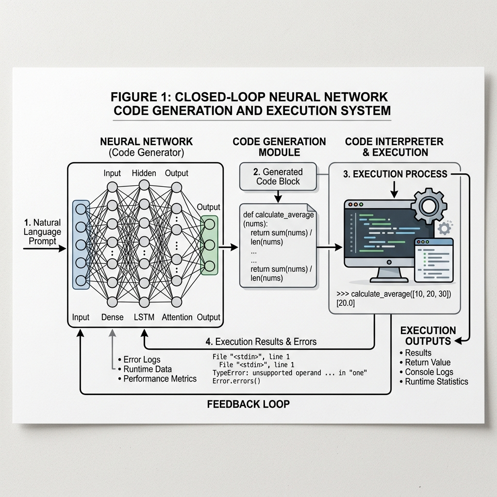

# 20.4 신경망은 프로그램이다: 실행의 미래

앞 절들이 주로 “긴 시퀀스를 어떻게 더 효율적으로 처리할 것인가”를 다뤘다면, 이번 절은 “모델이 복잡한 문제를 어떤 계산 절차로 풀 것인가”를 다룹니다. 긴 컨텍스트를 싸게 읽는 것만으로는 충분하지 않습니다. 코딩, 데이터 분석, 수학, agent workflow에서는 모델이 중간 상태를 만들고, 검증하고, 필요하면 외부 실행기를 호출해야 합니다.

인공지능의 진화는 정적인 규칙 기반 시스템에서 동적인 데이터 주도형 모델로의 여정이었습니다. 하지만 파운데이션 모델(Foundation Models)의 다음 개척지는 데이터와 코드의 경계를 허물고 있습니다. 우리는 신경망이 단순한 함수 근사기(Function approximator)를 넘어, **프로그램을 생성하고 실행하는 주체** 가 되는 패러다임으로 이동하고 있습니다.

이 절에서는 "Neural Networks as Programs"라는 개념을 다룹니다. 이는 모델이 복잡한 추론 과업을 해결하기 위해 구조화된 절차를 생성하고 조작하거나, 일부를 내부적으로 시뮬레이션하는 시스템을 이해하는 데 유용한 프레이밍입니다.

## 정적 가중치에서 동적 실행으로

전통적으로 신경망은 학습된 가중치를 가진 고정된 계산 그래프로 간주됩니다. 입력을 받아 행렬 곱셈과 비선형 활성화 함수를 거쳐 출력을 생성합니다. 이 방식은 강력하지만, 명시적인 알고리즘 논리, 장기적인 상태 관리, 또는 정확한 정밀도가 필요한 작업(예: 다단계 수학 알고리즘 실행)에는 어려움을 겪습니다.

Neural Networks as Programs 개념은 이러한 관점을 두 가지 주요 방식으로 전환합니다.

1.  **프로그램 생성자로서의 신경망 (Neural Networks as Program Generators)**: 모델이 문제를 해결하기 위해 명시적인 코드(예: Python, SQL) 또는 도메인 특화 언어(DSL)를 생성하고, 이는 외부 인터프리터에 의해 실행됩니다.
2.  **프로그램 실행자로서의 신경망 (Neural Networks as Program Executors)**: 모델 자체가 프로그램의 실행을 시뮬레이션하는 방법을 학습하여, 전통적인 CPU나 가상 머신과 유사하게 상태와 메모리를 동적으로 유지합니다.

### 진화: NTM에서 현대의 LLM까지

프로그램과 유사한 기능을 가진 신경망에 대한 아이디어는 새로운 것이 아닙니다. 초기 연구는 현대적 접근 방식의 기초를 마련했습니다.

-   **Neural Turing Machines (NTM)**: Graves 등(2014) [[1]](#ref-1) 이 발표한 NTM은 신경망 컨트롤러를 외부 메모리 뱅크와 결합했습니다. 이를 통해 네트워크는 복사, 정렬, 연상 기억과 같은 기본적인 알고리즘을 학습할 수 있었으며, 사실상 미분 가능한 컴퓨터로 작동했습니다.
-   **Differentiable Neural Computers (DNC)**: NTM의 진화된 형태 [[2]](#ref-2) 로, 더 복잡한 메모리 주소 지정 메커니즘과 그래프 탐색과 같은 구조화된 작업에서 더 나은 성능을 제공했습니다.

이러한 모델들은 신경망이 알고리즘 논리를 학습할 수 있음을 증명했지만, 학습시키고 확장하기가 어려웠습니다. 돌파구는 대규모 언어 모델(LLM)의 스케일과 고품질 코드를 생성하는 창발적 능력에서 비롯되었습니다.

## 프로그램 생성자로서의 LLM: 실행 가이드 생성 (Execution-Guided Synthesis)

오늘날 이 개념이 가장 실용적으로 구현된 사례 중 하나가 **실행 가이드 생성 (Execution-Guided Synthesis)** 입니다. 코드 실행 환경이나 데이터 분석 도우미에서 자주 볼 수 있는 패턴으로, 모델은 복잡한 문제를 자신의 가중치 안에서만 해결하려 하기보다 Python 프로그램을 작성하고 그것을 외부 실행 환경에 맡깁니다.

이는 강력한 피드백 루프를 생성합니다:
1.  **생성 (Generate)**: 모델이 사용자의 프롬프트를 기반으로 프로그램을 작성합니다.
2.  **실행 (Execute)**: 외부 환경이 프로그램을 실행하고 결과 또는 에러 로그를 반환합니다.
3.  **정제 (Refine)**: 실행이 실패하거나 에러가 발생하면, 모델은 에러 로그를 읽고 프로그램의 수정된 버전을 생성합니다.


*출처: AI 생성 이미지*

외부 실행은 산술·상태 전이를 검사할 수 있게 하지만 잘못 생성한 프로그램도 결정론적으로 잘못된 답을 냅니다. 명세, 경계 사례와 독립 테스트로 검증하고, 샌드박스·최소 권한·시간 및 비용 제한을 적용해야 합니다. 테스트 통과도 검사하지 않은 입력의 정확성을 증명하지는 않습니다.

### Agentic coding에서의 실무 패턴

현대 코딩 에이전트는 보통 아래 루프를 따릅니다.

1. **읽기:** 관련 파일, 테스트, 문서, 이슈 설명을 찾습니다.
2. **계획:** 변경 범위를 작게 나누고 위험한 파일을 식별합니다.
3. **수정:** diff나 직접 파일 수정으로 패치를 만듭니다.
4. **실행:** unit test, type check, lint, integration test를 돌립니다.
5. **반성:** 실패 로그를 읽고 원인을 좁힙니다.
6. **반복:** 필요한 만큼 수정과 검증을 반복합니다.

이 루프에서 LLM은 모든 계산을 머릿속으로 하지 않습니다. 오히려 좋은 시스템일수록 테스트 러너, 타입체커, 검색 도구, 패키지 매니저, 샌드박스 같은 외부 프로그램에 일을 나눕니다. 그래서 “신경망은 프로그램이다”라는 말은 모델이 CPU를 대체한다는 뜻이 아니라, 모델이 **프로그램을 만들고, 실행 결과를 해석하고, 다음 행동을 선택하는 controller** 가 된다는 뜻에 가깝습니다.

## 실행 시뮬레이션: 신경망 인터프리터 (Neural Interpreter)

외부 실행을 위한 코드를 생성하는 것과 별개로, 모델이 내부적으로 실행을 *시뮬레이션* 하도록 학습시키는 방향도 중요한 연구 주제입니다. 외부 인터프리터를 쓰기 어렵거나, 너무 자주 호출하면 지연 시간과 비용이 커지는 상황에서 특히 의미가 있습니다.

Python 스크립트의 출력을 예측하도록 훈련된 모델을 생각해 보십시오. 이를 정확하게 수행하려면 모델은 변수 상태와 제어 흐름에 대한 멘탈 모델을 유지해야 합니다.

### PyTorch 예제: 단순한 신경망 상태 머신

완전한 프로그램 합성은 간단한 예제의 범위를 벗어나지만, 신경망이 단순한 상태 머신이나 프로그램 실행자처럼 작동하도록 훈련될 수 있음을 보여줄 수 있습니다. 여기서는 입력 지침에 따라 카운트를 증가시키거나 감소시키는 카운터를 시뮬레이션하도록 학습하는 간단한 순환 신경망(RNN)을 구현하여, 상태 유지 및 실행 논리를 보여줍니다.

> **교육용 장난감 학습.** 길이 10인 합성 시퀀스 32개를 반복 학습합니다. 학습 오차 감소는 알고리즘 습득이나 더 긴 길이로의 일반화를 입증하지 않습니다. 분산 학습·체크포인트·평가 파이프라인은 구현하지 않습니다.

```python
import torch
import torch.nn as nn
import torch.optim as optim

class NeuralCounter(nn.Module):
    def __init__(self, input_size, hidden_size, output_size):
        super(NeuralCounter, self).__init__()
        self.hidden_size = hidden_size
        # 상태를 유지하기 위한 RNN 레이어
        self.rnn = nn.RNN(input_size, hidden_size, batch_first=True)
        # 은닉 상태를 출력 값으로 매핑하는 선형 레이어
        self.fc = nn.Linear(hidden_size, output_size)

    def forward(self, x, initial_state=None):
        # x shape: (batch_size, sequence_length, input_size)
        if initial_state is None:
            initial_state = x.new_zeros(1, x.size(0), self.hidden_size)

        out, hidden = self.rnn(x, initial_state)
        # 모든 타임스텝의 출력 매핑
        out = self.fc(out)
        return out, hidden

# 하이퍼파라미터
input_size = 2  # [증가, 감소] 원-핫 인코딩
hidden_size = 16
output_size = 1 # 현재 카운트
seq_length = 10
batch_size = 32

# 모델 인스턴스화
model = NeuralCounter(input_size, hidden_size, output_size)
criterion = nn.MSELoss()
optimizer = optim.Adam(model.parameters(), lr=0.01)

# 더미 훈련 데이터 생성
# 입력: 증가(1,0) 및 감소(0,1)의 시퀀스
inputs = torch.randint(0, 2, (batch_size, seq_length, 1))
# 원-핫 인코딩으로 변환: shape (batch_size, seq_length, 2)
inputs_one_hot = torch.zeros(batch_size, seq_length, 2)
inputs_one_hot.scatter_(2, inputs, 1.0)

# 타겟 계산 (증가 - 감소의 누적 합)
targets = torch.zeros(batch_size, seq_length, 1)
for i in range(batch_size):
    current_count = 0.0
    for t in range(seq_length):
        if inputs[i, t, 0] == 0: # 증가
            current_count += 1.0
        else: # 감소
            current_count -= 1.0
        targets[i, t, 0] = current_count

# 훈련 루프
for epoch in range(100):
    optimizer.zero_grad()
    outputs, _ = model(inputs_one_hot)
    loss = criterion(outputs, targets)
    loss.backward()
    optimizer.step()

    if (epoch + 1) % 20 == 0:
        print(f'Epoch [{epoch+1}/100], Loss: {loss.item():.4f}')

print("학습 종료. 독립 시퀀스와 더 긴 길이에서 평가해야 합니다.")
```

이 예제에서 RNN의 은닉 상태는 현재 카운트를 보유하는 "메모리" 또는 "레지스터" 역할을 하며, 네트워크는 입력 지침에 따라 이 상태를 업데이트하는 방법을 학습합니다.

## 실험과 배포의 경계

입력은 증가·감소 명령이며 목표는 각 시점의 누적 합에 대한 MSE입니다. 예제는 CPU FP32, 은닉 차원 16, Adam 학습률 0.01, 고정 배치 32개와 100회 업데이트를 사용합니다. 별도 seed의 미관측 시퀀스와 더 긴 길이에서 MSE·정확한 카운트 일치율을 측정하고, 비정상 손실이나 발산 시 중단해야 합니다. 학습·평가 시퀀스를 중복 제거 후 분리하고 생성 규칙·seed를 기록합니다.

실험을 재개하려면 모델·옵티마이저·RNG 상태, 단계와 데이터 생성 설정을 저장합니다. 체크포인트 크기만으로 총 메모리를 추정하지 말고 그래디언트·옵티마이저·시퀀스 활성화도 계산합니다. 실행 도구를 배포할 때는 정확성·권한·지연·비용 회귀 기준을 통과한 버전만 사용하고 이전 정상 버전으로 되돌릴 수 있어야 합니다.

신경 기호 시스템은 학습과 명시적 절차를 결합하는 연구 방향입니다. 자동 생성한 알고리즘이나 자체 수정은 가설·패치 후보로 취급하며, 독립 검증과 통제된 릴리스 없이는 신뢰할 수 없습니다.

## Quizzes

<details>
<summary>Quiz 1: 외부 인터프리터는 생성한 프로그램의 정확성을 보장하나요?</summary>
*아닙니다. 명세가 틀리거나 코드에 버그가 있으면 정확히 실행해도 답이 틀립니다. 독립 테스트·경계 사례·샌드박스·권한과 자원 제한이 필요합니다.*
</details>

<details>
<summary>Quiz 2: NTM의 외부 메모리는 RNN 상태와 어떻게 다른가요?</summary>
*제어기와 주소 지정 가능한 메모리를 분리해 위치를 선택하여 읽고 쓸 수 있습니다. 더 긴 입력에 대한 일반화는 가능성을 제공할 뿐 자동 보장하지 않으므로 길이 밖 평가가 필요합니다.*
</details>

<details>
<summary>Quiz 3: 뉴로-심볼릭 AI의 맥락에서 "Symbolic"은 무엇을 의미하나요?</summary>
*이는 전통적인 규칙 기반 AI, 논리, 그리고 이산적인 표현(예: 코드 또는 수학 공식)을 의미합니다. 이를 "Neural" 네트워크와 결합하면 시스템은 직관적인 패턴 인식과 엄격한 논리적 추론의 이점을 모두 누릴 수 있습니다.*
</details>

<details>
<summary>Quiz 4: Neural Turing Machines (NTM)은 메모리 접근을 위해 하이브리드 주소 지정 메커니즘을 사용합니다. 콘텐츠 기반 주소 지정(Content-based addressing)과 위치 기반 주소 지정의 후속 보간 게이팅(Interpolation gating) 단계에 대한 수학적 수식을 작성하고 설명하세요.</summary>
*NTM은 메모리 가중치 벡터 $w_t$를 생성하기 위해 다단계 주소 지정 메커니즘을 사용합니다.*
*1. **콘텐츠 기반 주소 지정**: 컨트롤러는 키 벡터 $k_t$와 양의 스칼라 키 강도 $\beta_t$를 출력합니다. 위치 $i$에 대한 가중치는 메모리 행렬 $M_t$와의 코사인 유사도에 의해 결정됩니다:*
$$w_t^c(i) = \frac{\exp(\beta_t K(k_t, M_t(i)))}{\sum_j \exp(\beta_t K(k_t, M_t(j)))}$$
*여기서 $K(u, v) = \frac{u \cdot v}{\|u\| \|v\|}$는 코사인 유사도입니다.*
*2. **보간 게이트**: 콘텐츠 기반 주소와 이전 타임스텝의 주소 지정 벡터 $w_{t-1}$을 혼합하기 위해, NTM은 컨트롤러가 출력하는 스칼라 보간 게이트 $g_t \in (0, 1)$를 사용합니다:*
$$w_t^g = g_t w_t^c + (1 - g_t) w_{t-1}$$
*이를 통해 네트워크는 유사한 콘텐츠에 집중하거나 과거의 초점을 기반으로 순차적으로 반복할 수 있습니다.*
</details>


---

## References

1. <a id="ref-1"></a>Graves, A., Wayne, G., & Danihelka, Ivo. (2014). *Neural Turing Machines*. [arXiv:1410.5401](https://arxiv.org/abs/1410.5401).
2. <a id="ref-2"></a>Graves, A., et al. (2016). *Hybrid computing using a neural network with dynamic external memory*. [Nature, 538(7626), 471-476](https://www.nature.com/articles/nature20101).
