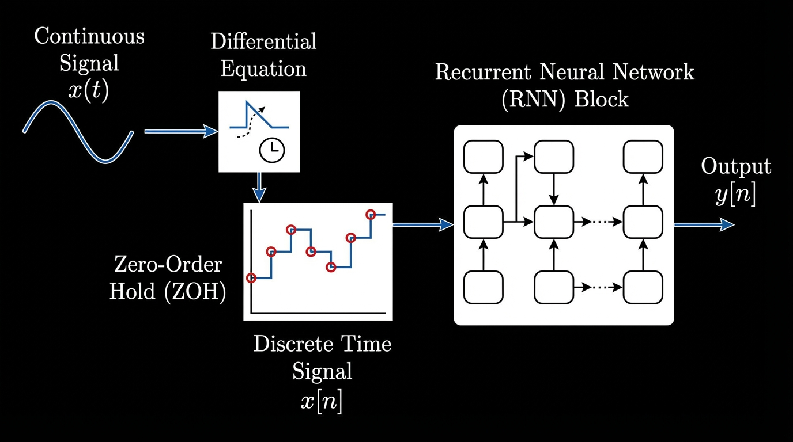

import SSMVsTransformerVisualizer from '../../../components/chapter-20/SSMVsTransformerVisualizer.tsx';

# 20.1 상태 공간 모델 (SSM)

긴 문맥에서는 어텐션의 연산과 KV 캐시가 중요한 비용입니다. 상태 공간 모델(SSM)은 과거를 고정 크기 순환 상태로 요약합니다. 폭과 상태 크기를 고정하면 시퀀스에 선형인 연산과 길이에 독립적인 decode 상태를 얻을 수 있지만, 정확한 회상과 압축 사이의 절충이 있습니다. 상수 메모리는 모델 가중치와 학습 활성값을 포함한 전체 메모리가 아니라 순환 상태의 길이 의존성을 뜻합니다.

이 장은 SSM·Mamba, 선형 어텐션, 프로그램을 사용하는 모델, MTP, 확산 언어 모델과 월드 모델을 서로 다른 설계 선택으로 살펴봅니다. 어느 하나가 나머지를 보편적으로 대체한다고 가정하지 않습니다.

## 1. 연속에서 이산으로: SSM의 수학

상태 공간 모델(State Space Models)은 완전히 새로운 개념이 아닙니다. 칼만 필터(Kalman filters)와 같은 제어 공학의 기초가 되는 이론입니다. 핵심 아이디어는 암시적인 잠재 상태(Latent state) $h(t)$ 를 통해 1차원 입력 신호 $x(t)$ 를 출력 신호 $y(t)$ 로 매핑하는 것입니다.

연속 시간(Continuous time) 환경에서 이는 다음과 같은 선형 미분 방정식 시스템으로 정의됩니다.

$$ h'(t) = \mathbf{A}h(t) + \mathbf{B}x(t) $$
$$ y(t) = \mathbf{C}h(t) + \mathbf{D}x(t) $$

여기서 각 변수는 다음을 의미합니다.
*   $\mathbf{A}$ 는 상태 전이 행렬(State transition matrix)로, 은닉 상태가 어떻게 진화하는지 결정합니다.
*   $\mathbf{B}$ 는 입력을 상태 공간으로 투영합니다.
*   $\mathbf{C}$ 는 상태를 다시 출력 공간으로 투영합니다.
*   $\mathbf{D}$ 는 직접적인 스킵 커넥션(Skip connection)입니다 (종종 생략되거나 단순한 잔차 연결로 취급됨).

문장의 단어와 같은 이산적인(Discrete) 토큰을 처리하는 신경망에서 이를 사용하려면, 연속적인 시스템을 이산화해야 합니다. 이를 위해 스텝 크기를 나타내는 시간 척도 파라미터 $\Delta$ 를 도입합니다. **Zero-Order Hold (ZOH)** 라는 기법을 사용하여 연속 행렬 $(\mathbf{A}, \mathbf{B})$ 를 이산 행렬 $(\bar{\mathbf{A}}, \bar{\mathbf{B}})$ 로 변환합니다.

$$ \bar{\mathbf{A}} = \exp(\Delta \mathbf{A}) $$
$$ \bar{\mathbf{B}} = \left(\int_0^\Delta \exp(\tau\mathbf{A})\,d\tau\right)\mathbf{B}. $$

이 적분은 $\mathbf A$ 가 특이행렬이어도 정의됩니다. 가역일 때는 $\mathbf A^{-1}(\exp(\Delta\mathbf A)-\mathbf I)\mathbf B$ 로 쓸 수 있습니다. $\bar{\mathbf B}\approx\Delta\mathbf B$ 는 작은 스텝의 1차 근사이며 일반적인 정확 ZOH 식은 아닙니다.

이 과정을 거치면 다음과 같은 이산 순환 업데이트 규칙(Discrete recurrent update rule)이 도출됩니다.

$$ h_t = \bar{\mathbf{A}} h_{t-1} + \bar{\mathbf{B}} x_t $$
$$ y_t = \mathbf{C} h_t $$


*출처: AI 생성 이미지*

S4는 위 ZOH와 다른 **쌍선형 이산화** 를 사용합니다. [[5]](#ref-5) 고정된 선형 시불변(LTI) 코어는 합성곱으로 계산할 수 있지만 코어의 상태 전이는 토큰 내용에 따라 바뀌지 않습니다. 이를 둘러싼 비선형 네트워크 전체가 추론을 전혀 할 수 없다는 뜻은 아닙니다.

---

## 2. 입력에 따라 정보를 선택하기

Mamba는 $B_t,C_t,\Delta_t$ 를 입력 $x_t$ 에 의존하게 합니다. [[1]](#ref-1) $B_t$ 는 상태에 쓰는 정보, $C_t$ 는 읽는 정보, 양수인 $\Delta_t$ 는 상태 변화의 시간 척도를 조절합니다. 작은 스텝은 상태 변화를 줄일 수 있지만 특정 단어를 무조건 무시한다는 규칙은 아닙니다.

입력 의존성 때문에 고정된 LTI 합성곱을 그대로 사용할 수는 없습니다. 그러나 affine 상태 전이의 결합은 연관적이므로 학습·prefill에는 병렬 스캔을 사용할 수 있고, decode에는 한 단계씩 상태를 갱신할 수 있습니다. 원 논문의 최대 5배 수치는 측정한 **추론 처리량** 이며 전체 학습 속도 보장이 아닙니다.

<SSMVsTransformerVisualizer client:load lang="ko" />


## 3. Mamba-2와 SSD

Mamba-2의 구조화된 상태 공간 이중성(SSD)은 제한된 SSM과 구조화된 어텐션의 연결을 활용합니다. [[2]](#ref-2) 상태 차원에 공통인 전이 스칼라를 사용하면 청크 내부 계산을 행렬 곱 중심으로 구성할 수 있습니다. 청크 사이의 상태 전달도 필요합니다. 이론적 동등성, 커널 속도, 전체 모델 속도는 별도의 주장입니다.


## 4. 하이브리드의 메모리 계산

Jamba와 Nemotron 사례는 SSM과 어텐션을 결합합니다. [[3]](#ref-3) [[4]](#ref-4) 순환 상태는 과거를 압축하고 어텐션은 명시적 KV 표현에 접근하지만, 어느 쪽도 완벽한 회상을 보장하지 않습니다.

활성 파라미터 수는 전체 가중치 저장량이 아닙니다. 예를 들어 총 52B 파라미터의 BF16 가중치는 $52\times10^9\times2=104$ GB입니다. 활성 파라미터가 12B여도 양자화·분산·오프로딩 없이 80 GB 장치에 전체 가중치가 들어가지는 않습니다. KV, 순환 상태, 활성값, 임시 버퍼와 메타데이터는 추가입니다.

| 구성 | 고정된 폭에서의 시퀀스 연산 | Decode의 문맥 상태 |
| :--- | :--- | :--- |
| 밀집 어텐션 | Prefill은 $O(L^2)$; 다음 토큰 어텐션은 $O(L)$ | KV가 $O(L)$ |
| 순수 선택적 SSM | $O(L)$ | 길이에 대해 $O(1)$ |
| 어텐션을 포함한 하이브리드 | 남아 있는 밀집 어텐션은 여전히 $O(L^2)$ | 해당 층의 KV는 여전히 $O(L)$ |

여기서 $L$ 은 시퀀스 길이입니다. 하이브리드는 상수를 줄일 수 있지만 모든 층이 선형으로 바뀌지는 않습니다. 같은 품질·배치·길이에서 속도와 메모리를 측정하고, 회상·접두사 복원·분기 롤백을 검증합니다.


## 5. 디스패처 구현: PyTorch의 Selective Scan

> **교육용 순차 계산.** 학습된 Mamba 블록이 아닙니다. 입력 항은 $\Delta B$ 근사이며 합성곱·게이트·캐시·패딩·안정적 혼합 정밀도·분산 커널을 생략합니다. Mamba-1은 병렬 스캔, Mamba-2는 SSD를 사용합니다. 아래 코드는 작은 FP32 텐서의 작동 원리를 설명합니다.

```python
import torch
import torch.nn as nn
import torch.nn.functional as F

class SimplifiedSelectiveSSM(nn.Module):
    """
    A simplified, educational implementation of a Selective State Space Model.
    Shows input-dependent parameters, exact exp(dt*A), and first-order dt*B.
    """
    def __init__(self, d_model: int, d_state: int):
        super().__init__()
        self.d_model = d_model
        self.d_state = d_state

        # Projections for the input-dependent parameters (The "Selective" part)
        # dt: step size, B and C: state transition matrices
        self.dt_proj = nn.Linear(d_model, d_model)
        self.B_proj = nn.Linear(d_model, d_state)
        self.C_proj = nn.Linear(d_model, d_state)

        # A is typically initialized to a specific structure (e.g., HiPPO matrix)
        # for structured dynamics; here A_log is an ordinary trainable parameter.
        # We represent log(A) to ensure A remains strictly negative (for stability).
        self.A_log = nn.Parameter(torch.randn(d_model, d_state))

        # Skip connection
        self.D = nn.Parameter(torch.randn(d_model))

    def forward(self, x: torch.Tensor) -> torch.Tensor:
        # x shape: (batch_size, seq_len, d_model)
        B, L, D = x.shape

        # 1. Compute input-dependent parameters across the whole sequence
        # Softplus ensures the step size (\Delta) is strictly positive
        dt = F.softplus(self.dt_proj(x)) # (B, L, D)
        B_mat = self.B_proj(x)           # (B, L, d_state)
        C_mat = self.C_proj(x)           # (B, L, d_state)

        # Negative A contracts the homogeneous recurrence; input gains can still grow.
        A = -torch.exp(self.A_log)       # (D, d_state)

        # 2. Discretize and compute state updates
        # [EDUCATIONAL NOTE]: This loop is sequential for clarity.
        # Mamba-1 uses a parallel associative scan here. Mamba-2 uses SSD block-matmul.
        y = torch.zeros_like(x)
        h = torch.zeros(B, D, self.d_state, device=x.device, dtype=x.dtype) # Initial hidden state

        for t in range(L):
            x_t = x[:, t, :]       # (B, D)
            dt_t = dt[:, t, :]     # (B, D)
            B_t = B_mat[:, t, :]   # (B, d_state)
            C_t = C_mat[:, t, :]   # (B, d_state)

            # Exponential transition with a first-order input coefficient
            # \bar{A} = exp(dt * A)
            # \bar{B} \approx dt * B
            dA = torch.exp(dt_t.unsqueeze(-1) * A)                 # (B, D, d_state)
            dB = dt_t.unsqueeze(-1) * B_t.unsqueeze(1)             # (B, D, d_state)

            # State update: h_t = \bar{A} h_{t-1} + \bar{B} x_t
            h = dA * h + dB * x_t.unsqueeze(-1)                    # (B, D, d_state)

            # Output projection: y_t = C h_t + D x_t
            y_t = torch.sum(h * C_t.unsqueeze(1), dim=-1) + self.D * x_t # (B, D)
            y[:, t, :] = y_t

        return y

# Example usage simulating a forward pass
# Batch=2, Seq_len=128, D_model=512, D_state=16
model = SimplifiedSelectiveSSM(d_model=512, d_state=16)
dummy_input = torch.randn(2, 128, 512)
output = model(dummy_input)

print(f"Input shape: {dummy_input.shape}")   # torch.Size([2, 128, 512])
print(f"Output shape: {output.shape}")       # torch.Size([2, 128, 512])
```

---

## 6. 실무적 정리

고정 크기 상태의 이득은 압축된 과거가 작업에 충분할 때 유용합니다. 길이별 품질, 상태 정밀도, 복원 후 연속 생성의 동등성과 실제 장치 비용을 함께 평가해야 합니다. 다음 절에서는 Mamba의 스캔과 SSD가 같은 순환식을 어떻게 다르게 실행하는지 살펴봅니다.


## Quizzes

<details>
<summary>Quiz 1: LTI 코어와 선택적 SSM은 무엇이 다른가요?</summary>
*LTI 코어는 시간에 따라 같은 계수를 사용합니다. 선택적 SSM은 입력에 따라 계수를 바꿀 수 있습니다. 이것이 LTI를 포함한 전체 비선형 네트워크에 추론 능력이 전혀 없다는 뜻은 아닙니다.*
</details>

<details>
<summary>Quiz 2: 선택적 scan 커널은 어떤 메모리 비용을 줄이나요?</summary>
*융합과 재계산으로 큰 중간 상태를 HBM에 반복 기록하는 비용을 줄입니다. 모든 모델 상태나 전체 학습이 SRAM 안에 들어간다는 뜻은 아닙니다.*
</details>

<details>
<summary>Quiz 3: 선형 복잡도만으로 실제 속도를 예측할 수 있나요?</summary>
*아닙니다. 배치·시퀀스·상태 차원, 메모리 대역폭, 커널과 행렬곱 효율에 따라 달라집니다. SSD는 효율적인 행렬곱의 기회를 제공하지만 전체 모델의 속도는 측정해야 합니다.*
</details>

<details>
<summary>Quiz 4: 하이브리드 모델에 어텐션 층이 남으면 무엇을 따로 계산해야 하나요?</summary>
*어텐션 층의 길이에 비례하는 KV와 제곱에 비례하는 prefill 연산을 별도로 계산합니다. 총 가중치와 활성 가중치를 혼동하지 않으며, 순환 상태가 고정 크기라고 전체 메모리가 고정되는 것은 아닙니다.*
</details>

---

## References

1. <a id="ref-1"></a>Gu, A., & Dao, T. (2023). *Mamba: Linear-Time Sequence Modeling with Selective State Spaces*. [arXiv:2312.00752](https://arxiv.org/abs/2312.00752).
2. <a id="ref-2"></a>Dao, T., & Gu, A. (2024). *Transformers are SSMs: Generalized Models and Efficient Algorithms Through Structured State Space Duality (Mamba-2)*. [arXiv:2405.21060](https://arxiv.org/abs/2405.21060).
3. <a id="ref-3"></a>Lieber, O., et al. (2024). *Jamba: A Hybrid Transformer-Mamba Language Model*. AI21 Labs. [arXiv:2403.19887](https://arxiv.org/abs/2403.19887).
4. <a id="ref-4"></a>NVIDIA. (2025). *Nemotron-Nano: An Accurate and Efficient Hybrid Mamba-Transformer Reasoning Model*. [arXiv:2504.03624](https://arxiv.org/abs/2504.03624).

5. <a id="ref-5"></a>Gu, A., Goel, K., & Ré, C. (2022). *Efficiently Modeling Long Sequences with Structured State Spaces.* [S4 paper](https://arxiv.org/abs/2111.00396).
