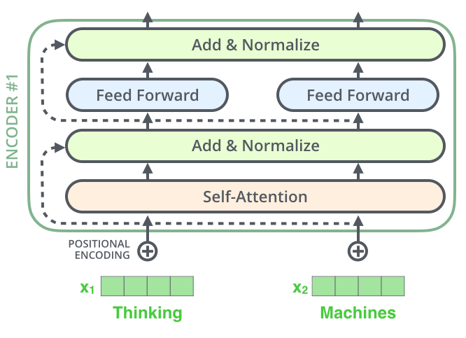

import LayerNormVisualizer from '../../../components/chapter-3/LayerNormVisualizer';

# 3.4 레이어 정규화 및 잔차

한 토큰의 두 특성값이 `[1, 3]`입니다. 두 값에 10을 더하면 `[11, 13]`이 됩니다. 정규화를 거치고도 두 입력을 구분할 수 있을까요? **LayerNorm** 은 특성값의 평균을 먼저 빼므로 둘 다 `[-1, 1]`이 된 뒤 같은 크기로 조정됩니다. **RMSNorm** 은 평균을 빼지 않고 제곱 평균의 제곱근(RMS)으로 나누므로 결과가 달라집니다. 매 층에서 잔차 상태를 정규화하는 모델의 체크포인트를 옮길 때도 같은 연산을 선택해야 원래 결과를 재현할 수 있습니다. [[2]](#ref-2) [[7]](#ref-7)

<a id="동기-깊은-네트워크의-딜레마"></a>
<a id="비유-합창단과-지름길"></a>
<a id="예제-정규화-효과"></a>
<a id="normalization-example"></a>

## 같은 값을 더한 토큰과 거의 일정한 토큰 비교하기

엡실론을 `0.00001`로 두고 `[1, 3]`과 `[11, 13]`을 비교해 보세요. LayerNorm의 출력은 두 경우 모두 약 `[-0.999995, 0.999995]`입니다. RMSNorm의 출력은 `[0.447213, 1.341639]`에서 `[0.913500, 1.079591]`로 바뀝니다. 특성별 배율은 1, 편향을 쓰는 경우 그 값은 0으로 두었습니다. [파이토치로 같은 숫자를 직접 확인](#pytorch-normalization-check)할 수 있습니다.

<LayerNormVisualizer client:load lang="ko" />

<a id="레이어-정규화-안정성-유지"></a>

## 엡실론을 키우면 무엇이 달라질까요?

트랜스포머 텐서의 모양이 `[배치, 토큰, 특성]`이라고 합시다. 토큰 하나의 특성값 $x_i$가 $d$개일 때, 이들의 평균을 $\mu$, 모집단 분산을 $v=\frac1d\sum_i(x_i-\mu)^2$로 씁니다. 두 연산 모두 다른 토큰이나 배치 원소의 값을 섞지 않습니다. 특성별 배율 $\gamma_i$, LayerNorm의 편향 $\beta_i$, 양수인 상수 $\epsilon$을 쓰면 다음과 같습니다. [[2]](#ref-2) [[7]](#ref-7) [[8]](#ref-8)

$$
\begin{aligned}
\operatorname{LN}(x)_i &= \gamma_i\frac{x_i-\mu}{\sqrt{v+\epsilon}}+\beta_i,\\
\operatorname{RMSNorm}(x)_i &= \gamma_i\frac{x_i}{\sqrt{\frac1d\sum_j x_j^2+\epsilon}}.
\end{aligned}
$$

값 차이가 작은 `[1, 1.002]`에서 평균을 빼면 $-0.001$과 $+0.001$이 남으므로 $v=10^{-6}$입니다. $\epsilon=10^{-5}$라면 LayerNorm은 두 값을 $\sqrt{0.000011}$로 나누어 약 `[-0.30151, 0.30151]`을 냅니다. 엡실론을 `0.001`로 키우면 두 출력의 절댓값은 `0.03161`로 줄어듭니다. 제곱근을 먼저 구한 뒤 엡실론을 더하면 이 계산을 재현할 수 없습니다.

배율이 1이고 편향이 0일 때 LayerNorm 출력의 평균은 0이고 분산은 $v/(v+\epsilon)$입니다. 위에서 작은 엡실론을 쓴 경우, 이 분산은 실수 연산에서 정확히 $1/11$입니다. 입력이 `[2, 2]`라면 분산은 0입니다. 학습한 배율과 편향을 적용하면 출력의 통계량은 다시 달라질 수 있습니다. 부동소수점 계산 결과를 대조할 때는 오차를 허용합니다.

<a id="잔차-연결-고속도로"></a>
<a id="pre-ln-vs-post-ln-아키텍처의-변화"></a>

## 잔차 분기의 출력이 0일 때 무엇이 남을까요?

He 등은 기존 표현에 더할 변화량을 분기에서 학습하는 잔차 블록으로 깊은 영상 인식 모델을 훈련했습니다. 입력을 그대로 통과시키는 경로에 모양이 같은 분기 $F$를 더하면 $x+F(x)$입니다. 이를 $x$에 대해 미분하면 항등 항이 남습니다. 분기 쪽 도함수에 따라 이 항이 증폭되거나 상쇄될 수 있습니다. [[1]](#ref-1)

<a id="post-ln-원본"></a>
<a id="pre-ln-현대-표준"></a>

분기 출력을 0으로 놓고 정규화 위치만 옮겨 보겠습니다. 원래 트랜스포머는 잔차를 더한 뒤에 LayerNorm을 적용했습니다. [[9]](#ref-9)

| 하위 층의 배치 | 출력 | 분기 출력이 0이고 입력이 `[1, 3]`일 때 |
| --- | --- | --- |
| Pre-LN | $x+F(\operatorname{LN}(x))$ | `[1, 3]` |
| Post-LN | $\operatorname{LN}(x+F(x))$ | 약 `[-0.999995, 0.999995]` |

<figure>



<figcaption>점선은 입력이 자기 어텐션을 우회해 첫 덧셈에 이르는 경로입니다. 정규화는 더한 결과에 적용합니다. 그림은 Jay Alammar의 <a href="https://jalammar.github.io/illustrated-transformer/">The Illustrated Transformer</a>에서 가져왔습니다.</figcaption>
</figure>

Pre-LN 블록 $L$개의 분기가 더하는 변화량이 서로 무상관이고 초기 상태와도 무상관이라고 가정해 봅시다. 각 변화량의 분산이 $s^2$이면 분산을 더할 수 있으므로, 여러 샘플에서 한 특성을 관측한 분산은 $\operatorname{Var}(x_L)=\operatorname{Var}(x_0)+Ls^2$입니다. 학습된 모델에서는 변화량 사이에 상관이 생길 수 있습니다.

Pre-LN에서는 분기가 아무것도 더하지 않으면 입력이 잔차 경로를 그대로 통과합니다. Post-LN에서는 잔차 합을 거쳐 전달되는 기울기에 정규화의 야코비안이 작용합니다. Xiong 등은 초기화 시 자신들이 분석한 Post-LN 모델의 출력 부근에서 큰 기울기 기댓값을 관측했고, Pre-LN에서 워밍업을 생략할 수 있는 조건을 연구했습니다. 실제 옵티마이저 일정은 목표 깊이와 데이터, 수치 정밀도에서 검증해야 합니다. [[3]](#ref-3)

<a id="pytorch-구현"></a>
<a id="pytorch-normalization-check"></a>

## CPU에서 두 식 검산하기

아래 텐서에서 한 행은 토큰 하나입니다. 파이토치 2.15 예제는 수치 차이를 확인하기 위해 float64를 쓰고, 학습되는 배율과 편향을 생략하며 두 함수에 엡실론을 명시합니다. `correction=0`은 파이토치 LayerNorm처럼 특성 수를 분산의 분모로 쓴다는 뜻입니다. [[8]](#ref-8)

```python
import torch
from torch.nn import functional as F

x = torch.tensor([[1, 3], [11, 13], [1, 1.002], [2, 2]], dtype=torch.float64)
mean = x.mean(dim=-1, keepdim=True)
variance = x.var(dim=-1, keepdim=True, correction=0)
for eps in (1e-5, 1e-3):
    ln = F.layer_norm(x, (2,), eps=eps)
    rms = F.rms_norm(x, (2,), eps=eps)
    torch.testing.assert_close(ln, (x - mean) / (variance + eps).sqrt())
    torch.testing.assert_close(rms, x / (x.square().mean(-1, keepdim=True) + eps).sqrt())
    torch.testing.assert_close(ln[0], ln[1])
    torch.testing.assert_close(ln[3], torch.zeros_like(ln[3]))
    assert not torch.allclose(rms[0], rms[1])
    print(eps, ln[2].tolist(), ln[2].var(correction=0).item())
```

출력의 각 줄 마지막 수는 `[1, 1.002]`를 정규화한 결과의 분산으로, 각각 약 `0.090909`와 `0.000999`입니다. 블록을 다른 구현으로 옮길 때는 동일한 은닉 상태를 넣고 정규화 전후의 값을 대조합니다. 수치 정밀도를 의심하기 전에 특성 축, 분산의 분모, 엡실론의 위치, 배율·편향, 잔차 덧셈의 순서부터 확인하세요.

<a id="연구-보강-깊이-방향의-routing"></a>
<a id="simplehc-잔차-상태-접근도-시스템-설계다"></a>

## 최근 잔차 연결 연구가 바꾸는 것

**2026-11-25 기준.** Attention Residuals는 이전 층의 출력에 줄 가중치를 학습합니다. 블록 단위 변형은 여러 층을 묶어 읽거나 전송해야 할 이전 상태의 수를 줄입니다. Low-Rank Attention Residuals는 원래 폭의 잔차 값을 유지하면서 가중치를 구하는 데만 폭이 좁은 키를 씁니다. Su는 1B와 4B 모델에서 얻은 결과를 보고했습니다. 두 방법 모두 토큰 위치와 별개로 어느 깊이의 표현을 가져올지 선택합니다. [[4]](#ref-4) [[5]](#ref-5)

SimpleHC는 학습 가능한 읽기·쓰기 게이트를 유지하고 잔차 혼합을 없애며, 여러 하위 층에서 그룹 시작 상태를 공유합니다. 저자들은 실험한 15B·30B MoE 모델에서 mHC와 비슷한 다운스트림 성능을 보고했습니다. 다른 학습 시스템에서 이 방식을 검토하려면 데이터, 깊이, 연산량을 맞춘 뒤 검증 성능, 기울기·활성화의 노름, 메모리 전송량, 실측 스텝 시간을 함께 비교합니다. [[6]](#ref-6)

## Quizzes

<details>
<summary>Quiz 1: 두 특성에 같은 상수를 더해도 LayerNorm의 출력은 같습니다. RMSNorm의 출력은 왜 달라질까요?</summary>
*LayerNorm은 함께 이동한 평균을 빼므로 평균과 각 특성의 차이가 유지됩니다. RMSNorm은 평균을 빼지 않으므로 상수를 더하면 분자와 분모가 함께 달라집니다.*
</details>

<details>
<summary>Quiz 2: LayerNorm 출력의 분산이 0에 가깝다면 구현 오류일까요?</summary>
*꼭 그렇지는 않습니다. 배율이 1이고 편향이 0이면 분산은 v/(v+epsilon)입니다. 입력이 일정하면 0이고, 입력 분산이 엡실론보다 훨씬 작으면 0에 가까워집니다.*
</details>

<details>
<summary>Quiz 3: 분기 출력을 0으로 놓으면 Pre-LN과 Post-LN을 어떻게 구분할 수 있나요?</summary>
*Pre-LN은 잔차 경로의 입력을 그대로 내보냅니다. Post-LN은 더할 값이 없어도 입력을 정규화합니다. [1, 3]처럼 정규화 전후의 값이 다른 입력으로 검사하면 됩니다.*
</details>

<details>
<summary>Quiz 4: 입력을 그대로 전달하는 경로가 있어도 깊은 모델의 기울기가 불안정해질 수 있는 이유는 무엇인가요?</summary>
*분기의 도함수가 항등 항에 더해져 이를 상쇄하거나 증폭할 수 있습니다. Post-LN에서는 정규화의 도함수도 잔차 합에 작용합니다. 블록을 쌓으면 이렇게 얻은 야코비안이 차례로 곱해집니다.*
</details>

<details>
<summary>Quiz 5: 깊이 방향으로 어텐션을 적용할 때는 어떤 상태를 더 읽어야 할까요?</summary>
*각 상태의 가중치를 계산하고 값을 합치려면 앞선 하위 층이나 블록의 표현을 읽어야 합니다. 상태 수와 라우팅 키의 폭에 따라 저장 공간, 전송량, 스텝 시간이 달라집니다.*
</details>

## References

1. <a id="ref-1"></a>He, K., et al. (2016). [Deep Residual Learning for Image Recognition](https://openaccess.thecvf.com/content_cvpr_2016/html/He_Deep_Residual_Learning_CVPR_2016_paper.html).
2. <a id="ref-2"></a>Ba, J. L., Kiros, J. R., & Hinton, G. E. (2016). [Layer Normalization](https://arxiv.org/abs/1607.06450).
3. <a id="ref-3"></a>Xiong, R., et al. (2020). [On Layer Normalization in the Transformer Architecture](https://arxiv.org/abs/2002.04745).
4. <a id="ref-4"></a>Kimi Team. (2026). [Attention Residuals](https://arxiv.org/abs/2603.15031).
5. <a id="ref-5"></a>Su, J. (2026). [Low-Rank Attention Residuals](https://arxiv.org/abs/2607.09694).
6. <a id="ref-6"></a>Zhang, X., et al. (2026). [On the Design of Hyper-Connections: Simplification, Stability, and Scalability](https://arxiv.org/html/2611.05984v1).
7. <a id="ref-7"></a>Zhang, B., & Sennrich, R. (2019). [Root Mean Square Layer Normalization](https://arxiv.org/abs/1910.07467).
8. <a id="ref-8"></a>PyTorch 2.15 문서. [LayerNorm](https://docs.pytorch.org/docs/2.15/generated/torch.nn.LayerNorm.html) 및 [RMSNorm](https://docs.pytorch.org/docs/2.15/generated/torch.nn.RMSNorm.html).
9. <a id="ref-9"></a>Vaswani, A., et al. (2017). [Attention Is All You Need, 3.1절](https://arxiv.org/html/1706.03762).
