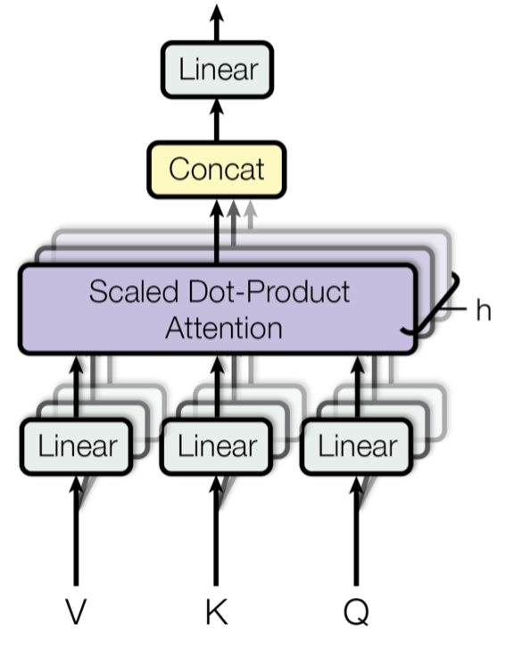

import MhaVisualizer from '../../../components/chapter-3/MhaVisualizer.tsx';

# 3.2 멀티 헤드 어텐션

한 어텐션 헤드는 질의 하나에 대해 각 입력 위치의 가중치를 구합니다. 값 벡터의 모든 좌표에 같은 가중치를 씁니다. 출력의 한 부분에는 첫 토큰의 숫자가, 다른 부분에는 마지막 토큰의 특징이 필요하다면 어떻게 할까요? 두 헤드가 각자 다른 가중치로 값을 읽고, 출력 투영이 두 결과를 섞을 수 있습니다. [[1]](#ref-1)

---

### **비유: 전문가 위원회**

두 검토자가 같은 보고서를 읽고 각자 눈여겨본 대목을 짧은 메모로 남기면, 편집자는 두 메모를 종합합니다. 멀티헤드 어텐션에서 각 헤드가 어떤 질의·키·값을 읽을지는 투영 행렬이 결정합니다. 두 헤드가 서로 다른 패턴을 학습할지는 학습 결과에 달려 있습니다. 처음부터 각 헤드에 특정 분야가 배정되는 것은 아닙니다.

---

## 왜 Multi-Head인가? (표현 서브스페이스)

입력 벡터 세 개가 $A=(1,0)$, $B=(0,1)$, $C=(1,1)$ 이라고 합시다. 첫 헤드는 질의와 키 모두에서 첫 좌표를, 둘째 헤드는 둘째 좌표를 읽습니다. 질의가 C라면 두 좌표 모두 1입니다. 첫 헤드에서는 A와 C의 점수가 같고, 둘째 헤드에서는 B와 C의 점수가 같습니다. 이 예제에는 마스크가 없으므로 두 헤드 모두 세 입력 전체를 볼 수 있습니다.

다음 단계로 전달할 정보는 값이 결정합니다. 좌표가 $(x,y)$ 인 토큰에서 헤드 1은 $x-y$, 헤드 2는 $2y$ 를 값으로 읽습니다. 헤드 1의 값은 $[1,-1,0]$ 이므로 두 토큰이 서로의 기여를 일부 상쇄할 수 있습니다. 가중치가 높다는 사실만으로 헤드 출력까지 알 수는 없습니다. [두 헤드 계산 예제](#two-head-calculation)에서 이 가중치들이 최종 벡터에 어떻게 반영되는지 확인할 수 있습니다.

---

## Multi-Head Attention의 수학적 원리

여기서 $Q$, $K$, $V$ 는 각 투영에 들어가는 입력입니다. 셀프 어텐션에서는 셋 모두 같은 시퀀스 행렬 $X$ 를 쓸 수 있습니다. 아래 식에서 각 헤드의 질의·키 차원은 $d_k$, 값 차원은 $d_v$ 입니다. 한 질의 위치에서 헤드 $h$ 개가 낸 결과를 특징 축을 따라 이어 붙입니다.

$$\text{MultiHead}(Q, K, V) = \text{Concat}(\text{head}_1, \dots, \text{head}_h)W^O$$

<div style={{ display: 'flex', flexDirection: 'column', alignItems: 'center', width: '100%', margin: '20px 0' }}>

<div style={{ maxWidth: '600px', width: '100%' }}>

</div>

<em style={{ marginTop: '10px', color: '#7f8c8d' }}>Vaswani 외, 그림 2 오른쪽. [Lilian Weng의 어텐션 해설](https://lilianweng.github.io/posts/2018-06-24-attention/)에도 같은 도식이 실려 있습니다. [[1]](#ref-1)</em>

</div>

여기서:
$$\text{head}_i = \text{Attention}(QW_i^Q, KW_i^K, VW_i^V)$$

그리고 투영 행렬들은 다음과 같은 파라미터 행렬입니다:
*   $W_i^Q \in \mathbb{R}^{d_{model} \times d_k}$
*   $W_i^K \in \mathbb{R}^{d_{model} \times d_k}$
*   $W_i^V \in \mathbb{R}^{d_{model} \times d_v}$
*   $W^O \in \mathbb{R}^{hd_v \times d_{model}}$

최초 트랜스포머의 기본 모델은 $d_{model}=512$ 에 헤드 8개를 사용해 헤드당 $d_k=d_v=64$ 였습니다 [[1]](#ref-1). 같은 폭의 헤드를 쓰는 구현에서는 전체 폭을 나누어떨어지게 하는 헤드 수를 선택할 수 있습니다. 전체 폭과 시퀀스 길이가 고정돼 있으면 헤드 수가 늘어도 점수 행렬의 곱셈량은 대체로 비슷합니다. 다만 모든 가중치를 저장하는 단순 구현은 헤드마다 시퀀스 길이의 제곱에 해당하는 행렬을 보관합니다.

---

## PyTorch 구현

아래 CPU 예제는 가중치를 직접 확인하기 위해 중간 행렬을 꺼내 보여 줍니다. 입력은 특징 폭이 같은 배치 단위 float32 질의·키·값이며, 키와 값의 시퀀스 길이는 같습니다. 선택적으로 전달하는 불리언 마스크는 모든 배치와 헤드가 공유하는 질의 위치 × 키 위치 행렬입니다. `True` 인 위치를 볼 수 있습니다. 한 행이 모두 가려지면 softmax를 계산할 수 있는 위치가 없으므로 오류를 냅니다. 드롭아웃, 샘플별 패딩 마스크, 캐싱, 융합 커널은 이 예제에서 생략합니다.

```python
import torch
from torch import nn


class MultiHeadAttention(nn.Module):
    def __init__(self, width, heads):
        super().__init__()
        if width < 1 or heads < 1 or width % heads:
            raise ValueError("width and heads must be positive, with width divisible by heads")
        self.heads = heads
        self.head_width = width // heads
        self.w_q = nn.Linear(width, width, bias=False)
        self.w_k = nn.Linear(width, width, bias=False)
        self.w_v = nn.Linear(width, width, bias=False)
        self.w_o = nn.Linear(width, width, bias=False)

    def split(self, x):
        batch, length, _ = x.shape
        return x.reshape(batch, length, self.heads, self.head_width).transpose(1, 2)

    def forward(self, q, k, v, allowed=None):
        queries = self.split(self.w_q(q))
        keys = self.split(self.w_k(k))
        values = self.split(self.w_v(v))
        scores = (queries @ keys.transpose(-2, -1)) / self.head_width**0.5
        if allowed is not None:
            if allowed.dtype != torch.bool or allowed.shape != scores.shape[-2:]:
                raise ValueError("expected a shared boolean [query, key] mask")
            if not allowed.any(dim=-1).all():
                raise ValueError("each query must have a visible key")
            scores = scores.masked_fill(~allowed, -torch.inf)
        weights = scores.softmax(dim=-1)
        context = weights @ values
        joined = context.transpose(1, 2).reshape(q.shape)
        return self.w_o(joined), weights


layer = MultiHeadAttention(width=2, heads=2)
x = torch.tensor([[[1., 0.], [0., 1.], [1., 1.]]])
with torch.no_grad():
    layer.w_q.weight.copy_(torch.eye(2))
    layer.w_k.weight.copy_(torch.eye(2))
    layer.w_v.weight.copy_(torch.tensor([[1., -1.], [0., 2.]]))
    layer.w_o.weight.copy_(torch.tensor([[1., 1.], [1., -1.]]))
    output, weights = layer(x, x, x)
    torch.testing.assert_close(output[0, 2], torch.tensor([1.956232, -1.422319]))
    visible = torch.ones(3, 3, dtype=torch.bool).tril()
    _, causal_weights = layer(x, x, x, visible)
    assert torch.count_nonzero(causal_weights.triu(1)) == 0
    torch.testing.assert_close(causal_weights.sum(-1), torch.ones(1, 2, 3))
```

첫 호출은 질의 C의 계산 예제를 그대로 재현합니다. 두 번째 호출은 인과 마스크를 적용합니다. 마지막 두 줄은 미래 위치의 가중치가 0이고 보이는 위치의 가중치 합은 1인지 확인합니다.

---

## 예제: 다양한 관점

질의가 C일 때 헤드 출력은 약 $0.267$ 과 $1.689$ 입니다. 출력 투영은 이어 붙인 두 값 $(u,v)$ 를 $(u+v,u-v)$ 로 바꾸므로, 반올림하면 최종 벡터는 $(1.956,-1.422)$ 입니다. 둘째 헤드의 값만 투영 직전에 0으로 만들면 어느 좌표가 달라질지 먼저 예측해 보세요. 이어서 질의를 C에서 A로 바꾸고 한 헤드의 가중치만 달라지는 이유를 설명해 보세요.

<MhaVisualizer client:load lang="ko" />

---

## Quizzes

<details>
<summary>Quiz 1: 질의를 C에서 A로 바꾸면 헤드 2가 모든 토큰에 같은 가중치를 주는 이유는 무엇인가요?</summary>
*헤드 2는 질의의 둘째 좌표를 읽습니다. A에서 이 좌표는 0이라 세 점곱이 모두 0이고 softmax 결과는 균등합니다. 헤드 1이 읽는 첫 좌표는 C와 A 모두 1입니다.*
</details>

<details>
<summary>Quiz 2: 질의가 C일 때 헤드 2의 값을 출력 투영 직전에 0으로 만들면 무엇이 바뀌나요?</summary>
*헤드가 계산한 가중치와 원래 가중합은 그대로이고, 이어 붙이는 둘째 값만 0이 됩니다. 두 출력 좌표에 모두 둘째 값이 들어가므로 결과는 약 (1.956, −1.422)에서 (0.267, 0.267)로 바뀝니다.*
</details>

<details>
<summary>Quiz 3: 폭 512인 층에 같은 폭의 헤드 8개가 있으면 질의 하나에서 몇 개의 특징을 이어 붙이나요?</summary>
*헤드마다 값의 좌표 64개를 반환합니다. 따라서 8 × 64 = 512개의 특징이 출력 투영에 들어갑니다.*
</details>

<details>
<summary>Quiz 4: 모델 폭을 고정한 채 헤드 수를 늘려도 메모리 사용량이 증가할 수 있는 이유는 무엇인가요?</summary>
*점곱에 참여하는 좌표 수는 줄지만, 단순 구현은 헤드마다 질의 위치 × 키 위치 크기의 가중치 행렬을 보관합니다. 배치와 시퀀스 길이가 같다면 헤드 수가 두 배가 될 때 저장할 가중치 수도 두 배입니다. 이 행렬 전체를 저장하지 않는 커널은 메모리 사용 방식이 다릅니다.*
</details>

<details>
<summary>Quiz 5: 예제에서 마스크 한 행이 모두 거짓이면 왜 오류를 내나요?</summary>
*모든 키가 가려지면 가중치를 나눠 줄 위치가 없습니다. 모든 점수를 똑같은 유한한 음수로 바꾸면 가려진 키들에 가중치가 균등하게 배분돼 오류를 알아채기 어렵습니다.*
</details>

---

## References

1. <a id="ref-1"></a>Vaswani, A., et al. (2017). *Attention is all you need*. In Advances in neural information processing systems (pp. 5998-6008). [arXiv:1706.03762](https://arxiv.org/abs/1706.03762).
