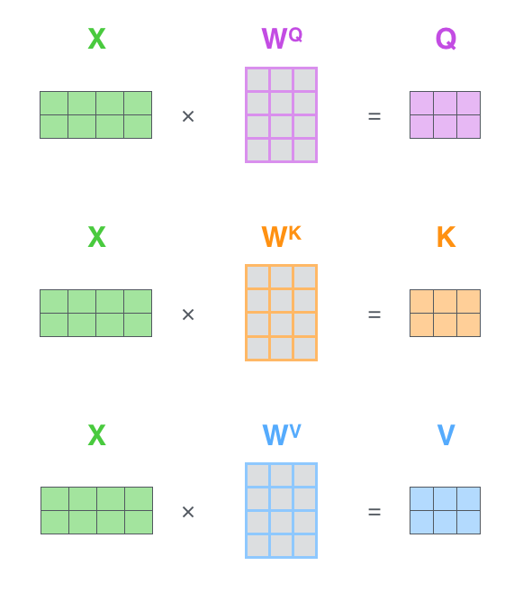

import AttentionVisualizer from '../../../components/chapter-3/AttentionVisualizer';

# 3.1 Self-Attention Mathematics

순환 모델은 정보를 순서대로 전달합니다. 첫 번째 토큰과 백 번째 토큰을 연결하려면 중간 위치들을 거치는 계산이 필요합니다. Self-attention은 각 위치가 다른 위치의 정보를 직접 읽는 방법을 학습하게 합니다. 원래 트랜스포머는 이 방식으로 학습 예제 안에서 병렬 처리를 가로막던 순환 연산을 없앴습니다 [[1]](#ref-1).

“The key to the cabinets is missing.”이라는 문장을 생각해 봅시다. “is” 위치의 표현은 문장 앞부분 전체를 하나의 순환 상태에 압축하지 않고도 “key”의 정보를 가져올 수 있습니다. 이는 구조가 허용하는 동작이지, 특정 헤드가 이 문법 관계를 실제로 학습했다는 증거는 아닙니다. 인과적 디코더는 현재와 이전 위치만 읽으며, 학습을 병렬로 한다고 자기회귀 생성까지 병렬로 되는 것은 아닙니다.

핵심은 세 단계입니다. 무엇을 찾을지 정하고, 읽을 수 있는 정보에 점수를 매긴 다음, 그 정보를 섞습니다. 파일 서랍장에 비유해 각 역할을 살펴보겠습니다.

---

### **비유: 파일 서랍장 시스템**

당신이 매우 효율적인 파일 시스템을 갖춘 도서관에서 연구를 하고 있다고 가정해 봅시다.

*   **Query ($Q$):** 이것은 당신이 찾고 있는 것입니다. 머릿속에 있는 주제입니다 (예: "새는 어떻게 나는가?").
*   **Key ($K$):** 이것들은 파일 폴더에 붙어 있는 라벨이나 태그입니다. 각 폴더에는 안에 무엇이 들어 있는지에 대한 요약이 있습니다.
*   **Value ($V$):** 이것은 폴더 안에 들어 있는 실제 내용입니다.

필요한 정보를 찾기 위해:
1.  당신의 **Query** 를 모든 **Key** 와 비교하여 어떤 폴더가 관련이 있는지 확인합니다.
2.  각 폴더에 대한 **관련성 점수 (Attention weight)** 를 계산합니다.
3.  폴더에서 **Value** 를 추출하되, 관련성 점수가 높은 폴더의 값에 더 많은 가중치를 부여합니다.

Self-attention에서는 각 토큰 위치가 query, key, value를 제공합니다. 읽을 수 있는 위치는 마스크가 정하며, 인과적 디코더는 미래 토큰을 볼 수 없습니다.

---

## 임베딩에서 Q, K, V로: 선형 투영 (Linear Projections)

실제로는 입력 단어 임베딩을 Queries, Keys, Values로 직접 사용하지 않습니다. 대신, 학습 가능한 가중치 행렬을 사용하여 이들을 서로 다른 공간으로 투영(project)합니다.

$T$를 시퀀스 길이, $d_{model}$을 임베딩 차원이라고 할 때, 행렬 $X \in \mathbb{R}^{T \times d_{model}}$로 표현되는 입력 시퀀스가 주어지면 다음과 같이 계산합니다:

$$Q = XW_Q$$
$$K = XW_K$$
$$V = XW_V$$

여기서 학습 가능한 가중치 행렬은 다음과 같습니다:
*   $W_Q \in \mathbb{R}^{d_{model} \times d_k}$
*   $W_K \in \mathbb{R}^{d_{model} \times d_k}$
*   $W_V \in \mathbb{R}^{d_{model} \times d_v}$

**왜 이렇게 할까요?**
세 역할에 모두 $X$를 쓰면 “무엇을 찾을지”, “어떻게 검색될지”, “어떤 정보를 반환할지”가 같은 표현에 묶입니다. 서로 다른 투영을 학습하면 각 역할에 필요한 특징을 따로 정할 수 있습니다. 더 깊은 층의 $X$에는 이미 앞선 층에서 얻은 문맥 정보가 들어 있으므로, 항상 정적인 단어 임베딩인 것은 아닙니다.

---

## Scaled Dot-Product Attention의 수학적 원리

Self-Attention의 핵심 연산은 **Scaled Dot-Product Attention** 입니다. 행렬 $Q, K, V$로 묶인 Query, Key, Value 세트가 주어지면, 연산은 다음과 같이 정의됩니다:

$$\text{Attention}(Q, K, V) = \text{softmax}\left(\frac{QK^T}{\sqrt{d_k}}\right)V$$

<div style={{ display: 'flex', flexDirection: 'column', alignItems: 'center', width: '100%', margin: '20px 0' }}>

<div style={{ maxWidth: '600px', width: '100%' }}>

</div>

<em style={{ marginTop: '10px', color: '#7f8c8d' }}>Source: [The Illustrated Transformer by Jay Alammar](https://jalammar.github.io/illustrated-transformer/)</em>

</div>

여기서:
*   $Q \in \mathbb{R}^{T \times d_k}$ (Query 행렬)
*   $K \in \mathbb{R}^{T \times d_k}$ (Key 행렬)
*   $V \in \mathbb{R}^{T \times d_v}$ (Value 행렬)
*   $T$는 시퀀스 길이입니다.
*   $d_k$는 Key(및 Query)의 차원입니다.
*   $\sqrt{d_k}$는 스케일링 요소입니다.

### 단계별 분석

1.  **Dot Product ($QK^T$):** 각 Query와 모든 Key 사이의 원시 유사도를 측정합니다.
2.  **Scaling ($\frac{1}{\sqrt{d_k}}$):** 내적(dot product)의 크기가 너무 커지는 것을 방지합니다. 크기가 커지면 softmax 함수가 매우 작은 기울기를 갖는 영역으로 밀려나기 때문입니다.
3.  **Softmax:** 스케일링된 점수를 합이 1이 되는 확률(attention weights)로 변환합니다.
4.  **Weighted Sum ($V$):** Attention weight에 Value를 곱하여 최종 출력을 얻습니다.

---

## PyTorch 구현

아래 작은 구현은 점수 행렬과 가중합을 직접 보여줍니다.

> **의도적으로 단순화한 구현입니다.** CPU float32 예제이며 전체 어텐션 행렬을 메모리에 만듭니다. 드롭아웃, 혼합 정밀도 누적, 융합 커널, 캐시 위치 오프셋을 생략했습니다. 마스크에서 1/True는 허용된 위치를 뜻하며 각 쿼리 행에 적어도 하나의 key가 보여야 합니다. 그렇지 않으면 이 유한값 마스크 구현은 의미 없는 분포를 만듭니다.

```python
import torch
import torch.nn as nn
import torch.nn.functional as F

def scaled_dot_product_attention(query, key, value, mask=None):
    """
    Scaled Dot-Product Attention 계산.
    """
    d_k = query.size(-1)
    
    # Step 1 & 2: 내적(Dot product) 및 스케일링
    # query shape: (batch, heads, seq_len, d_k)
    # key.transpose(-2, -1) shape: (batch, heads, d_k, seq_len)
    # scores shape: (batch, heads, seq_len, seq_len)
    scores = torch.matmul(query, key.transpose(-2, -1)) / (d_k ** 0.5)
    
    # 선택 사항: 마스크 적용 (예: 인과적 autoregressive 디코딩용)
    if mask is not None:
        scores = scores.masked_fill(mask == 0, -1e9)
    
    # Step 3: Softmax를 통한 attention weights 획득
    attention_weights = F.softmax(scores, dim=-1)
    
    # Step 4: Value의 가중 합
    # output shape: (batch, heads, seq_len, d_v)
    output = torch.matmul(attention_weights, value)
    
    return output, attention_weights

# 예제 사용법
batch_size = 1
seq_len = 4
d_k = 8
d_v = 8

# 랜덤 텐서
Q = torch.randn(batch_size, 1, seq_len, d_k)
K = torch.randn(batch_size, 1, seq_len, d_k)
V = torch.randn(batch_size, 1, seq_len, d_v)

output, weights = scaled_dot_product_attention(Q, K, V)
print("Output Shape:", output.shape)
print("Attention Weights Shape:", weights.shape)
```

---

## 예제: 어텐션 가중치 행렬

주의 가중치 한 행이 출력 벡터가 되기까지를 따라가 봅시다. 아래 예제는 네 토큰과 직접 지정한 2차원 Q, K, V 벡터를 사용합니다. 질의 토큰을 고르고 인과 마스크를 켜고 끄면서 가중치가 어떻게 달라지는지, 가중된 값들이 어떤 출력으로 합쳐지는지 확인하세요. 작은 입력에 대한 정확한 계산이며, 학습된 모델에서 측정한 주의 패턴은 아닙니다.

<AttentionVisualizer client:load lang="ko" />

---

## Quizzes

<details>
<summary>Quiz 1: Attention 공식에서 스케일링 요소 $\sqrt{d_k}$가 필요한 이유는 무엇인가요?</summary>
*Query와 key의 성분이 서로 독립이고 평균 0, 분산 1이면 내적의 분산은 $d_k$입니다. $d_k$의 제곱근으로 나누면 이 가정 아래 분산이 1 근처에 유지되어 softmax 포화를 줄입니다. 학습한 벡터가 가정을 정확히 만족할 필요는 없으며 이 스케일링만으로 학습 안정성을 보장하지도 않습니다.*
</details>

<details>
<summary>Quiz 2: Self-Attention과 일반적인 Attention (예: Bahdanau Attention)의 차이점은 무엇인가요?</summary>
*일반적인 attention은 대개 디코더 상태를 인코더 상태와 정렬합니다 (cross-attention). Self-attention은 단일 시퀀스의 서로 다른 위치들을 연결하여 동일한 시퀀스의 표현을 계산합니다 (예: 문장 내의 단어들이 같은 문장 내의 다른 단어들에 주의를 기울임).*
</details>

<details>
<summary>Quiz 3: 대화형 예제에서 인과 마스크를 켜면, 첫 토큰의 출력이 온도를 바꿔도 달라지지 않는 이유는 무엇인가요?</summary>
*첫 토큰의 질의에는 자기 자신만 보입니다. 따라서 허용된 모든 온도에서 정규화된 가중치는 1이고, 출력은 자신의 값 벡터 V₁ = [1, 0]입니다. 다른 토큰은 마스크에 의해 가중치가 0이므로 출력에 기여할 수 없습니다. 직접 지정한 이 벡터들은 계산 과정을 보여 줄 뿐, 모델이 학습한 단어 의미를 나타내지 않습니다.*
</details>

<details>
<summary>Quiz 4: 입력 임베딩을 직접 사용하지 않고 선형 투영을 통해 Q, K, V를 만드는 이유는 무엇인가요?</summary>
*무엇을 찾을지 정하는 query, 검색될 특징인 key, 반환할 정보인 value에 서로 다른 특징을 학습할 수 있습니다. 깊은 층의 입력 $X$는 이미 문맥을 반영할 수 있습니다. 핵심은 정적 표현과 문맥 표현의 구분이 아니라 역할의 분리입니다.*
</details>

<details>
<summary>Quiz 5: Self-Attention은 가변 길이 시퀀스를 어떻게 처리하나요?</summary>
*Self-attention은 행렬 연산을 기반으로 하므로 고정된 시퀀스 길이에 의존하지 않고 가변 길이 시퀀스를 자연스럽게 처리할 수 있습니다. 출력 차원은 입력 시퀀스 길이에 의해 결정되며, 길이에 관계없이 동일한 매개변수(투영 행렬)가 사용됩니다.*
</details>

<details>
<summary>Quiz 6: 시퀀스 길이가 $T$, $d_k = d_v = d_{model}$일 때 Q, K, V 투영과 어텐션 핵심 연산의 파라미터 및 지배적인 FLOPs를 구하세요. 정사각형 출력 투영을 더하면 어떻게 달라지나요?</summary>
*편향과 출력 투영을 제외하면 세 투영 행렬의 파라미터는 $3d_{model}^2$개입니다. 곱셈과 덧셈을 각각 한 FLOP으로 세면 투영에는 $6Td_{model}^2$, $QK^T$와 value 가중합에는 합계 $4T^2d_{model}$가 필요합니다. 지배적인 총량은 $6Td_{model}^2 + 4T^2d_{model}$이며, 스케일링과 softmax에 $O(T^2)$ 연산이 추가됩니다. $W_O \in \mathbb{R}^{d_{model} \times d_{model}}$를 더하면 파라미터는 $4d_{model}^2$, 지배적인 FLOPs는 $8Td_{model}^2 + 4T^2d_{model}$가 됩니다. 정규화와 피드포워드 하위 층은 이 계산에 포함하지 않습니다.*
</details>

---

## References

1. <a id="ref-1"></a>Vaswani, A., et al. (2017). *Attention is all you need*. In Advances in neural information processing systems (pp. 5998-6008). [arXiv:1706.03762](https://arxiv.org/abs/1706.03762).
