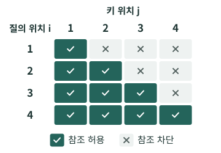

<a id="42-decoder-only-gpt-style"></a>

# 4.2 GPT와 디코더 전용 트랜스포머

학습 파일에는 `red blue`라고 쓰여 있고, 사용자는 `red`까지만 입력했습니다. GPT 방식의 디코더가 두 경우에 풀어야 할 문제는 같습니다. `red` 다음에 어떤 토큰이 올까요? 학습할 때는 정답 `blue`에 얼마의 확률을 줬는지 확인할 수 있습니다. 사용자에게 답을 보낼 때는 다음 토큰을 하나 골라야 그 뒤를 이어 갈 수 있습니다.

<a id="the-metaphor-the-autoregressive-storyteller-autoregressive-이야기꾼"></a>
<a id="shifted-target-example"></a>

## 한 줄에서 예측 세 개 만들기

색 이름 하나가 토큰 하나라고 가정하겠습니다. 시작을 표시하는 `BOS`와 끝을 표시하는 `EOS`를 붙이면, `BOS red blue EOS` 한 줄에서 다음과 같이 학습할 수 있습니다.

| 현재 위치에서 볼 수 있는 토큰 | 다음 토큰의 정답 |
| --- | --- |
| `BOS` | `red` |
| `BOS red` | `blue` |
| `BOS red blue` | `EOS` |

학습 배치에는 예문 전체가 들어 있습니다. 각 행에 넣을 정답 토큰열을 미리 알고 있으므로, 한 층 안에서 세 행을 병렬로 계산할 수 있습니다. 이렇게 정답 토큰을 다음 위치의 입력으로 쓰는 방식을 **티처 포싱(teacher forcing)** 이라고 합니다. 생성할 때는 실제로 선택한 토큰이 다음 입력을 결정합니다. `red`를 한 번 더 골랐다면, 다음 예측에 쓸 입력은 `BOS red red`입니다.

<a id="causal-self-attention-masking-the-future"></a>

## 각 위치는 어디까지 볼 수 있을까?

**인과적 셀프 어텐션** 에서 $i$번 위치의 쿼리는 $j \le i$인 위치의 키를 참조할 수 있습니다. 따라서 `red` 위치에서는 자기 자신까지 봅니다. 이때 맞혀야 하는 `blue`는 대각선에서 한 칸 더 오른쪽에 있습니다.

<figure style={{ margin: '1.5rem 0' }}>



<figcaption>3번 위치에서는 1·2·3번 키를 볼 수 있습니다. 그림은 인과적 마스크의 규칙에 따라 그렸습니다. 허용된 위치에 줄 가중치는 모델이 쿼리와 키로 계산합니다.</figcaption>
</figure>

<a id="core-training-objective-causal-language-modeling-clm"></a>
<a id="clm의-수학적-정의"></a>

## 정답 토큰에는 얼마의 확률을 줬을까?

시작 토큰 `BOS`를 $x_0$, `EOS`까지 예측할 토큰 $T$개를 $x_1,\ldots,x_T$라고 하겠습니다. $x_{0:t-1}$은 $t$번째 정답을 맞힐 때 볼 수 있는 토큰열입니다. 파라미터가 $\theta$인 인과적 언어 모델에서 이 토큰들이 차례로 나올 조건부 확률은 다음과 같습니다.

$$
P_\theta(x_{1:T}\mid x_0)=\prod_{t=1}^T P_\theta(x_t\mid x_{0:t-1}).
$$

정답 토큰 하나당 평균 학습 손실은 $-\frac{1}{T}\sum_{t=1}^T \log P_\theta(x_t\mid x_{0:t-1})$입니다. 세 위치에서 정답에 각각 0.6, 0.5, 0.7의 확률을 줬다고 해 봅시다. 세 토큰이 그대로 이어질 확률은 $0.6\times0.5\times0.7=0.21$이고, 평균 손실은 토큰당 약 0.520나트(nat)입니다.

<a id="pytorch-implementation-causal-mask"></a>

### 파이토치로 마스크와 정답 위치 확인하기

CPU에서 실행하는 예제입니다. 패딩이 없는 토큰열 하나와 미리 정한 확률을 써서 손으로도 손실을 검산할 수 있습니다. 그림에는 1번부터 4번까지 네 위치가 있지만 코드에서는 3×3 마스크로 충분합니다. `EOS`는 마지막 정답이고 그 뒤에는 맞혀야 할 토큰이 없기 때문입니다. 아래에서 어텐션 점수와 다음 토큰의 확률 분포는 서로 다른 값입니다.

```python
import torch
import torch.nn.functional as F

bos, red, blue, eos = range(4)
sequence = torch.tensor([bos, red, blue, eos])
inputs, targets = sequence[:-1], sequence[1:]
positions = torch.arange(len(inputs))
allowed = positions[:, None] >= positions[None, :]
scores = torch.tensor([[1., 2., 3.], [0., 1., 2.], [2., 0., 1.]])
attention = scores.masked_fill(~allowed, -torch.inf).softmax(dim=-1)
assert attention[1, 2] == 0 and attention[1, 1] > 0

# One vocabulary distribution per prefix, in BOS/red/blue/EOS column order.
probs = torch.tensor([[.1, .6, .2, .1], [.1, .1, .5, .3], [.1, .1, .1, .7]])
loss = F.cross_entropy(probs.log(), targets)
print(f"{loss.item():.3f}")  # 0.520
assert probs[1].argmax().item() == blue
```

프롬프트가 `BOS red`일 때 확률이 가장 높은 토큰만 고르는 탐욕적 디코딩을 쓰면, 마지막 줄처럼 둘째 행에서 `blue`를 선택합니다. 이제 입력이 `BOS red blue`이므로 셋째 행의 확률을 쓸 수 있습니다. 샘플링에서 다른 토큰을 뽑았다면, 그 토큰까지 포함한 새 입력의 확률 분포를 구해야 합니다.

<a id="evolution-and-key-models"></a>
<a id="1-gpt-3-2020"></a>
<a id="2-llama-3-2024"></a>
<a id="decoder-only-모델-비교"></a>

## GPT-3와 Llama 3의 초기 구성

각 모델의 최초 공개 자료에 기록된 사양입니다(2026-11-25 확인). 두 모델은 서로 다른 토크나이저로 학습 토큰 수를 셌습니다.

| 모델 | 사전 학습 토큰 | 컨텍스트 길이 | 어텐션 구성 |
| --- | ---: | ---: | --- |
| GPT-3 175B (2020) [[1]](#ref-1) | 3,000억 | 2,048 | 밀집 어텐션 층과 가까운 위치만 참조하는 희소 어텐션 층을 번갈아 사용 |
| Llama 3 8B·70B (2024년 4월) [[3]](#ref-3) | 15조 초과 | 8,192 | 여러 쿼리 헤드가 키와 값 헤드를 공유하는 GQA 사용 |

Meta의 후속 기술 보고서는 4월의 Llama 3와 7월의 Llama 3.1을 구분합니다. 서빙 설정을 정할 때는 모델 계열의 이름뿐 아니라 어느 버전의 체크포인트를 쓸지도 확인해야 합니다 [[2]](#ref-2).

<a id="why-decoder-only-won-the-scaling-war-왜-decoder-only가-승리했는가"></a>
<a id="1-the-power-of-a-unified-objective-통합된-목표의-힘"></a>
<a id="3-in-context-learning-and-prompting-인컨텍스트-러닝과-프롬프팅"></a>

## 규모와 프롬프트 실험에서 확인한 것

Kaplan 등의 연구진은 모델 크기와 학습 데이터, 연산량을 바꿔 가며 실험했습니다. 실험 범위 안에서 평가용 텍스트의 언어 모델 손실은 대략 거듭제곱 법칙을 따랐습니다. 이 손실로 알 수 있는 것은 평가 데이터에 나온 토큰에 모델이 어느 정도의 확률을 주느냐입니다. 번역 오류가 줄었는지, 추론 문제를 맞혔는지는 별도로 평가해야 합니다 [[4]](#ref-4).

Brown 등의 연구진은 GPT-3의 가중치를 고정하고 지시문을 줬습니다. 퓨샷 조건에서는 프롬프트에 풀이 예시도 넣었습니다. 번역을 비롯한 일부 과제에서 모델은 예시를 활용했지만, 두 문장에서 같은 단어가 같은 뜻인지 묻는 Word-in-Context의 퓨샷 정확도는 49.4%로 우연히 고를 때와 비슷했습니다. 실험으로 관찰한 것은 주어진 프롬프트와 과제에서의 행동입니다. 모델 내부에서 그 답을 어떻게 얻었는지까지 가려내지는 못합니다 [[1]](#ref-1).

인컨텍스트 학습을 직접 확인하려면 감정 분류에 `A`와 `B`라는 임의의 레이블을 써 보세요. 긍정 후기와 부정 후기의 예시를 하나씩 보여 준 뒤, 예시의 레이블을 서로 바꿔 같은 평가용 후기들을 다시 분류합니다. 새 규칙에 맞게 예측이 바뀌는 비율은 얼마인가요? `긍정`·`부정`처럼 익숙한 레이블을 쓰면 예시가 답에 얼마나 기여했는지 구별하기 어렵습니다.

<a id="2-architectural-simplicity-and-scaling-아키텍처의-단순성과-스케일링"></a>
<a id="4-zero-overhead-for-task-specificity-과업-특화-오버헤드-제로"></a>
<a id="5-kv-caching-efficiency-kv-캐싱의-효율성"></a>

## 첫 토큰을 내기 전과 후에 서버가 하는 일

디코더 전용 모델은 같은 층으로 프롬프트를 읽고 출력을 이어 씁니다. 컨텍스트 한도가 2,048토큰이고 프롬프트가 1,800토큰이면, 특수 토큰까지 포함해 248토큰을 더 담을 수 있습니다. 인코더와 디코더가 따로 있어도 여러 과제를 텍스트로 표현할 수 있습니다. 예를 들어 T5는 번역과 분류 모두에서 인코더로 입력을 읽고 디코더로 정답 텍스트를 생성했습니다 [[6]](#ref-6).

**프리필(prefill)** 에서는 프롬프트의 여러 위치를 각 층에서 병렬로 처리하고, 각 위치의 키와 값(K와 V)을 저장합니다. 첫 출력 토큰은 마지막 위치에서 예측합니다. 이어지는 **디코드(decode)** 에서는 방금 고른 토큰을 처리하면서 K와 V를 캐시에 추가하고, 그 위치의 쿼리로 이전 토큰들과 현재 토큰을 참조합니다. 저장해 둔 키와 값은 다시 계산할 필요가 없습니다. 하지만 전체 어텐션을 쓰면 새 쿼리가 읽을 캐시의 길이는 토큰을 생성할수록 늘어납니다.

인코더-디코더 모델에서도 디코더의 셀프 어텐션 K와 V를 캐시에 저장할 수 있습니다. 원문이 고정되어 있다면 인코더는 한 번만 실행하고, 인코더 출력에서 구한 크로스 어텐션용 K와 V도 생성 단계마다 재사용할 수 있습니다 [[5]](#ref-5). 두 서빙 시스템을 비교할 때는 입력·출력 길이, 배치 크기, 하드웨어를 맞추세요. 첫 토큰까지 걸리는 시간, 그 뒤 토큰 사이의 간격, 최대 메모리 사용량을 나눠 재면 긴 프롬프트와 긴 답변이 각각 어느 단계에 부담을 주는지 볼 수 있습니다. [12.1절의 KV 메모리 계산 예제](/ko/chapter-12/kv-cache-management/#mixed-request-budget)에서는 길이가 다른 요청을 한 배치에 넣으면 필요한 메모리가 얼마나 달라지는지 확인할 수 있습니다.

## Quizzes

<details>
<summary>Quiz 1: `red` 위치에서 자기 자신을 볼 수 있어도 정답이 새지 않는 이유는 무엇인가요?</summary>
*그 위치에서 맞혀야 하는 정답은 `blue`입니다. 인과적 마스크는 `BOS`와 `red`까지 허용하고 `blue`가 있는 위치는 가립니다.*
</details>

<details>
<summary>Quiz 2: 세 위치의 학습 손실을 한 번에 계산하면서도 세 토큰을 독립적으로 생성할 수 없는 이유는 무엇인가요?</summary>
*학습할 때는 각 위치에서 참조하는 토큰열이 예문에 들어 있습니다. 생성할 때는 첫 토큰으로 무엇을 고르는지에 따라 다음 예측의 입력이 달라집니다.*
</details>

<details>
<summary>Quiz 3: 예시를 두 개 줬더니 모델이 후기를 올바르게 분류했습니다. 예시의 레이블을 바꿔 보면 무엇을 확인할 수 있을까요?</summary>
*레이블을 바꾼 예시로 같은 평가용 후기들을 다시 분류합니다. 모델이 바뀐 규칙을 따른다면 프롬프트 안의 대응 관계가 예측에 영향을 줬다는 근거가 됩니다. 처음에 답 하나를 맞힌 것만으로는 이를 구별하기 어렵습니다.*
</details>

<details>
<summary>Quiz 4: 마스크에서 허용된 영역이 삼각형이면 그 안의 어텐션 가중치도 모두 같을까요?</summary>
*허용된 각 키의 가중치는 쿼리와 키의 점수에 행별 소프트맥스를 적용해 구합니다. 가려진 키의 가중치는 0입니다. 코드 예제의 둘째 행처럼 참조가 허용된 키끼리도 가중치는 다를 수 있습니다.*
</details>

<details>
<summary>Quiz 5: 인코더-디코더 모델이 번역문을 길게 생성하면 어느 쪽 캐시가 늘어날까요?</summary>
*디코더가 생성 토큰을 처리할 때마다 그 토큰의 키와 값이 셀프 어텐션 캐시에 추가됩니다. 원문은 그대로이므로 크로스 어텐션용 키와 값의 길이도 그대로입니다.*
</details>

<details>
<summary>Quiz 6: 전체 어텐션을 쓰는 디코더에서 2,048토큰 시퀀스 한 개의 KV 데이터는 얼마나 클까요?</summary>
*층 수가 $L$, 저장된 토큰 수가 $S$, 층당 KV 헤드 수가 $H$, 헤드 차원이 $D$, 원소당 바이트 수가 $p$라면 크기는 $2LSHDp$바이트입니다. 키와 값을 모두 저장하므로 2를 곱합니다. $L=32$, $S=2048$, $H=32$, $D=128$이고 FP16($p=2$)을 쓰면 정확히 1 GiB인 1,073,741,824바이트입니다. 메모리 할당에 드는 부가 공간과 모델 가중치는 별도입니다.*
</details>

## References

1. <a id="ref-1"></a>Brown, T. B., et al. (2020). *Language Models are Few-Shot Learners*. [논문](https://arxiv.org/abs/2005.14165).
2. <a id="ref-2"></a>Grattafiori, A., et al. (2024). *The Llama 3 Herd of Models*. [논문](https://arxiv.org/abs/2407.21783).
3. <a id="ref-3"></a>Meta (2024). *Llama 3 Model Card*. [4월 공개 모델 카드](https://github.com/meta-llama/llama3/blob/main/MODEL_CARD.md).
4. <a id="ref-4"></a>Kaplan, J., et al. (2020). *Scaling Laws for Neural Language Models*. [논문](https://arxiv.org/abs/2001.08361).
5. <a id="ref-5"></a>Hugging Face. *Transformers 4.57.1: EncoderDecoderCache*. [캐시 문서](https://huggingface.co/docs/transformers/v4.57.1/en/internal/generation_utils#transformers.EncoderDecoderCache).
6. <a id="ref-6"></a>Raffel, C., et al. (2020). *Exploring the Limits of Transfer Learning with a Unified Text-to-Text Transformer*. [논문](https://jmlr.org/papers/v21/20-074.html).
