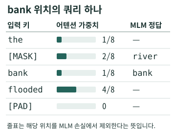

<a id="41-encoder-only-bert-style"></a>

# 4.1 BERT와 인코더 전용 트랜스포머

*the bank flooded*와 *the bank lent money*를 비교해 보세요. `bank` 왼쪽은 같지만 뒤에 `flooded`가 오면 강둑, `lent`가 오면 은행으로 읽힙니다. 인코더는 오른쪽 단어까지 반영해 `bank`를 서로 다른 벡터로 표현할 수 있습니다. 분류기는 그 벡터로 단어의 뜻을 판별할 수 있습니다. 인과적 디코더에서는 **`bank` 위치의 벡터** 를 계산하는 시점에 뒤의 동사를 참조할 수 없습니다. 동사 뒤에 오는 위치라면 두 단어를 모두 참조할 수 있습니다.

<a id="the-metaphor-the-detective-vs-the-storyteller-탐정과-이야기꾼"></a>
<a id="bidirectional-attention-all-to-all-connectivity"></a>
<a id="mlm-target-example"></a>

## `bank`가 읽을 단어와 모델이 맞힐 단어

`the river bank flooded` 뒤에 패딩 한 칸을 붙여 다섯 자리 입력을 만듭니다. 이 예제에서는 각 단어가 토큰 하나입니다. 학습에서 맞힐 위치로 `river`와 `bank`를 고른 다음, `river`는 `[MASK]`로 바꾸고 `bank`는 그대로 둡니다. 인코더에 보이는 입력은 `the [MASK] bank flooded [PAD]`입니다.

BERT의 밀집 셀프 어텐션 층에서 `bank`의 쿼리는 **패딩을 제외한 모든 입력 위치** 의 키와 값을 읽을 수 있습니다. 자기 자신과 `[MASK]`도 여기에 포함됩니다. 이때 쓰는 쿼리, 키, 값은 모두 이 층에 *들어오는* 표현에서 구합니다. 패딩 마스크로 `[PAD]` 키를 제외하고, 남은 키에 얼마의 가중치를 줄지는 쿼리와 키의 점수로 계산합니다.

<figure style={{ margin: '1.5rem 0' }}>



<figcaption>손으로 계산할 수 있도록 허용된 키 네 개의 점수를 차례로 0, ln 2, 0, ln 4로 정했습니다. 소프트맥스를 적용하면 지수 값 1, 2, 1, 4를 합계 8로 나눈 가중치가 나옵니다. 마지막 열은 각 위치에서 맞혀야 할 원래 토큰입니다.</figcaption>
</figure>

`flooded`는 이 쿼리에서 가중치를 절반이나 받지만, 그 위치에 맞혀야 할 정답은 없습니다. `[MASK]`는 어텐션에서 볼 수 있고 그 자리의 정답은 `river`입니다. 그대로 남겨 둔 `bank`도 채점합니다. 어텐션 마스크는 **어느 입력을 참조할지**, 손실 마스크는 **어느 위치의 예측을 채점할지** 정합니다.

<a id="core-training-objective-masked-language-modeling-mlm"></a>
<a id="mlm-작동-방식"></a>
<a id="mlm의-수학적-정의"></a>

## 마스크드 언어 모델링에서 점수를 매기는 법

BERT 원 논문에서 Devlin 등은 WordPiece 위치의 15%를 예측 대상으로 뽑았습니다. **선택된 위치 중** 80%는 `[MASK]`로 바꾸고, 10%는 무작위 토큰으로 바꾸고, 10%는 원래 토큰을 그대로 뒀습니다. 세 경우 모두 원래 토큰의 ID가 정답입니다. 위 예제에서는 두 경우를 한눈에 비교하려고 의도적으로 두 위치를 골랐습니다 [[2]](#ref-2).

선택한 위치들의 집합을 $M$, 위치 $i$의 원래 토큰을 $x_i$, 토큰을 바꾼 뒤의 입력을 $\tilde{x}$라고 하겠습니다. $M$이 비어 있지 않을 때 마스크드 언어 모델링(masked language modeling, MLM)의 평균 손실은 다음과 같습니다.

$$
\mathcal L_{\rm MLM}=-\frac{1}{|M|}\sum_{i\in M}\log P_\theta(x_i\mid\tilde{x},i).
$$

파라미터가 $\theta$인 모델이 맞힐 단어는 입력과 **같은 위치** 의 원래 토큰입니다. `[MASK]` 위치의 어휘 분포에서 `river`에 0.5, 그대로 둔 `bank` 위치에서 `bank`에 0.25의 확률을 줬다고 해 봅시다. 평균 손실은 정답 하나당 $-(\log 0.5+\log 0.25)/2\approx1.040$나트입니다. `input_id == mask_id`인 행만 골라 채점하면 이 예제에서 확률이 더 낮았던 정답이 빠져 0.693이 됩니다. 인과적 언어 모델에서 정답을 한 칸 옮기는 방식은 [4.2절의 정답 세 개 예제](/ko/chapter-4/decoder-only/#shifted-target-example)에서 비교해 볼 수 있습니다.

<a id="pytorch-implementation-mlm-head"></a>

### 파이토치로 두 손실값 확인하기

패딩이 있는 시퀀스 하나를 CPU에서 계산하는 예제입니다. 손으로 검산할 수 있도록 어텐션 점수와 어휘 로짓을 직접 지정했습니다. 학습된 인코더라면 어텐션 점수는 각 헤드에서, 어휘 로짓은 마지막 층의 은닉 상태에서 구합니다. 이 예제에서는 시작·종료 특수 토큰, 무작위 토큰 치환, 옵티마이저 업데이트, 배치 처리를 생략했습니다.

```python
import math
import torch
import torch.nn.functional as F

pad, mask, the, river, bank, flooded = range(6)
original = torch.tensor([the, river, bank, flooded, pad])
inputs = original.clone()
inputs[1] = mask
selected = torch.tensor([False, True, True, False, False])
labels = original.masked_fill(~selected, -100)

# One query at bank, five keys. The last key is padding.
scores = torch.log(torch.tensor([1., 2., 1., 4., 100.]))
weights = scores.masked_fill(inputs == pad, -torch.inf).softmax(dim=0)
torch.testing.assert_close(weights, torch.tensor([1., 2., 1., 4., 0.]) / 8)

# Five positions, six vocabulary entries per position.
logits = torch.zeros(5, 6)
logits[1] = torch.tensor([.1, .1, .1, .5, .1, .1]).log()
logits[2] = torch.tensor([.15, .15, .15, .15, .25, .15]).log()
loss = F.cross_entropy(logits, labels, ignore_index=-100)
assert math.isclose(loss.item(), -(math.log(.5) + math.log(.25)) / 2, rel_tol=1e-6)
logits[4, pad] = 100  # The ignored padding position has no direct loss.
torch.testing.assert_close(F.cross_entropy(logits, labels), loss)
only_mask = inputs == mask
print(f"{loss.item():.3f}", f"{F.cross_entropy(logits[only_mask], labels[only_mask]).item():.3f}")
```

출력은 `1.040 0.693`입니다. 채점에서 빠지는 패딩 위치의 로짓을 바꿔도 첫 번째 손실은 그대로입니다. 두 번째 계산에서는 입력을 그대로 두고 `[MASK]` 위치의 예측만 채점했습니다. 실제 배치에서는 손실을 평균 내기 전 모든 예제에서 무시되지 않은 레이블 수를 세야 합니다. 배치 전체에 유효한 레이블이 하나도 없다면 평균을 구할 수 없습니다.

<a id="evolution-and-key-models"></a>
<a id="0-the-precursor-elmo-and-the-sesame-street-naming-trend"></a>

## 양방향으로 문맥을 읽는 두 가지 방법

ELMo는 왼쪽에서 오른쪽으로 읽는 LSTM 언어 모델과 반대로 읽는 LSTM 언어 모델의 상태를 조합해 문맥 벡터를 만들었습니다. BERT에서는 인코더의 각 층 안에서 한 위치의 표현에 양쪽 문맥이 함께 반영됩니다. 위 예제의 밀집 층에서는 `bank` 위치의 쿼리가 오른쪽의 `flooded`를 바로 참조할 수 있습니다 [[1]](#ref-1) [[2]](#ref-2).

<a id="1-bert-2018"></a>
<a id="2-roberta-2019"></a>
<a id="3-modernbert-2024"></a>
<a id="encoder-only-모델-비교"></a>

### 세 모델의 학습 구성 비교

각 모델이 발표될 당시의 구성을 2026-11-25에 확인했습니다. 세 연구가 실험한 내용은 서로 다릅니다.

| 모델 | 연구진이 실험한 내용 | 모델을 쓸 때 확인할 점 |
| --- | --- | --- |
| BERT (2018) [[2]](#ref-2) | 밀집 인코더를 MLM과 다음 문장 예측(NSP)으로 사전 학습했습니다. NSP는 두 문장이 원문에서 이어지는지 분류하는 과제입니다. | 특수 토큰을 포함한 입력 한도는 WordPiece 토큰 512개입니다. 정답 구간을 찾는 헤드를 학습하면 각 위치에서 답이 시작하고 끝날 점수를 구할 수 있습니다. |
| RoBERTa (2019) [[3]](#ref-3) | 미리 정한 마스킹 패턴과 다시 뽑는 패턴을 비교했습니다. 입력을 묶는 방식도 바꾸고 NSP를 뺐으며, 데이터 양과 학습 시간도 늘려 실험했습니다. | 마스킹 방식을 비교한 실험에서 동적 마스킹은 비슷하거나 조금 나은 성능을 보였습니다. 작은 데이터 조건의 텍스트는 약 16 GB, 최종 구성은 약 160 GB였습니다. 최종 성능의 차이에서 마스킹이나 NSP만의 기여분을 읽어 낼 수는 없습니다. |
| ModernBERT (2024) [[4]](#ref-4) | 회전 위치 임베딩을 쓰고 최대 8,192토큰의 입력을 학습했습니다. 세 층마다 한 층은 전역 어텐션을, 나머지 층은 128토큰의 지역 윈도 어텐션을 사용합니다. | 지역 층에서는 윈도 안의 양쪽을 보고, 멀리 떨어진 토큰은 전역 층에서 직접 연결할 수 있습니다. 패딩 제거로 절약할 수 있는 연산량은 배치 안의 시퀀스 길이 분포에 달려 있습니다. |

<a id="why-encoder-only-models-still-matter-왜-encoder-only-모델이-여전히-쓰이는가"></a>

## 필요한 출력에서 출발하기

계좌 번호가 있는 구간을 표시하려면 각 위치별 예측이 필요합니다. 문서를 검색하려면 쿼리와의 유사도로 관련 문서를 높은 순위에 놓을 수 있는 임베딩이 필요합니다. 인코더는 양쪽에 쓸 특징을 만들 수 있지만, 원래의 `[CLS]` 벡터만 꺼냈을 때 검색이 잘된다는 보장은 없습니다. 토큰을 어떻게 풀링했는지 기록하고, 그럴듯한 오답 문서를 포함한 평가용 쿼리에서 재현율을 측정하세요. 디코더도 프롬프트를 한 번 처리하면 마지막 위치에 앞 문맥을 반영할 수 있습니다. 어떤 구조를 쓸지는 실제 요청의 품질과 지연 시간, 배치 형태에 맞춰 결정하는 편이 좋습니다.

## Quizzes

<details>
<summary>Quiz 1: `bank`의 쿼리에서 `[MASK]` 위치를 볼 수 있나요?</summary>
*그 위치에서는 `[MASK]`의 임베딩을 봅니다. 예제에서 해당 키가 받는 가중치는 2/8입니다. 원래 있었던 `river`는 입력에서 교체됐고 학습 정답으로 쓰입니다.*
</details>

<details>
<summary>Quiz 2: `input_id == mask_id`인 위치만 채점하면 왜 손실이 달라질까요?</summary>
*선택됐지만 그대로 남은 위치나 다른 일반 토큰으로 교체된 위치가 빠집니다. 예제에서는 `bank`의 정답 확률 0.25가 빠지고 `river`의 0.5만 남아 손실이 0.693나트가 됩니다.*
</details>

<details>
<summary>Quiz 3: 직접 채점하지 않는 토큰도 학습 업데이트에 영향을 줄 수 있나요?</summary>
*그렇습니다. 선택되지 않은 `flooded`는 `bank`의 쿼리에서 참조할 수 있습니다. 값 벡터가 채점 대상의 예측에 기여하면 그 경로로 그래디언트를 받습니다. 패딩 키는 어텐션에서 제외하므로 이 쿼리로 이어지는 경로가 없습니다.*
</details>

<details>
<summary>Quiz 4: RoBERTa의 최종 점수로 NSP를 빼서 얼마나 좋아졌는지 알 수 있을까요?</summary>
*최종 학습에서는 데이터 양과 학습 시간 등 여러 조건을 바꿨습니다. NSP만의 효과를 확인하려면 데이터, 입력 시퀀스 구성, 토큰 치환 방식, 학습 예산을 맞추고 NSP 포함 여부만 바꾼 실험을 비교해야 합니다.*
</details>

<details>
<summary>Quiz 5: ModernBERT의 어텐션 헤드 하나가 수천 토큰 떨어진 두 단어를 직접 연결할 수 있을까요?</summary>
*두 단어가 모두 입력에 들어 있고 해당 키를 볼 수 있다면 전역 층에서는 가능합니다. 128토큰 지역 층에서는 주변 윈도만 직접 볼 수 있습니다. 앞선 층을 거쳐 먼 문맥이 간접적으로 전달될 수도 있습니다.*
</details>

## References

1. <a id="ref-1"></a>Peters, M. E., et al. (2018). *Deep contextualized word representations*. [논문](https://arxiv.org/abs/1802.05365).
2. <a id="ref-2"></a>Devlin, J., et al. (2018). *BERT: Pre-training of Deep Bidirectional Transformers for Language Understanding*. [논문](https://arxiv.org/abs/1810.04805).
3. <a id="ref-3"></a>Liu, Y., et al. (2019). *RoBERTa: A Robustly Optimized BERT Pretraining Approach*. [논문](https://arxiv.org/abs/1907.11692).
4. <a id="ref-4"></a>Warner, B., et al. (2024). *Smarter, Better, Faster, Longer: A Modern Bidirectional Encoder for Fast, Memory Efficient, and Long Context Finetuning and Inference*. [논문](https://arxiv.org/abs/2412.13663).
