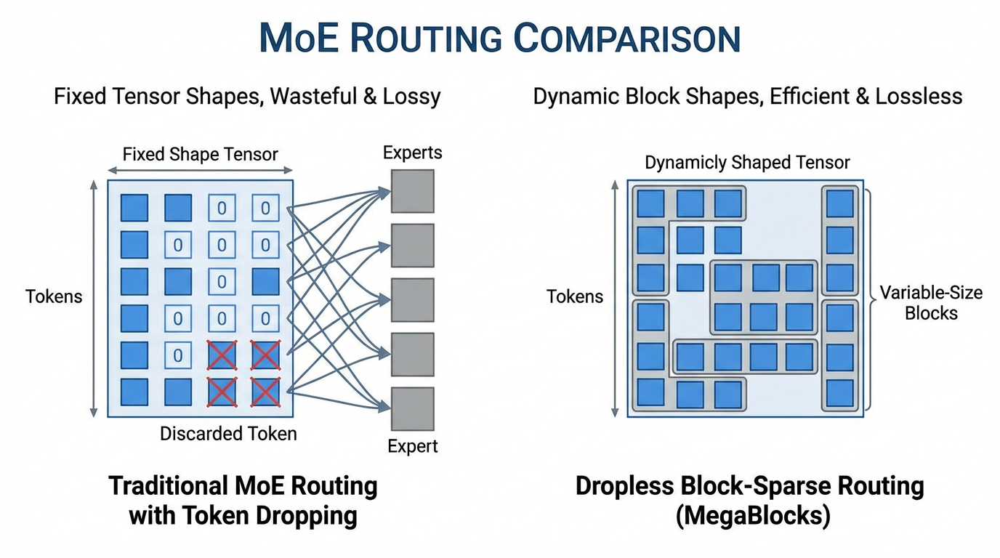

# 5.5 사례 연구: MoE 아키텍처와 시스템 절충


MoE는 모델 용량과 토큰당 연산을 분리하는 설계입니다. Dense 블록은 토큰마다 전체 변환을 실행하고 MoE는 expert를 선택적으로 활성화합니다. 임베딩 lookup과 공유 구성 요소는 별도 회계가 필요합니다. 활성 연산을 줄일 수 있지만 실제 지연은 dispatch·메모리 전송·배치에 달려 있습니다.

이번 케이스 스터디에서는 네 가지 기념비적인 **MoE** 아키텍처인 **Mixtral 8x7B** , **DBRX** , **Grok-1** , 그리고 **DeepSeek-V3** 를 기술적으로 해부해 보겠습니다. 단순히 스펙을 나열하는 것을 넘어, 각 연구팀이 규모와 효율성의 파레토 프론티어(Pareto frontier)를 돌파하기 위해 선택한 구체적인 엔지니어링 트레이드오프와 라우팅 혁신을 분석합니다.

---

## 1. Mixtral 8x7B: 오픈소스 MoE의 촉매제

Mistral AI가 2023년 말에 출시한 **Mixtral 8x7B** [[1]](#ref-1) 는 **MoE** 아키텍처를 대중적인 오픈소스 생태계로 이끈 촉매제였습니다. 이 모델은 **MoE** 가 GPT-4와 같은 빅테크 기업의 조 단위 파라미터 모델 전유물이라는 환상을 깨뜨렸습니다.

### "8x7B"라는 이름의 오해
"8x7B"라는 이름은 훌륭한 마케팅 용어이지만, 기술적으로는 오해의 소지가 있습니다. 가장 흔한 오해는 Mixtral이 70억(7B) 개의 파라미터를 가진 독립적인 모델 8개의 앙상블이며, 따라서 총 560억(56B) 개의 파라미터를 가질 것이라는 생각입니다. 하지만 실제 Mixtral의 총 파라미터 수는 **47B** 개이며, 특정 토큰에 대한 포워드 패스(Forward pass) 동안 활성화되는 파라미터는 **13B** 개뿐입니다.

왜 47B일까요? Transformer 아키텍처에서 Self-Attention 메커니즘과 토큰 임베딩은 모든 전문가(Expert) 간에 **공유** 됩니다. 오직 Feed-Forward Network (FFN) 레이어만이 복제됩니다. 
Dense 7B 모델의 어텐션 파라미터를 $P_{attn}$ , FFN 파라미터를 $P_{ffn}$ 이라고 할 때, Mixtral의 대략적인 총 파라미터 수는 다음과 같이 계산됩니다.

$$ P_{total} = P_{attn} + (8 \times P_{ffn}) \approx 47B $$

### 라우팅 메커니즘 (Routing Mechanism)
Mixtral은 8개의 전문가 중 2개를 선택하는 표준적인 Top-2 라우팅 메커니즘($K=2, N=8$)을 사용합니다. 주어진 입력 상태 $x$ 에 대해, 라우터는 Top-2 로짓(Logits)에 소프트맥스(Softmax)를 적용하여 게이팅 벡터 $G(x)$ 를 계산합니다. **MoE** 레이어의 출력은 선택된 두 전문가의 가중합(Weighted sum)이 됩니다.

$$ y = \sum_{i=1}^{2} G(x)_i E_i(x) $$

토큰당 단 두 개의 전문가만 활성화하므로 Mixtral은 약 13B의 active parameter만 계산하면서 47B의 전체 parameter를 유지합니다. 다만 이 숫자가 dense 13B와 같은 latency를 보장하지는 않습니다. 모든 expert weight를 메모리에 올려야 하고, routing communication과 batch shape에 따른 kernel utilization 차이가 남습니다. 그럼에도 Mixtral은 sparse MoE가 효율적으로 학습되고, 양자화하면 hyperscaler 밖에서도 배포될 수 있음을 보여 주었습니다.

---

## 2. DBRX: Fine-Grained 전문가의 힘

Mixtral이 Coarse-Grained (거친 입자의) **MoE** 의 실행 가능성을 증명했다면, Databricks의 **DBRX** 는 MegaBlocks 프레임워크 [[2]](#ref-2) 를 기반으로 한 **Fine-Grained (세밀한) MoE 아키텍처** 를 도입하여 다른 길을 개척했습니다.

### 조합의 폭발 (Combinatorial Explosion)
**DBRX** 는 총 132B 파라미터를 가지며, 활성 파라미터는 36B입니다. 8개의 거대한 전문가 중 2개를 선택하는 대신, **DBRX** 는 **16개의 더 작은 전문가를 사용하고 4개를 선택** ($K=4, N=16$) 합니다.

Mixtral과 **DBRX** 모두 사용 가능한 FFN 파라미터의 25%를 활성화하지만, 표현력(Representation power) 측면에서 수학적 의미는 완전히 다릅니다. 단일 레이어를 통과할 때 토큰이 취할 수 있는 가능한 라우팅 조합(전문가 경로)의 수는 이항 계수 $\binom{N}{K}$ 로 결정됩니다.

*   **Mixtral (8 choose 2):** $\binom{8}{2} = 28$ 개의 가능한 경로.
*   **DBRX (16 choose 4):** $\binom{16}{4} = 1820$ 개의 가능한 경로.

DBRX는 레이어당 순서 없는 expert 부분집합을 약 65배 많이 제공합니다. 그러나 조합 수만으로 학습된 전문화·실제 표현력·품질을 측정할 수는 없습니다. expert 크기·routing·데이터·최적화도 다릅니다.

### Dropless Routing (MegaBlocks)
전통적인 **MoE** 구현은 GPU 연산을 위한 정적 텐서(Static tensor) 형태를 유지하기 위해 각 전문가에게 엄격한 "용량 계수(Capacity factor)"를 강제합니다. 만약 한 전문가에게 너무 많은 토큰이 몰리면, 초과된 토큰은 단순히 **버려집니다 (Dropped)**. 즉, FFN 처리를 거치지 않고 Residual connection을 통해 그대로 통과하게 되어 성능 저하를 유발합니다.

**DBRX** 는 Block-Sparse 행렬 곱셈을 사용하여 **MoE** 연산을 재구성한 MegaBlocks를 활용합니다. 이를 통해 전문가의 크기를 동적으로 조정할 수 있으며, 토큰이 버려지는 현상을 완전히 제거하는 **Dropless Routing** (드롭리스 라우팅)을 구현합니다. 또한 활용도가 낮은 전문가를 패딩(Padding)하는 데 낭비되는 연산량도 방지합니다.


*출처: AI 생성 이미지*

---

## 3. Grok-1: 브루트 포스 스케일링 (Brute Force Scaling)

xAI가 개발한 **Grok-1** [[3]](#ref-3) 은 무식할 정도의 크기 확장이 가진 힘을 보여줍니다. 오픈 소스로 공개될 당시, 이 모델은 무려 **314B** 에 달하는 총 파라미터를 자랑하며 현존하는 가장 큰 오픈 소스 모델 중 하나로 자리 잡았습니다.

Grok-1은 Top-2 expert routing을 사용합니다 [[3]](#ref-3). 여덟 expert 중 둘을 고른다고 전체 파라미터의 정확히 1/4이 활성화되는 것은 아닙니다. 공유 어텐션·임베딩·expert 크기도 포함해야 합니다. 총파라미터의 단순 비율로 문서화된 활성 파라미터 정의를 대신하지 않습니다.

314B 파라미터의 16비트 가중치 payload만 약 628 GB입니다. KV 상태·activation·workspace·할당 여유·통신은 제외한 값입니다. 필요한 device 수는 사용 가능한 메모리와 배치 방식에 달려 있으며, 8대 노드라고 전체 서빙 작업이 들어간다는 보장은 아닙니다.

---

## 4. DeepSeek-V3: routing·정밀도·시스템의 결합

2024년 DeepSeek-V3 보고서는 희소 expert·latent attention·FP8 학습·multi-token prediction의 결합을 문서화합니다 [[4]](#ref-4). GPU-hour 회계는 보고한 학습 단계의 값이며 전체 연구·실패 실험·데이터 준비·배포 비용은 아닙니다. 경쟁 모델의 연산량이 미공개라면 정량적 비용 비율을 주장할 수 없습니다.

**DeepSeek-V3** 는 총 **671B** 의 파라미터를 가지지만, 토큰당 활성 파라미터는 **37B** 에 불과합니다. 전체 파라미터의 약 5.5%만 활성화하는 이 극단적인 희소성(Sparsity)은 몇 가지 급진적인 아키텍처 혁신을 통해 달성되었습니다.

### DeepSeekMoE: Shared + Fine-Grained Routed Experts
표준 라우팅 풀(Pool)을 사용하는 대신, **DeepSeek-V3** 는 FFN을 두 가지 서로 다른 유형의 전문가로 분리합니다.
1.  **Shared Experts (공유 전문가):** 모든 토큰에 대해 *항상* 활성화되는 1개의 전문가입니다. 이 전문가는 일반적인 언어 구조와 보편적 지식을 포착하여 네트워크의 Dense 백본(Backbone) 역할을 합니다.
2.  **Routed Experts (라우팅 전문가):** 256개의 고도로 전문화된 Fine-Grained 전문가입니다. 라우터는 토큰당 최대 8개를 선택합니다.

공유 expert는 항상 활성화되는 용량을 제공하고 routed expert는 조건부로 전문화합니다. 이 분리만으로 붕괴가 불가능해지는 것은 아닙니다. 균형화·수치 안정성은 여전히 학습 시스템의 일부입니다.

### Auxiliary-Loss-Free Load Balancing (보조 손실 없는 부하 분산)
보조 균형화는 과업 선호와 활용도 사이에 절충을 만들 수 있으며 효과는 계수·집계 범위에 달려 있습니다. DeepSeek-V3는 비미분 bias로 expert를 선택하고 bias 없는 친화도로 혼합 가중치를 계산하며, 작은 시퀀스 단위 보조 항도 유지합니다 [[4]](#ref-4). dispatch가 바뀌면 gradient를 받는 expert도 달라지므로 detached가 routing에 영향이 없다는 뜻은 아닙니다. 전체 구분은 [5.4절](/ko/chapter-5/collapsing-load-balancing)을 참고하세요.

#### Auxiliary-Free 라우팅 구현

다음은 **DeepSeek-V3** 의 동적 바이어스 라우팅의 핵심 개념을 보여주는 PyTorch 구현입니다. 바이어스는 Top-K '선택' 과정에만 적용되며, FFN 조합에 실제로 사용되는 게이팅 가중치(Gating weights)는 바이어스가 없는 원래의 로짓에서 파생된다는 점에 주목하십시오.

```python
import torch
import torch.nn as nn
import torch.nn.functional as F

class DeepSeekAuxFreeRouter(nn.Module):
    def __init__(self, d_model: int, num_routed_experts: int, top_k: int):
        super().__init__()
        # 라우터 네트워크 (Linear 레이어 자체에는 bias가 없음)
        self.gate = nn.Linear(d_model, num_routed_experts, bias=False)
        self.top_k = top_k
        
        # 부하 분산을 위한 동적 바이어스 항 (역전파를 통해 업데이트되지 않음)
        self.register_buffer("expert_bias", torch.zeros(num_routed_experts))
        
    def forward(self, x: torch.Tensor):
        # x shape: [batch_size, seq_len, d_model]
        logits = self.gate(x) # [B, S, E]
        
        # 1. 라우팅 결정에만 동적 바이어스(Dynamic bias)를 추가합니다.
        routing_logits = logits + self.expert_bias
        
        # 2. 바이어스가 추가된 로짓을 기반으로 top-k 전문가를 선택합니다.
        topk_logits, topk_indices = torch.topk(routing_logits, self.top_k, dim=-1)
        
        # 3. 바이어스가 없는(UNBIASED) 원래의 로짓을 사용하여 게이팅 가중치를 계산합니다.
        # DeepSeek은 Softmax 대신 Sigmoid를 사용하여 Affine 조합을 수행합니다.
        # 이를 통해 가중치의 총합이 엄격하게 1.0으로 제한되지 않도록 합니다.
        unbiased_selected_logits = logits.gather(-1, topk_indices)
        gate_weights = torch.sigmoid(unbiased_selected_logits)
        
        # 가중치 정규화 (DeepSeek의 세부 구현에 따라 선택적 적용)
        gate_weights = gate_weights / gate_weights.sum(dim=-1, keepdim=True)
        
        return gate_weights, topk_indices
        
    @torch.no_grad()
    def update_bias(self, expert_load: torch.Tensor, target_load: torch.Tensor, step_size: float = 0.001):
        """
        학습 스텝의 끝에서 호출됩니다.
        expert_load: 이번 배치에서 각 전문가에게 라우팅된 실제 토큰 수.
        target_load: 이상적인 균등 분포 토큰 수.
        """
        # load > target 이면 차이가 음수 -> 바이어스 감소.
        # load < target 이면 차이가 양수 -> 바이어스 증가.
        load_diff = target_load - expert_load
        
        # DeepSeek은 부호(sign) 기반 또는 비례 업데이트 규칙을 사용합니다.
        self.expert_bias += step_size * torch.sign(load_diff)
```

보조 균형 손실을 제거하면 gradient interference의 한 원인을 줄일 수 있습니다. 하지만 최종 benchmark는 data, scale, architecture, optimization, post-training이 함께 만든 결과이므로 이 기법 하나를 성능의 인과적 설명으로 보아서는 안 됩니다.

---

## 5. GLM-5.2: MoE가 전체 agent pipeline으로 확장되다

GLM-5.2는 개선이 router에만 머물지 않는 2026년 사례입니다. MIT로 공개된 설정에는 753B parameter, 78개 layer, 처음 3개의 dense layer, 이후 256 routed expert + 1 shared expert, 토큰당 routed expert 8개 선택이 명시되어 있습니다 [[5]](#ref-5) [[6]](#ref-6).

Long-context 경로는 **IndexShare**를 포함한 DeepSeek Sparse Attention을 사용합니다. 네 개 layer 묶음이 sparse indexer 하나를 재사용합니다. 각 layer의 attention 계산은 독립적으로 유지하면서, 과거의 어느 위치를 검색할지 정하는 비싼 결정을 amortize합니다. Sparse attention을 논문 속 복잡도 주장이 아니라 실제 serving design으로 만든 셈입니다.

MTP 경로도 inference와 함께 설계됐습니다. Z.ai는 IndexShare/KVShare, rejection sampling, end-to-end total-variation objective로 평균 accepted speculative length가 4.56에서 5.47 token으로 늘었다고 보고합니다. Serving stack에는 layer splitting, memory management, long-context kernel, cache pipeline, CPU scheduler path도 포함됩니다 [[5]](#ref-5). Architecture가 speculative decoding을 가능하게 할 수는 있지만, draft acceptance가 실제 latency 개선으로 이어지는지는 systems layer가 결정합니다.

Post-training은 long-horizon agent를 직접 겨냥합니다. Parallel on-policy distillation은 열 개가 넘는 expert policy를 합치고, critic-based PPO는 압축된 장기 trajectory를 학습하며, token-level loss는 짧은 sample이 학습을 지배하지 않도록 합니다. Anti-hacking filter는 rule을 먼저 적용하고 LLM judge를 거칩니다. 의심스러운 tool call을 막았을 때 dummy result를 돌려주어 rollout이 실패 뒤 회복하게 합니다. **Failure recovery 자체가 training distribution에 들어간** 드문 공개 사례입니다.

공개 범위도 함께 읽어야 합니다. Launch material은 post-training machinery를 자세히 설명하지만 전체 pre-training corpus mixture와 filtering recipe는 공개하지 않습니다. Open weight는 architecture inspection과 deployment를 가능하게 하지만, 전체 training pipeline의 재현성을 자동으로 보장하지는 않습니다.

## 6. 아키텍처 비교

차이점을 종합하기 위해, Dense 베이스라인(Llama-3 70B)과 함께 이 모델들의 비교 매트릭스를 살펴보겠습니다.

| Model | Architecture Type | Total Params | Active Params | Experts ($N$) | Top-K ($K$) | Routing Strategy |
| :--- | :--- | :--- | :--- | :--- | :--- | :--- |
| **Llama-3 70B** | Dense | 70B | 70B | N/A | N/A | N/A |
| **Mixtral 8x7B** | Coarse MoE | 47B | 13B | 8 | 2 | Standard Softmax |
| **DBRX** | Fine-Grained MoE | 132B | 36B | 16 | 4 | Dropless (MegaBlocks) |
| **Grok-1** | Coarse MoE | 314B | 여기서는 미보고 | 8 | 2 | Standard Softmax |
| **DeepSeek-V3** | Ultra-Fine MoE | 671B | 37B | 256 (+1 shared) | 8 | Aux-Loss-Free Bias |
| **GLM-5.2** | Long-context MoE | 753B | 인용한 config에 미공개 | 256 (+1 shared) | 8 | Aux-Loss-Free + IndexShare |

*관찰 결과:* 업계의 트렌드는 명확합니다. 모델은 Coarse-Grained 전문가(8 choose 2)에서 극단적인 Fine-Grained 희소성(256 choose 8)으로 이동하고 있습니다. 총 파라미터 수는 세상의 지식을 담기 위해 기하급수적으로 증가하는 반면, 활성 파라미터 수는 추론 속도와 배치 처리 효율성을 유지하기 위해 엄격하게 제한되고 있습니다.

---

## 10월 사례: 서빙 단계에 따라 활성 연산이 달라진다

**2026-10-13 기준.** DeepSeek V4.1 Flash 보고서는 Causal Encoder-Decoder에서 **backbone 552B**, **prefill 활성 8B**, **decode 활성 16B** 를 설명합니다 [[7]](#ref-7). 입력이 많은 에이전트에는 활성 파라미터 열 하나로 비용을 설명할 수 없다는 사례입니다.

expert dispatch·공유 구성 요소·압축 캐시 연산·lookup 메모리·통신을 포함해 입력 처리와 출력 생성을 따로 측정합니다. expert 선택 비율이나 활성 파라미터만으로 FLOPs·HBM 용량·지연이 결정되지는 않습니다. 필요한 가중치·상태의 저장 공간도 여전히 확보해야 합니다. 고정 품질·지연 목표에서 전체 작업을 비교합니다. prefill을 절약해도 다른 병목이 지배적일 수 있습니다.


## 7. 요약 및 다음 단계

Mixtral에서 DeepSeek-V3로 이어지는 **MoE** 아키텍처의 진화는 지능을 확장하는 것이 더 이상 단순히 레이어를 쌓는 문제가 아님을 보여줍니다. 핵심은 **라우팅 효율성과 희소성(Sparsity)** 에 있습니다. 우리는 Fine-Grained 전문가가 어떻게 조합적 용량을 증가시키는지, Dropless 라우팅이 어떻게 하드웨어 활용도를 극대화하는지, 그리고 Auxiliary-Loss-Free 전략이 어떻게 학습 신호의 순수성을 보호하는지 살펴보았습니다.

하지만 아키텍처를 설계하는 것은 절반의 성공에 불과합니다. 256개의 전문가를 가진 671B 파라미터 모델을 학습시키는 것은 치명적인 시스템 수준의 도전 과제를 안겨줍니다. 15조 개의 토큰을 GPU가 쉬지 않도록 이 거대한 모델에 어떻게 공급할 수 있을까요? 토큰이 완전히 다른 서버에 상주하는 전문가에게 전송되어야 할 때 발생하는 엄청난 노드 간 통신 오버헤드는 어떻게 처리할까요?

다음 장인 **Chapter 6: Foundation Model Pre-training** 에서는 인프라 계층으로 깊이 내려갑니다. 수개월간의 연속적인 학습 동안 이 거대한 Sparse 모델을 안정적으로 유지하고 데이터를 공급하기 위해 필요한 방대한 데이터 엔지니어링 파이프라인, 토큰화(Tokenization) 과학, 그리고 극한의 네트워킹(NVLink/InfiniBand) 기술을 탐구할 것입니다.

---

---

## Quizzes

<details>
<summary>Quiz 1: 왜 Mixtral 8x7B의 총 파라미터 수는 56B가 아니라 47B입니까?</summary>

*Mixtral은 7B 모델 전체를 8번 복제하는 것이 아닙니다. 8개의 전문가에 복제되는 것은 FFN 레이어뿐이고, Self-Attention 가중치와 토큰 임베딩은 모두 공유됩니다. Dense Transformer에서 FFN이 파라미터의 큰 비중을 차지하므로, 이 부분만 8번 복제해도 총 파라미터 수는 56B가 아니라 약 47B가 됩니다.*
</details>

<details>
<summary>Quiz 2: DBRX 라우팅의 가장 큰 이점은 무엇입니까?</summary>
*더 세분된 routing은 순서 없는 expert 부분집합을 더 많이 제공합니다. 유연성은 늘지만 조합 수만으로 다른 모델 간 품질이나 동일 활성 연산량을 증명하지는 못합니다.*
</details>

<details>
<summary>Quiz 3: DeepSeek-V3의 동적 선택 bias는 무엇을 바꾸고 무엇을 보장하지 않나요?</summary>
*비미분 동적 bias는 선택에 영향을 주고 혼합 가중치는 원래 친화도를 사용합니다. 이 제어기를 미분 가능한 과업 페널티로 넣지는 않지만 dispatch와 학습 gradient는 바뀝니다. V3는 작은 시퀀스 단위 보조 항도 유지합니다.*
</details>

<details>
<summary>Quiz 4: 전문가 용량을 초과하면 어떤 일이 일어나며, MegaBlocks는 이를 어떻게 해결합니까?</summary>

*전통적인 MoE 구현에서는 GPU 실행을 위해 정적인 텐서 형태가 필요합니다. 그래서 전문가의 용량을 초과하면 초과 토큰이 버려지고 FFN을 건너뛰게 되어 품질이 떨어집니다. 반대로 너무 적은 토큰이 들어오면 남는 공간이 패딩으로 채워져 연산이 낭비됩니다. MegaBlocks는 block-sparse 행렬 곱셈을 사용해 라우팅된 토큰 수에 맞춰 연산 블록을 동적으로 조정하므로, 토큰 드롭과 패딩 낭비를 모두 피할 수 있습니다.*
</details>

---

---

## References

1. <a id="ref-1"></a>Jiang, A. Q., et al. (2024). *Mixtral of Experts*. arXiv preprint. [arXiv:2401.04088](https://arxiv.org/abs/2401.04088).
2. <a id="ref-2"></a>Gale, T., et al. (2022). *MegaBlocks: Efficient Routing for Mixture-of-Experts*. arXiv preprint. [arXiv:2211.15841](https://arxiv.org/abs/2211.15841).
3. <a id="ref-3"></a>xAI. (2024). "Open Release of Grok-1." "xAI Blog". [Link](https://x.ai/blog/grok-os).
4. <a id="ref-4"></a>DeepSeek-AI. (2024). *DeepSeek-V3 Technical Report*. arXiv preprint. [arXiv:2412.19437](https://arxiv.org/abs/2412.19437).
5. <a id="ref-5"></a>Z.ai. (2026). *GLM-5.2: From Long Context to Long-Horizon Agents*. [Z.ai](https://z.ai/blog/glm-5.2).
6. <a id="ref-6"></a>Z.ai. (2026). *GLM-5.2 model card and configuration*. [Hugging Face](https://huggingface.co/zai-org/GLM-5.2).
7. <a id="ref-7"></a>DeepSeek-AI. (2026). DeepSeek-V4.1-Flash: Pushing the Limits of KV Cache Compression. [Source](https://arxiv.org/abs/2609.19969).
