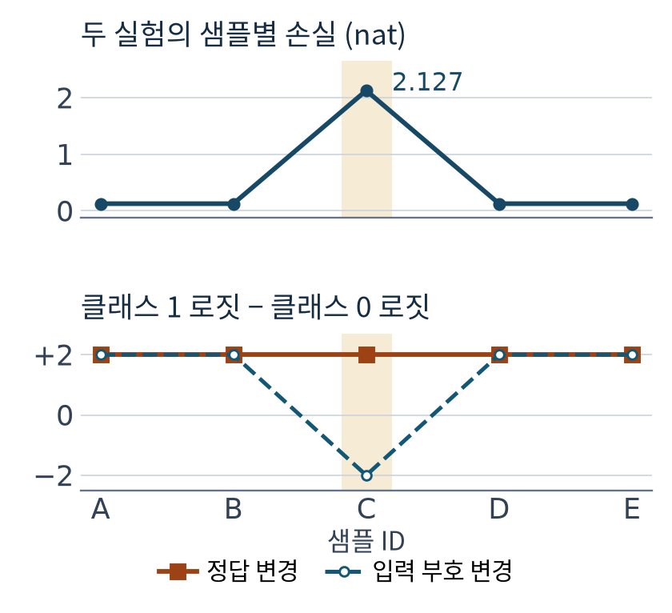

import replaySource from '../../../components/chapter-6/loss_replay.py?url&no-inline';
import LossSpikeSimulator from '../../../components/chapter-6/LossSpikeSimulator.tsx';

# 6.3 대규모 학습 안정성

학습 대시보드에서 손실이 갑자기 치솟았습니다. 체크포인트를 복원하고 같은 배치를 넣었더니 똑같은 급등이 나타납니다. 모델의 계산이 달라졌을까요, 아니면 정답 레이블이 바뀌었을까요? 아래 실험에서는 서로 다른 두 조건에서 손실도 파라미터의 그래디언트도 같습니다. 원인을 가려내려면 배치 안에 무엇이 들어 있었는지 확인해야 합니다.

공급자 보고서는 특정 학습 스택이 복구 불가능한 급등 없이 긴 실행을 마쳤다는 증거를 제공할 수 있습니다. 예를 들어 DeepSeek-V3 보고서는 자체 FP8 학습 결과를 설명합니다 [[1]](#ref-1). 이는 보고된 시스템에 대한 증거이며 QK 정규화, FP8 또는 하나의 레시피가 다른 모델에도 롤백 없는 학습을 보장한다는 뜻은 아닙니다.

## 1. 손실이 설명할 수 있는 것과 없는 것

하나의 정답 클래스 $y$에 대한 소프트맥스 교차 엔트로피의 로짓 미분은 다음과 같습니다.

$$
\frac{\partial \mathcal{L}}{\partial z_i}=p_i-\mathbf{1}[i=y].
$$

각 성분은 $[-1,1]$ 안에 있습니다. 따라서 하나의 분포 밖 정답 토큰이 최종 로짓에 대해 직접 “천문학적” 그래디언트를 만들지는 않습니다. 하지만 유계 로짓 그래디언트가 큰 활성화와 네트워크 Jacobian에 곱해지고, 누적·옵티마이저 상태·수치 오버플로·분산 손상이 영향을 증폭하면 파라미터 그래디언트는 여전히 커질 수 있습니다. 이 구분이 검사 대상을 결정합니다.

<a id="loss-spike-replay"></a>

### 똑같은 손실 급등을 만드는 두 가지 변화

합성 샘플 A부터 E까지 다섯 개를 같은 가중치 $w=2$로 두 번 계산합니다. 각 샘플에는 입력 $x$와 정답 $y$가 하나씩 있고, 두 클래스의 로짓은 $[0, wx]$입니다. 평소에는 $x=1$, $y=1$입니다. 샘플 C에서만 조건을 바꿉니다. 첫 번째 실험에서는 정답을 0으로 바꾸고, 두 번째 실험에서는 정답을 유지한 채 입력만 $-1$로 바꿉니다. 실험 내내 가중치를 고정했으므로 앞 샘플의 업데이트가 뒤 샘플에 영향을 주지 않습니다.

<figure style={{maxWidth: '32rem', margin: '1.5rem auto'}}>



<figcaption>그림 1. 위쪽 그래프에서는 두 실험의 손실이 겹칩니다. 아래쪽 그래프는 클래스 1의 로짓에서 클래스 0의 로짓을 뺀 값입니다. CPU에서 PyTorch로 계산한 값을 Matplotlib로 그렸습니다.</figcaption>
</figure>

샘플 C에서 모델이 정답에 부여한 확률은 두 실험 모두 $1/(1+e^2)$입니다. 교차 엔트로피는 **2.126928 nat** 이고, 자동 미분으로 구한 $\partial\mathcal{L}/\partial w$도 두 번 모두 **+0.880797** 입니다. 클래스 1의 예측 확률을 $p_1$이라 하면 $\partial\mathcal{L}/\partial w=(p_1-y)x$입니다. 정답을 바꾼 쪽은 $(0.880797-0)(+1)$, 입력을 바꾼 쪽은 $(0.119203-1)(-1)$이므로 부호까지 같습니다. 반면 정답 ID와 두 클래스의 로짓 차이를 보면 무엇이 달라졌는지 구분할 수 있습니다. 실제로 손실이 급등하면 어느 변환을 수정할지 결정하기 전에 샘플 ID와 전처리 후의 정답, 재현에 필요한 입력을 보존하세요.

<a href={replaySource} download="loss_replay.py">CPU 재현 코드 받기 (Python)</a>. PyTorch가 설치된 환경에서 `python loss_replay.py`를 실행하면 각 실험의 샘플 다섯 개에 대한 기록이 출력됩니다. 스크립트는 float64로 계산한 두 손실과 그래디언트의 차이가 절대 오차 $10^{-12}$ 이내인지 확인합니다. 여기서 측정한 값은 두 클래스 모델의 샘플별 결과입니다.

실제 학습에서 확인할 원인은 네 부류로 나눌 수 있습니다.

- **데이터/목표:** 손상 텍스트, 극단적 반복, 잘못된 레이블, 누락된 EOS 경계, 어텐션·패딩 마스크 오류, 중복 패킹, 예상하지 못한 혼합 드리프트
- **최적화:** 학습률 불연속, 부족한 워밍업, 클리핑 체제 변경, 옵티마이저 상태 불일치, 지나친 유효 배치 또는 오래된 그래디언트
- **수치/모델:** 비유한 활성화, 어텐션·LM 로짓 증가, 불안정한 reduction, 저정밀도 오버플로/언더플로, 초기화·정규화 결함
- **시스템:** 랭크 비동기화, collective 실패, 조용한 데이터 손상, 잘못된 체크포인트 샤드, 커널/컴파일러 회귀, 잘못된 객체를 반환한 스토리지 재시도

손실 그래프만으로 부류를 추론하지 않습니다. 사고를 재생할 수 있도록 배치 ID, 아티팩트 해시, 랭크별 지표, 마지막 정상 체크포인트를 보존합니다.

## 2. 안정화 기법과 적용 범위

### QK 정규화

쿼리와 키 벡터를 내적 전에 정규화하면 어텐션 로짓 규모를 제어할 수 있습니다.

$$
A=\operatorname{softmax}\left(\frac{\operatorname{Norm}(Q)\operatorname{Norm}(K)^T}{\sqrt{d_k}}+M\right),
$$

여기서 $M$은 causal·패딩 제약을 담습니다. 일부 아키텍처에서 어텐션 포화를 줄일 수 있지만, 피드포워드 활성화, 최종 언어 모델 로짓, 옵티마이저 상태, 잘못된 데이터를 제한하지는 않습니다. 학습률 배수는 보편적인 값으로 복사하지 말고 실제 모델과 초기화에서 다시 검증해야 합니다.

### 어텐션 로짓과 LM 로짓 캡

다음과 같은 유계 변환을

$$
\hat z=c\tanh(z/c)
$$

어텐션 점수 또는 최종 LM 로짓에 적용할 수 있습니다. 두 개입은 대상 텐서, 그래디언트, 품질 트레이드오프가 다릅니다. 텐서 이름, 캡 값, 정밀도, 마스킹 순서, 절제 실험 결과를 명시합니다. 캡은 증가 증상을 숨길 수 있으며, 캡이 없을 때 텐서가 드리프트하는 원인을 찾는 일을 대신하지 않습니다.

### $z$-loss

보조 $z$-loss는 로그 분배 함수의 제곱에 페널티를 줍니다.

$$
\mathcal{L}_z=\alpha\left(\log\sum_i e^{z_i}\right)^2.
$$

대형 언어 모델에서 로짓 규모 드리프트를 억제하기 위해 사용된 바 있습니다 [[2]](#ref-2). 충분한 정밀도로 계산하고 유효한 causal 정답 위치에만 적용합니다. 패딩이나 무시한 프롬프트 위치에 적용하면 유효 목표가 바뀌고 배치 형상에 따라 크기가 달라집니다.

## 3. 마스크가 올바른 Causal 손실

다음은 스모크 테스트 가능한 손실 헬퍼이며 전체 학습 루프는 아닙니다. `logits` 형상은 `(배치, 시퀀스, 어휘)`, 레이블은 입력 토큰 ID를 담고 패딩·제외 위치는 `ignore_index`이며, 모델이 causal 어텐션과 올바른 패딩 마스크를 이미 적용했다고 가정합니다.

```python
import torch
import torch.nn.functional as F

def causal_cross_entropy_with_z_loss(
    logits: torch.Tensor,
    labels: torch.Tensor,
    *,
    ignore_index: int = -100,
    z_loss_weight: float = 1e-4,
):
    if logits.ndim != 3 or labels.shape != logits.shape[:2]:
        raise ValueError("expected logits (B, L, V) and labels (B, L)")

    # 토큰 t로 토큰 t+1을 예측합니다.
    shift_logits = logits[:, :-1, :].float().contiguous()
    shift_labels = labels[:, 1:].contiguous()
    valid = shift_labels.ne(ignore_index)
    if not torch.any(valid):
        raise ValueError("batch has no supervised causal targets")

    ce_sum = F.cross_entropy(
        shift_logits.view(-1, shift_logits.size(-1)),
        shift_labels.view(-1),
        ignore_index=ignore_index,
        reduction="sum",
    )
    ce = ce_sum / valid.sum()

    log_z = torch.logsumexp(shift_logits, dim=-1)
    z_loss = log_z.square()[valid].mean()
    total = ce + z_loss_weight * z_loss
    return total, {"cross_entropy": ce.detach(), "z_loss": z_loss.detach()}

# 형상, 마스킹, dtype, 유한값 스모크 테스트입니다.
torch.manual_seed(7)
toy_logits = torch.randn(2, 5, 11, dtype=torch.bfloat16, requires_grad=True)
toy_labels = torch.tensor([[1, 2, 3, 4, 5], [6, 7, -100, -100, -100]])
toy_loss, parts = causal_cross_entropy_with_z_loss(toy_logits, toy_labels)
toy_loss.backward()
assert torch.isfinite(toy_loss)
assert toy_logits.grad is not None and torch.isfinite(toy_logits.grad).all()
```

분산 학습에서는 길이가 다른 랭크별 평균의 평균이 아니라 **전역 유효 토큰 수** 로 정규화합니다. 그렇지 않으면 패딩과 가변 길이 배치가 랭크 가중치를 바꿉니다. 시퀀스/컨텍스트 병렬화를 사용하면 각 정답의 소유 프로세스와 분자·분모를 만드는 collective를 확인합니다.

## 4. 개입 전 관측 가능성

텔레메트리 경로를 압도하지 않으면서 급등을 분해할 수 있는 주기로 다음 신호를 기록합니다.

| 계층 | 필요한 신호 |
| :--- | :--- |
| 목표 | 토큰 정규화 학습/검증 손실, 유효 토큰, 도메인별 손실, $z$-loss, 레이블/마스크 수 |
| 모델 | 전역·계층별 그래디언트, 가중치, 활성화, Q/K, 어텐션 로짓, LM 로짓 노름과 어텐션 엔트로피 |
| 옵티마이저/정밀도 | 학습률, 클리핑 비율, 업데이트/가중치 비율, 비유한 값/오버플로 수, loss scale 또는 FP8 amax/scale |
| MoE | 전문가별 토큰, 부하 불균형, 용량 초과 드롭, 라우터 엔트로피, 통신 시간 |
| 시스템 | GPU당 토큰/s, MFU, 데이터 대기, p50/p95 스텝·collective 시간, 지연 랭크, ECC/NCCL/스토리지/커널 이벤트 |
| 증거 | 샘플/팩 ID, 데이터 매니페스트 해시, 모델/설정/코드/컨테이너 해시, 체크포인트 세대 |

히스토그램과 계층별 꼬리는 전역 평균에 숨은 국소 실패를 보여줄 수 있습니다. 텔레메트리 오버헤드를 제한하고 collective·스토리지 사고 중에도 경보가 도착하는지 시험합니다.

## 5. 손실 급등 대응 절차

1. **증거 고정:** 마지막 정상 체크포인트, 현재 아티팩트 해시, 전역 스텝/토큰 수, 학습률, 샘플/팩 ID, 랭크 로그, 하드웨어 이벤트를 기록합니다. 의심 체크포인트나 데이터 샤드를 덮어쓰지 않습니다.
2. **동기화·유한값 확인:** 모든 랭크가 스텝, 토큰 수, 체크포인트 세대, 비유한 상태에 합의하는지 확인합니다. 값이 처음 달라지는 계층·랭크를 찾습니다.
3. **정상 상태에서 재생:** 완전한 체크포인트를 복원하고 같은 코드/설정/월드 크기로 의심 배치를 실행합니다. 재현되지 않으면 비결정성, 시스템 상태, 하드웨어 가능성이 커집니다.
4. **통제 분기 비교:** 재생, 건너뛰기, 정상 대조 배치를 실행합니다. 한 번에 하나만 바꾸며, 데이터 건너뛰기·학습률 감소·옵티마이저 상태 폐기를 동시에 하지 않습니다.
5. **원인 부류 이분 탐색:** 샤드 체크섬과 마스크를 검증하고, 더 높은 정밀도나 안전한 커널과 비교하며, 옵티마이저·스케줄러 식별자를 확인하고, 의심 하드웨어에서 워크로드를 옮깁니다.
6. **복구 선택과 게이트:** 짧은 재개가 예상 손실, 업데이트 노름, 처리량, 홀드아웃 지표와 맞을 때만 다시 시작합니다. 복구가 단순 상관이 아니라 인과적이라고 판단한 근거를 기록합니다.

배치를 건너뛰면 결정적인 모델·마스크 버그를 숨길 수 있습니다. 옵티마이저 상태를 폐기하면 학습 궤적이 바뀌고 재시작을 불안정하게 만들 수 있습니다. 둘 다 기본 처방이 아니라 실험입니다.

## 6. 체크포인트와 복구 신호

복구 체크포인트에는 샤딩된 모델·옵티마이저 상태, 스케줄러, 그래디언트 스케일러 또는 FP8 상태, 전역 스텝·소비 토큰, RNG 상태, 샘플러와 정확한 데이터 커서, 데이터셋/토크나이저/모델/코드/설정 해시가 들어갑니다. 체크섬과 완료 마커로 발행하고 완료된 세대만 불러옵니다.

체크포인트 주기는 장애 경제성으로 정합니다. 저장에 $C$분이 걸리고 관측한 복구 가능 장애 평균 간격이 $F$라면 최적 간격은 쓰기 간섭, 재시작 시간, 예상 손실 연산에 달려 있으며 보편적인 스텝 수가 아닙니다. 백그라운드 저장의 영향과 복원 대역폭을 측정합니다.

주기적으로 다음을 연습합니다.

- 원래 월드 크기에서 복원하고 다음 배치 ID·업데이트 비교
- 포맷과 데이터 샘플러가 재샤딩을 지원할 때만 변경된 월드 크기에서 복원
- 체크포인트 샤드를 손상·누락시키고 로더가 닫힌 방식으로 실패하는지 확인
- 마지막 정상 아티팩트를 복원하고 프로덕션 롤백 경로 실행
- 실제 커널·프레임워크 버전에서 비트 단위 재생과 통계적으로 동등한 재개를 구분

## 7. MoE와 저정밀도 안정성

MoE 학습은 라우팅 불균형, 토큰 드롭, 전문가 병렬 collective, 라우터 목표의 상호 작용을 추가합니다. DeepSeek-V3가 보고한 바이어스 기반 부하 균형은 하나의 설계 지점입니다 [[1]](#ref-1). “보조 손실 없음”이 완벽한 균형이나 운영 상태 부재를 뜻하지는 않습니다. 품질과 부하를 함께 측정하고 구현을 인용한 알고리즘과 묶습니다.

FP8은 텐서별 범위와 스케일링 상태를 추가합니다. E4M3 최댓값과 블록/텐서 스케일링 방식만으로 안정성이 결정되지는 않습니다. amax 기록, 포화/언더플로, 스케일 지연, 누적/reduction dtype, 폴백 텐서, 커널 버전을 기록합니다. 스케일링 상태를 체크포인트에 저장하고 파일럿에서 BF16 대조군과 비교합니다. 수치적으로 안정적인 실행도 품질·처리량 게이트를 통과해야 합니다.

## 8. 인터랙티브: 손실 급등 시뮬레이터

관측 단계를 50으로 맞추고 두 시나리오를 번갈아 선택해 보세요. 둘 다 손실이 5입니다. 여덟 단계 앞으로 가면 한 곡선은 내려가고 다른 곡선은 계속 올라갑니다. 두 곡선은 이 비교를 위해 만든 예시입니다.

<LossSpikeSimulator lang="ko" client:load />

50단계에서 다음 업데이트를 적용하기 전에 무엇을 남겨야 할까요? 급등을 일으킨 배치와, 가장 최근에 복원 시험을 통과한 체크포인트부터 확보하세요.

## Quizzes

<details>
<summary>Quiz 1: 하나의 예상 밖 정답 토큰이 로짓에 대한 유계하지 않은 교차 엔트로피 그래디언트를 직접 만들지 않는 이유는 무엇인가요?</summary>
*미분은 $p_i-\mathbf{1}[i=y]$이며 각 성분이 $[-1,1]$ 안에 있기 때문입니다. 큰 활성화/Jacobian, 누적, 옵티마이저 동역학, 수치·시스템 결함을 통해 큰 파라미터 그래디언트는 생길 수 있으므로 그 메커니즘을 검사해야 합니다.*
</details>

<details>
<summary>Quiz 2: 어텐션 로짓 캡과 최종 LM 로짓 캡을 구분해야 하는 이유는 무엇인가요?</summary>
*서로 다른 텐서에 작용하며 어텐션 라우팅과 토큰 확률에 각각 영향을 줍니다. 마스킹, 그래디언트, 하이퍼파라미터, 품질 트레이드오프가 달라 “로짓 캡”이라고만 쓰면 실험을 재현할 수 없습니다.*
</details>

<details>
<summary>Quiz 3: 예제의 z-loss 헬퍼가 causal 언어 모델 배치에 맞도록 만드는 두 가지 마스킹 세부 사항은 무엇인가요?</summary>
*토큰 $t$가 토큰 $t+1$을 예측하도록 로짓·레이블을 시프트하고, `ignore_index`가 아닌 레이블에서만 교차 엔트로피와 z-loss를 계산하여 패딩·의도적 마스크 위치를 제외합니다.*
</details>

<details>
<summary>Quiz 4: 의심 배치를 건너뛰자 급등이 사라졌습니다. 데이터가 근본 원인임이 증명됐나요?</summary>
*아닙니다. 마스크, 모델, 옵티마이저, 커널, 하드웨어 결함도 상태에 따라 사라질 수 있습니다. 같은 완전한 체크포인트에서 재생·건너뛰기·정상 대조 분기를 비교하고 동기화된 증거를 검사해야 합니다.*
</details>

<details>
<summary>Quiz 5: FP8 스케일링 상태를 체크포인트에 포함해야 하는 이유는 무엇인가요?</summary>
*다음 양자화 연산이 amax 기록과 스케일 선택에 의존하기 때문입니다. 가중치만 복원하면 수치 궤적이 바뀌어 오버플로·언더플로 또는 거짓 재개 불일치가 생길 수 있습니다.*
</details>

## References

1. <a id="ref-1"></a>DeepSeek-AI. (2024). *DeepSeek-V3 Technical Report*. [arXiv:2412.19437](https://arxiv.org/abs/2412.19437).
2. <a id="ref-2"></a>Chowdhery, A., et al. (2022). *PaLM: Scaling Language Modeling with Pathways*. [arXiv:2204.02311](https://arxiv.org/abs/2204.02311).
3. <a id="ref-3"></a>PyTorch. *Numerical Accuracy*. [PyTorch 개발자 문서](https://docs.pytorch.org/docs/stable/notes/numerical_accuracy.html).
4. <a id="ref-4"></a>PyTorch. *Reproducibility*. [PyTorch 개발자 문서](https://docs.pytorch.org/docs/stable/notes/randomness.html).
