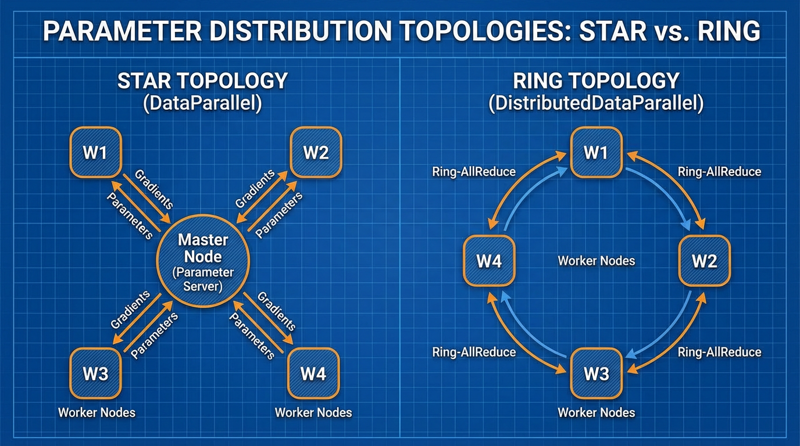

import DDPBucketingTimeline from '../../../components/chapter-7/DDPBucketingTimeline.tsx';

<a id="71-data-parallelism-dpddp"></a>

# 7.1 데이터 병렬 학습(DP와 DDP)

6장에서는 수만 개의 GPU가 광학 스위치로 연결된 물리적 인프라와, 수조 개의 파라미터를 가진 모델에 데이터를 공급하기 위한 파이프라인을 구축했습니다. 또한 Model Collapse 와 같은 통계적 붕괴 현상을 방지하고 고품질의 학습 데이터를 엔지니어링하는 방법도 살펴보았습니다.

이제 우리는 연산의 물리적 한계와 마주해야 합니다.

큰 모델의 학습 시간은 모델·토큰 수·하드웨어·활용도에 달려 있습니다. 분산 학습은 처리량을 늘릴 수 있지만 통신과 동기화 비용도 추가합니다. 모델 크기만으로 단일 GPU 학습이 수학적으로 불가능하다고 단정할 수는 없습니다.

가장 기본적이고 근본적인 분산 전략은 **Data Parallelism** (데이터 병렬화) 입니다. 이 패러다임에서는 모델의 아키텍처를 쪼개지 않고 클러스터 내의 모든 GPU에 완벽하게 복제합니다. 모델을 나누는 대신, 데이터를 나누는 것입니다.

---

## 1. 초기의 단순한 접근: `DataParallel` (DP)

역사적으로 엔지니어들은 PyTorch의 `torch.nn.DataParallel` (DP) 로 구현된 단일 프로세스, 멀티 스레드 패러다임을 사용하여 학습을 병렬화하려고 시도했습니다.

로직은 매우 직관적입니다:
1. **복제 (Replicate):** 단일 노드(예: 8-GPU 서버)의 모든 GPU에 모델을 복사합니다.
2. **분산 (Scatter):** 거대한 글로벌 배치(예: 1024개의 시퀀스)를 가져와 128개 시퀀스 단위의 마이크로 배치(Micro-batch)로 쪼갭니다. 각 GPU에 하나의 마이크로 배치를 보냅니다.
3. **순전파 (Forward Pass):** 각 GPU는 독립적으로 순전파를 계산하고 자체적인 로컬 Loss를 구합니다.
4. **수집 및 역전파 (Gather & Backward):** 여기서 아키텍처의 치명적인 한계가 드러납니다. DP는 Parameter Server 토폴로지를 사용하며 (일반적으로 GPU 0을 마스터로 암묵적 매핑), 모든 GPU는 자신의 그래디언트(Gradient)를 GPU 0으로 보냅니다. GPU 0은 그래디언트들의 평균을 내어 마스터 모델의 가중치를 업데이트한 다음, 새로운 가중치를 GPU 1-7로 다시 브로드캐스트(Broadcast)합니다.


*출처: AI 생성 이미지*

### DDP를 권장하는 이유
`DataParallel` 은 최신 AI 인프라 환경에서 본질적인 결함을 가지고 있습니다:
* **Python GIL (Global Interpreter Lock):** 여러 스레드를 관리하는 단일 Python 프로세스로 동작하기 때문에, GIL이 실행 속도를 심각하게 제한합니다.
* **GPU 0 병목 현상:** 마스터 GPU는 심각한 통신 병목 지점이 됩니다. GPU 1-7이 유휴 상태(Idle)로 대기하는 동안, GPU 0은 그래디언트를 집계하고 가중치를 업데이트하느라 과부하에 걸립니다. 이는 극단적인 VRAM 불균형과 낮은 연산 활용도(종종 50% 미만의 MFU)를 초래합니다.
* **단일 노드의 한계:** DP는 여러 대의 물리적 서버(Multi-node)에 걸쳐 확장할 수 없습니다.

Foundation Model 을 학습시키기 위해서는 마스터 노드라는 개념 자체를 완전히 제거해야 합니다.

---

## 2. 분산 학습의 표준: Distributed Data Parallel (DDP)

DP의 병목 현상을 해결하기 위해 업계는 **Distributed Data Parallel (DDP)** (`torch.nn.parallel.DistributedDataParallel`) 로 전환했습니다.

DDP는 멀티 프로세스 아키텍처로 동작합니다. 만약 1,024개의 GPU가 있다면, 1,024개의 독립적인 Python 프로세스를 생성합니다. 각 프로세스는 고유한 옵티마이저, 자체 메모리 공간, 그리고 완벽하게 동일한 모델 복제본을 가집니다.

DDP는 프로세스별 모델 복제본을 사용하고 역전파 중 그래디언트를 동기화합니다. 초기화 시 파라미터 동기화와 설정에 따른 버퍼 broadcast도 수행할 수 있습니다. All-Reduce의 구체적인 ring·tree·계층형 알고리즘은 백엔드와 토폴로지에 달려 있습니다. 아래 ring 분석은 한 가지 비용 모델입니다. [[2]](#ref-2)

### Ring All-Reduce의 수학적 원리
2017년 Baidu Research에서 딥러닝에 도입한 [[1]](#ref-1) Ring All-Reduce는 $N$ 개의 노드가 특정 노드에 과부하를 주지 않고도 그래디언트의 평균을 낼 수 있게 해줍니다.

모델의 그래디언트 총 크기를 $M$ 이라고 가정해 봅시다 (예: 1B 파라미터 모델의 경우 약 4GB). 단순한 Parameter Server 구조에서는 마스터 노드가 $M \times (N-1)$ 바이트의 데이터를 수신해야 하며, 이는 클러스터 크기에 비례하여 선형적으로 증가하여 필연적으로 네트워크 대역폭을 붕괴시킵니다.

Ring All-Reduce에서 GPU들은 논리적인 원형(Ring)으로 배치됩니다. 알고리즘은 두 단계로 동작합니다:
1. **Scatter-Reduce:** 그래디언트 텐서는 $N$ 개의 블록으로 쪼개집니다. 각 GPU는 오른쪽 이웃에게 하나의 블록을 보내고 왼쪽 이웃으로부터 다른 블록을 받아 지속적으로 값을 누적합니다. $N-1$ 단계가 지나면, 모든 GPU는 $N$ 개의 블록 중 정확히 *하나* 에 대해 완전히 집계된 합을 가지게 됩니다.
2. **All-Gather:** 완전히 집계된 블록들이 다시 링을 따라 순환합니다. 추가로 $N-1$ 단계가 지나면 모든 GPU가 완전하게 집계된 전체 그래디언트 텐서를 가지게 됩니다.

이 과정에서 *단일 노드* 가 전송하는 총 데이터 양은 다음과 같습니다:
$$ \text{Volume} = 2 \times \frac{N - 1}{N} \times M $$

전송 바이트는 $N$ 이 커질수록 $2M$ 에 가까워지지만 지연은 독립적이지 않습니다. 단계당 시작 비용 $\alpha$ 와 유효 대역폭 $B$ 를 사용하면

$$ T_{ring}\approx 2(N-1)\alpha + \frac{2(N-1)M}{NB}. $$

토폴로지, 혼잡과 느린 랭크는 추가 비용을 만들며 대규모 확장을 별도로 검증해야 합니다.

---

## 3. 연산과 통신의 중첩: Gradient Bucketing

Ring All-Reduce를 사용하더라도 전체 역전파(Backward pass)가 끝날 때까지 기다렸다가 수 기가바이트의 그래디언트를 네트워크로 전송하는 것은 GPU를 I/O 대기 상태(Idle)로 방치하는 결과를 낳습니다.

최신 DDP 구현체는 **Gradient Bucketing** (그래디언트 버키팅) 을 통해 이 문제를 해결합니다.
역전파 중에는 마지막 레이어(예: Layer 100)부터 첫 번째 레이어(Layer 1) 순으로 그래디언트가 계산됩니다. Layer 100의 그래디언트 전송을 시작하기 위해 Layer 1의 그래디언트 계산이 끝날 때까지 기다릴 필요가 없습니다.

DDP는 그래디언트를 "버킷(Bucket)" 단위로 그룹화합니다 (PyTorch의 기본값은 25MB). 계산된 그래디언트로 버킷이 가득 차는 즉시, DDP는 NCCL (NVIDIA Collective Communication Library) 백엔드를 통해 비동기적(Non-blocking)으로 `all_reduce` 네트워크 호출을 실행합니다.

### Interactive: 연산과 통신의 중첩 (Overlap) 시각화
아래의 인터랙티브 타임라인을 사용하여 DDP가 역전파 연산과 네트워크 통신을 어떻게 중첩(Overlap)시키는지 확인해 보십시오. 버키팅이 GPU의 대기 상태를 방지하고, 순수한 연산 시간 뒤로 네트워크 지연 시간(Latency)을 숨기는 과정을 관찰할 수 있습니다.

<DDPBucketingTimeline lang="ko" client:load />

*Note: PyTorch에서는 DDP 래퍼(Wrapper)의 `bucket_cap_mb` 파라미터를 사용하여 버킷 크기를 조정할 수 있습니다. 이 값을 사용 중인 InfiniBand나 NVLink 대역폭에 맞게 튜닝하는 것은 클러스터 처리량을 극대화하기 위한 매우 중요한 마이크로 최적화(Micro-optimization) 기법입니다.*

---

## 4. PyTorch 교육용 구현

> **교육용 분산 학습 골격.** NCCL과 GPU별 프로세스를 가정하며 실제 GPU 실행은 검증하지 않았습니다. 입력은 고정 seed의 합성 정수 ID이고 목적은 토큰별 분류입니다. 실제 언어 모델·데이터 파이프라인이 아닙니다. 전역 데이터셋은 모든 랭크에서 같아야 하며 `DistributedSampler`의 기본 패딩은 데이터 크기가 나누어떨어지지 않을 때 중복 인덱스를 추가할 수 있습니다. 체크포인트, 재시작, 평가, 가변 길이 마스크와 통신 장애 처리는 생략합니다.

```python
import os
import torch
import torch.nn as nn
import torch.optim as optim
from torch.utils.data import DataLoader, Dataset
from torch.utils.data.distributed import DistributedSampler
from torch.nn.parallel import DistributedDataParallel as DDP
from torch.distributed import init_process_group, destroy_process_group

# 1. 분산 프로세스 그룹 초기화
def setup():
    # torchrun이 아래의 환경 변수들을 자동으로 설정합니다.
    init_process_group(backend="nccl")
    local_rank = int(os.environ["LOCAL_RANK"])
    torch.cuda.set_device(local_rank)
    return local_rank

def cleanup():
    destroy_process_group()

# 설명을 위한 더미 데이터셋
class DummyCorpus(Dataset):
    def __init__(self, size=1024, seq_len=32, vocab_size=256):
        generator = torch.Generator().manual_seed(42)
        self.data = torch.randint(0, vocab_size, (size, seq_len), generator=generator)
        self.labels = torch.randint(0, vocab_size, (size, seq_len), generator=generator)

    def __len__(self):
        return len(self.data)

    def __getitem__(self, idx):
        return self.data[idx], self.labels[idx]

def train():
    local_rank = setup()

    # 2. 모델 인스턴스화 및 로컬 GPU로 이동
    # 실제 환경에서는 복잡한 Transformer 아키텍처가 들어갑니다.
    model = nn.Sequential(
        nn.Embedding(256, 64),
        nn.Linear(64, 128),
        nn.GELU(),
        nn.Linear(128, 256)
    ).to(local_rank)

    # 3. 모델을 DDP로 래핑
    # gradient_as_bucket_view=True는 불필요한 메모리 복사를 방지하여 메모리를 최적화합니다.
    model = DDP(model, device_ids=[local_rank], gradient_as_bucket_view=True)

    # 4. Distributed Sampler 설정
    dataset = DummyCorpus()
    # Sampler는 각 프로세스가 데이터셋의 상호 배타적인 조각을 받도록 보장합니다.
    sampler = DistributedSampler(dataset, shuffle=True)
    dataloader = DataLoader(dataset, batch_size=8, sampler=sampler, num_workers=4)

    optimizer = optim.AdamW(model.parameters(), lr=1e-4)
    criterion = nn.CrossEntropyLoss()

    # 5. Training Loop
    epochs = 3
    for epoch in range(epochs):
        # 중요: 매 에폭마다 서로 다른 셔플링을 보장하기 위해 sampler에 에폭을 설정해야 합니다.
        sampler.set_epoch(epoch)

        for step, (inputs, targets) in enumerate(dataloader):
            inputs, targets = inputs.to(local_rank), targets.to(local_rank)

            optimizer.zero_grad()

            # Forward pass
            outputs = model(inputs)
            loss = criterion(outputs.view(-1, 256), targets.view(-1))

            # Backward pass가 비동기 All-Reduce 버킷 전송을 트리거합니다.
            loss.backward()

            # 모든 그래디언트가 완전히 동기화된 후에만 옵티마이저가 스텝을 진행합니다.
            optimizer.step()

            if local_rank == 0 and step % 10 == 0:
                print(f"Epoch {epoch} | Step {step} | Loss {loss.item():.4f}")

    cleanup()

if __name__ == "__main__":
    # 8개의 GPU가 있는 단일 노드에서 이 스크립트를 실행하려면:
    # torchrun --standalone --nproc_per_node=8 train_ddp.py
    train()
```

일반적인 DDP 경로에서는 backward가 완료될 때 필요한 그래디언트 동기화도 완료되어 로컬 옵티마이저가 같은 그래디언트로 업데이트합니다. `optimizer.step()` 자체는 분산 barrier가 아닙니다. 느린 랭크는 collective에서 다른 랭크를 기다리게 만들 수 있으며, `no_sync()`를 쓰는 그래디언트 누적은 마지막 backward의 동기화까지 별도로 고려해야 합니다.

---

## Summary

DDP는 모델 복제본을 유지하며 데이터 병렬 연산과 그래디언트 통신을 겹칩니다. 이득은 연산 대 통신 비율과 느린 랭크에 달려 있습니다. 버킷 조정은 노출되는 통신을 줄일 수 있지만 선형 확장이나 완전한 지연 은닉을 보장하지 않습니다.

하지만, 여전히 극복할 수 없는 명백한 한계가 존재합니다. **DDP는 전체 모델의 가중치, 그래디언트, 그리고 옵티마이저 상태(Optimizer states)가 단일 GPU의 VRAM 안에 모두 들어가야만 동작합니다.**

단순한 혼합 정밀도 Adam 예산은 BF16 가중치 2바이트, BF16 그래디언트 2바이트, FP32 마스터 가중치 4바이트, 두 FP32 모멘트 8바이트로 파라미터당 16바이트입니다. FP32 그래디언트 등 구현에 따라 달라집니다. 여기에 시퀀스 길이·배치 크기에 따른 활성화, 임시 버퍼, collective, 체크포인트와 평가 여유를 더해야 합니다. 따라서 80GB에서 학습 가능한 파라미터 수에 단일한 상한 예시를 적용할 수 없습니다.

우리는 표준 Data Parallelism 을 넘어서서 메모리 공간 자체를 쪼개기 시작해야 합니다. 이어지는 **7.2 ZeRO (Zero Redundancy Optimizer)** 에서는 클러스터 전체에 걸쳐 모델의 상태를 산산조각 내어 단일 GPU의 메모리 장벽을 영원히 부수는 방법을 탐구할 것입니다.

---

## 실제 학습에 연결하기 전

입력 manifest·토크나이저·모델/설정 hash를 고정하고, 동일 데이터에서 단일 장치 기준과 평균 그래디언트를 비교하세요. 위 예제의 batch 8, AdamW 학습률 $10^{-4}$, 3 epoch는 합성 동작 확인용 설정입니다. 실제 학습에서는 유효 전역 토큰 batch, 정밀도, 누적 횟수와 loss mask를 명시해야 합니다.

토큰 기준 학습·검증 손실과 도메인별 지표, nonfinite/overflow 횟수, 그래디언트·활성화 norm, 처리량·MFU, 데이터 대기, collective 시간과 느린 랭크, 재구성 가능한 batch ID를 기록하세요. 비유한 손실이나 collective 실패는 모든 랭크에서 중단하고 마지막 검증된 체크포인트로 복구해야 합니다. 체크포인트에는 모델·옵티마이저·스케줄러·정밀도 상태, step·토큰 수, RNG·sampler·정확한 데이터 cursor와 hash가 필요합니다. 재개 동등성, 분리된 오프라인 품질·안전성·성능 평가와 이전 정상 번들로의 복귀를 통과하기 전에는 배포하지 않습니다.

## Quizzes

<details>
<summary>Quiz 1: DDP가 여러 GPU에서 일반적으로 권장되는 이유는 무엇인가요?</summary>
*프로세스별 실행과 그래디언트 통신 겹침이 단일 프로세스 DP의 파이썬 경합과 복제·집계 비용을 줄일 수 있습니다. 권장은 공식 사용 중단과 다르며 실제 성능은 측정해야 합니다.*
</details>

<details>
<summary>Quiz 2: 10개와 1,000개 랭크에서 ring의 바이트와 시간이 어떻게 다른가요?</summary>
*전송량은 $1.8M$ 에서 $1.998M$ 으로 약 11% 늘어납니다. 그러나 시작 비용은 $18\alpha$ 에서 $1998\alpha$ 로 늘어나므로 비슷한 바이트 수가 비슷한 시간을 뜻하지는 않습니다.*
</details>

<details>
<summary>Quiz 3: DDP에서 "Gradient Bucketing (그래디언트 버키팅)"의 주요 목적은 무엇인가?</summary>
*Gradient Bucketing은 연산(역전파)과 통신(네트워크 전송)을 중첩(Overlap)시키기 위해 사용됩니다. 그래디언트를 동기화하기 위해 전체 역전파가 끝날 때까지 기다리는 대신, DDP는 그래디언트를 버킷으로 그룹화합니다. 깊은 레이어의 그래디언트가 먼저 계산되어 버킷이 가득 차는 즉시 NCCL을 통해 비동기 All-Reduce를 트리거하며, 이를 통해 얕은 레이어의 연산이 진행되는 동안 네트워크 지연 시간을 숨길 수 있습니다.*
</details>

<details>
<summary>Quiz 4: 1,024개의 GPU(각 80GB VRAM)로 구성된 클러스터가 있다고 가정할 때, 1,000억(100B) 파라미터 모델을 표준 DDP를 사용하여 학습할 수 있는가? 그 이유는 무엇인가?</summary>
*불가능합니다. 표준 DDP는 모델 가중치, 그래디언트, 그리고 옵티마이저 상태의 전체 복제본이 '모든 단일 GPU'의 VRAM에 상주해야 합니다. 100B 파라미터 모델을 혼합 정밀도(Mixed precision)로 학습하려면 옵티마이저 상태와 가중치를 저장하는 데만 약 1.6 테라바이트(TB)의 VRAM이 필요하며, 이는 단일 GPU의 80GB 한계를 아득히 초과합니다. 따라서 ZeRO나 텐서 병렬화(Tensor Parallelism) 같은 고급 기술이 필수적입니다.*
</details>

---

## References

1. <a id="ref-1"></a>Gibiansky, A. (2017). "Bringing HPC Techniques to Deep Learning." Baidu Research. [Link](https://andrew.gibiansky.com/blog/machine-learning/baidu-allreduce/).
2. <a id="ref-2"></a>Li, S., et al. (2020). *PyTorch Distributed: Experiences on Accelerating Data Parallel Training.* VLDB. [arXiv:2006.15704](https://arxiv.org/abs/2006.15704).
